# 3차시 강의 정리: 상품 API와 MySQL 연결

- **교재**: 2026-2_백엔드실무프로젝트_3차시.pdf (튜터 최정규)
- **이전 차시**: 2차시 Spring MVC와 REST API 기초 (인사 API 확장)
- **검증**: 아래 최종 코드는 `./gradlew compileJava`로 컴파일 확인, 앱 실행·테스트·DB 동작은 미확인

---

## 1. 한눈에 보는 오늘 내용

| 구분 | 내용 |
|---|---|
| 목표 | 상품을 MySQL에 저장하고 서버 재시작 후에도 조회 |
| 핵심 구성요소 | Entity, DTO, Converter, Repository, Service, Controller |
| 새 개념 | JPA 매핑, `@Builder`, 쿼리 메서드, `Optional`, 트랜잭션 |
| 입력 방식 3종 | `@RequestBody`, `@PathVariable`, `@RequestParam` |
| 새 의존성 | Lombok, Spring Data JPA, MySQL Driver |

| 기능 | 요청 | 입력 방식 |
|---|---|---|
| 상품 등록 | `POST /api/products` | JSON 본문 |
| 전체 조회 | `GET /api/products` | 없음 |
| 단건 조회 | `GET /api/products/{id}` | 경로의 상품 ID |
| 이름 검색 | `GET /api/products/search?name=키보드` | 쿼리 파라미터 |

#### 전체 데이터 흐름

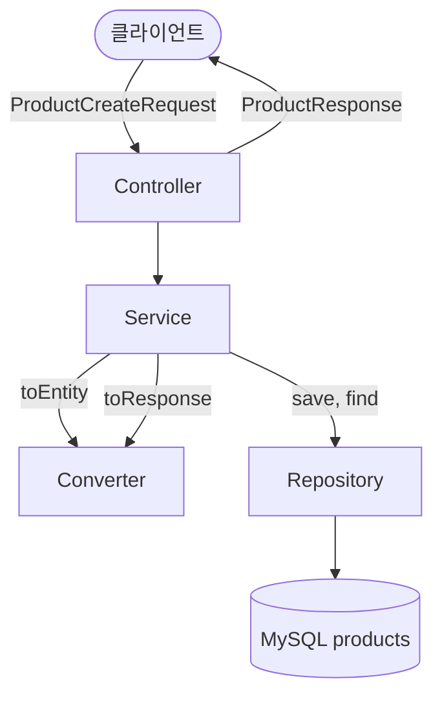

- **읽는 법**: 요청 DTO는 Converter로 Entity가 되어 DB에 저장되고, 결과는 응답 DTO로 변환되어 반환

---

## 2. 준비: 설정과 패키지

#### 패키지 구성

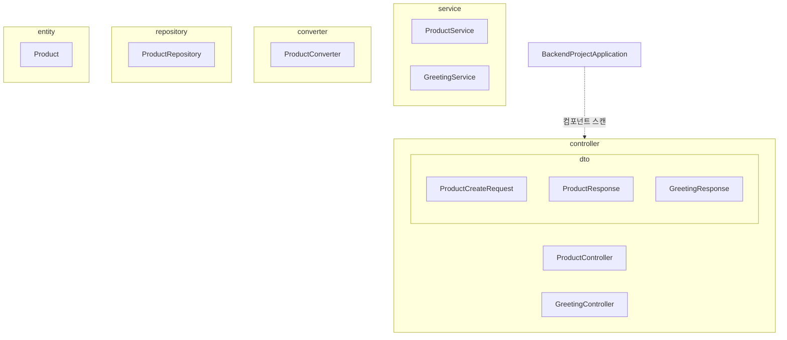

- **읽는 법**: 메인 클래스 패키지 아래에 계층별 패키지, 작성 코드는 DTO를 `controller.dto`에 배치

- **Lombok**: `compileOnly`와 `annotationProcessor` 두 줄 추가, Gradle 새로고침
- **DB 계정**: 환경변수 `DB_USERNAME`, `DB_PASSWORD`를 실행 구성에 설정

```yaml
spring:
  application:
    name: BackendProject

  datasource:
    url: jdbc:mysql://localhost:3306/backend_project
    username: ${DB_USERNAME}
    password: ${DB_PASSWORD}

  jpa:
    hibernate:
      ddl-auto: update
    show-sql: true
    properties:
      hibernate:
        format_sql: true
```

- **`ddl-auto: update`**: Entity 매핑에 맞춰 테이블 생성·변경, 실습용 설정, 운영 DB는 별도 관리
- **`show-sql`, `format_sql`**: Hibernate 실행 SQL을 콘솔에 읽기 쉽게 표시
- **실행 확인**: Started 로그 확인, DB 연결 오류 시 MySQL 실행 여부, DB 이름, 계정과 비밀번호 순서로 점검
- **`.env` 관리**: `.gitignore`에 포함되어 git 추적 제외 확인

---

## 3. 실습 1: 상품 등록

### 3-1. Entity

> **쉬운 정의:** Entity는 DB 테이블의 한 행을 자바 객체로 표현한 클래스

**아주 간단한 핵심 예시**

```java
@Entity                          // JPA가 관리하는 클래스, DB 테이블과 연결
@Table(name = "products")        // 테이블 이름 지정
public class Product {
    @Id                          // 기본 키
    private Long id;
    private String name;
}
```

#### Entity와 테이블 구조

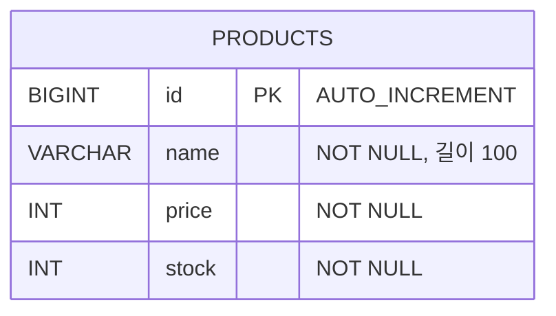

- **읽는 법**: `Product` 필드 4개가 `products` 테이블 컬럼 4개에 대응, `id`가 기본 키

| Java | MySQL | 의미 |
|---|---|---|
| Product 클래스 | products 테이블 | 상품 데이터 구조 |
| id 필드 | id 기본 키 컬럼 | 상품 식별 번호 |
| name / price / stock | 같은 이름 컬럼 | 상품명 / 가격 / 재고 |
| Product 객체 한 개 | 테이블 행 한 개 | 특정 상품 데이터 |

- **`@GeneratedValue(strategy = IDENTITY)`**: MySQL `AUTO_INCREMENT`로 ID 생성
- **`@Column`**: `name`은 컬럼명, `nullable = false`는 NULL 금지, `length = 100`은 문자열 길이
- **`@NoArgsConstructor(access = PROTECTED)`**: JPA용 기본 생성자, 외부 직접 생성 차단
- **`@Builder`(생성자에 부착)**: 이름을 지정해 객체 생성, `new Product(name, price, stock)`과 같은 목적
- **주의점**: ID는 식별자, 삭제·롤백 후 연속 번호 보장 없음

```java
// entity/Product.java
@Entity
@Table(name="products")
@Getter
@NoArgsConstructor(access = AccessLevel.PROTECTED) // 아무런인자를 받지않은 기본 생성자
public class Product {

    // 이름 기반으로 Product를 만드는 빌더용 생성자
    @Builder
    public Product(String name, Integer price, Integer stock){
        this.name = name;
        this.price = price;
        this.stock = stock;
    }

    @Id
    @GeneratedValue(strategy = GenerationType.IDENTITY) //DB에서 autoincreament랑 같음
    private Long id;
    //정수형으로 하는 이유는 DB에서 index로 만들어 이진탐색 형식으로 찾기쉽게하려고
    //ex) id = 1, 2, 3, 4... 식으로 있다면 10번을 찾으려할떄 이진탐색으로 탐색

    @Column(name="name", nullable=false, length=100)
    private String name;

    @Column(nullable=false)
    private Integer price;

    @Column(nullable=false)
    private Integer stock;
}
```

- **원본 주석 보충**: 이진탐색은 단순화한 설명, 실제 DB 기본 키 인덱스는 보통 B-Tree 구조

### 3-2. DTO

```java
// controller/dto/ProductCreateRequest.java : 등록 요청 입력 형식
public record ProductCreateRequest(
        String name,
        Integer price,
        Integer stock
        // int 기본값은 0, Integer 기본값은 null
) {

}
```

```java
// controller/dto/ProductResponse.java : 응답 형식, 요청과 달리 id 포함
public record ProductResponse(
        Long id,
        String name,
        Integer price,
        Integer stock
) {

}
```

- **Integer 사용 이유**: `int`는 누락 시 0, `Integer`는 `null`이라 누락 입력 검증 가능
- **DTO와 Entity 분리**: DB 매핑 구조와 API 응답 구조의 변경 목적 구분

### 3-3. Converter

```java
// converter/ProductConverter.java
public class ProductConverter {

    // 요청 DTO를 Entity로 변환
    public static Product toEntity(ProductCreateRequest request){
        return Product.builder()
                .name(request.name())
                .price(request.price())
                .stock(request.stock())
                .build();
    }

    //Product Entity -> 응답 DTO 변환
    public static ProductResponse toResponse(Product product){
        return new ProductResponse(
                product.getId(),
                product.getName(),
                product.getPrice(),
                product.getStock()
        );
    }
}
```

### 3-4. Repository

> **쉬운 정의:** Repository는 SQL을 직접 쓰지 않고 DB에 저장·조회를 맡기는 인터페이스

**아주 간단한 핵심 예시**

```java
public interface ProductRepository extends JpaRepository<Product, Long> {
    // 구현 없이 선언만, 스프링 데이터 JPA가 구현체 생성
}
// 사용: productRepository.save(product);
```

- **제네릭 타입**: 첫째 `Product`는 관리할 엔티티, 둘째 `Long`은 ID 타입
- **`@Repository`**: 인터페이스에는 보통 생략

#### 클래스 의존 관계

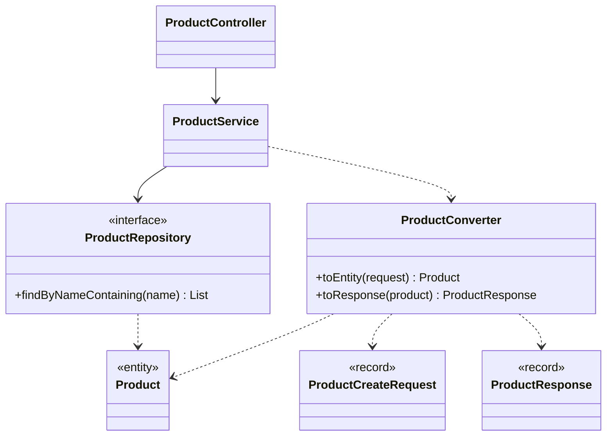

- **읽는 법**: 실선은 필드로 보유(DI), 점선은 변환·사용 관계, Converter가 DTO와 Entity 사이를 연결

### 3-5. DI 세 가지 방식 (PDF 비교)

| 방식 | 특징 | 실습 사용 |
|---|---|---|
| 필드 주입 | 짧지만 필요한 의존성이 드러나지 않음 | 비교용 |
| 세터 주입 | 생성 후 의존성 설정·변경 가능 | 비교용 |
| 생성자 주입 | 생성 시점에 필수 의존성 표현, `final` 가능 | 사용 |

- **`@RequiredArgsConstructor`**: `final` 필드를 받는 생성자를 Lombok이 생성, 그 생성자로 스프링이 빈 주입

### 3-6. Service: 등록

#### 등록 입력 검증 분기

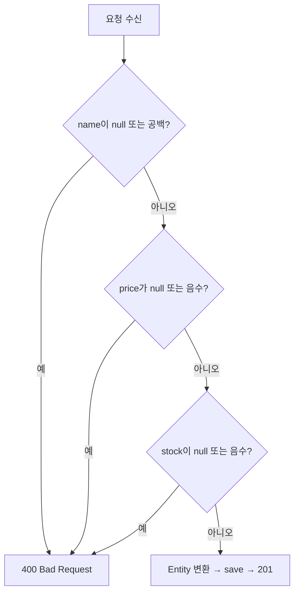

- **읽는 법**: 세 조건 중 하나라도 걸리면 400, 모두 통과해야 저장

```java
// service/ProductService.java (등록 부분)
@Service
@RequiredArgsConstructor
public class ProductService {
    private final ProductRepository productRepository;

    // 상품 등록: 입력 검증 후 저장, 하나의 트랜잭션으로 처리
    @Transactional
    public ProductResponse create(ProductCreateRequest request){
        // 이름이 비었거나 가격·재고가 null 또는 음수면 400
        if(request.name() == null || request.name().isBlank() ||
        request.price() == null || request.price() < 0 ||
        request.stock() == null || request.stock() < 0){
            throw new ResponseStatusException(HttpStatus.BAD_REQUEST, "상품명과 0 이상의 가격/재고를 입력하세요.");
        }
        Product product = ProductConverter.toEntity(request);
        Product saved = productRepository.save(product);

        return ProductConverter.toResponse(saved);
    }
    // 나머지 메서드는 아래 실습 2~4
}
```

- **`||` 단락 평가**: 앞 조건이 참이면 뒤 조건은 평가하지 않음, `null` 검사를 앞에 둬야 안전
- **입력 검증 위치**: Entity 생성 전

### 3-7. Controller: 등록

> **쉬운 정의:** `@RequestBody`는 요청 본문의 JSON을 자바 객체로 바꿔 받는 표시

```java
// controller/ProductController.java (등록 부분)
@RestController
@RequestMapping("/api/products")
@RequiredArgsConstructor
public class ProductController {
    private final ProductService productService;

    // POST /api/products : JSON 본문을 받아 등록, 201 응답
    @PostMapping
    public ResponseEntity<ProductResponse> create(
            @RequestBody ProductCreateRequest request
    ) {
       ProductResponse response = productService.create (request);

       return ResponseEntity.status(HttpStatus.CREATED)
               .body(response);
    }
}
```

#### 등록 요청 흐름

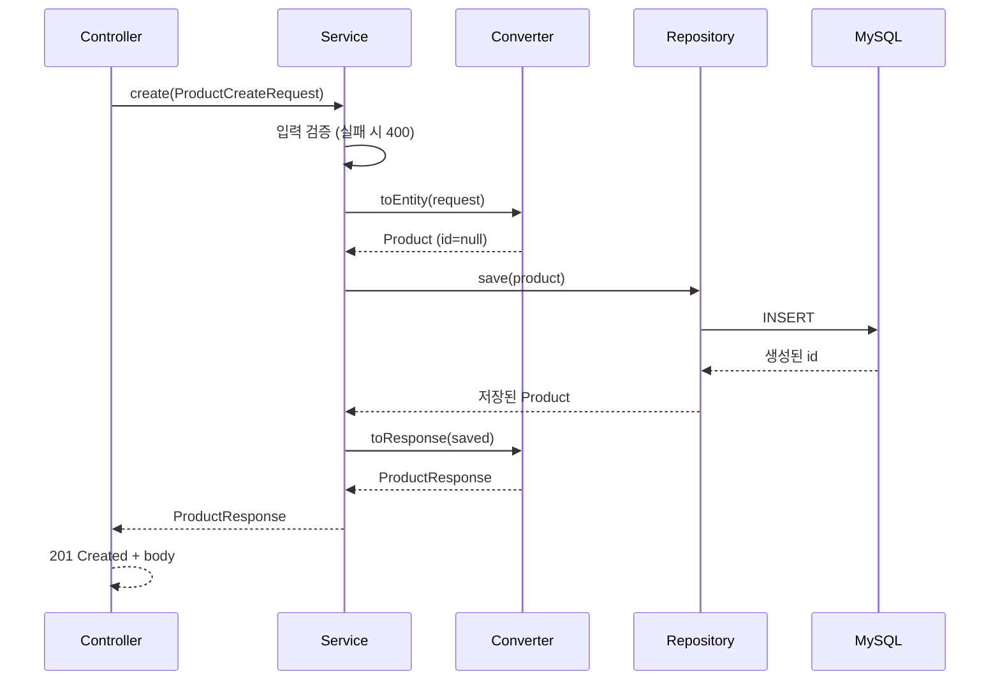

- **읽는 법**: 요청 DTO는 `id=null` Entity가 되고, INSERT 후 DB가 생성한 id가 채워져 응답 DTO로 변환

**요청과 예상 결과 (실행 전)**

```http
POST /api/products
Content-Type: application/json

{"name": "키보드", "price": 50000, "stock": 10}
```

```json
{"id":1,"name":"키보드","price":50000,"stock":10}
```

- **상태 코드**: `201 Created`
- **그 결과가 나온 이유**: 클라이언트는 ID를 보내지 않고, DB가 생성한 ID가 `save()` 반환 Entity에 담겨 응답
- **주의점**: ID 값은 DB 상태에 따라 달라짐, 이후 단건 조회는 실제 응답으로 받은 ID 사용

---

## 4. 실습 2: 전체 조회

```java
// service/ProductService.java (전체 조회)
// 전체 상품을 응답 DTO 목록으로 변환
public List<ProductResponse> findAll(){
    return productRepository.findAll().stream()
            .map(ProductConverter::toResponse)
            .toList();
}
```

```java
// controller/ProductController.java (전체 조회)
// GET /api/products : 경로가 비어 있어 공통 경로만으로 매핑
@GetMapping
public ResponseEntity<List<ProductResponse>> findAll() {
    return ResponseEntity.ok(productService.findAll());
}
```

- **`findAll()`**: `SELECT id, name, price, stock FROM products`에 해당
- **`stream().map().toList()`**: 반복문으로 `ProductResponse`를 하나씩 만들어 목록에 담는 코드와 같은 목적
- **결과 없음**: `null`이 아닌 빈 목록, 응답은 `200 OK`와 `[]`
- **주의점**: 전체 조회의 순서는 기본적으로 보장하지 않음, 정렬은 명시

---

## 5. 실습 3: 단건 조회

> **쉬운 정의:** `Optional`은 값이 있을 수도 없을 수도 있다고 미리 알려 주는 포장지

**아주 간단한 핵심 예시**

```java
Product product = productRepository.findById(id)
        // 없으면 404 예외, 있으면 Product 꺼냄
        .orElseThrow(() -> new ResponseStatusException(HttpStatus.NOT_FOUND, "없음"));
```

#### 단건 조회 분기

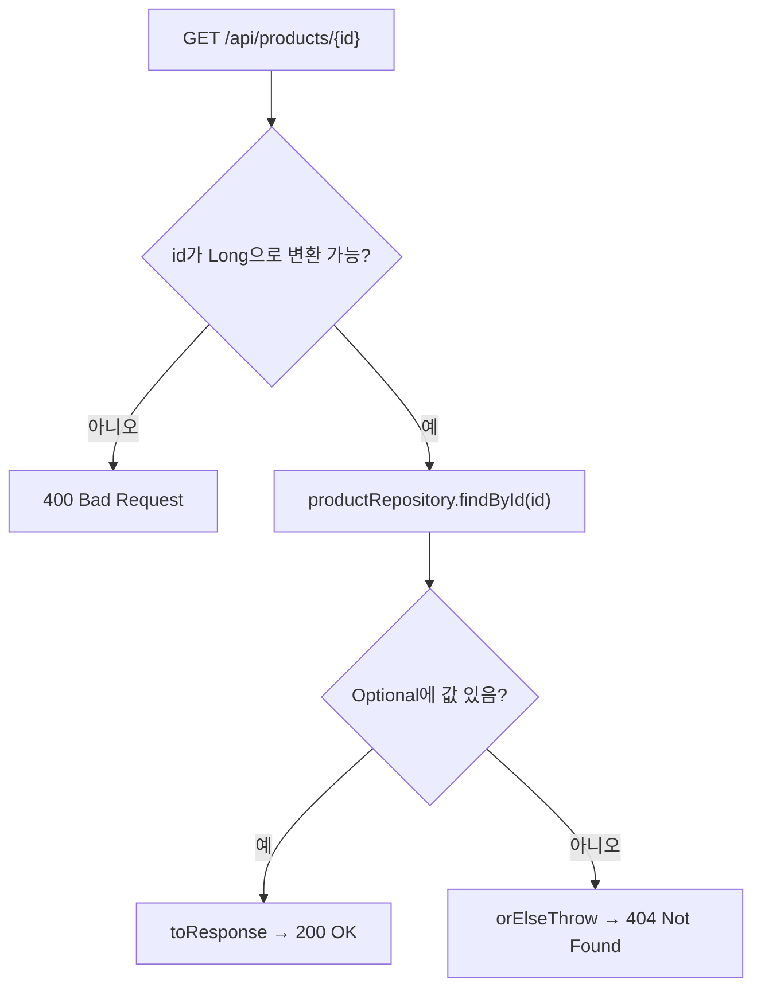

- **읽는 법**: 변환 실패는 400, 조회 실패는 404로 서로 다른 지점에서 갈림

```java
// service/ProductService.java (단건 조회)
// ID로 상품 조회, 없으면 404
public ProductResponse findById(Long id){
    Product product = productRepository.findById(id)
            .orElseThrow(() -> new ResponseStatusException(
                    HttpStatus.NOT_FOUND,
                    "상품을 찾을 수 없습니다"
            ));
    return ProductConverter.toResponse(product);
}
```

```java
// controller/ProductController.java (단건 조회)
// GET /api/products/{id} : 경로 변수를 id로 수신
@GetMapping("/{id}")
public ResponseEntity<ProductResponse> findById(@PathVariable("id") Long id) {
    ProductResponse response = productService.findById(id);
    return ResponseEntity.ok(response);
}
```

| 요청 상황 | 응답 |
|---|---|
| 등록된 상품 ID | 200 OK와 상품 객체 |
| 등록되지 않은 상품 ID | 404 Not Found |
| 상품이 없는 상태의 전체 조회 | 200 OK와 빈 배열 |
| 숫자가 아닌 ID | 400 Bad Request (Long 변환 실패) |

- **주의점**: 조회 실패가 자동으로 404가 되지 않음, `orElseThrow`에서 명시, 단건 부재와 목록의 빈 결과는 다르게 표현

---

## 6. 실습 4: 이름 검색

> **쉬운 정의:** 쿼리 메서드는 메서드 이름만 규칙에 맞게 지으면 조회 SQL이 자동으로 만들어지는 기능

**아주 간단한 핵심 예시**

```java
// 이름에 문자열이 포함된 상품 조회 (WHERE name LIKE '%키보드%')
List<Product> findByNameContaining(String name);
```

#### 이름 검색 분기

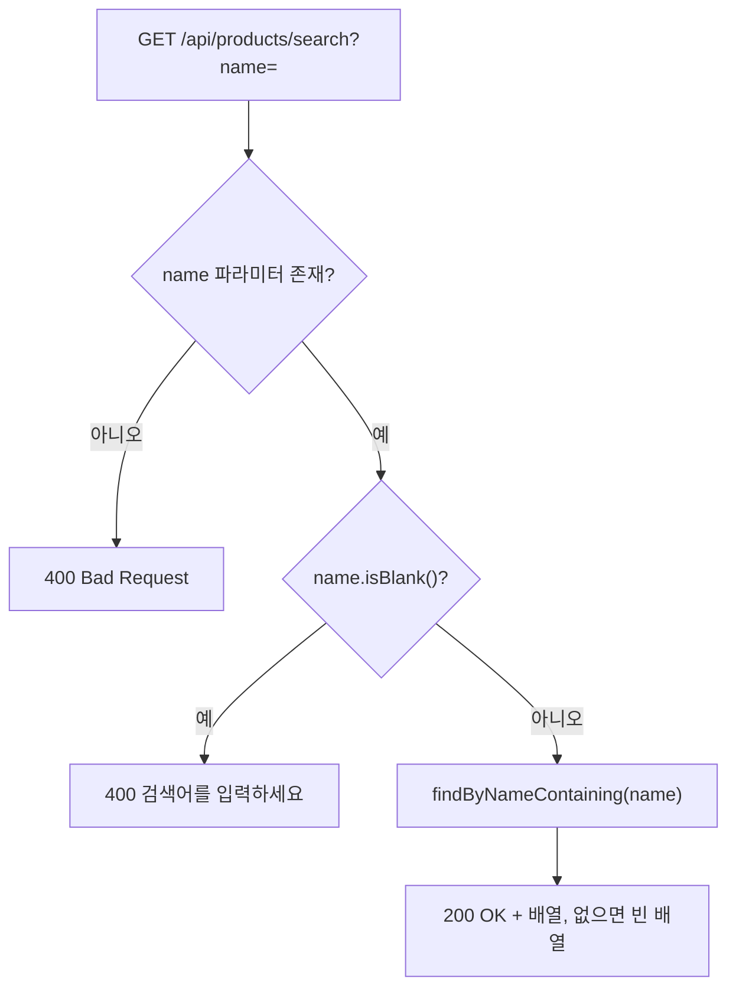

- **읽는 법**: 파라미터 누락(스프링)과 빈 문자열(Service)은 서로 다른 단계에서 400 처리

```java
// repository/ProductRepository.java
public interface ProductRepository extends JpaRepository<Product, Long> {
    List<Product> findByNameContaining(String name);
}
```

```java
// service/ProductService.java (검색)
// 이름 검색, 빈 검색어는 400
public List<ProductResponse> search(String name){
    if(name.isBlank()){
        throw new ResponseStatusException(
                HttpStatus.BAD_REQUEST,
                "검색어를 입력하세요"
        );
    }

    return productRepository.findByNameContaining(name)
            .stream()
            .map(ProductConverter::toResponse)
            .toList();
}
```

```java
// controller/ProductController.java (검색)
// GET /api/products/search?name=... : 쿼리 파라미터 수신
@GetMapping("/search")
public ResponseEntity<List<ProductResponse>> search(@RequestParam("name") String name){
    List<ProductResponse> responses = productService.search(name);
    return ResponseEntity.ok(responses);
}
```

- **이름 해석**: `findBy` 조건 조회, `Name` 엔티티 속성명, `Containing` 포함, 기준은 DB 컬럼명이 아닌 Java 속성명
- **`@RequestParam`**: 기본 필수, `name` 누락 시 400, 빈 문자열은 별도 검사
- **예상 결과 (실행 전)**: 키보드 2개 등록 후 `search?name=키보드` 호출 시 2건 배열, 일치 없으면 `[]`

### Repository 정리

| 메서드 | 역할 | 반환 |
|---|---|---|
| `save(product)` | 저장 | 저장된 Entity |
| `findById(id)` | ID로 한 건 조회 | `Optional<Product>` |
| `findAll()` | 전체 조회 | `List<Product>` |
| `existsById(id)` | 존재 여부 | `boolean` |
| `count()` | 전체 개수 | `long` |
| `deleteById(id)` | ID로 삭제 | `void` |

| 쿼리 메서드 | 조건 |
|---|---|
| `findByName` | 이름 일치 |
| `findByNameContaining` | 이름에 문자열 포함 |
| `findByPriceLessThanEqual` | 지정 가격 이하 |
| `findByStockGreaterThan` | 지정 수량보다 재고 많음 |
| `findByNameOrderByPriceAsc` | 이름 일치, 가격 오름차순 |

### 요청 입력 방식 비교

#### 입력값의 위치와 어노테이션

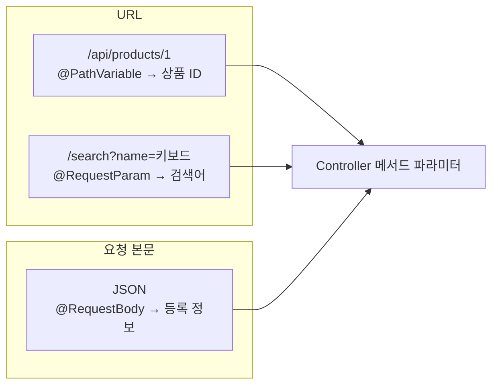

- **읽는 법**: 값이 URL 경로, 쿼리 문자열, 본문 중 어디에 있는지에 따라 어노테이션 선택

| 어노테이션 | 값의 위치 | 실습 용도 |
|---|---|---|
| `@PathVariable` | `/api/products/1` | 조회할 상품 ID |
| `@RequestParam` | `/search?name=키보드` | 검색어 |
| `@RequestBody` | POST 요청 본문 JSON | 등록할 상품 정보 |

- **주의점**: HTTP 메서드와 입력 방식은 일대일 관계가 아님

---

## 7. 트랜잭션

> **쉬운 정의:** 트랜잭션은 여러 DB 작업을 "전부 성공 아니면 전부 취소"로 묶는 단위

- **필요 상황**: 재고 10개 중 3개 출고 시 재고 변경(7개)과 출고 기록 저장이 함께 성공해야 함
- **Commit**: 변경 확정, **Rollback**: 변경 취소
- **주의점**: 오류 응답이 곧 롤백은 아님, 이미 커밋된 데이터는 자동 취소되지 않음

#### 출고 예시 (원자성)

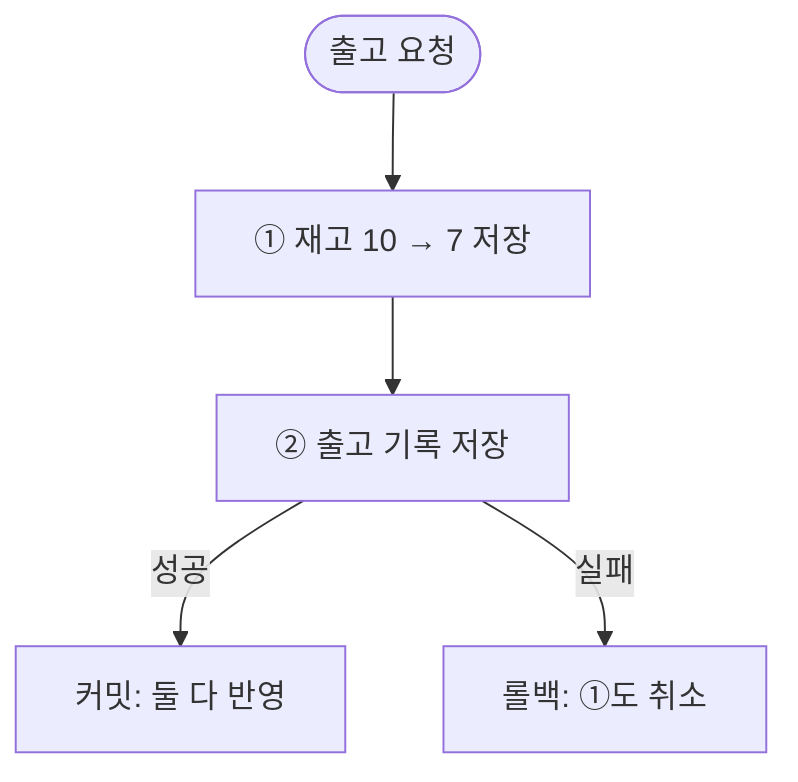

- **읽는 법**: 두 번째 작업 실패 시 첫 번째 작업까지 되돌려 재고만 줄어드는 상태 방지

| ACID | 의미 | 상품 API와의 연결 |
|---|---|---|
| Atomicity 원자성 | 전부 반영 또는 전부 취소 | 롤백된 상품은 남지 않음 |
| Consistency 일관성 | 처리 전후 데이터 규칙 유지 | 재고 음수 금지는 업무 코드와 DB 제약으로 구현 |
| Isolation 격리성 | 동시 트랜잭션 간섭 제어 | `@Transactional`만으로 동시성 문제가 모두 해결되지는 않음 |
| Durability 지속성 | 커밋 결과를 장애 후에도 보존 | 정상 커밋 상품은 재시작 후에도 조회 가능 |

#### 트랜잭션 상태 흐름

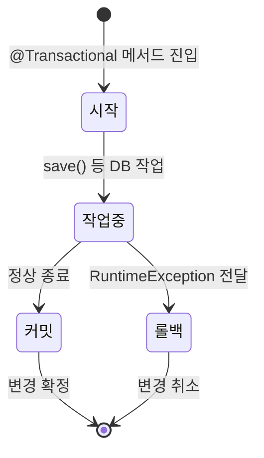

- **읽는 법**: 정상 종료는 커밋, 롤백 대상 예외가 메서드 밖으로 전달되면 롤백

#### `@Transactional` 유무 비교

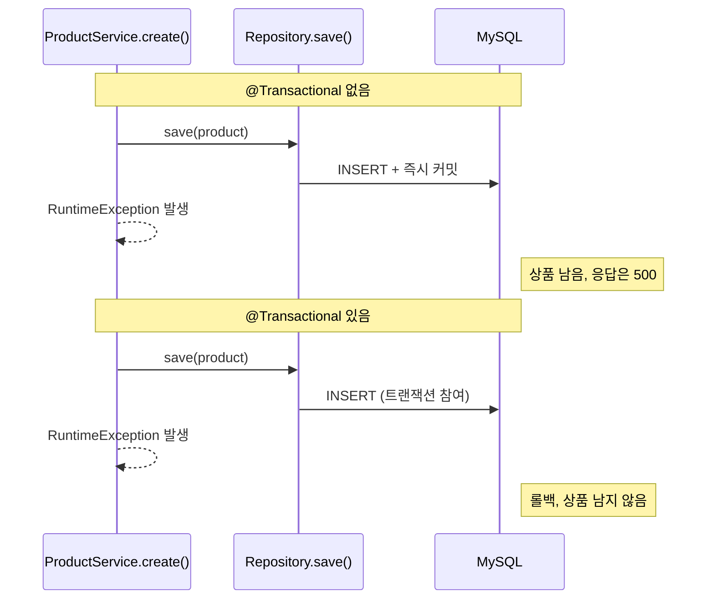

- **읽는 법**: 같은 예외라도 트랜잭션이 없으면 `save()`가 이미 커밋, 있으면 Service 전체가 롤백

| Service 설정 | `save()` 뒤 예외 발생 시 |
|---|---|
| `@Transactional` 없음 | `save()`가 자체 트랜잭션 완료, 이후 예외가 커밋을 되돌리지 않음 |
| `@Transactional` 있음 | `save()`가 Service 트랜잭션에 참여, 롤백 대상 예외 전달 시 저장도 취소 |

### 튜터 시연 순서

1. **트랜잭션 없음**: `save()` 직후 `throw new RuntimeException("저장 이후 오류 발생")`, 응답 500, SQL 확인 시 상품 저장됨
2. **`@Transactional` 추가**: 같은 예외 발생, 기본 설정에서 `RuntimeException`은 롤백 대상, 상품 저장 안 됨
3. **정상 복원**: 시연용 `throw` 제거, `@Transactional` 유지, 201 응답과 재시작 후 조회 확인

- **예상 결과 (실행 전)**: 시연 1은 DB에 행 존재, 시연 2는 행 없음
- **주의점**: 예외를 메서드 안에서 잡아 무시하면 롤백되지 않음, 같은 클래스 내부 자기 호출 시연은 사용하지 않음

### `readOnly` 설정 (PDF 정리)

```java
// 조회용 메서드임을 표시
@Transactional(readOnly = true)
public List<ProductResponse> findAll() { ... }
```

- **적용 대상**: `findAll`, `findById`, `search`
- **주의점**: 쓰기를 강제로 막는 검증 장치 아님, 작성 코드에는 아직 미적용

---

## 8. API 확인 항목

| 확인 동작 | 기대 결과 |
|---|---|
| 정상 상품 등록 | 201, 응답 ID와 SQL 행 일치 |
| 잘못된 이름·가격·재고로 등록 | 400, 저장 안 됨 |
| 전체 조회와 이름 검색 | 200, 응답 배열과 조건 확인 |
| 존재하는 ID / 없는 ID 조회 | 각각 200 / 404 |
| 예외 시연의 `@Transactional` 유무 | 각각 저장 취소 / 개별 저장 유지 |

- **확장 과제**: 상품 정보 수정·삭제, 재고 변경
