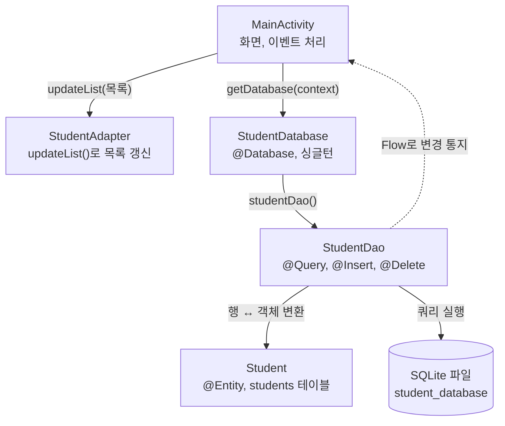
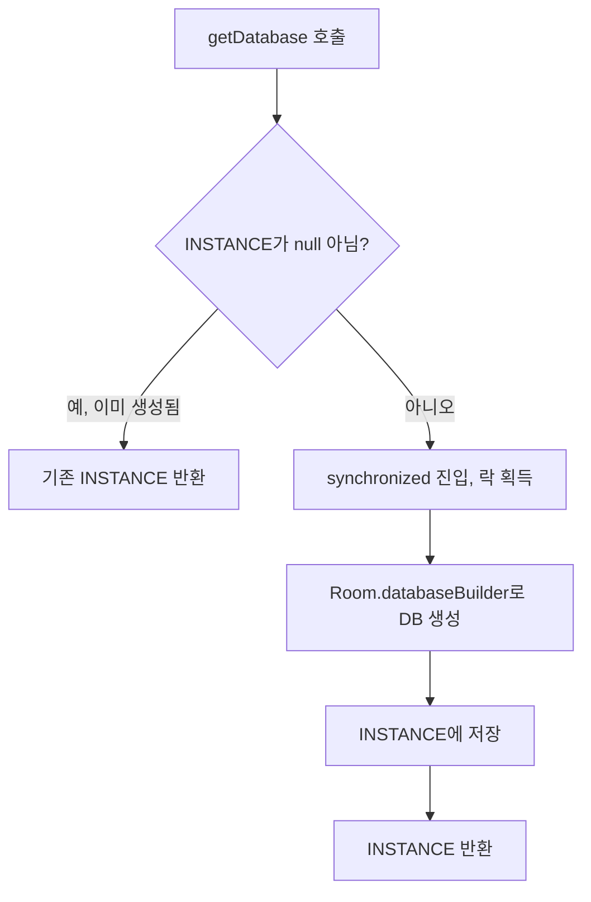
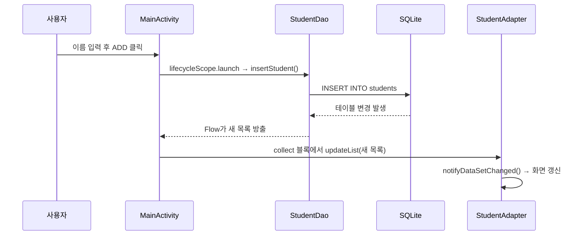

# 11주차 강의 정리: Room 데이터베이스 학생 목록 앱

- **강의 코드**: [neonunu/kotlin-2026c · AppWeek11](https://github.com/neonunu/kotlin-2026c/tree/main/AppWeek11)
- **공식 문서**: [Room을 사용하여 로컬 데이터베이스에 데이터 저장](https://developer.android.com/training/data-storage/room?hl=ko)
- **이전 주차**: [10주차 RecyclerView](week10-recyclerview.md) (UI 코드 그대로 재사용)
- **다음 주 예고**: 고급 Room, Flow 심화, UI 상태 관리, ViewModel, StateFlow

---

## 1. 한눈에 보는 오늘 내용

| 구분 | 내용 |
|---|---|
| 목표 | 앱을 종료해도 학생 목록이 **유지**되도록 로컬 DB(Room) 적용 |
| 핵심 구성요소 3종 | `@Entity`(테이블), `@Dao`(DB 연산 인터페이스), `@Database`(DB 본체) |
| 핵심 비동기 개념 | 코루틴(Coroutine), `suspend` 함수, `Flow` |
| 새 Gradle 설정 | `kapt` 플러그인, Room 2.8.3, `kotlinx-coroutines-android`, lifecycle |
| 새로 만든 파일 2개 | `data/StudentDao.kt`, `data/StudentDatabase.kt` |
| 수정한 파일 | `Student.kt`(Entity 전환), `StudentAdapter.kt`(`updateList` 추가), `MainActivity.kt`, `build.gradle.kts` |
| 수정 없는 파일 | `activity_main.xml`, `item_student.xml` (UI 레이어는 10주차 그대로) |
| 적용된 디자인 패턴 | 싱글턴(Singleton) |

- **변경 범위**: 화면(프론트엔드)은 그대로이고 **백엔드와 DB 코드만 교체**
- **10주차와의 차이**: 메모리 `ArrayList` → 디스크의 SQLite(Room)

---

## 2. 도입: 동기와 비동기

### 강의 비유 정리

| 비유 | 동기(blocking) | 비동기(non-blocking) |
|---|---|---|
| 단톡방 공지 | 30명이 읽었는지 하나씩 확인하고 다음 공지 | 공지만 올리고 다음 일 진행 |
| 게임 다운로드 + 유튜브 | 다운로드가 끝날 때까지 다른 작업 불가 | 다운로드는 백그라운드, 화면에서는 유튜브 시청 |
| 이삿짐센터 | 한 명이 모든 일을 순서대로 처리 | 여러 명이 역할을 나눠 동시에 처리 |
| 은행 창구 | 상담원 1명이 번호 순서대로 처리 | 상담원 3명이 동시에 3명 처리 |
| 수업 진도 | 2차 방정식부터 전부 복습 후 미적분 | 필요한 부분만 진행 |

- **동기식(blocking)**: 앞 작업이 끝나야 다음 작업 시작, 그동안 호출한 쪽이 멈춤
- **비동기식(non-blocking)**: 작업을 맡겨 두고 호출한 쪽은 계속 진행, 속도·응답성 향상
- **DB가 왜 비동기여야 하는가**
  - DB 읽기·쓰기는 디스크 접근이라 시간이 걸림
  - 화면을 그리는 **메인 스레드**에서 직접 실행하면 화면 멈춤(ANR) 위험
  - Room은 메인 스레드에서 DB 쿼리 실행 시 기본적으로 예외 발생

### 스레드 비유

- 게임: 내 캐릭터 조작(메인) / 다른 플레이어 렌더링 / 배경음악이 서로 다른 스레드로 분담
- 중요도 순서: 내 조작 반응 > 배경 이미지, 그래서 **화면 담당 메인 스레드는 막으면 안 됨**
- 강의 중 PC 작업관리자 확인: 물리 코어 6개, 논리 프로세서 12개, 스레드 3천여 개 동작 중

### Flow와 스트림

> **쉬운 정의:** Flow는 값이 한 번으로 끝나지 않고 **계속 흘러오는** 데이터 통로

- **스트림(stream)**: 물줄기처럼 끊이지 않고 흐르는 데이터, 유튜브·축구 중계 스트리밍이 대표 예
- **강의 비유: 수도 배관**
  - 댐 → 정수 시설 → 아파트 물탱크 → 각 가정 수도꼭지
  - 단수돼도 물탱크에 찬 만큼은 사용 가능, 유튜브가 끊겨도 버퍼에 받아 둔 만큼 재생되는 것과 같은 원리
  - 정수 시설 = **계속 감시**하는 역할 (필터 교체 시기를 알려 주는 정수기와 동일)
- **코틀린 `Flow`**: 코루틴의 하위 개념, 데이터가 바뀔 때마다 새 값을 흘려보냄
- **오늘 앱에서의 역할**: DB의 학생 목록이 바뀌면 감시하던 Flow가 알려 주고 화면 자동 갱신
  - 감시카메라처럼 **백그라운드에서** 계속 모니터링
  - 화면을 막지 않으므로 논블로킹(non-blocking) 방식

### 코루틴

> **쉬운 정의:** 코루틴은 스레드를 막지 않고 "잠깐 멈췄다가 이어서" 실행하는 가벼운 작업 단위

- **코루틴(Coroutine)**: 코틀린이 제공하는 비동기 처리 기능 (안드로이드 전용이 아닌 코틀린 공통 라이브러리)
- 오늘 사용하는 도구 2가지

| 구분 | `suspend` 함수 | `Flow` |
|---|---|---|
| 결과 횟수 | 한 번 (일회성) | 여러 번 (변경될 때마다) |
| 비유 | 수도꼭지를 한 번 틀어 물 한 컵 | 수도관을 계속 흐르는 물 |
| 사용 예 | 추가, 삭제, 단건 조회 | 전체 목록 관찰 |

- **일반 함수와의 차이**
  - 일반 함수 a, b, c: a가 끝나야 b, b가 끝나야 c 실행
  - 코루틴: 기다리는 동안 스레드를 붙잡지 않아 다른 작업이 진행 가능
  - 강의 비유: 이삿짐센터는 기사 여러 명이 역할을 나눠 동시에 작업
- 강의 안내: 코루틴은 뒤에서 `suspend`, `Flow` 코드를 볼 때 더 자세히 확인

### 강의 태도

- 문법 100%는 한 학기가 걸림 → 문법 20~30%만 다루고 **앱을 만들면서 나머지를 익히는 방식**
- 코드는 AI가 작성하는 시대 → 사람의 몫은 **뼈대 이해, 정확한 용어, 결과 검증의 책임**
- 정확한 용어를 알아야 정확한 프롬프트 작성 가능

---

## 3. Room 개요와 구조

> **쉬운 정의:** Room은 안드로이드 앱 안의 작은 DB(SQLite)를, SQL 문자열을 직접 다루지 않고 코틀린 클래스와 함수처럼 쓰게 해 주는 도구

- **SQLite**: 안드로이드에 내장된 경량 관계형 데이터베이스
- **Room**: SQLite를 **추상화**한 라이브러리 (복잡한 SQLite 작업을 감싸서 쓰기 쉽게 제공)
- **ORM(Object-Relational Mapping)**: 객체와 관계형 DB 테이블을 자동으로 변환하는 기술, 데이터베이스 수업의 ER 다이어그램 대응
  - 클래스 → 테이블, 멤버 변수 → 컬럼, 객체 하나 → 행(row)
- **장점**: SQL을 한 번 정의해 두면 이후에는 자바·코틀린 코드 짜듯이 사용, 쿼리와 트랜잭션 성능 최적화 지원
- **구성요소 3종** (각 파일을 만들 때 하나씩 자세히 설명)
  - `Entity`: 테이블 하나에 대응하는 클래스
  - `DAO`: DB 연산을 모아 놓은 인터페이스
  - `Database`: 둘을 묶는 DB 본체, 앱 전체에서 하나만 존재




- **3대 구성요소 역할**
  - `Entity`: 무엇을 저장하는가 (테이블 정의)
  - `DAO`: 어떻게 읽고 쓰는가 (연산 정의)
  - `Database`: 둘을 묶는 본체, 앱 전체에서 하나만 존재
- **작성 방식**: DAO는 **인터페이스**(본문 없음), Database는 **추상 클래스**(`RoomDatabase` 상속)
  - 구현체는 `kapt`(어노테이션 처리)가 컴파일 시점에 자동 생성

### 프로젝트 파일 구조

```
AppWeek11/app/src/main/
├── java/com/appweek11/
│   ├── MainActivity.kt          ← (수정) Flow 수집, 코루틴 기반 추가·삭제
│   ├── StudentAdapter.kt        ← (수정) updateList() 추가
│   └── data/
│       ├── Student.kt           ← (수정) 일반 클래스 → @Entity
│       ├── StudentDao.kt        ← (신규) DB 연산 인터페이스
│       └── StudentDatabase.kt   ← (신규) DB 본체, 싱글턴
└── res/layout/
    ├── activity_main.xml        ← 변경 없음
    └── item_student.xml         ← 변경 없음
```

- **`data` 폴더**: 데이터 관련 파일을 별도 패키지로 관리
- **파일 생성 주의**: `MainActivity.kt`와 같은 위치가 아니라 **`data/` 아래**에 생성해야 함 (강의 중 잘못 만든 파일 삭제 후 재생성)

---

## 4. 파일별 코드 해설

### 4-1. `build.gradle.kts` (앱 모듈)

```kotlin
plugins {
    alias(libs.plugins.android.application)
    alias(libs.plugins.kotlin.android)
    id("org.jetbrains.kotlin.kapt")        // 어노테이션 처리기 (Room 코드 생성용)
}

dependencies {
    implementation("androidx.core:core-ktx:1.15.0")
    implementation("androidx.lifecycle:lifecycle-runtime-compose:2.8.7")
    implementation("androidx.recyclerview:recyclerview:1.4.0")

    // Room database
    val roomVersion = "2.8.3"               // 버전 변수화: 한 곳만 바꾸면 3곳에 적용
    implementation("androidx.room:room-runtime:$roomVersion")
    implementation("androidx.room:room-ktx:$roomVersion")
    kapt("androidx.room:room-compiler:$roomVersion")

    // Coroutine
    implementation("org.jetbrains.kotlinx:kotlinx-coroutines-android:1.7.3")
}
```

- **`kapt` 플러그인**: `@Entity`, `@Dao` 같은 어노테이션을 읽어 구현 코드를 자동 생성
- **`room-runtime`**: Room 핵심 라이브러리
- **`room-ktx`**: 코루틴·Flow 지원 확장
- **`room-compiler`**: 코드 생성기, `implementation`이 아니라 **`kapt`** 로 선언
- **`kotlinx-coroutines-android`**: 그룹이 `androidx`가 아니라 `org.jetbrains.kotlinx`
  - 안드로이드에 종속되지 않은 코틀린 공통 라이브러리라 서버 개발에도 사용
- **`viewBinding = true`**: 10주차에서 이미 설정, 유지
- **수정 후 Sync 필수**: Sync 없이는 새 의존성 미적용

### 4-2. `data/Student.kt` (Entity)

> **쉬운 정의:** `Student` 클래스 위에 `@Entity`를 붙이면 "이 클래스가 DB의 `students` 테이블"이라는 선언

- **스키마(Schema)**: 테이블 구조 설계도 (컬럼 이름, 데이터 타입, 기본 키 정의)
  - `CREATE TABLE`에서 정의하는 내용, 조회·삽입 같은 데이터 조작(DML)과 구분
  - 강의 설명: "틀"이라 해도 틀린 말은 아니지만 **구조도**에 가까움
- **어노테이션(Annotation)**: 코드 위에 `@`로 붙이는 표식, 컴파일러와 라이브러리가 읽고 코드를 생성
- **Entity**: 테이블 하나에 대응하는 데이터 클래스, 클래스 위에 `@Entity`를 붙여 선언
- 녹취의 "NTT"는 **Entity**, "사인"은 **`@`** 기호

**아주 간단한 핵심 예시**

```kotlin
@Entity(tableName = "students")      // 이 클래스 = students 테이블
data class Student(
    @PrimaryKey(autoGenerate = true) // 기본 키, 값 자동 증가
    val id: Int = 0,
    val name: String
)
```

**강의 코드 전체**

```kotlin
@Entity(tableName = "students")
data class Student(
    @PrimaryKey(autoGenerate = true)
    val id: Int = 0,

    @ColumnInfo(name = "student_name")
    val name: String,

    val department: String = "Computer Science",
    val grade: String = "1st Year",
    val email: String = "",

    @ColumnInfo(name = "added_date")
    val addedDate: Long = System.currentTimeMillis()
) {
    override fun toString(): String = name
}
```

| 요소 | 의미 |
|---|---|
| `@Entity(tableName = "students")` | DB 테이블 이름 지정, 생략 시 클래스 이름 사용 |
| `@PrimaryKey(autoGenerate = true)` | 각 행의 고유 식별자, 중복 불가(Unique), 비어 있으면 안 됨(Not null), 값 자동 생성 |
| `@ColumnInfo(name = ...)` | 컬럼 이름 지정, **선택사항** |
| 어노테이션 없는 속성 | 변수 이름이 그대로 컬럼 이름 (`department`, `grade`, `email`) |
| `id: Int = 0` | 기본값 0이면 Room이 저장 시 새 번호 부여 |
| `addedDate: Long` | 날짜를 밀리초(Long)로 저장 |

- **컬럼 이름 규칙**
  - 코틀린: 카멜 표기법 (`addedDate`)
  - DB: 스네이크 표기법 (`added_date`), `@ColumnInfo`로 매핑
- **10주차 대비 변화**
  - `class` → `data class`
  - `id`가 `UUID` 문자열 → 자동 증가 `Int`
  - `addedDate`가 `Date` → `Long`
- **`toString()` 오버라이드**: 객체를 출력하면 학생 이름이 나오도록 재정의 (자바 최상위 `Object`의 함수를 오버라이드)
- **데이터베이스 수업 연결**: 기본 키 = 유일(Unique) + 널 불가(Not null)

### 4-3. `data/StudentDao.kt` (DAO) ⭐

> **쉬운 정의:** DAO는 "DB에 어떤 일을 시킬 수 있는지" 적어 놓은 **주문서**, 함수 이름과 SQL을 짝지어 두면 호출할 때 해당 SQL이 실행됨

- **DAO(Data Access Object)**: 데이터 접근 객체, DB 연산을 모아 놓은 인터페이스
- **CRUD**: Create(생성), Read(조회), Update(수정), Delete(삭제)
  - 오늘 코드: `@Insert`, `@Query`(조회), `@Update`, `@Delete`
- 녹취의 "dau/다우"는 **DAO**, "지리/코리"는 **`@Query`**
- 이 절에서 앞서 배운 `suspend`와 `Flow`가 실제로 어디에 쓰이는지 확인

**아주 간단한 핵심 예시**

```kotlin
@Dao
interface StudentDao {
    @Query("SELECT * FROM students")  // 이 SQL을 getAll()과 연결
    fun getAll(): Flow<List<Student>>

    @Insert
    suspend fun insert(student: Student) // INSERT 자동 생성
}
```

**강의 코드 핵심 (조회)**

```kotlin
// 전체 조회: 변경될 때마다 새 목록 전달, 최신(id 큰 순)이 위
@Query("SELECT * FROM students ORDER BY id DESC")
fun getAllStudents(): Flow<List<Student>>

// 단건 조회: 한 번 호출하고 끝
@Query("SELECT * FROM students WHERE id = :studentId")
suspend fun getStudentById(studentId: Int): Student?

// 이름 검색: LIKE + 와일드카드 %
@Query("SELECT * FROM students WHERE student_name LIKE '%' || :searchQuery || '%' ORDER BY id DESC")
fun searchStudents(searchQuery: String): Flow<List<Student>>
```

**강의 코드 핵심 (변경)**

```kotlin
@Insert(onConflict = OnConflictStrategy.REPLACE) // 같은 키가 있으면 덮어쓰기
suspend fun insertStudent(student: Student)

@Insert(onConflict = OnConflictStrategy.REPLACE)
suspend fun insertAllStudents(students: List<Student>) // 여러 명 한 번에

@Update
suspend fun updateStudent(student: Student)

@Delete
suspend fun deleteStudent(student: Student)       // 주어진 객체 한 건 삭제

@Query("DELETE FROM students")                    // 조건 필요하면 @Query로 직접 작성
suspend fun deleteAllStudents()
```

| 어노테이션 | SQL 대응 | 비고 |
|---|---|---|
| `@Insert` | `INSERT INTO` | `onConflict`로 충돌 처리 방식 지정 |
| `@Update` | `UPDATE ... SET` | 기본 키로 대상 행 식별 |
| `@Delete` | `DELETE FROM` | 객체의 기본 키로 대상 행 식별 |
| `@Query("...")` | 직접 작성한 SQL | `SELECT`는 항상 `@Query`로 작성 |

- **`SELECT`는 어노테이션 이름이 다름**: `@Select`가 아니라 **`@Query`**
- **`:studentId` 형태**: SQL 안에서 함수 매개변수를 참조
- **`DESC`**: 내림차순, id가 클수록(최근 추가) 위, 게시판 최신 글이 위로 오는 것과 같은 원리, 오름차순은 `ASC`
- **`Flow` 함수에는 `suspend`가 없음**
  - Flow 반환 함수는 호출 즉시 Flow 객체만 반환, 실제 쿼리는 Room이 백그라운드에서 처리
  - 그래서 `suspend` 없이 선언
- **`suspend` 함수는 코루틴 안에서만 호출 가능** → `lifecycleScope.launch { ... }`가 필요한 이유
- **`Flow<List<Student>>`의 제네릭**
  - `Flow<T>`의 `T`는 흘러오는 값의 타입
  - 여기서는 학생 목록 전체가 값 하나, 목록이 바뀌면 새 목록이 다시 도착
- **그 외 정의된 함수**: 학과별·학년별 조회, 전체·학과별 인원 수 (`COUNT(*)`), 오늘 수업에서는 일부만 사용

### 4-4. `data/StudentDatabase.kt` (Database, 싱글턴) ⭐

> **쉬운 정의:** `StudentDatabase`는 DB 파일 전체를 대표하는 **관리실**, 앱 어디서 호출해도 같은 관리실 하나만 쓰도록 만들어 놓음

- **싱글턴(Singleton)**: 객체를 프로그램 전체에서 **단 하나만** 만들도록 보장하는 디자인 패턴
  - 일반 클래스는 `new`로 무한히 찍어낼 수 있지만, 싱글턴은 하나뿐
  - DB 객체가 둘이면 같은 파일을 서로 다르게 건드려 데이터 일관성이 깨짐
- 이 절에서 함께 나오는 키워드: `@Volatile`(변경 즉시 공유), `synchronized`(한 번에 한 스레드만 진입), 자세한 비유는 7절

```kotlin
@Database(
    entities = [Student::class],   // 이 DB에 들어가는 테이블 목록
    version = 1,                   // 구조 변경 시 올리는 버전 (마이그레이션용)
    exportSchema = false           // 스키마 파일 내보내기 안 함
)
abstract class StudentDatabase : RoomDatabase() {

    // DAO를 꺼내는 추상 메소드, 구현은 Room이 생성
    abstract fun studentDao(): StudentDao

    companion object {
        @Volatile                  // 스레드 간 변경 즉시 공유 (가시성 보장)
        private var INSTANCE: StudentDatabase? = null

        // 인스턴스 하나를 만들어 모두에게 돌려줌
        fun getDatabase(context: Context): StudentDatabase {
            return INSTANCE ?: synchronized(this) {
                val instance = Room.databaseBuilder(
                    context.applicationContext,
                    StudentDatabase::class.java,
                    "student_database"          // DB 파일 이름
                ).build()

                INSTANCE = instance
                instance
            }
        }
    }
}
```

| 요소 | 의미 |
|---|---|
| `@Database(entities, version, exportSchema)` | DB 정의, 어떤 Entity를 포함하고 현재 버전이 몇인지 선언 |
| `abstract class ... : RoomDatabase()` | 구현 없이 선언만, Room이 구현 클래스 자동 생성 |
| `abstract fun studentDao()` | DAO 접근 통로 |
| `companion object` | 자바의 `static` 영역, 인스턴스 없이 `StudentDatabase.getDatabase()` 호출 가능 |
| `@Volatile` | 한 스레드가 `INSTANCE`를 바꾸면 다른 스레드가 즉시 변경된 값을 읽음 |
| `synchronized(this)` | 한 번에 한 스레드만 진입, 나머지는 대기 |
| `context.applicationContext` | 액티비티가 아닌 앱 전체 컨텍스트 사용 (액티비티 수명과 분리) |
| `"student_database"` | 실제 SQLite 파일 이름 |

#### `getDatabase()` 동작 흐름



- **싱글턴이 필요한 이유**: DB 객체가 여러 개면 같은 파일을 서로 다른 객체가 건드려 유일성·일관성 훼손
- **`exportSchema = false`**: 스키마 JSON 파일을 외부로 내보내지 않는 설정
- **`version`**: 나중에 컬럼을 추가하는 등 구조를 바꿀 때 올리고 마이그레이션 정의

### 4-5. `StudentAdapter.kt`

- **10주차 대비 변경점**: 목록을 **교체할 수 있도록** 바뀜

```kotlin
class StudentAdapter(
    private var studentList: List<Student>,      // val → var, ArrayList → List
    private val onItemClick: (Student, Int) -> Unit,
    private val onItemLongClick: (Int) -> Unit
) : RecyclerView.Adapter<StudentAdapter.StudentViewHolder>() {
    // ... ViewHolder, onCreateViewHolder, onBindViewHolder, getItemCount는 10주차와 동일

    // Flow에서 새 데이터를 받으면 호출, 목록 교체 후 화면 갱신 요청
    fun updateList(newList: List<Student>) {
        studentList = newList
        notifyDataSetChanged()
    }
}
```

- **추가된 함수 `updateList()`**: Flow가 새 목록을 전달할 때마다 호출
- **`val` → `var`**: 목록 자체를 통째로 바꿔 끼우기 위함
- **그대로인 부분**: `onCreateViewHolder`, `onBindViewHolder`, `getItemCount` 필수 3종, 클릭·롱클릭 처리

### 4-6. `MainActivity.kt` ⭐

> **쉬운 정의:** 화면은 DB에서 흘러오는 학생 목록을 **계속 지켜보다가**, 변하면 알아서 다시 그림, 추가·삭제는 DB에 시키기만 함

```kotlin
// 1. DB 인스턴스 획득 (싱글턴)
database = StudentDatabase.getDatabase(this)

// 2. 목록 관찰: DB가 바뀔 때마다 collect 블록이 다시 실행됨
private fun observeStudents() {
    lifecycleScope.launch {
        database.studentDao().getAllStudents().collect { students ->
            currentStudents = students
            adapter.updateList(students)   // 어댑터에 새 목록 전달
            updateStudentCount()           // "Total Students: N" 갱신
        }
    }
}

// 3. 추가: DB에 저장만 하고 화면 갱신은 Flow에 맡김
lifecycleScope.launch {
    database.studentDao().insertStudent(newStudent)
}
```

| 요소 | 의미 |
|---|---|
| `lifecycleScope` | 액티비티 수명주기에 묶인 코루틴 범위, 액티비티 종료 시 작업 자동 취소 |
| `launch { }` | 새 코루틴 시작 (`kotlinx.coroutines.launch`) |
| `.collect { }` | Flow가 보내는 값을 받는 수신 블록, 값이 올 때마다 실행 |
| `currentStudents` | 현재 화면 목록 사본, 중복 검사·삭제 대상 확인용 |

**10주차에서 사라진 것과 바뀐 것**

| 10주차 | 11주차 |
|---|---|
| `studentList` (`ArrayList`) 직접 수정 | DB에 저장, 목록은 Flow가 전달 |
| `addInitialData()`로 6명 삽입 | 없음, **빈 목록에서 시작** |
| `notifyItemInserted/Removed` 호출 | `adapter.updateList()`로 통째로 교체 |
| `Math.random()` 학년 | `(1..4).random()` |
| 삭제 시 `position` 인덱스로 제거 | 삭제 시 `Student` 객체를 DAO에 전달 |

- **추가 시 화면을 직접 건드리지 않는 이유**: DB 변경 → Flow 재방출 → `collect` → 화면 갱신 흐름이 자동으로 이어짐
- **학년 랜덤 값**: 강의 중 설명 "1~4학년 중 랜덤, 크게 신경 쓰지 않아도 됨"
- **이메일**: 입력한 학생 이름으로 생성 (공백은 `.`으로 치환)
- **삭제 흐름**: 롱클릭 → `currentStudents[position]`으로 객체 확인 → 확인 대화상자 → `deleteStudent(student)`
- **전체 삭제**: `deleteAllStudents()` 실행 시 `students` 테이블 비움, 개수 0으로 초기화
- **UI 파일**: `activity_main.xml`, `item_student.xml`은 10주차 코드를 그대로 복사해 사용

---

## 5. 전체 데이터 흐름

### 학생 추가 시



### 스레드 관점

- `lifecycleScope.launch`: 메인 스레드 컨텍스트에서 시작
- 실제 DB 접근: Room이 **내부적으로 IO 스레드에서 처리**한 뒤 결과를 전달
- 화면 갱신: 메인 스레드에서 실행
- 결과: 사용자 화면은 멈추지 않고 DB 작업은 뒤에서 진행 (다운로드하며 유튜브를 보는 것과 같은 구조)

### 앱을 껐다 켰을 때

- 메모리(RAM)의 `ArrayList`는 앱 종료 시 사라짐
- Room은 **디스크의 SQLite 파일**에 저장하므로 재실행 시 그대로 유지
- 재실행하면 `observeStudents()`가 다시 시작되어 저장된 목록을 Flow로 받아 표시

---

## 6. 강의 시연 결과

> 아래 결과는 강의 중 에뮬레이터 시연 기준. 이 문서 작성 과정에서 앱 실행은 하지 않음 (빌드만 별도 확인, 6-1절 참고)

| 동작 | 결과 |
|---|---|
| 앱 첫 실행 | 학생 0명, 빈 목록에서 시작 |
| 이름 `1`, `2` 추가 | 최근 추가한 항목이 **위**에 표시 (`ORDER BY id DESC`) |
| 항목 길게 클릭 → Delete | 해당 학생 삭제, 토스트 표시 |
| 항목 짧게 클릭 | 상세 정보 대화상자 |
| 화면 회전 | 목록 유지 (회전 시 액티비티가 다시 생성되어도 DB에서 다시 읽음) |
| 앱 종료 후 재실행 | 삭제·추가한 결과 **그대로 유지** |
| `CLEAR ALL` | 전체 삭제, 개수 0 |

- **10주차와의 가장 큰 차이**: 재실행해도 삭제했던 학생이 되살아나지 않음
- **같은 이름 재추가 시 학년이 바뀔 수 있음**: 학년이 랜덤이라 삭제 후 다시 추가하면 학년 값이 달라질 수 있음 (강의 중 `55` 삭제 후 재추가로 설명)
- **중복 이름 차단**: 코드상 같은 이름은 "already exists" 토스트로 막음 (코드 기준, 시연 항목 아님)

### 6-1. 빌드 확인 (문서 작성 중 실행)

- `AppWeek11`에서 `assembleDebug` 실행 → **BUILD SUCCESSFUL** (오류 없음)
- 경고 2건: `adapterPosition` deprecated (10주차 코드와 동일 사유)
- 로그 메시지: `Kapt currently doesn't support language version 2.0+. Falling back to 1.9.`
  - 의미: `kapt`가 Kotlin 언어 버전 1.9로 동작, 빌드 실패는 아님
  - 참고: `kapt` 대체재로 KSP가 있음 (이번 강의 범위 밖)
- **JDK 주의**: JDK 25(시스템 기본)로 터미널 빌드 시 `25.0.x` 오류만 출력되며 실패
  - JDK 21로 지정하면 성공 확인
  - Android Studio에서는 프로젝트의 Gradle JDK 설정을 따름

---

## 7. 곁가지: 싱글턴과 스레드 동기화

### 레이스 컨디션과 락

- **레이스 컨디션(경쟁 조건)**: 여러 스레드가 같은 자원을 동시에 차지하려 할 때 충돌하는 상황
- **락(lock)**: 한 스레드가 자원을 점유하는 동안 다른 스레드의 진입을 막는 장치
- **강의 비유**: 화장실이 하나뿐일 때 가장 먼저 들어간 사람이 문을 잠그면 나머지는 대기
  - 문 잠금 = 락, 기다리는 사람 = 블록(대기)된 스레드, 사용 중 표시 = 이미 생성된 인스턴스

### 싱글턴 구현 방식 비교

| 방식 | 특징 | 강의 평가 |
|---|---|---|
| `synchronized` 메서드 | 호출 때마다 락 확인, 단순 | 매번 문을 두드리는 구조라 느림, 실무 비권장 |
| DCL(Double-Checked Locking) | 락 전에 한 번, 락 안에서 한 번 검사 | 성능 좋음, `volatile` 필수, 현재 강의 코드가 이 계열 |
| `enum` 싱글턴 (Java) | 인스턴스가 하나로 보장, 직렬화·리플렉션도 안전 | 가장 간단하고 권장 |
| 정적 내부 클래스 (holder) | 지연 로딩 가능 | 참고용 |

- **전부 외울 필요 없음**: **AI에게 던질 키워드**로 알고 있으면 충분
  - 키워드: `Singleton`, `synchronized`, `volatile`, `DCL`, `enum`, 레이스 컨디션
- **면접 포인트**: 자바 계열 취업 시 싱글턴 구현과 DCL 질문이 자주 나옴
- **강의 중 확인한 사실**: 학생 대부분이 운영체제의 레이스 컨디션 개념을 처음 듣는 상태, 자바 취업 준비 시 꼭 알아야 할 용어로 안내

### 동기·비동기 용어 보충

- **`suspend`의 정확한 의미**: 스레드를 막지 않고 **일시 중단했다가 재개**할 수 있는 함수
  - 강의의 "여러 개를 동시에 실행" 설명은 `suspend` 자체의 성질이 아니라, **코루틴을 여러 개 띄웠을 때** 가능한 동작
  - 같은 코루틴 안에서 `suspend` 함수를 연속 호출하면 순서대로 실행됨
- **Flow의 정수 시설 비유**: 상류(DB)에서 흘러온 값이 중간에서 감시·가공되어 하류(화면)에 도달, 변화가 생기면 자동으로 새 값이 흘러감

---

## 8. 주의점

- **`getDatabase()`의 락 안쪽 재검사**
  - 강의 코드: `INSTANCE ?: synchronized(this) { 생성 }`
  - 락 **안에서 `INSTANCE`를 다시 검사하지 않음** → 스레드 두 개가 거의 동시에 진입하면 두 번째 스레드가 락을 얻은 뒤 DB를 한 번 더 생성할 가능성
  - 이론상 완전한 DCL은 락 안에서 한 번 더 검사
  - 개선 예시 (실행 미확인):
    ```kotlin
    return INSTANCE ?: synchronized(this) {
        INSTANCE ?: Room.databaseBuilder(...).build().also { INSTANCE = it }
    }
    ```
  - 이 앱에서는 `onCreate`가 메인 스레드에서만 호출하므로 실제 문제 발생 가능성은 낮음
- **`@PrimaryKey(autoGenerate)`와 `id = 0`**: `id`에 0을 넣어야 새 번호를 부여, 직접 값을 넣으면 `REPLACE`와 만나 기존 행을 덮어씀
- **`version` 미변경 후 스키마 수정**: Entity에 컬럼을 추가하고 `version`을 그대로 두면 기존 앱 데이터와 충돌, 개발 중에는 앱 삭제 후 재설치로 해결 가능, 실제 서비스는 마이그레이션 필요
- **`notifyDataSetChanged()`**: 전체 재계산, 항목 수가 많으면 비효율, 이후 `DiffUtil` 또는 `ListAdapter` 검토 대상
- **`adapterPosition` deprecated**: `bindingAdapterPosition` 권장, 삭제 애니메이션 중 `-1` 반환 가능
- **`handleItemLongClick(position)`**: 인덱스로 `currentStudents`를 읽으므로 범위 검사(`position < size`)가 있음
- **`build.gradle.kts` 수정 후 Sync**: 하지 않으면 Room 클래스·바인딩 클래스 미생성
- **`kapt` 경고**: 빌드 로그의 Kapt 경고는 실패가 아님, 단 `kapt`는 장기적으로 KSP로 대체되는 추세
- **한 번에 완성되는 코드는 없음**: 강의 메시지, 소프트웨어는 계속 업데이트되는 대상이며 이번 코드도 다음 주에 고도화 예정
- **문자열 SQL의 오타**: `@Query` 안의 SQL은 컴파일 시점에 Room이 문법과 컬럼 이름을 검사 (오타가 있으면 빌드 단계에서 오류)

---

## 9. Git 작업 흐름 (강의 중)

- 녹취 기준, 단계별 커밋 진행 (정확한 커밋 단위는 저장소 이력 참고)
  1. **초기 설정**: Gradle 수정, 빈 `Student/Dao/Database` 파일 생성
  2. **데이터 계층**: `Student`(Entity) + `StudentAdapter` 수정
  3. **DAO·Database**: 연산 인터페이스, 싱글턴 DB 작성
  4. **화면 연결**: `MainActivity` 수정, 레이아웃 복사, 빌드 오류 수정
- **강의 중 오류 수정 사례**
  - `kotlinx` 의 `x` 누락
  - 이전 주차 패키지 이름(`appweek10`)이 남아 있어 import 오류
  - 복사 후 `MainActivity` 누락
- **실습 팁**: 이전 주차 코드를 복사할 때는 **패키지명·import·`R` 경로**를 반드시 새 주차에 맞게 수정

---

## 10. 다음 주 예고

| 주차 | 주제 |
|---|---|
| 12주차 | 고급 Room, Flow 심화(실시간 데이터 업데이트), 효율적인 비동기 작업 처리, **UI 상태 관리, ViewModel, StateFlow** |
| 13주차 | 최신 아키텍처 (Jetpack Compose, MVVM 비교) |

- 12주차는 11주차 코드의 **심화**, 큰 틀은 유지
- 선행 학습 권장: GitHub에 올라온 12주차 코드 미리 확인

---

## 11. 확인 질문

- `StudentDao.getAllStudents()`는 `suspend`가 없는데, 왜 `deleteStudent()`는 `suspend`여야 하는가?

<details>
<summary>답 보기</summary>

- `getAllStudents()`는 **Flow**를 반환 → 호출 즉시 Flow 객체만 돌려주고, 실제 쿼리와 변경 감시는 Room이 백그라운드에서 수행
- `deleteStudent()`는 호출 한 번에 **작업이 끝나는 일회성 DB 쓰기** → 완료까지 시간이 걸리므로 `suspend`로 선언하고 코루틴 안에서 호출
- 호출 쪽(`lifecycleScope.launch`)이 작업을 기다리는 동안에도 메인 스레드는 막히지 않음

</details>
