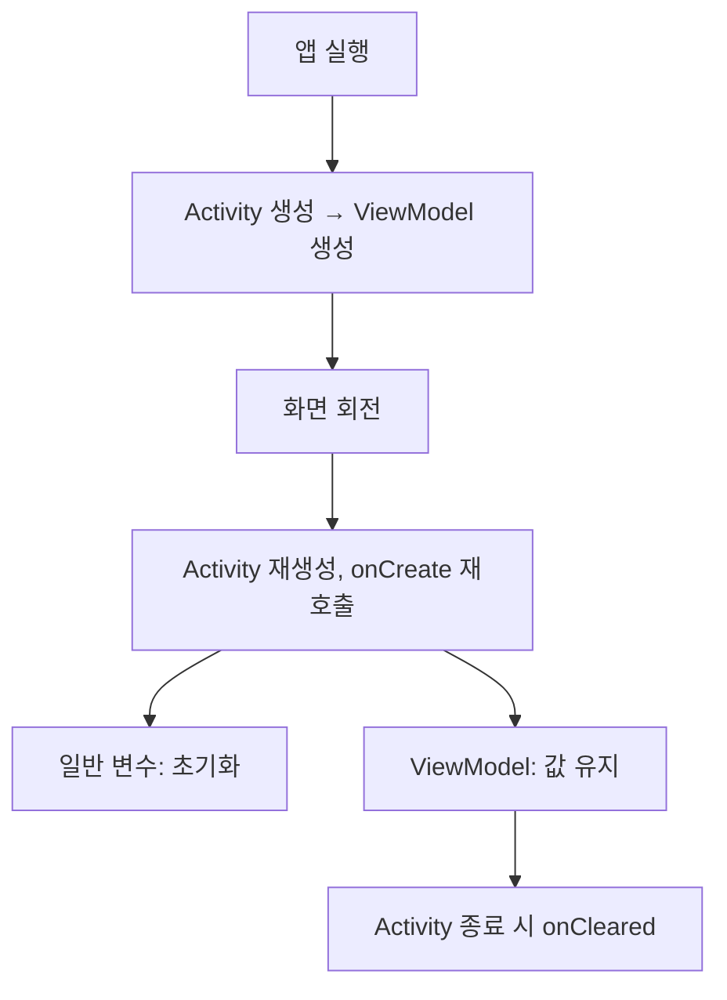
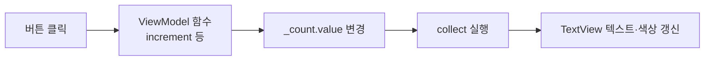

# 12주차 실습 정리: ViewModel과 StateFlow

---

## 1. 한눈에 보는 오늘 내용

| 구분 | 내용 |
|---|---|
| 목표 | 화면 회전 후에도 카운터 값 유지 |
| 핵심 개념 | `ViewModel`, `StateFlow`, `lifecycleScope`, `repeatOnLifecycle` |
| 새 파일 | `CounterViewModel.kt` |
| 수정 파일 | `MainActivity.kt`, `activity_main.xml`, `build.gradle.kts` |
| 데이터 저장 위치 | 메모리 (Room DB 미사용) |
| 앱 구조 | 단일 Activity + ViewModel |
| 필수 설정 | `viewBinding = true`, lifecycle·coroutines 의존성 |

- **변경 범위**: 11주차 DB 코드를 쓰지 않고 상태 관리만 학습
- **11주차와의 차이**: 영구 저장(DB)이 아니라 앱 실행 중 상태 유지

---

## 2. 11주차 복습: 코드 다이어트

### 10주차 vs 11주차 코드

| 항목 | 10주차 (강사 코드) | 11주차 (AppWeek11) |
|---|---|---|
| 폴더 구조 | `data/` 패키지 분리 | 한 폴더에 5개 파일 |
| 레이아웃 | Linear, Grid 2열, Grid 3열 전환 | Linear만 사용 |
| 클릭 처리 | `handleItemClick` 함수 호출 | 람다 안에 직접 작성 |
| 핵심 기술 | Room, Flow, 코루틴, RecyclerView | 동일 |
| 코드 줄 수 | 약 264줄 | 약 100줄 감소 |

- **핵심 구조**: 두 버전의 아키텍처 동일, 표현 방식만 다름

### `suspend` 함수와 일반 함수

> **쉬운 정의:** `suspend`는 "급하지 않으니 메인 작업을 방해하지 않게 뒤에서 처리해 줘"라고 표시하는 키워드

- **일반 함수**: 메인 스레드에서 호출 순서대로 실행
- **`suspend` 함수**: 코루틴 안에서 실행, 메인 스레드를 막지 않음
- **적용 기준**

| 함수 | 반환 | suspend | 이유 |
|---|---|---|---|
| `getAllStudents()` | `Flow<List<Student>>` | 없음 | 변경 시 바로 화면 갱신 |
| `insertStudent`, `insertAllStudents` | - | 있음 | 늦게 처리해도 무방 |
| `updateStudent` | - | 있음 | 늦게 처리해도 무방 |
| `deleteStudent`, `deleteAllStudents` | - | 있음 | 늦게 처리해도 무방 |
| `getStudentById` | `Student?` | 있음 | 단건 조회 |

### 코루틴

> **쉬운 정의:** 코루틴은 스레드를 막지 않고 "잠깐 멈췄다 이어서" 실행하는 가벼운 작업 단위

- **코루틴**: 스레드 위에서 실행되는 일시 중단 가능한 작업 단위, 흔히 경량 스레드라고 부름
- **`launch`**: 새 비동기 작업을 시작하는 코루틴 빌더, non-blocking
- **위치**: `androidx` 전용이 아닌 `kotlinx` 공용 라이브러리, 백엔드·데스크톱에서도 사용

### Flow와 `collect`

> **쉬운 정의:** Flow는 값이 계속 흘러오는 수도관이고, `collect`는 그 수도관 끝에서 물을 받는 수도꼭지

- **Flow**: 값이 계속 흘러오는 비동기 데이터 스트림, 변경 시 `emit`
- **`collect`**: Flow가 방출하는 값을 구독하는 suspend 함수

### Room과 RecyclerView

> **쉬운 정의:** Room은 SQLite를 코틀린 클래스처럼 쓰게 감싼 도구이고, RecyclerView는 화면에 보이는 칸만 만들어 두고 스크롤할 때 칸을 재활용하는 목록 위젯

- **Room**: SQLite를 추상화한 래퍼, NumPy 위의 Pandas와 같은 관계
- **RecyclerView**: 화면에 보이는 항목만 로딩, ListView 대비 성능 우위
- **Adapter 필수 오버라이드 3개**
  - `onCreateViewHolder`: 항목 레이아웃 생성
  - `onBindViewHolder`: 데이터 바인딩
  - `getItemCount`: 항목 개수 반환

---

## 3. ViewModel과 StateFlow

### 문제 상황

> **쉬운 정의:** 구성 변경은 화면을 돌리는 것처럼 앱의 환경이 바뀌어서 Activity가 부서졌다가 새로 만들어지는 일

- **화면 회전**: 구성 변경(Configuration Change) 발생
- **Activity**: 재생성되어 `onCreate`가 다시 호출됨
- **일반 변수**: 값 초기화 (카운트 0으로 리셋)
- **6주차 카운터 앱**: 같은 문제를 가진 레거시 코드



### ViewModel

> **쉬운 정의:** ViewModel은 Activity가 부서졌다 다시 만들어져도 값을 대신 들고 있어 주는 별도 보관함

- **ViewModel**: UI 상태를 관리하는 클래스, 구성 변경에서 살아남음
- **특징**
  - Activity 라이프사이클 준수
  - 구성 변경 후에도 데이터 유지
  - 필요할 때 생성, 불필요하면 해제 (메모리 효율)
  - 비즈니스 로직과 UI 로직 분리 (UI 코드 없음)
  - Activity와 독립적으로 존재

### StateFlow

> **쉬운 정의:** StateFlow는 "지금 값이 뭔지" 항상 기억하고 있다가, 값이 바뀌면 구독자에게 알려 주는 전광판

- **Flow**: 신호를 계속 받기만 하는 스트림, 라디오 채널에 비유
- **StateFlow**: 현재 상태를 기억하는 Flow, 초기값 필수
- **`MutableStateFlow`**: 값 변경 가능 (가변, `mutable`)
- **`StateFlow`**: 읽기 전용 (불변, `immutable`)
- **`asStateFlow()`**: 가변을 읽기 전용으로 형 변환

> **쉬운 정의:** 안쪽 열쇠(`_count`)로는 값을 고칠 수 있고, 바깥에는 유리창(`count`)만 열어 두어 보기만 가능하게 한 구조

| import 3종 | 패키지 |
|---|---|
| `MutableStateFlow` | `kotlinx.coroutines.flow` |
| `StateFlow` | `kotlinx.coroutines.flow` |
| `asStateFlow` | `kotlinx.coroutines.flow` |

---

## 4. 실습 1: 프로젝트 생성

- **프로젝트 생성**: New Project → Empty Views Activity
- **이름**: `AppWeek12`
- **패키지**: `com.appweek12`
- **SDK**: minSdk 26, compileSdk 36

---

## 5. 실습 2: `build.gradle.kts` 설정

> **쉬운 정의:** `viewBinding`은 XML의 `id`를 `binding.textViewCount`처럼 코드에서 바로 쓰게 해 주는 연결 도구

초기 상태에서 빌드하면 `ActivityMainBinding`과 `viewModels`를 찾지 못하는 에러 발생. 아래 항목 추가로 해결.

```kotlin
android {
    // ...
    buildFeatures {
        viewBinding = true   // ActivityMainBinding 자동 생성
    }
}

dependencies {
    implementation(libs.androidx.core.ktx)
    implementation(libs.androidx.appcompat)
    implementation(libs.material)
    implementation(libs.androidx.activity)
    implementation(libs.androidx.constraintlayout)

    // ViewModel, StateFlow
    val lifecycleVersion = "2.7.0"   // 버전 변수: 업데이트 시 숫자 한 곳만 수정
    val coroutineVersion = "1.7.3"
    implementation("androidx.lifecycle:lifecycle-viewmodel-ktx:$lifecycleVersion")      // ViewModel 클래스
    implementation("androidx.lifecycle:lifecycle-runtime-ktx:${lifecycleVersion}")      // lifecycleScope, repeatOnLifecycle
    implementation("androidx.activity:activity:1.8.1")                                  // by viewModels() 위임
    implementation("org.jetbrains.kotlinx:kotlinx-coroutines-android:${coroutineVersion}") // 코루틴, Flow

    testImplementation(libs.junit)
    androidTestImplementation(libs.androidx.junit)
    androidTestImplementation(libs.androidx.espresso.core)
}
```

- **`viewBinding = true`**: `ActivityMainBinding` 클래스 자동 생성
- **버전 변수**: 업데이트 시 숫자 한 곳만 수정
- **추가 의존성 역할**

| 의존성 | 역할 |
|---|---|
| `lifecycle-viewmodel-ktx` | `ViewModel` 클래스 |
| `lifecycle-runtime-ktx` | `lifecycleScope`, `repeatOnLifecycle` |
| `activity` | `by viewModels()` 위임 |
| `kotlinx-coroutines-android` | 코루틴, Flow |

---

## 6. 실습 3: `CounterViewModel.kt`

```kotlin
package com.appweek12

import kotlinx.coroutines.flow.MutableStateFlow
import kotlinx.coroutines.flow.StateFlow
import kotlinx.coroutines.flow.asStateFlow
import androidx.lifecycle.ViewModel

// ViewModel 상속: 화면 회전에도 값 유지, UI 코드 없이 로직만 담당
class CounterViewModel : ViewModel() {

    // 가변 상태: ViewModel 안에서만 수정 (초기값 0, 다른 값도 가능)
    private val _count = MutableStateFlow(0)

    // 읽기 전용 상태: Activity는 읽기만 가능 (asStateFlow로 형 변환)
    val count: StateFlow<Int> = _count.asStateFlow()

    // +1
    fun increment() {
        _count.value += 1
    }

    // -1
    fun decrement() {
        _count.value -= 1
    }

    // 0으로 초기화
    fun reset() {
        _count.value = 0
    }

    // +10
    fun incrementBy10() {
        _count.value += 10
    }
}
```

- **`_count`**: ViewModel 내부에서만 수정 가능한 가변 상태
- **`count`**: Activity가 읽기만 가능한 공개 상태
- **초기값**: `MutableStateFlow(0)`의 `0`, 임의 값 지정 가능 (수업 중 899로 변경 테스트)
- **함수 4개**: 모두 `_count.value`만 변경, `count`는 건드리지 않음
- **UI 코드 없음**: 백엔드 로직만 포함

---

## 7. 실습 4: `activity_main.xml`

- **구성**: 세로 `LinearLayout`
  - 제목 `TextView` ("Counter App")
  - 카운트 `TextView` (`@+id/textViewCount`, 72sp, 기본 파랑 `#2196F3`)
  - 가로 버튼 행: `buttonMinus`, `buttonPlus`, `buttonReset` (`layout_weight` 균등 분할)
  - `buttonPlus10`
  - 하단 라벨 "StateFlow"

```xml
<!-- 카운트 표시: 코드에서 binding.textViewCount로 접근 -->
<TextView
    android:id="@+id/textViewCount"
    android:layout_width="match_parent"
    android:layout_height="wrap_content"
    android:text="0"
    android:textSize="72sp"
    android:textStyle="bold"
    android:gravity="center"
    android:layout_marginBottom="32dp"
    android:textColor="#2196F3" />   <!-- 기본 파랑, 실행 중 when 분기로 색 변경 -->
```

- **버튼 ID 4개**: `buttonMinus`, `buttonPlus`, `buttonReset`, `buttonPlus10`
- **은행 앱 비유**: 1만 원, 10만 원씩 더하는 버튼과 같은 용도

---

## 8. 실습 5: `MainActivity.kt`

```kotlin
package com.appweek12

import android.graphics.Color
import android.os.Bundle
import androidx.activity.viewModels
import androidx.appcompat.app.AppCompatActivity
import androidx.lifecycle.Lifecycle
import androidx.lifecycle.lifecycleScope
import androidx.lifecycle.repeatOnLifecycle
import com.appweek12.databinding.ActivityMainBinding
import kotlinx.coroutines.launch

class MainActivity : AppCompatActivity() {
    private lateinit var binding: ActivityMainBinding

    // by viewModels(): ViewModel 자동 생성과 라이프사이클 관리 (회전해도 기존 객체 재사용)
    private val viewModel: CounterViewModel by viewModels()

    override fun onCreate(savedInstanceState: Bundle?) {
        super.onCreate(savedInstanceState)
        binding = ActivityMainBinding.inflate(layoutInflater)
        setContentView(binding.root)

        setupObservers()   // 상태 관찰 시작
        setupListeners()   // 버튼 이벤트 연결
    }

    private fun setupObservers() {
        // lifecycleScope.launch: Activity 라이프사이클에 묶인 코루틴 시작
        lifecycleScope.launch {
            // repeatOnLifecycle(STARTED): 시작 상태일 때만 관찰, 중지되면 자동 취소
            repeatOnLifecycle(Lifecycle.State.STARTED) {
                // collect: count 값이 바뀔 때마다 실행
                viewModel.count.collect { count ->
                    binding.textViewCount.text = count.toString()

                    // when 색상 분기: 양수 초록, 음수 빨강, 0 검정 (학습용 장식)
                    when {
                        count > 0 -> binding.textViewCount.setTextColor(Color.GREEN)
                        count < 0 -> binding.textViewCount.setTextColor(Color.RED)
                        else -> binding.textViewCount.setTextColor(Color.BLACK)
                    }
                }
            }
        }
    }

    // setupListeners: 버튼 클릭 → ViewModel 함수 호출
    private fun setupListeners() {
        binding.buttonPlus.setOnClickListener { viewModel.increment() }
        binding.buttonMinus.setOnClickListener { viewModel.decrement() }
        binding.buttonReset.setOnClickListener { viewModel.reset() }
        binding.buttonPlus10.setOnClickListener { viewModel.incrementBy10() }
    }
}
```

### 구성 요소 정리

> **쉬운 정의:** `by viewModels()`는 ViewModel을 직접 만들지 않고 "있으면 기존 것을, 없으면 새로" 받아 오는 방법

> **쉬운 정의:** `lifecycleScope`는 Activity와 수명을 같이하는 코루틴 작업장이고, `repeatOnLifecycle(STARTED)`는 화면이 보이는 동안에만 관찰하게 하는 스위치

- **`by viewModels()`**: ViewModel 자동 생성과 라이프사이클 관리
- **`lifecycleScope.launch`**: Activity 라이프사이클에 묶인 코루틴 시작
- **`repeatOnLifecycle(STARTED)`**: 시작 상태일 때만 관찰, 중지되면 자동 취소
- **`collect`**: `count` 값이 바뀔 때마다 실행
- **`when` 색상 분기**: 양수 초록, 음수 빨강, 0 검정 (학습용 장식)
- **`setupListeners`**: 버튼 클릭 → ViewModel 함수 호출

### 데이터 흐름



---

## 9. 실행과 검증

- **실행 순서**
  - Build → Rebuild Project 후 실행
  - `+` 여러 번, `+10`, `-`로 값 변경
  - 화면 회전 후 값 유지 확인
  - Reset 후 검정색 복귀 확인
- **기대 결과**: 회전해도 `0`으로 돌아가지 않음
- **비교 실험**: 6주차 레거시 카운터 앱은 회전 시 0으로 초기화
- **확인 포인트**: 값은 `onCreate`가 아니라 ViewModel의 `StateFlow`가 보관

---

## 10. 자주 하는 실수

| 실수 | 올바른 방법 |
|---|---|
| `CounterViewModel()` 직접 생성 | `by viewModels()` 사용 |
| ViewModel에 Activity·Context 참조 | 순수 로직만 작성 (메모리 누수 방지) |
| `repeatOnLifecycle` 없이 `collect` | 라이프사이클에 맞춰 수집 |
| `_count`를 외부에 공개 | `count`로 읽기 전용 공개 |
| 의존성·`viewBinding` 누락 | `build.gradle.kts` 먼저 확인 후 Sync |

---

## 11. 11주차 vs 12주차

| 항목 | 11주차 | 12주차 |
|---|---|---|
| 핵심 기술 | Room + Flow | ViewModel + StateFlow |
| 데이터 저장 | 디스크 (영구) | 메모리 (앱 실행 중) |
| UI 갱신 시점 | DB 데이터 변경 | 상태 변경 |
| 구성 변경 | Activity 재생성 시 DB에서 재조회 | ViewModel이 값 보존 |
| 복잡도 | 중간 | 낮음 (개념 학습용) |

---

## 12. 13주차 예고

| 항목 | 13A (XML) | 13B (Compose) |
|---|---|---|
| Activity 상속 | `AppCompatActivity` | `ComponentActivity` |
| 레이아웃 | XML + ViewBinding | `@Composable` 함수 |
| 목록 위젯 | RecyclerView + Adapter | `LazyColumn` + `items` |
| 입력 위젯 | `EditText` | `TextField` |
| 상태 관찰 | `setupObservers` | `collectAsState` |
| UI 갱신 | `updateList` 수동 호출 | 리컴포지션 자동 |
| 코드량 | 약 400줄 | 약 150줄 감소 |

- **동일한 계층**: `Student`, `StudentDao`, `StudentDatabase`, `StudentRepository`, `StudentViewModel`
- **다른 계층**: UI 계층만 교체
- **XML 학습 이유**: 레거시 앱 유지보수, 하이브리드 마이그레이션 프로젝트 대응

---

## 13. 시험 대비 핵심 용어

- **구성 변경**: 화면 회전 등으로 Activity가 재생성되는 상황
- **`suspend`**: 코루틴 안에서만 호출 가능한 일시 중단 함수
- **`Flow`**: 값이 계속 흘러오는 비동기 데이터 스트림, 변경 시 `emit`
- **`StateFlow`**: 현재 값을 보관하는 Flow, 초기값 필요
- **`ViewModel`**: UI 상태 보존과 로직 분리 담당
- **`lifecycleScope`**: Activity 라이프사이클에 묶인 코루틴 스코프
- **`repeatOnLifecycle`**: 지정한 라이프사이클 상태에서만 블록 반복 실행
- **non-blocking**: 호출한 스레드를 막지 않는 방식

