# 백엔드 실무 Week01~09 통합 정리

웹 통신의 기초부터 Servlet·JSP·JDBC를 거쳐 Spring Boot·JPA 게시판까지, 9주 동안 배운 내용을 학습 순서대로 한 문서에 통합한 정리

> 여러 주차에 반복 등장한 주제(HTTP, 상태 코드, GET·POST, forward·redirect, MVC, DTO·DAO, 빌드 도구, 인터페이스, 3계층, `@Controller`·`@RestController`)는 처음 배운 위치 한 곳으로 통합
>
> 자동 전사에서 잘못 인식된 용어는 공식 명칭으로 보정하고, 강의의 단순화된 설명과 실제 기술 동작이 다른 부분은 `기술 보정`으로 구분
>
> 7~9주차 실습 코드는 `~/springworkspace/articleProjectC` 프로젝트 기준. 이름·학번은 `이름 학번`으로 대체

## 목차

- [학습 로드맵](#학습-로드맵)
  - [0. 학습 순서와 주제 연결](#0-학습-순서와-주제-연결)
- [1부 웹 동작 원리 · Week01](#1부-웹-동작-원리--week01)
  - [1. 웹 프로그램 구조](#1-웹-프로그램-구조)
  - [2. HTTP 메시지](#2-http-메시지)
  - [3. HTTP 상태 코드](#3-http-상태-코드)
  - [4. 로그인 요청 예시](#4-로그인-요청-예시)
- [2부 Java 기초 · Week02](#2부-java-기초--week02)
  - [5. 클래스와 객체](#5-클래스와-객체)
  - [6. Java 패키지](#6-java-패키지)
  - [7. 객체지향의 세 가지 특징](#7-객체지향의-세-가지-특징)
  - [8. 업캐스팅과 다운캐스팅](#8-업캐스팅과-다운캐스팅)
  - [9. 싱글톤 패턴](#9-싱글톤-패턴)
  - [10. 오버로딩과 오버라이딩](#10-오버로딩과-오버라이딩)
  - [11. 추상 클래스와 인터페이스](#11-추상-클래스와-인터페이스)
  - [12. static](#12-static)
  - [13. 트랜잭션](#13-트랜잭션)
- [3부 MVC와 Servlet · Week02~03](#3부-mvc와-servlet--week0203)
  - [14. MVC 모델](#14-mvc-모델)
  - [15. HTTP 메서드와 CRUD](#15-http-메서드와-crud)
  - [16. URL과 파라미터](#16-url과-파라미터)
  - [17. Servlet과 관련 기술](#17-servlet과-관련-기술)
  - [18. Servlet Container와 생명주기](#18-servlet-container와-생명주기)
  - [19. URL Mapping](#19-url-mapping)
  - [20. HttpServletRequest와 Filter](#20-httpservletrequest와-filter)
- [4부 JSP 스코프와 화면 이동 · Week04](#4부-jsp-스코프와-화면-이동--week04)
  - [21. 요청 바디와 JSP 실행 결과](#21-요청-바디와-jsp-실행-결과)
  - [22. JSP 스코프](#22-jsp-스코프)
  - [23. forward와 redirect](#23-forward와-redirect)
  - [24. 로그인 Form·Controller 예시](#24-로그인-formcontroller-예시)
  - [25. Week04 헷갈리는 표현](#25-week04-헷갈리는-표현)
- [5부 서비스 데이터 설계 · Week05](#5부-서비스-데이터-설계--week05)
  - [26. 프론트엔드·백엔드·데이터베이스](#26-프론트엔드백엔드데이터베이스)
  - [27. 이미지 저장 전략](#27-이미지-저장-전략)
- [6부 DB 연동: DTO·DAO·JDBC · Week06](#6부-db-연동-dtodaojdbc--week06)
  - [28. DB 연동 전체 흐름](#28-db-연동-전체-흐름)
  - [29. DTO](#29-dto)
  - [30. 여러 레코드와 컬렉션](#30-여러-레코드와-컬렉션)
  - [31. 회원가입 요청 흐름](#31-회원가입-요청-흐름)
  - [32. DAO](#32-dao)
  - [33. JDBC와 Connector/J](#33-jdbc와-connectorj)
  - [34. 예외 처리](#34-예외-처리)
  - [35. JDBC 4단계](#35-jdbc-4단계)
  - [36. PreparedStatement](#36-preparedstatement)
  - [37. SQL 실행 메서드](#37-sql-실행-메서드)
  - [38. ResultSet](#38-resultset)
  - [39. Controller에서 DAO로 분리](#39-controller에서-dao로-분리)
  - [40. 로그인 구현](#40-로그인-구현)
  - [41. 세션과 메뉴 처리](#41-세션과-메뉴-처리)
  - [42. 과제 요구사항](#42-과제-요구사항)
  - [43. Servlet 프로젝트 구조](#43-servlet-프로젝트-구조)
  - [44. 빌드 도구와 의존성](#44-빌드-도구와-의존성)
- [7부 3계층과 Spring MVC · Week07](#7부-3계층과-spring-mvc--week07)
  - [45. 엔터프라이즈 3계층](#45-엔터프라이즈-3계층)
  - [46. DTO·VO·Entity](#46-dtovoentity)
  - [47. Servlet MVC와 Spring MVC](#47-servlet-mvc와-spring-mvc)
  - [48. Spring MVC 처리 흐름](#48-spring-mvc-처리-흐름)
  - [49. Model과 ModelAndView](#49-model과-modelandview)
  - [50. Spring Framework와 Spring Boot](#50-spring-framework와-spring-boot)
- [8부 Spring Boot 프로젝트 · Week08](#8부-spring-boot-프로젝트--week08)
  - [51. 프로젝트 생성](#51-프로젝트-생성)
  - [52. 프로젝트 폴더 구조](#52-프로젝트-폴더-구조)
  - [53. 설정 파일](#53-설정-파일)
  - [54. 템플릿 엔진](#54-템플릿-엔진)
  - [55. Spring Bean과 계층 어노테이션](#55-spring-bean과-계층-어노테이션)
  - [56. @Controller와 @RestController](#56-controller와-restcontroller)
  - [57. 요청 매핑 어노테이션](#57-요청-매핑-어노테이션)
  - [58. 화면 이동 실습](#58-화면-이동-실습)
- [9부 게시판 글쓰기와 JPA · Week09](#9부-게시판-글쓰기와-jpa--week09)
  - [59. Bootstrap과 CDN](#59-bootstrap과-cdn)
  - [60. 공통 레이아웃 분리](#60-공통-레이아웃-분리)
  - [61. 게시판 컨트롤러와 글쓰기 폼](#61-게시판-컨트롤러와-글쓰기-폼)
  - [62. 폼 데이터 바인딩](#62-폼-데이터-바인딩)
  - [63. DTO와 getter·setter·Lombok](#63-dto와-gettersetterlombok)
  - [64. JPA 개요](#64-jpa-개요)
  - [65. JPA Entity 작성](#65-jpa-entity-작성)
  - [66. 다음 수업과 시험 일정](#66-다음-수업과-시험-일정)
- [10부 실습 프로젝트 구조 · Week07~09](#10부-실습-프로젝트-구조--week0709)
  - [67. 주차별 프로젝트 변화](#67-주차별-프로젝트-변화)
  - [68. articleProjectC 전체 트리](#68-articleprojectc-전체-트리)
- [11부 시험 대비](#11부-시험-대비)
  - [69. 출제 강조 총정리](#69-출제-강조-총정리)
  - [70. 헷갈리는 개념 비교](#70-헷갈리는-개념-비교)
  - [71. 기술 보정 모음](#71-기술-보정-모음)
  - [72. JDBC·Java 핵심 용어](#72-jdbcjava-핵심-용어)
  - [73. 최종 암기 흐름](#73-최종-암기-흐름)
  - [74. 예상 문제](#74-예상-문제)
  - [75. 최종 체크리스트](#75-최종-체크리스트)
  - [76. 한눈에 보는 핵심](#76-한눈에-보는-핵심)

---

## 학습 로드맵

### 0. 학습 순서와 주제 연결

#### 0.1 한 줄 흐름

```text
웹 요청·응답(HTTP) → Java 객체지향 → MVC·Servlet → JSP 스코프·화면 이동
→ 서비스 데이터 설계 → JDBC·DTO·DAO → 3계층·Spring MVC → Spring Boot 프로젝트
→ Mustache 레이아웃·게시판 폼·JPA Entity
```

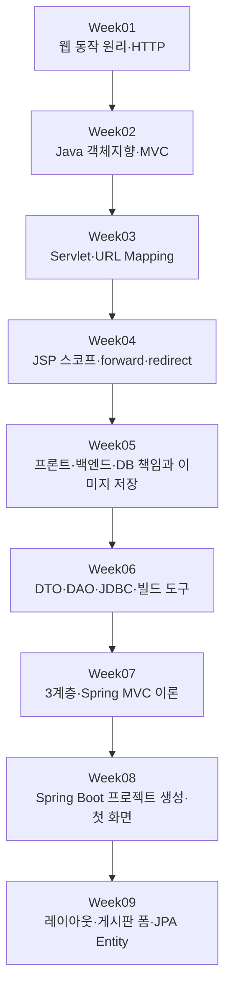

#### 0.2 주차별 학습 목표와 연결

| 주차 | 핵심 주제 | 이 주차에서 답할 질문 | 다음 주차와의 연결 |
| --- | --- | --- | --- |
| Week01 | 웹 프로그램, HTTP 메시지, 상태 코드 | 브라우저와 서버는 무엇을 주고받는가 | 요청을 처리할 Java 코드 필요 |
| Week02 | 클래스·객체, 상속·다형성·캡슐화, 오버로딩·오버라이딩, MVC | 서버 코드를 어떤 구조로 나누는가 | MVC의 Controller를 Servlet으로 구현 |
| Week03 | Servlet, Container, 생명주기, URL Mapping, Filter | 요청 URL이 어떻게 Java 메서드에 도착하는가 | 처리 결과를 화면에 넘기는 방법 필요 |
| Week04 | request 정보, JSP 4개 영역, forward·redirect | 처리 결과를 어디에 저장하고 어떻게 화면을 바꾸는가 | 영구 저장은 DB가 담당 |
| Week05 | 프론트·백엔드·DB 책임, 이미지 저장 전략 | 데이터는 어느 계층이 저장·보호하는가 | 백엔드에서 DB에 접근하는 코드 필요 |
| Week06 | DTO, DAO, JDBC 4단계, PreparedStatement, ResultSet, Maven·Gradle | Java 코드가 DB에 어떻게 저장·조회하는가 | 반복 코드를 프레임워크가 대신 처리 |
| Week07 | 엔터프라이즈 3계층, Servlet MVC와 Spring MVC, Gradle | Spring은 요청을 어떤 순서로 처리하는가 | 실제 Spring Boot 프로젝트 생성 |
| Week08 | Spring Initializr, 폴더 구조, 설정 파일, Bean, `@GetMapping`, Mustache | Spring Boot에서 첫 화면을 어떻게 띄우는가 | 공통 레이아웃과 게시판 기능 확장 |
| Week09 | Bootstrap, Mustache Partial, 글쓰기 폼, DTO 바인딩, JPA Entity | 폼 데이터를 받아 DB 저장을 어떻게 준비하는가 | Repository로 실제 DB 저장 (Week10) |

#### 0.3 같은 개념이 기술만 바뀌어 반복되는 구조

| 역할 | Servlet·JSP (Week03~06) | Spring Boot (Week07~09) |
| --- | --- | --- |
| 요청 접수 | Servlet Container의 URL Mapping | `DispatcherServlet` + `HandlerMapping` |
| URL 연결 | `@WebServlet("/login.do")` | `@GetMapping("/")`, `@PostMapping("/article/new")` |
| 파라미터 수신 | `request.getParameter("id")` | 매개변수 DTO 자동 바인딩 |
| 데이터 운반 | `UsersDTO` | `ArticleDTO`, `ArticleEntity` |
| DB 접근 | `UsersDAO` + JDBC 4단계 | Repository (JPA) |
| 화면 | JSP | Mustache |
| 공통 화면 포함 | `<%@ include %>` | `{{>layouts/header}}` |
| 화면 이동 | `forward()`, `sendRedirect()` | 뷰 이름 반환, `"redirect:/"` |
| 라이브러리 | JAR 직접 복사 (`WEB-INF/lib`) | `build.gradle` 의존성 선언 |

#### 0.4 중복 주제의 통합 위치

| 주제 | 등장 주차 | 통합 위치 |
| --- | --- | --- |
| HTTP 메시지 구조·시작줄 | Week01, 04, 08, 09 | 2장 |
| 상태 코드 | Week01, 08, 09 | 3장 |
| 추상 클래스·인터페이스 | Week08, 09 | 11장 |
| MVC 모델 | Week02, 06, 07 | 14장 |
| HTTP 메서드·CRUD·GET 발생 상황 | Week02, 03, 08, 09 | 15장 |
| URL·URI·파라미터 | Week03, 08, 09 | 16장 |
| forward·redirect | Week04, 08, 09 | 23장 |
| DTO | Week06, 07, 09 | 29장, 46장 |
| 빌드 도구·의존성 | Week02, 06, 07, 09 | 44장 |
| 3계층·DataSource | Week07, 08 | 45장 |
| Spring MVC 처리 흐름·ViewResolver | Week07, 08, 09 | 48장 |
| Bean·계층 어노테이션 | Week08, 09 | 55장 |
| `@Controller`·`@RestController` | Week07, 08, 09 | 56장 |

---

## 1부 웹 동작 원리 · Week01

### 1. 웹 프로그램 구조

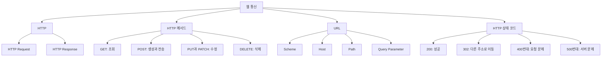

#### 1.1 클라이언트·서버 요청/응답

**웹 프로그램**: 클라이언트가 서버에 요청을 보내고 서버가 처리 결과를 응답하는 구조

```text
사용자
  ↓
클라이언트(브라우저)
  ↓ HTTP Request
서버
  ↓
Servlet
  ↔ Database
  ↓ HTTP Response
클라이언트 화면 표시
```

##### 1.1.1 클라이언트 역할

- 사용자의 입력 수집
- 서버에 HTTP 요청 전송
- 서버의 응답을 화면에 표시

##### 1.1.2 서버 역할

- 요청과 입력값 검증
- 로그인과 사용자 권한 확인
- 서비스 기능 실행
- 데이터베이스 조회 또는 수정
- 처리 결과 반환
- 중요 데이터와 시스템 보호

### 2. HTTP 메시지

#### 2.1 HTTP

**HTTP(Hypertext Transfer Protocol)**: 브라우저와 서버가 요청과 응답을 주고받기 위한 통신 규칙

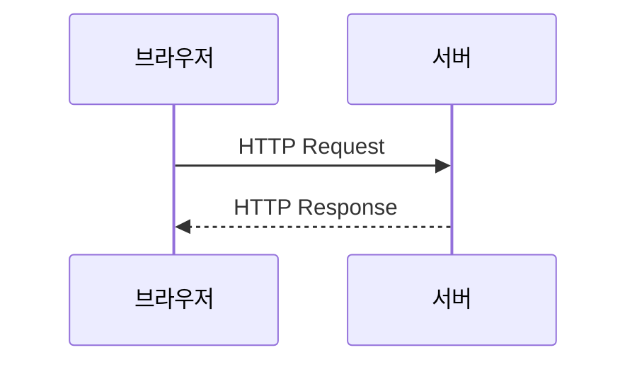

#### 2.2 HTTP 메시지와 HTTP 메서드

**HTTP 메시지**: 클라이언트와 서버가 주고받는 요청 또는 응답 데이터 전체

**HTTP 메서드**: 서버에 요청할 동작의 종류를 나타내는 시작줄의 항목

```text
HTTP 메시지 = 봉투 전체
HTTP 메서드 = 봉투 앞면의 용건
```

HTTP 요청 예시

```http
POST /myapp/login.do HTTP/1.1
Host: localhost:8080
Content-Type: application/x-www-form-urlencoded
Content-Length: 21

id=hong&password=1234
```

요청 메시지 구조

```text
시작줄: 요청 메서드 + 경로 + HTTP 버전
헤더: 요청의 부가 정보
빈 줄: 헤더와 바디의 경계
바디: 서버로 보낼 데이터
```

일반화한 요청 구성

```text
HTTP 요청
├── Method : GET, POST, PUT, PATCH, DELETE
├── URL    : /members
├── Header : 요청 부가 정보
└── Body   : 서버로 전달할 데이터
```

HTTP 응답 구성

```text
HTTP 응답
├── Status Code : 200, 404, 500
├── Header      : 응답 부가 정보
└── Body        : HTML, JSON 등의 결과
```

응답 예시

```http
HTTP/1.1 200 OK
Content-Type: text/html; charset=UTF-8

<!doctype html>
<html>
<body>로그인 성공</body>
</html>
```

JSON 응답 예시

```json
{
  "success": true,
  "message": "로그인 성공"
}
```

#### 2.3 요청과 응답의 시작줄 비교

| 구분 | 요청 시작줄 | 응답 시작줄 |
| --- | --- | --- |
| 예시 | `GET /intro HTTP/1.1` | `HTTP/1.1 200 OK` |
| 첫 항목 | HTTP 메서드 | HTTP 버전 |
| 둘째 항목 | 요청 대상(경로) | 상태 코드 |
| 셋째 항목 | HTTP 버전 | 이유 문구 |
| HTTP 메서드 | 포함 | **없음** |

- 요청 메시지의 시작줄에는 HTTP 메서드 정보가 담겨 백엔드로 전달
- 응답 메시지에는 HTTP 메서드가 필요 없고 대신 **상태 코드(status)**가 핵심
- 클라이언트(브라우저·React)가 응답에서 가장 먼저 받는 부분이 시작줄 → 상태 코드로 처리 결과 판단

```text
HTTP 메시지 구성
1. 시작줄 (Start Line)
2. 헤더 (Headers)      : Host, Content-Type 등 부가 정보
3. 빈 줄              : 헤더와 바디 구분
4. 바디 (Body)        : HTML, JSON, 폼 데이터. 없을 수도 있음
```

> 기술 보정: 강의 중 "응답 시작줄에 클라이언트 URL 주소가 들어간다"는 설명은 부정확. HTTP/1.1 응답 시작줄은 HTTP 버전·상태 코드·이유 문구로 구성되며, redirect 대상 주소는 `Location` 헤더에 포함

### 3. HTTP 상태 코드

#### 3.1 범위별 의미

| 범위 | 의미 | 대표 코드 |
| --- | --- | --- |
| `1xx` | 정보성 응답 | `100 Continue` |
| `2xx` | 성공 | `200 OK`, `201 Created` |
| `3xx` | 리다이렉션 | `301 Moved Permanently`, `302 Found`, `307`, `308` |
| `4xx` | 클라이언트 측 요청 오류 | `400`, `401`, `403`, `404` |
| `5xx` | 서버 측 오류 | `500`, `503` |

#### 3.2 주요 코드

| 코드 | 의미 | 대표 상황 |
| --- | --- | --- |
| `200` | 요청 성공 | 화면·데이터 정상 응답 |
| `201` | 생성 성공 | REST API에서 새 자원 생성 |
| `302` | 다른 URL로 임시 이동 | redirect 응답 |
| `400` | 잘못된 요청 | 필수 값 누락, 형식 오류 |
| `401` | 인증 실패 | 로그인 필요 |
| `403` | 권한 없음 | 로그인했지만 접근 권한 부족 |
| `404` | 요청 자원 없음 | 없는 주소 요청 |
| `500` | 서버 내부 오류 | 서버 코드 예외 |

#### 3.3 클라이언트의 해석 (Week09)

- `200`: 요청한 처리가 성공
- `404`: 요청 실패. 클라이언트가 없는 주소를 요청한 경우
- `500`: 서버 문제로 요청한 처리를 수행하지 못함
- `302`: redirect 응답. 응답에 적힌 주소로 즉시 재요청

> 시험 핵심: `200` 성공 / `302` 리다이렉트 / `404` 자원 없음 / `500` 서버 오류
>
> 모든 `4xx`가 단순히 사용자의 잘못이라는 뜻은 아님. 요청 형식·인증·권한·자원 상태 등 요청 쪽 문제를 의미

### 4. 로그인 요청 예시

#### 4.1 로그인 HTTP 요청 예시

```http
POST /login
Content-Type: application/x-www-form-urlencoded

username=admin&password=1234
```

```text
1. 아이디와 비밀번호 입력
2. POST /login 요청
3. Servlet Container에서 LoginServlet 선택
4. LoginServlet에서 입력값 확인
5. DB에서 사용자 정보 조회
6. 로그인 성공 시 Session 생성
7. 메인 화면 또는 처리 결과 반환
```

간단한 로그인 Servlet 예시

```java
@WebServlet("/login")
public class LoginServlet extends HttpServlet {

    @Override
    protected void doPost(
            HttpServletRequest request,
            HttpServletResponse response
    ) throws IOException {

        String username = request.getParameter("username");
        String password = request.getParameter("password");

        // 학습용 고정 조건
        // 실제 서비스에서는 DB 조회와 Password Hash 검증 필요
        boolean loginSuccess =
            username.equals("admin") &&
            password.equals("1234");

        if (loginSuccess) {
            HttpSession session = request.getSession();
            session.setAttribute("username", username);

            response.sendRedirect("/main");
        } else {
            response.sendRedirect("/login?error=true");
        }
    }
}
```

---

## 2부 Java 기초 · Week02

### 5. 클래스와 객체

#### 5.1 클래스와 객체

```text
클래스 = 객체 생성을 위한 설계도
객체   = 클래스를 기반으로 실제 생성한 대상
객체   = 필드 + 메서드
```

클래스 예시

```java
class Person {

    String name;
    int age;

    void eat() {
    }
}
```

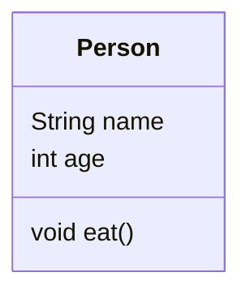

```text
Person 클래스
├── 필드
│   ├── String name
│   └── int age
└── 메서드
    └── void eat()
```

객체 생성

```java
Person p1 = new Person();
Person p2 = new Person();
```

```text
Person       = 클래스이자 참조 변수의 타입
p1, p2       = 참조 변수
new Person() = 객체 생성 표현식
```

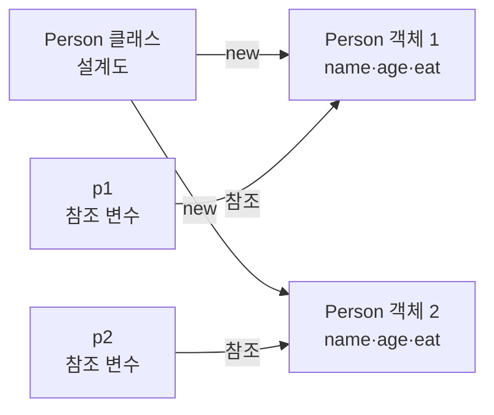

- `p1`과 `p2`: 서로 다른 객체를 참조
- 같은 클래스에서 여러 객체 생성 가능

### 6. Java 패키지

#### 6.1 Java Package

**Package**: 관련 클래스와 Interface를 묶어 관리하는 이름 공간

```java
package controller;

public class LoginServlet {
}
```

```text
controller
└── LoginServlet
```

Controller Package 이름 예시

```java
package controller;
```

```java
package com.example.controller;
```

Java 기본 Package 예시

```java
java.lang   // String, System, Math
java.io     // 파일 입출력
java.util   // List, Map, Scanner
java.sql    // 데이터베이스 연결
```

- `INSERT`, `SELECT`, `UPDATE`, `DELETE`: Package가 아닌 SQL 명령어
- `java.sql`: `Connection`, `Statement`, `PreparedStatement`, `ResultSet` 등의 JDBC 타입 제공

### 7. 객체지향의 세 가지 특징

#### 7.1 객체지향의 세 가지 특징

```text
상속   = 기존 클래스의 기능을 물려받는 구조
다형성 = 같은 타입·호출이 실제 객체에 따라 다르게 동작하는 특징
캡슐화 = 데이터와 기능을 묶고 외부의 직접 접근을 제한하는 특징
```

##### 7.1.1 상속

**상속(Inheritance)**: 기존 클래스의 필드와 메서드를 새로운 클래스에서 물려받는 구조

```java
class Person {

    String name;
    int age;

    void eat() {
    }
}

class Student extends Person {

    String sn;
}
```

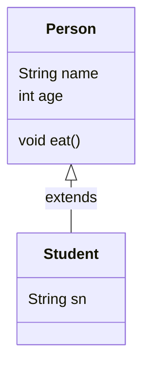

```text
Person
├── String name
├── int age
└── void eat()
        △
        │ extends
        │
Student
└── String sn
```

- `Person`: 부모 클래스
- `Student`: 자식 클래스
- `extends`: 상속 키워드
- `Student` 객체에서 `name`, `age`, `eat()`, `sn` 사용 가능

##### 7.1.2 다형성

**다형성(Polymorphism)**: 부모 타입 하나로 여러 자식 객체를 참조하고, 실제 객체에 따라 오버라이딩된 동작을 실행하는 특징

```java
class Animal {

    void sound() {
        System.out.println("동물 소리");
    }
}

class Dog extends Animal {

    @Override
    void sound() {
        System.out.println("멍멍");
    }
}

class Cat extends Animal {

    @Override
    void sound() {
        System.out.println("야옹");
    }
}
```

```java
Animal animal1 = new Dog();
Animal animal2 = new Cat();

animal1.sound(); // 멍멍
animal2.sound(); // 야옹
```

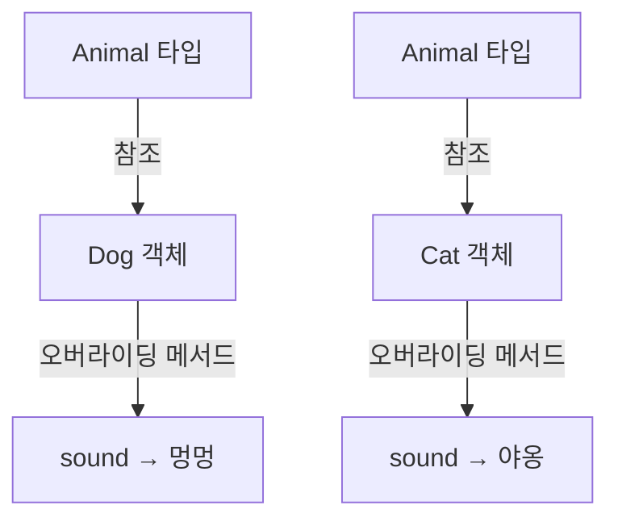

다형성과 관련된 형변환

```text
다형성
├── 부모 타입으로 여러 자식 객체 참조
├── 실제 객체에 따른 오버라이딩 메서드 실행
└── 상속 관계의 형변환
    ├── 업캐스팅
    └── 다운캐스팅
```

##### 7.1.3 캡슐화

**캡슐화(Encapsulation)**: 객체의 내부 데이터를 숨기고 공개 메서드를 통해 접근을 제어하는 방식

```java
class Person {

    private String name;
    private int age;

    public void setName(String name) {
        this.name = name;
    }

    public String getName() {
        return name;
    }
}
```

```text
private = 외부 직접 접근 제한
getter  = 값 조회
setter  = 값 변경
```

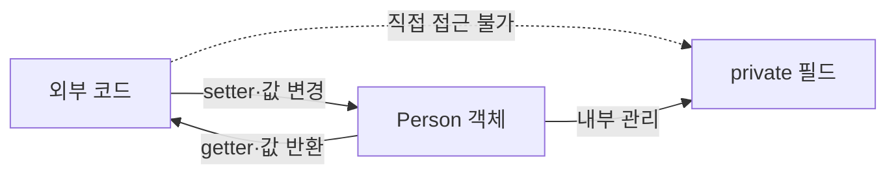

### 8. 업캐스팅과 다운캐스팅

#### 8.1 업캐스팅과 다운캐스팅

예제 구조

```java
class Person {

    String name;
    int age;

    void eat() {
    }
}

class Student extends Person {

    String sn;
}
```

##### 8.1.1 업캐스팅

**업캐스팅(Upcasting)**: 자식 객체를 부모 타입 변수로 참조하는 형변환

```java
Person s1 = new Student();
```

```text
참조 변수 타입 = Person
실제 객체       = Student
```

- 자동 형변환으로 `(Person)` 생략 가능
- 참조 변수 타입인 `Person`에 선언된 멤버까지 접근 가능
- 실제 객체의 `Student.sn`에는 `s1`을 통한 직접 접근 불가

```java
s1.name = "홍길동";
s1.age = 10;
s1.eat();

// 컴파일 오류
// s1.sn = "12345";
```

##### 8.1.2 다운캐스팅

**다운캐스팅(Downcasting)**: 부모 타입 참조를 자식 타입으로 명시적으로 변환하는 형변환

```java
Student s2 = (Student) s1;

s2.name = "홍길동";
s2.age = 10;
s2.eat();
s2.sn = "12345";
```

- 자동 변환 불가
- `(Student)`와 같은 명시적 형변환 필요
- 부모 타입이 항상 특정 자식 객체를 가리킨다는 보장이 없기 때문

컴파일 오류 예시

```java
Person s1 = new Student();

// 명시적 형변환 부재
Student s2 = s1;
```

상속·참조 구조

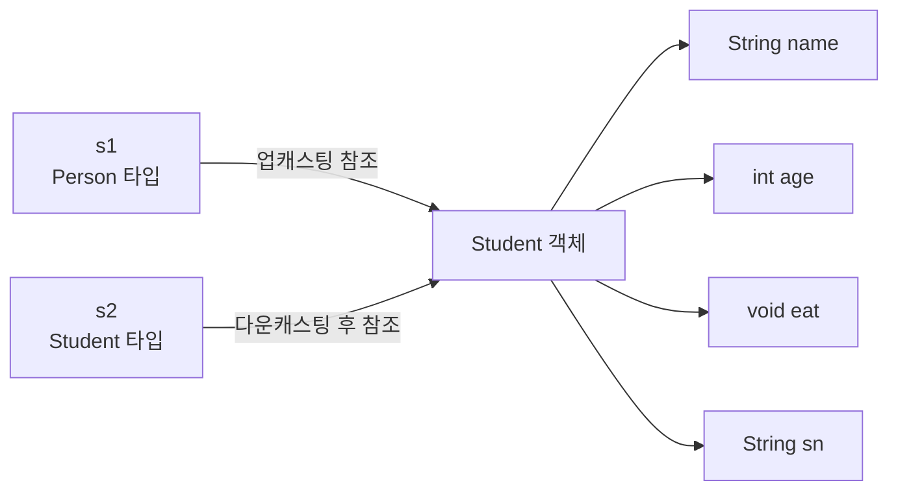

접근 범위

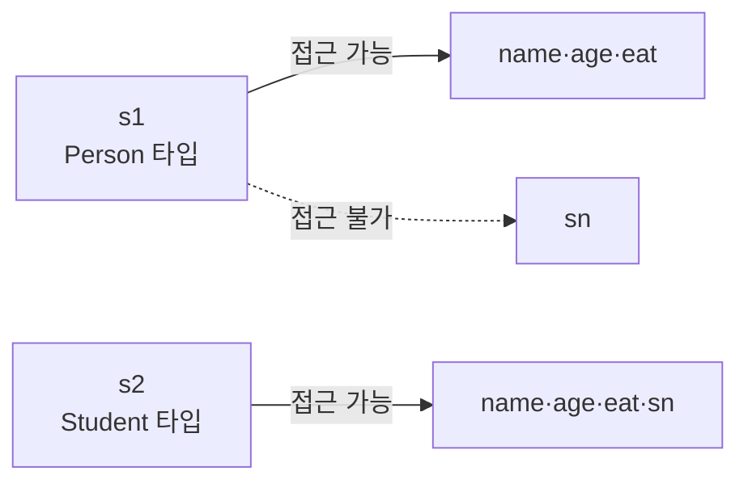

안전한 다운캐스팅

```java
Person person = new Student();

if (person instanceof Student) {
    Student student = (Student) person;
    student.sn = "12345";
}
```

실제 객체가 다른 경우의 실행 오류

```java
Person person = new Person();
Student student = (Student) person; // ClassCastException
```

### 9. 싱글톤 패턴

#### 9.1 Singleton Pattern

**Singleton**: 특정 클래스의 객체를 하나만 생성해 공동으로 사용하는 Pattern

일반 클래스의 서로 다른 객체

```java
Person p1 = new Person();
Person p2 = new Person();

System.out.println(p1 == p2); // false
```

Singleton 클래스

```java
public class Singleton {

    private static final Singleton instance =
        new Singleton();

    private Singleton() {
    }

    public static Singleton getInstance() {
        return instance;
    }
}
```

사용 예시

```java
Singleton s1 = Singleton.getInstance();
Singleton s2 = Singleton.getInstance();

System.out.println(s1 == s2); // true
```

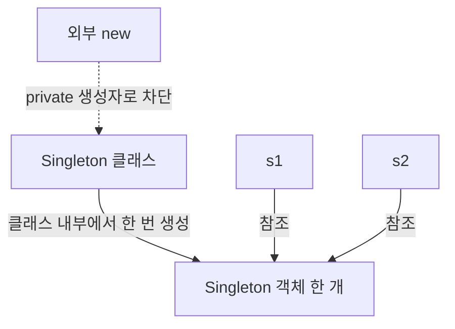

구성 요소

```java
private static final Singleton instance =
    new Singleton();
```

- `static`: 클래스에 한 개 존재
- `final`: 다른 객체로 참조 변경 불가
- `private`: 외부 직접 접근 제한

```java
private Singleton() {
}
```

- 외부의 `new Singleton()` 차단

```java
public static Singleton getInstance() {
    return instance;
}
```

- 객체 생성 없이 호출 가능한 메서드
- 유일한 객체 반환

Servlet과 Singleton Pattern의 차이

- Servlet: Container가 일반적으로 등록당 한 인스턴스를 생성하고 관리
- Singleton Pattern: 개발자가 생성자와 `static` 멤버로 단일 객체 생성 규칙 구현
- 둘 다 객체 공유의 외형은 비슷하지만 생성·관리 주체와 구현 방식에서 차이

### 10. 오버로딩과 오버라이딩

#### 10.1 메서드 오버로딩

**오버로딩(Overloading)**: 같은 클래스 또는 상속 관계에서 같은 이름의 메서드를 서로 다른 매개변수 목록으로 여러 개 선언하는 기능

구분 조건

```text
1. 매개변수 개수
2. 매개변수 타입
3. 매개변수 타입의 순서
```

판단 기준에서 제외되는 항목

- 반환 타입
- 매개변수 이름

가능한 선언

```java
class Person {

    void eat() {
    }

    void eat(int amount) {
    }

    void eat(int amount, int time) {
    }

    void eat(float amount, int time) {
    }

    void eat(int amount, float time) {
    }
}
```

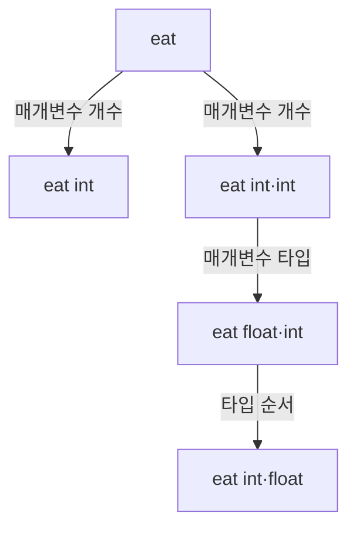

반환 타입만 다른 경우

```java
void eat() {
}

int eat() { // 컴파일 오류
    return 10;
}
```

두 메서드의 Signature

```text
eat()
eat()
```

매개변수 이름만 다른 경우

```java
void eat(int a, int b) {
}

void eat(int b, int a) { // 컴파일 오류
}
```

두 메서드의 Signature

```text
eat(int, int)
eat(int, int)
```

| 메서드 조합 | 가능 여부 | 이유 |
| --- | --- | --- |
| `eat()` | 가능 | 기본 메서드 |
| `eat(int)` | 가능 | 매개변수 개수 차이 |
| `eat(int, int)` | 가능 | 매개변수 개수 차이 |
| `eat(float, int)` | 가능 | 매개변수 타입 차이 |
| `eat(int, float)` | 가능 | 타입 순서 차이 |
| `void eat()`·`int eat()` | 불가능 | 반환 타입만 차이 |
| `eat(int a, int b)`·`eat(int b, int a)` | 불가능 | 매개변수 이름만 차이 |

#### 10.2 메서드 오버라이딩

**오버라이딩(Overriding)**: 부모 클래스에서 상속받은 메서드를 자식 클래스의 목적에 맞게 다시 정의하는 기능

```java
class Person {

    void eat() {
        System.out.println("사람이 먹는다");
    }
}

class Student extends Person {

    @Override
    void eat() {
        System.out.println("학생이 먹는다");
    }
}
```

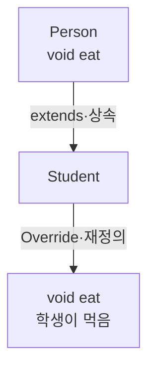

실행 예시

```java
Person person = new Person();
Student student = new Student();

person.eat();  // 사람이 먹음
student.eat(); // 학생이 먹음
```

다형성과 오버라이딩

```java
Person person = new Student();

person.eat(); // 학생이 먹음
```

```text
참조 변수 타입 = Person
실제 객체       = Student
실행 메서드     = Student.eat()
```

오버라이딩 조건

```text
1. 부모·자식 상속 관계
2. 같은 메서드 이름
3. 같은 매개변수 개수
4. 같은 매개변수 타입과 순서
5. 같거나 호환 가능한 반환 타입
6. 부모보다 좁게 변경할 수 없는 접근 범위
```

`@Override`의 역할

- 부모 메서드의 재정의 의도 표시
- 메서드명이나 매개변수 오류를 컴파일 단계에서 확인
- 오버라이딩 메서드에 사용 권장

오버라이딩이 아닌 예시

```java
class Person {

    void eat() {
    }
}

class Student extends Person {

    void eat(int amount) {
    }
}
```

```text
Person  = eat()
Student = eat(int)
```

- 서로 다른 매개변수 목록
- 오버라이딩이 아닌 새로운 오버로드 메서드 추가

#### 10.3 오버로딩과 오버라이딩 비교

| 구분 | 오버로딩 | 오버라이딩 |
| --- | --- | --- |
| 영문 | Overloading | Overriding |
| 위치 | 같은 클래스 또는 상속 관계 | 부모·자식 클래스 |
| 상속 관계 | 불필요 | 필요 |
| 메서드 이름 | 동일 | 동일 |
| 매개변수 | 서로 달라야 함 | 동일해야 함 |
| 반환 타입 | 판단 기준 아님 | 같거나 호환 가능 |
| 목적 | 여러 입력 방식 제공 | 부모 기능을 자식 목적에 맞게 변경 |
| 관련 개념 | 편의성 | 다형성 |
| Annotation | 없음 | `@Override` 권장 |

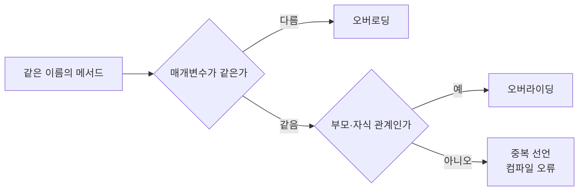

```text
오버로딩
→ 같은 메서드 이름
→ 서로 다른 매개변수 목록

오버라이딩
→ 부모·자식 상속 관계
→ 같은 메서드 형태
→ 자식 클래스에서 내용 재정의
```

### 11. 추상 클래스와 인터페이스

> Week08에서 처음 복습하고 Week09에서 JPA Repository 작성 전에 다시 정리한 내용. Java 문법이므로 이 위치에 통합

#### 11.1 추상 메서드

**추상 메서드(Abstract Method)**: 중괄호 본문 없이 선언만 있는 메서드

```java
abstract void eat();   // 본문 { } 자체가 없음
```

- `void eat() { }`: 본문이 비어 있는 일반 메서드 (추상 메서드 아님)
- `abstract void eat();`: 본문이 아예 없는 추상 메서드

#### 11.2 추상 메서드를 가질 수 있는 두 종류

| 구분 | 추상 클래스 | 인터페이스 |
| --- | --- | --- |
| 선언 | `abstract class` | `interface` |
| 일반 메서드 포함 | 가능 | 원칙적으로 불가 (수업 기준) |
| 추상 메서드 없이 선언 | 가능 | 해당 없음 |
| `abstract` 키워드 | 필요 | 생략 가능 |
| 구성 | 필드, 생성자, 일반·추상 메서드 | 추상 메서드와 상수 |
| 상속 키워드 | `extends` | `implements` |
| 다중 상속 | 클래스 하나만 | 여러 인터페이스 구현 가능 |
| 직접 객체 생성 | 불가 | 불가 |

#### 11.3 객체를 직접 만들 수 없는 이유

- 본문이 없는 불완전한 메서드를 가진 설계도로는 객체를 찍어낼 수 없음
- 서브 클래스가 추상 메서드를 **반드시** 오버라이딩해 본문을 채운 뒤 그 서브 클래스로 객체 생성

```java
interface Person {
    void eat();               // public abstract 생략
}

class Student implements Person {
    @Override
    public void eat() {
        System.out.println("학생이 먹는다");
    }
}

Person p = new Student();     // ○
Person q = new Person();      // × 컴파일 오류
```

#### 11.4 왜 만드는가: 규격화

- 일반 상속의 오버라이딩: 서브 클래스의 **선택** 사항
- 추상 메서드의 오버라이딩: 서브 클래스의 **강제** 사항 (안 하면 컴파일 오류)
- 결과: `Person`을 구현한 클래스는 열어 보지 않아도 `eat()`이 반드시 존재
- 여러 서브 클래스를 같은 이름의 메서드로 통일 → 규격화
- Spring Framework에는 인터페이스·추상 클래스로 선언된 부분이 매우 많음

#### 11.5 인터페이스의 확장

```java
interface Person {
    void eat();
}

interface Police extends Person {     // 인터페이스가 인터페이스를 확장
    void arrest();
}

class MyPolice implements Police {
    @Override
    public void eat() { }

    @Override
    public void arrest() { }          // 두 메서드 모두 오버라이딩해야 객체 생성 가능
}
```

| 관계 | 키워드 |
| --- | --- |
| 클래스 → 클래스 | `extends` |
| 클래스 → 인터페이스 | `implements` |
| 인터페이스 → 인터페이스 | `extends` |

#### 11.6 Java 인터페이스의 정확한 구성 (기술 보정)

- 수업 기준: 인터페이스 = 추상 메서드 + 상수
- Java 8 이후: `default` 메서드, `static` 메서드 허용
- Java 9 이후: `private` 메서드 허용
- 인터페이스 메서드의 `public abstract`, 필드의 `public static final`은 생략 가능

### 12. static

**static**: 객체가 아니라 클래스에 소속되는 필드 또는 메서드를 지정하는 키워드

호출 방식

```java
클래스이름.static메서드();
```

JDBC 예시

```java
Class.forName("com.mysql.cj.jdbc.Driver");
DriverManager.getConnection(url, account, password);
```

인스턴스 메서드와 비교

```java
Connection con = DriverManager.getConnection(url, account, password);
PreparedStatement pstmt = con.prepareStatement(sql);

pstmt.setString(1, dto.getId());
pstmt.executeUpdate();
```

| 호출 | 구분 | 이유 |
| --- | --- | --- |
| `Class.forName()` | static 메서드 | `Class`라는 클래스 이름으로 호출 |
| `DriverManager.getConnection()` | static 메서드 | `DriverManager`라는 클래스 이름으로 호출 |
| `con.prepareStatement()` | 인스턴스 메서드 | `Connection` 객체를 통해 호출 |
| `pstmt.setString()` | 인스턴스 메서드 | `PreparedStatement` 객체를 통해 호출 |

수업 핵심

- `static` 메서드는 객체 생성 없이 클래스 이름으로 호출
- 공통 기능이나 객체 생성 전 필요한 기능에 활용
- 클래스 이름 뒤에 직접 호출되는 필드·메서드를 `static` 멤버로 판단

정확한 Java 관점

- `static` 멤버는 클래스 로딩과 초기화 과정에서 클래스 단위로 준비
- 모든 클래스의 모든 `static` 멤버가 무조건 `main()` 이전에 한꺼번에 로딩되는 구조는 아님
- 해당 클래스가 처음 적극적으로 사용되는 시점에 로딩과 초기화가 발생할 수 있는 구조

### 13. 트랜잭션

**트랜잭션(Transaction)**: 여러 데이터베이스 작업을 하나의 논리적 작업 단위로 묶는 기능

계좌 송금 예시

```text
1. A 계좌에서 10,000원 차감
2. B 계좌에 10,000원 추가
```

- 두 작업의 전체 성공 또는 전체 취소 필요
- 일부 작업만 반영되는 데이터 불일치 방지

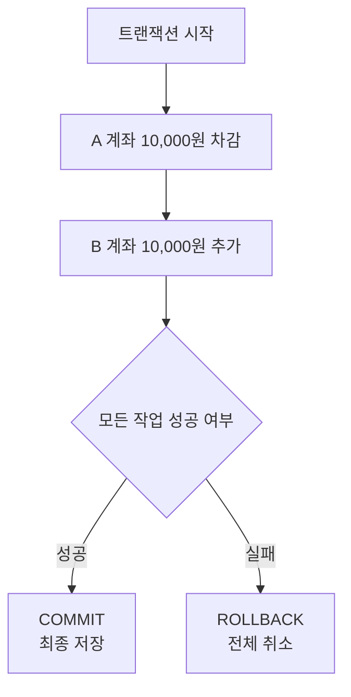

**COMMIT**: 트랜잭션에서 변경한 내용을 데이터베이스에 최종 저장

**ROLLBACK**: 트랜잭션에서 진행한 변경을 취소하고 이전 상태로 복구

---

## 3부 MVC와 Servlet · Week02~03

### 14. MVC 모델

#### 14.1 주요 구성 요소

**View**: 사용자 입력과 처리 결과를 표시하는 JSP 화면

**Controller**: 요청 수신, 파라미터 추출, 처리 흐름 제어를 담당하는 Servlet

**DTO(Data Transfer Object)**: 계층 사이에서 데이터를 운반하는 객체

**DAO(Data Access Object)**: DB 연결과 SQL 실행을 담당하는 객체

**DBMS(Database Management System)**: 데이터를 저장하고 관리하는 시스템

#### 14.2 MVC 역할 구분

| 구분 | 구성 요소 | 핵심 책임 |
| --- | --- | --- |
| Model | DTO | 데이터 한 건의 보관과 계층 간 전달 |
| Model | DAO | DB 연결, SQL 실행, 조회 결과의 DTO 변환 |
| View | JSP | 입력 화면과 처리 결과 출력 |
| Controller | Servlet | 요청 수신, 파라미터 처리, Model 호출, 응답 경로 선택 |

수업 기준 표현

```text
M = Model      → DB 연동 객체와 데이터 객체 → DTO + DAO
V = View       → 사용자 화면               → JSP
C = Controller → 요청 처리                 → Servlet
```

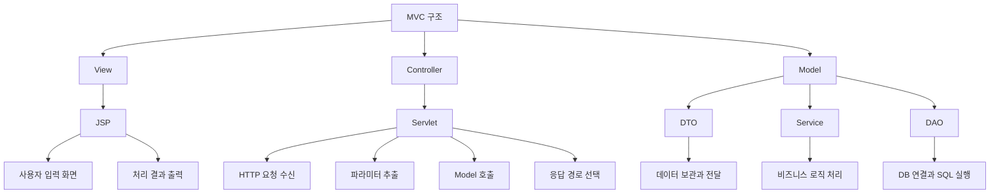

#### 14.3 Service를 포함한 MVC 확장 구조

Week02의 MVC 구조에서 Model에 포함된 세 요소

```text
DTO/VO  → 데이터를 담는 객체
DAO     → 데이터베이스 접근
Service → 비즈니스 로직 처리
```

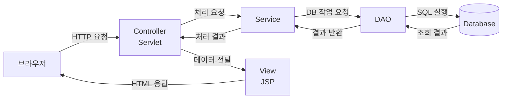

```text
브라우저
→ Controller
→ Service
→ DAO
→ Database
→ DAO
→ Service
→ Controller
→ View
→ 브라우저
```

- 단순 수업 예제: Controller에서 DAO 직접 호출
- 규모가 커진 구조: Controller와 DAO 사이에 Service 배치
- Controller의 DB 직접 접근보다 Service·DAO를 통한 접근 권장

#### 14.4 Week07에서의 확장

- Week02의 MVC: Model·View·Controller 세 역할 분리
- Week06: Model 안에서 DTO·DAO 분리, Service 추가
- Week07: 이 구조를 **Presentation·Service·Data Access 3계층**으로 일반화 (45장)
- Spring MVC: `DispatcherServlet`이 Controller·View 연결을 대신 처리 (48장)

### 15. HTTP 메서드와 CRUD

#### 15.1 HTTP 메서드와 CRUD

**CRUD**: 데이터 처리의 네 가지 기본 작업

```text
C = Create · 생성
R = Read   · 조회
U = Update · 수정
D = Delete · 삭제
```

| CRUD | HTTP 메서드 | Servlet 메서드 | 주요 용도 |
| --- | --- | --- | --- |
| Create | `POST` | `doPost()` | 회원가입, 데이터 등록 |
| Read | `GET` | `doGet()` | 회원·목록 조회 |
| Update | `PUT` | `doPut()` | 자원 전체 수정 |
| Update | `PATCH` | 기본 `doPatch()` 없음 | 자원 일부 수정 |
| Delete | `DELETE` | `doDelete()` | 회원 탈퇴, 데이터 삭제 |

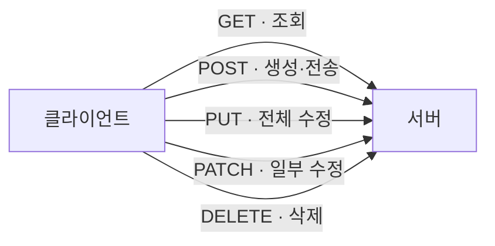

- CRUD와 HTTP 메서드의 연결: REST 설계에서 주로 사용하는 규칙
- HTML `<form>`의 기본 지원 메서드: `GET`, `POST`
- `PUT`, `PATCH`, `DELETE`: JavaScript `fetch()` 또는 Framework 기능 활용
- `HttpServlet`의 기본 `doPatch()` 부재
- PATCH 처리: `service()`에서 별도 분기 또는 Framework의 Mapping 기능 활용

#### 15.2 GET과 POST 비교

| 구분 | GET | POST |
| --- | --- | --- |
| 주요 용도 | 데이터 조회 | 데이터 생성 또는 전송 |
| 데이터 위치 | 주로 URL Query String | 주로 Request Body |
| Servlet 메서드 | `doGet()` | `doPost()` |
| 주소창 노출 | Query String 노출 | Body는 주소창에 미노출 |
| 북마크 | 적합 | 일반적으로 부적합 |
| 새로고침 | 같은 조회 반복 | 폼 재전송 경고 가능 |
| 반복 요청 | 서버 상태 불변 권장 | 서버 상태 변경 가능 |

주의사항

- POST 자체에 암호화 기능 없음
- 아이디·비밀번호 보호를 위한 HTTPS 필요
- GET Query String에 비밀번호·주민번호 등 민감 정보 사용 금지
- GET 요청 바디는 서버·중간 장비의 지원 차이로 일반적인 웹 개발에서 사용 지양
- URL과 요청 바디의 최대 크기는 브라우저·서버·프록시 설정에 따라 차이
- 로그아웃은 로그인 상태를 변경하는 요청
- `GET /logout.do`보다 `POST /logout.do` 권장
- 로그인·로그아웃 등 상태 변경 요청에 CSRF 방어 필요

#### 15.3 GET 요청이 발생하는 세 가지 상황

| 상황 | HTTP 메서드 | 이유 |
| --- | --- | --- |
| 주소창에 URL 입력 후 Enter | GET | 브라우저 기본 요청 |
| `<a href>` 하이퍼링크 클릭 | GET | `<a>` 태그에는 `method` 속성이 없음 |
| redirect 응답 후 재요청 | GET (일반적) | 브라우저가 `Location` 주소로 새 요청 |

```html
<a href="/intro">대학 소개</a>            <!-- 항상 GET -->

<form action="/login" method="post">      <!-- form만 method 선택 가능 -->
    <input name="id">
    <button type="submit">로그인</button>
</form>
```

- 정리: `PUT`·`POST`·`DELETE`처럼 메서드를 특별히 지정할 수 없는 상황은 대부분 GET
- `302`·`303` 이후 재요청은 일반적으로 GET, `307`·`308`은 원래 메서드 유지

#### 15.4 Servlet 메서드와 Spring 매핑 어노테이션의 대응

| HTTP 메서드 | Servlet | Spring MVC |
| --- | --- | --- |
| `GET` | `doGet()` | `@GetMapping` |
| `POST` | `doPost()` | `@PostMapping` |
| `PUT` | `doPut()` | `@PutMapping` |
| `PATCH` | 기본 메서드 없음 | `@PatchMapping` |
| `DELETE` | `doDelete()` | `@DeleteMapping` |

### 16. URL과 파라미터

#### 16.1 URL 구조

예시

```text
https://search.daum.net/nate?thr=sbma&w=tot&q=점메추
```

구조

```text
https:// search.daum.net /nate ? thr=sbma & w=tot & q=점메추
└ Scheme ┘ └──── Host ────┘ └Path┘  └──── Query String ────┘
```

| 구분 | 예시 값 | 의미 |
| --- | --- | --- |
| Scheme | `https` | 암호화된 HTTP 연결 방식 |
| Host | `search.daum.net` | 요청을 받을 서버의 Domain |
| Path | `/nate` | 서버 내부 요청 경로 |
| Query 시작 | `?` | Query String 시작 표시 |
| Parameter | `thr=sbma` | 유입 경로 등의 값 |
| Parameter | `w=tot` | 검색 범위 등의 값 |
| Parameter | `q=점메추` | 검색어 등의 값 |
| 구분자 | `&` | 여러 Parameter 구분 |

Servlet의 Query Parameter 읽기

```java
String keyword = request.getParameter("q");
String searchType = request.getParameter("w");
```

```text
q=점메추
    ↓
request.getParameter("q")
    ↓
"점메추"
```

- HTTPS: 클라이언트와 서버 사이의 통신 내용 암호화
- 브라우저 기록과 서버 로그에 전체 URL이 남을 가능성
- Query String의 민감 정보 사용 금지

#### 16.2 URL과 URI

```text
http://localhost:8080/intro
└ 프로토콜 ┘└ 호스트 ┘└포트┘└ 경로 ┘
```

| 구분 | 강의 기준 | 정확한 정의 |
| --- | --- | --- |
| URL | 전체 주소 `http://localhost:8080/intro` | 자원의 위치·접근 방법을 나타내는 URI |
| URI | 경로 부분 `/intro` | 자원을 식별하는 식별자 전체 개념 |
| Path | (URI와 같은 의미로 사용) | `/intro` 같은 경로 부분 |

- 코드에서는 백엔드 서버 주소·포트를 생략하고 경로(요청 URI)만 작성: `href="/intro"`, `@GetMapping("/intro")`
- 시험에서는 강의 의도대로 "전체 주소 = URL, `/intro` = URI" 구분

#### 16.3 파라미터의 두 종류

**파라미터(Parameter)**: 클라이언트가 요청하면서 서버로 함께 넘기는 데이터

##### 16.3.1 Query String

**Query String(쿼리 파라미터)**: `?` 뒤에 `키=값` 쌍을 `&`로 이어 붙여 보내는 방식

```text
/login?id=hong&pw=1234
/search?query=spring&sort=date
```

- 키가 있으므로 값의 의미를 구분 가능 (`1234`가 아이디인지 비밀번호인지)
- 폼 전송의 `name=값`도 같은 키·값 구조
- 검색 사이트 주소창에서 `?` 뒤의 여러 쌍 확인 가능

##### 16.3.2 Path Variable

**Path Variable(경로 변수)**: 키 없이 **값만** URL 경로의 일부로 보내는 방식

상품 상세 페이지 예시

```text
product 테이블: product_id (PK) = 1, 2, 3, 4, 5, 6

목록에서 3번 상품 클릭
→ 서버에 "product_id가 3인 레코드를 SELECT 해 주세요" 요청
→ SELECT * FROM product WHERE product_id = 3
→ 재고·상세 설명까지 담은 상세 화면 응답
```

| 방식 | 요청 주소 |
| --- | --- |
| Query String | `/products?productId=3` |
| Path Variable | `/products/3` |

##### 16.3.3 비교

| 구분 | Query String | Path Variable |
| --- | --- | --- |
| 형태 | `?key=value&key2=value2` | `/resource/value` |
| 키 | 있음 | 없음 (위치로 의미 결정) |
| 주된 용도 | 검색·필터·정렬·폼 값 | 특정 자원 식별 (게시글 번호, 상품 번호) |
| Servlet 읽기 | `request.getParameter("key")` | URI 문자열 직접 분석 |
| Spring 읽기 (예고) | `@RequestParam` 또는 DTO | `@PathVariable` |

> 시험 답안: 파라미터의 종류는 **Query String**과 **Path Variable**

### 17. Servlet과 관련 기술

#### 17.1 Servlet

**Servlet**: 클라이언트의 HTTP 요청을 처리하고 HTTP 응답을 만드는 Java 서버 프로그램

```java
import jakarta.servlet.http.HttpServlet;

public class LoginServlet extends HttpServlet {
}
```

```text
HttpServlet
    △
    │ extends
    │
LoginServlet
```

주요 객체와 메서드

- `doGet()`: 화면 또는 데이터 조회 요청 처리
- `doPost()`: 로그인·회원가입·데이터 등록 등의 요청 처리
- `HttpServletRequest`: 들어온 HTTP 요청 정보를 표현하는 객체
- `HttpServletResponse`: 클라이언트에 보낼 HTTP 응답을 구성하는 객체
- `HttpSession`: 사용자별 상태를 여러 요청에 걸쳐 유지하는 객체

#### 17.2 JSP

**JSP(JavaServer Pages)**: HTML 중심으로 동적 화면을 작성하기 위한 서버 측 View 기술

- 작성 시 HTML과 JSP 문법으로 구성
- 실행 시 Servlet Container에서 Servlet으로 변환
- 변환된 Servlet의 실행 결과로 HTML 생성
- 브라우저에는 JSP 원본이 아닌 생성된 HTML 전달

#### 17.3 Servlet API

**Servlet API**: Java 웹 프로그램의 Servlet·Request·Response·Session 등에 대한 표준 규칙

#### 17.4 Tomcat

**Tomcat**: Servlet API를 구현하고 Servlet과 JSP를 실행하는 Servlet Container

Tomcat의 역할

- 직접 작성한 Servlet 실행
- JSP를 Servlet으로 변환한 뒤 실행
- Spring MVC의 `DispatcherServlet` 실행
- Request·Response 객체 생성
- Session과 Servlet Lifecycle 관리

#### 17.5 Spring MVC

**Spring MVC**: Servlet 기반 웹 개발의 요청 분배·Controller 호출·View 연결을 편리하게 제공하는 Framework

- 모든 요청의 앞단에서 `DispatcherServlet` 활용
- 요청 URL과 HTTP 메서드에 맞는 Controller 탐색
- Controller 처리 결과를 View 또는 응답 본문으로 연결

#### 17.6 기술 관계

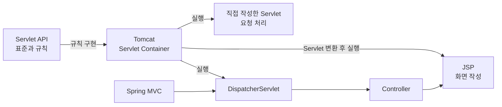

```text
Servlet API
└── Java 웹 기술의 표준 규칙

Tomcat
├── Servlet 객체 생성과 실행
├── JSP의 Servlet 변환과 실행
└── DispatcherServlet 실행

Spring MVC
└── DispatcherServlet을 통한 Controller 요청 분배
```

#### 17.7 Servlet과 JSP 요청 흐름

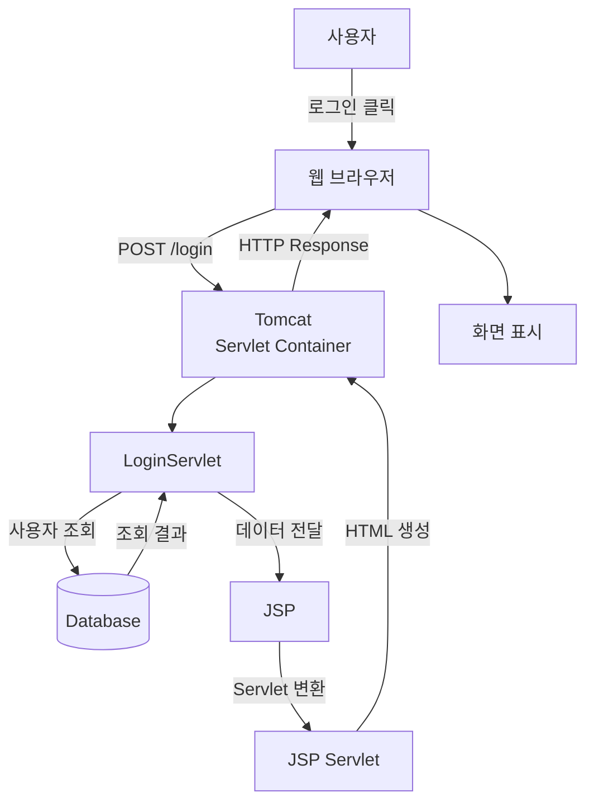

### 18. Servlet Container와 생명주기

#### 18.1 Servlet 클래스·객체·Container

| 구분 | 의미 | 예시 |
| --- | --- | --- |
| Servlet 클래스 | Servlet 객체의 설계도 | `LoginServlet.class` |
| Servlet 객체 | 실제 요청을 처리하는 인스턴스 | `LoginServlet` 객체 |
| Servlet Container | Servlet 객체와 요청 흐름을 관리하는 실행 환경 | Tomcat, Jetty, Undertow |

```mermaid
flowchart LR
    A[개발자] -->|Servlet 클래스 작성| B[Web Application]
    B -->|배포| C[Servlet Container<br/>Tomcat]
    C -->|객체 생성과 관리| D[Servlet 객체]
    E[클라이언트] -->|HTTP 요청| C
    C -->|URL Mapping| D
    D -->|HTTP 응답| E
```

개발자가 Servlet 객체를 직접 `new`로 생성할 필요가 없는 구조

#### 18.2 Servlet Container 주요 업무

```mermaid
flowchart TD
    A[Servlet 실행 환경]

    A --> B[Tomcat]
    B --> C[Servlet Container]

    C --> D[URL Mapping]
    D --> D1[요청 URL에 맞는 Servlet 선택]

    C --> E[Servlet Lifecycle]
    E --> E1[init: 최초 초기화]
    E --> E2[service: 요청 처리]
    E --> E3[destroy: 종료 처리]

    E2 --> F[HTTP 메서드별 분기]
    F --> F1[doGet]
    F --> F2[doPost]
    F --> F3[doPut]
    F --> F4[doDelete]

    C --> G[요청과 응답 객체]
    G --> G1[HttpServletRequest]
    G --> G2[HttpServletResponse]

    C --> H[Filter]
    H --> H1[Controller 실행 전후 공통 처리]

    C --> I[Session 관리]
    C --> J[여러 요청의 Thread 처리]
```

대표 구현체

- Tomcat
- Jetty
- Undertow

#### 18.3 Servlet 객체와 Singleton

- Servlet 선언 한 개당 객체 한 개의 일반적 생성
- 하나의 Servlet 객체를 여러 요청에서 공유
- Singleton과 유사한 동작
- 개발자가 직접 구현한 Singleton Pattern과 다른 개념
- 객체 생성과 관리 주체: Servlet Container
- 같은 Servlet 인스턴스에서 여러 Thread의 동시 요청 처리 가능

```mermaid
flowchart LR
    R1[요청 1] --> S[Servlet 객체 1개]
    R2[요청 2] --> S
    R3[요청 3] --> S
```

잘못된 요청 데이터 저장

```java
@WebServlet("/unsafe.do")
public class UnsafeServlet extends HttpServlet {

    // 여러 요청에서 공유되는 인스턴스 필드
    private String userId;

    @Override
    protected void doPost(
            HttpServletRequest request,
            HttpServletResponse response
    ) {
        userId = request.getParameter("userId");
    }
}
```

권장 저장 위치

- 메서드 지역변수
- `request` 영역
- 목적에 맞는 `session` 등 적절한 스코프

#### 18.4 Servlet Lifecycle

| 메서드 | 역할 | 호출 시점 |
| --- | --- | --- |
| `init()` | Servlet 초기화 | 객체 생성 후 한 번 |
| `service()` | 요청 처리 | 요청마다 |
| `destroy()` | 자원 정리 | Servlet 제거 전 한 번 |

```mermaid
flowchart LR
    A[Servlet 클래스 로딩] --> B[Servlet 객체 생성]
    B --> C[init<br/>한 번]
    C --> D[service<br/>요청마다]
    D --> D
    D --> E[destroy<br/>한 번]
```

```text
최초 로딩
→ Servlet 객체 생성
→ init()

클라이언트 요청
→ service()
→ doGet() 또는 doPost()

서버 종료 또는 재배포
→ destroy()
```

- `init()`은 요청마다 실행되는 메서드가 아닌 초기화 메서드
- 첫 요청 시 지연 생성 또는 시작 시 미리 생성하도록 설정 가능한 Servlet

#### 18.5 service()와 HTTP별 처리 메서드

`HttpServlet.service()`에서 HTTP 메서드 확인 후 알맞은 메서드 호출

```text
GET     → doGet()
POST    → doPost()
PUT     → doPut()
DELETE  → doDelete()
HEAD    → doHead()
OPTIONS → doOptions()
TRACE   → doTrace()
```

- 일반적으로 `service()` 직접 재정의 불필요
- 필요한 `doGet()`·`doPost()` 등을 재정의

POST Lifecycle 예시

```mermaid
sequenceDiagram
    participant C as 클라이언트
    participant T as Tomcat
    participant S as Servlet 객체

    Note over T,S: 1. 최초 로딩
    T->>S: 2. Servlet 객체 생성
    T->>S: 3. init() 실행

    Note over C,S: 요청마다 반복
    C->>T: 4. POST /login.do 요청
    T->>S: 5. service(request, response) 호출
    S->>S: 6. doPost(request, response) 실행
    S-->>T: 7. 처리 결과 반환
    T-->>C: 8. HTTP Response 전송

    Note over T,S: 9. 서버 종료 또는 재배포
    T->>S: 10. destroy() 실행
```

### 19. URL Mapping

#### 19.1 URL Mapping

**URL Mapping**: 외부 요청 URL과 요청을 처리할 Servlet의 연결 설정

```text
/login.do  → LoginServlet
/logout.do → LogoutServlet
```

`login.do`의 의미

- 학습용 표현: Controller의 별명
- 정확한 표현: 외부에 공개된 URL Pattern
- 내부 클래스명·파일 경로와 외부 주소의 분리
- URL Mapping 자체는 보안 기능이 아닌 연결 설정
- 별도로 필요한 보안: 인증, 권한 검사, 입력 검증, Session 보호, HTTPS

##### 19.1.1 Annotation 방식

```java
import jakarta.servlet.annotation.WebServlet;
import jakarta.servlet.http.HttpServlet;

@WebServlet("/logout.do")
public class LogoutServlet extends HttpServlet {
}
```

##### 19.1.2 XML 방식

Servlet 클래스

```java
import jakarta.servlet.http.HttpServlet;

public class LogoutServlet extends HttpServlet {
}
```

`WEB-INF/web.xml`

```xml
<?xml version="1.0" encoding="UTF-8"?>
<web-app xmlns="https://jakarta.ee/xml/ns/jakartaee"
         xmlns:xsi="http://www.w3.org/2001/XMLSchema-instance"
         xsi:schemaLocation="https://jakarta.ee/xml/ns/jakartaee
                             https://jakarta.ee/xml/ns/jakartaee/web-app_6_0.xsd"
         version="6.0">

    <servlet>
        <servlet-name>logoutServlet</servlet-name>
        <servlet-class>com.example.controller.LogoutServlet</servlet-class>
    </servlet>

    <servlet-mapping>
        <servlet-name>logoutServlet</servlet-name>
        <url-pattern>/logout.do</url-pattern>
    </servlet-mapping>

</web-app>
```

```text
<servlet>
└── Servlet 이름과 클래스 연결

<servlet-mapping>
└── Servlet 이름과 URL 연결
```

| 구분 | Annotation | XML |
| --- | --- | --- |
| 작성 위치 | Servlet 클래스 | `WEB-INF/web.xml` |
| 주요 설정 | `@WebServlet` | `<servlet>`, `<servlet-mapping>` |
| 장점 | 간단하며 클래스에서 바로 확인 | 설정을 한 파일에서 통합 관리 |
| 주의점 | 설정의 클래스별 분산 가능성 | 많은 XML 작성량 |

- 동일 Servlet과 URL의 Annotation·XML 중복 등록 시 충돌 또는 배포 오류 가능성

##### 19.1.3 URL Mapping Pattern

| Pattern | 의미 | 요청 예시 |
| --- | --- | --- |
| `/logout.do` | 정확히 일치하는 URL | `/logout.do` |
| `/member/*` | 특정 경로 아래의 모든 URL | `/member/list` |
| `*.do` | 특정 확장자로 끝나는 URL | `/login.do` |
| `/` | 다른 Mapping과 일치하지 않는 기본 요청 | Default Servlet |

#### 19.2 Container의 요청 처리 순서

```mermaid
flowchart TD
    A[브라우저의 POST /login.do] --> B[Container의 URL Mapping 검색]
    B --> C{Servlet 인스턴스 존재 여부}
    C -- 없음 --> D[LoginController 인스턴스 생성]
    D --> E[init 호출]
    E --> F[service에 request·response 전달]
    C -- 있음 --> F
    F --> G{HTTP 메서드 확인}
    G -- POST --> H[doPost 호출]
    G -- GET --> I[doGet 호출]
    H --> J[처리 후 응답]
    I --> J
```

#### 19.3 HTML Form과 Servlet 연결

```html
<form action="${pageContext.request.contextPath}/login.do" method="post">
    <input type="text" name="userId">
    <input type="password" name="password">
    <button type="submit">로그인</button>
</form>
```

```java
@WebServlet("/login.do")
public class LoginServlet extends HttpServlet {

    @Override
    protected void doPost(
            HttpServletRequest request,
            HttpServletResponse response
    ) throws IOException {

        String userId = request.getParameter("userId");
        String password = request.getParameter("password");
    }
}
```

주의사항

- `@WebServlet("/login.do")`와 Form `action` 경로 일치
- URL의 대소문자 구분
- `Login.do`와 `login.do`는 서로 다른 경로
- `action="Login.do"`는 현재 페이지 기준 상대 경로
- JSP에서 `${pageContext.request.contextPath}` 사용 권장
- Context Path 변경 시에도 재사용 가능한 경로

Context Path가 `/myapp`인 경우

```text
POST /myapp/login.do
     └────┘└───────┘
 Context Path  Servlet Mapping
```

#### 19.4 Tomcat 버전과 Servlet Package

```text
Tomcat 10 이상 → jakarta.servlet.*
Tomcat 9 이하  → javax.servlet.*
```

- Tomcat 10.1 환경: `jakarta.servlet` 사용
- 한 프로젝트에서 `javax.servlet.*`와 `jakarta.servlet.*` 혼용 금지

Tomcat 10.1 Servlet Controller 예시

```java
package controller;

import java.io.IOException;

import jakarta.servlet.ServletException;
import jakarta.servlet.annotation.WebServlet;
import jakarta.servlet.http.HttpServlet;
import jakarta.servlet.http.HttpServletRequest;
import jakarta.servlet.http.HttpServletResponse;

@WebServlet("/login")
public class LoginServlet extends HttpServlet {

    @Override
    protected void doGet(
            HttpServletRequest request,
            HttpServletResponse response
    ) throws ServletException, IOException {

        request.getRequestDispatcher(
            "/WEB-INF/views/login.jsp"
        ).forward(request, response);
    }

    @Override
    protected void doPost(
            HttpServletRequest request,
            HttpServletResponse response
    ) throws ServletException, IOException {

        String id = request.getParameter("id");
        String password = request.getParameter("password");

        response.getWriter().println("login: " + id);
    }
}
```

```mermaid
flowchart LR
    A[controller Package] -->|Class 포함| B[LoginServlet]
    B -->|extends| C[HttpServlet]
    C -->|소속 Package| D[jakarta.servlet.http]
    E[GET 요청] -->|호출| F[doGet]
    G[POST 요청] -->|호출| H[doPost]
    F --> B
    H --> B
```

### 20. HttpServletRequest와 Filter

#### 20.1 HttpServletRequest

**HttpServletRequest**: 클라이언트에서 들어온 HTTP 요청 정보를 표현하고 request 영역을 제공하는 Java 객체

- 요청을 직접 전송하는 객체가 아닌 들어온 요청의 객체 표현
- HTTP 요청마다 Container에서 새로운 Request·Response 객체 준비
- 동기 요청의 응답 완료 시 Request 객체와 request 영역의 일반적 종료
- forward 시 같은 Request 객체를 다음 서버 자원에 전달

정보 조회 예시

```java
String method = request.getMethod();
String uri = request.getRequestURI();
String id = request.getParameter("id");
String userAgent = request.getHeader("User-Agent");
String clientIp = request.getRemoteAddr();
```

Parameter와 Attribute 비교

| 구분 | Parameter | Attribute |
| --- | --- | --- |
| 생성 주체 | 주로 클라이언트 | 주로 서버 코드 |
| 읽기 | `getParameter("id")` | `getAttribute("loginUser")` |
| 저장 | Form, Query String, 요청 Body | `setAttribute(name, value)` |
| 기본 값 형태 | 문자열 | 모든 Java 객체 |
| 대표 용도 | 사용자의 입력값 | Controller가 JSP에 전달할 처리 결과 |

#### 20.2 Servlet Filter

**Filter**: 요청이 Servlet에 도착하기 전과 응답이 클라이언트로 돌아가기 전에 공통 작업을 수행하는 객체

주요 용도

- 문자 Encoding 설정
- 로그인 확인
- 권한 검사
- 요청·응답 Logging
- 공통 Header 설정

```mermaid
flowchart LR
    C[클라이언트] -->|Request| F1[Encoding Filter]
    F1 --> F2[Authentication Filter]
    F2 --> S[Servlet]
    S -->|Response| F2
    F2 --> F1
    F1 --> C
```

```java
import jakarta.servlet.Filter;
import jakarta.servlet.FilterChain;
import jakarta.servlet.ServletException;
import jakarta.servlet.ServletRequest;
import jakarta.servlet.ServletResponse;
import jakarta.servlet.annotation.WebFilter;

import java.io.IOException;

@WebFilter("/*")
public class EncodingFilter implements Filter {

    @Override
    public void doFilter(
            ServletRequest request,
            ServletResponse response,
            FilterChain chain
    ) throws IOException, ServletException {

        request.setCharacterEncoding("UTF-8");
        response.setCharacterEncoding("UTF-8");

        chain.doFilter(request, response);
    }
}
```

- `chain.doFilter()`: 다음 Filter 또는 Servlet으로 요청 전달
- `chain.doFilter()` 미호출: 요청 흐름 중단
- 로그인하지 않은 사용자의 요청 차단 등에 활용

#### 20.3 Servlet 전체 요청 흐름

```mermaid
flowchart TD
    A[브라우저<br/>Form 제출] -->|POST /login.do| B[Servlet Container<br/>Tomcat]
    B --> C[Filter Chain]
    C -->|통과| D[URL Mapping 확인]
    D --> E[LoginServlet 객체]
    E --> F[service]
    F -->|POST 요청| G[doPost]
    G --> H[Service·DAO]
    H --> I[JSP forward 또는 redirect]
    I --> C
    C -->|HTTP Response| A
```

```text
브라우저
→ Tomcat
→ Filter
→ URL Mapping
→ Servlet 객체
→ service()
→ doGet() 또는 doPost()
→ Service·DAO
→ JSP 또는 Redirect
→ 브라우저
```

---

## 4부 JSP 스코프와 화면 이동 · Week04

### 21. 요청 바디와 JSP 실행 결과

#### 21.1 HTML Form과 요청 바디

```jsp
<form action="${pageContext.request.contextPath}/login.do" method="post">
    <input type="text" name="id">
    <input type="password" name="password">
    <button type="submit">로그인</button>
</form>
```

처리 과정

```text
사용자의 폼 입력
→ 전송 버튼 클릭
→ 브라우저에서 입력값 직렬화
→ 직렬화된 값을 HTTP 요청 바디에 저장
→ /login.do로 전송
```

일반 폼의 바디 예시

```text
id=hong&password=1234
```

전송 대상

- `login.jsp` 문서 전체가 아닌 전송 가능한 폼 항목
- JSP 소스 코드가 아닌 `name` 속성과 사용자의 입력값
- `name`이 없는 폼 컨트롤은 일반적인 폼 전송 대상에서 제외

요청 바디 형식

| 형식 | 주요 용도 |
| --- | --- |
| `application/x-www-form-urlencoded` | 일반 HTML 폼 |
| `multipart/form-data` | 파일 업로드 폼 |
| `application/json` | JSON API |

#### 21.2 서버 응답과 JSP 실행 결과

```text
서버에서 JSP 실행
→ JSP 내부의 서버 코드 처리
→ 최종 HTML 생성
→ 생성된 HTML을 HTTP 응답 바디에 저장
→ 브라우저로 전송
→ 브라우저에서 HTML 렌더링
```

- 브라우저가 받는 내용: 서버에서 생성된 최종 HTML
- 브라우저로 전송하지 않는 내용: JSP 원본, Scriptlet, 서버 내부 Java 코드
- 정적 HTML 요청: 파일 내용을 응답 바디로 전송
- JSP 요청: 서버 실행 결과를 응답 바디로 전송
- 페이지 소스 보기: 생성된 HTML만 확인 가능

### 22. JSP 스코프

```mermaid
flowchart TD
    A[상태 저장과 화면 이동]

    A --> B[JSP Scope]
    B --> B1[page]
    B --> B2[request]
    B --> B3[session]
    B --> B4[application]

    B1 --> B11[현재 JSP에서만 사용]
    B2 --> B21[한 번의 요청 동안 사용]
    B3 --> B31[사용자별 로그인 정보 저장]
    B4 --> B41[웹 프로그램 전체에서 공유]

    A --> C[화면 이동]
    C --> C1[forward]
    C --> C2[redirect]

    C1 --> C11[같은 request 유지]
    C1 --> C12[주소창 URL 유지]

    C2 --> C21[새로운 요청 발생]
    C2 --> C22[주소창 URL 변경]

    A --> D[저장 기간]
    D --> D1[session: 로그인 중 임시 저장]
    D --> D2[Database: 영구 저장]
```

#### 22.1 스코프

**스코프(Scope)**: 서버 메모리에 저장한 속성값의 공유 범위와 수명

- JSP의 네 영역은 영구 저장소가 아닌 메모리 속성 저장 공간
- 필요한 범위 중 가장 작은 영역 선택 권장
- 과도하게 넓은 영역 사용 시 메모리 낭비와 사용자 간 데이터 오염 가능성

공통 속성 메서드

```java
setAttribute(String name, Object value)
getAttribute(String name)
removeAttribute(String name)
```

공유 범위 크기

```text
page < request < session < application
```

개념도

```mermaid
flowchart TB
    APP[application<br/>웹 애플리케이션 전체]
    APP --> SA[session A<br/>브라우저 세션 A]
    APP --> SB[session B<br/>브라우저 세션 B]
    SA --> RA1[request A-1]
    SA --> RA2[request A-2]
    SB --> RB1[request B-1]
    RA1 --> PA1[page<br/>현재 JSP]
    RA1 --> PA2[page<br/>forward된 JSP의 별도 page 영역]
```

> [!NOTE]
> 위 그림은 실제 Java 객체의 포함 관계가 아닌 수명과 공유 범위의 개념도

#### 22.2 JSP 네 영역

| 영역 | JSP 내장 객체 | Java 타입 예시 | 수명과 공유 범위 | 대표 용도 |
| --- | --- | --- | --- | --- |
| page | `pageContext` | `PageContext` | 현재 JSP 실행 동안 | 페이지 내부 임시값 |
| request | `request` | `HttpServletRequest` | HTTP 요청 한 번 | Controller에서 JSP로 결과 전달 |
| session | `session` | `HttpSession` | 한 클라이언트의 Session | 로그인 사용자, 장바구니 |
| application | `application` | `ServletContext` | 웹 애플리케이션 실행 동안 | 공용 설정, 전체 공지 |

이름과 대소문자

- JSP 내장 객체 변수명: 소문자로 시작
- Java 타입명: 대문자로 시작
- PDF의 `javax.servlet.*`와 Tomcat 10 이상의 `jakarta.servlet.*` 구분
- 한 프로젝트에서 `javax`와 `jakarta` 혼용 금지

#### 22.3 page 영역

```text
JSP 실행 시작
→ page 영역과 pageContext 사용
→ 현재 JSP 안에서 속성 공유
→ JSP 실행 종료
→ page 영역 소멸
```

```jsp
<%
pageContext.setAttribute("message", "현재 JSP에서만 사용");
String message =
    (String) pageContext.getAttribute("message");
%>
```

- 정적 Include `<%@ include %>`: 소스 통합으로 같은 JSP Page 처리 가능성
- 별도로 실행되는 자원으로 이동: 새로운 page 영역

#### 22.4 request 영역

```text
HTTP 요청 도착
→ request 영역 생성
→ Controller에서 속성 저장
→ forward로 같은 request를 JSP에 전달
→ JSP에서 속성 사용
→ 응답 완료
→ request 영역 소멸
```

```java
request.setAttribute("loginCheck", "ok");
request.getRequestDispatcher("/loginOk.jsp")
       .forward(request, response);
```

JSP의 속성 조회

```jsp
<%= request.getAttribute("loginCheck") %>
```

- forward: 같은 Request 사용으로 request 영역 유지
- redirect: 브라우저의 새 Request 발생으로 기존 request 영역 공유 불가

#### 22.5 session 영역

```text
getSession() 호출
→ 기존 Session 확인 또는 새 Session 생성
→ 새 Session ID 발급
→ 브라우저가 Session ID를 Cookie로 보관
→ 다음 요청에 Session ID 전송
→ 서버에서 같은 session 영역 탐색
→ 로그인 상태·장바구니 등 사용자별 값 사용
→ Timeout 또는 invalidate()
→ session 영역 소멸
```

```java
HttpSession session = request.getSession();
session.setAttribute("loginUser", user);
```

Session 구분 기준

- IP 주소가 아닌 일반적으로 Session ID Cookie
- 같은 IP의 다른 브라우저·프로필: 별도 Cookie 저장소로 보통 별도 Session
- 같은 브라우저 프로필의 여러 Tab: 보통 같은 Session Cookie 공유
- 브라우저 종료: Session Cookie 소멸 가능성
- 브라우저 종료만으로 서버 Session의 즉시 삭제 보장 없음
- 서버 Session 종료: Timeout, `invalidate()`, 애플리케이션 종료 등

로그아웃

```java
request.getSession().invalidate();
```

#### 22.6 application 영역

```text
웹 애플리케이션 시작 또는 배포
→ ServletContext와 application 영역 생성
→ 모든 사용자·JSP·Servlet에서 속성 공유
→ 웹 애플리케이션 중지 또는 재배포
→ application 영역 소멸
```

```java
ServletContext application = request.getServletContext();
application.setAttribute("serviceNotice", "오늘 18시에 점검");
```

- `ServletContext` 개수: 서버 전체에 하나가 아닌 웹 애플리케이션마다 하나
- 모든 요청 Thread에서 공유
- 변경 가능한 객체 저장 시 동시성 문제 고려

#### 22.7 로그인 정보와 application 영역

잘못된 로그인 상태 저장

```java
ServletContext application = request.getServletContext();
application.setAttribute("loginCheck", "ok");
```

```mermaid
flowchart LR
    U1[사용자 A<br/>로그인 성공] --> C[LoginController]
    C --> APP[application.loginCheck = ok]
    APP --> U1V[사용자 A가 ok 조회]
    APP --> U2V[로그인하지 않은 사용자 B도 ok 조회]
```

문제점

- 사용자 A의 로그인 성공값을 사용자 B도 조회 가능
- 사용자별 로그인 상태 분리 실패
- 인증 상태 오염에 따른 보안 오류
- Container 크기나 개수 감소와 무관
- `ServletContext`에 속성 참조를 추가한 만큼 메모리 사용

저장 위치 선택

| 데이터 | 권장 위치 |
| --- | --- |
| 한 번의 요청에서 JSP로 전달할 성공·실패 결과 | request |
| 다음 요청까지 유지할 사용자별 로그인 상태 | session |
| 모든 사용자에게 동일한 공지·공용 설정 | application |
| 회원·주문·게시글 등 영구 데이터 | Database |

#### 22.8 메모리 저장과 영속 저장

**영속성(Persistence)**: 프로그램 또는 서버 종료 뒤에도 데이터가 유지되는 성질

| 저장 위치 | 서버 재시작 이후 | 대표 용도 |
| --- | --- | --- |
| page·request 메모리 | 소멸 | 화면 처리용 임시 데이터 |
| session 메모리 | 일반적으로 소멸 가능 | 사용자별 임시 상태 |
| application 메모리 | 소멸 | 애플리케이션 공용 Cache·설정 |
| Database | 유지 | 회원, 주문, 게시글 |
| File | 유지 | 업로드 파일, Log, 설정 |

- JSP 네 스코프: 메모리 공유 범위이지 영구 저장소가 아닌 구조
- Session의 File·외부 저장소 보존: 별도 Session 영속화 설정 필요

### 23. forward와 redirect

#### 23.1 forward

**forward**: 서버 내부에서 현재 요청을 다른 서버 자원으로 전달하는 이동 방식

```java
request.setAttribute("loginError", "로그인 실패");
request.getRequestDispatcher("/loginFail.jsp")
       .forward(request, response);
```

```mermaid
sequenceDiagram
    autonumber
    actor Browser as 브라우저
    participant Controller as LoginController
    participant JSP as loginFail.jsp

    Browser->>Controller: POST /login.do
    Controller->>JSP: forward(request, response)
    Note over Controller,JSP: 서버 내부 이동·동일 Request
    JSP-->>Browser: 200 OK + 생성된 HTML
    Note over Browser: 주소창은 /login.do 유지
```

특징

- 브라우저 요청 횟수: 한 번
- 주소창 URL: 기존 요청 URL 유지
- 기존 request 영역 유지
- Controller 처리 결과를 JSP에 전달할 때 적합

#### 23.2 redirect

**redirect**: 서버가 새 주소를 안내하고 브라우저가 해당 주소로 다시 요청하는 이동 방식

```java
response.sendRedirect(
    request.getContextPath() + "/loginOk.jsp"
);
```

```mermaid
sequenceDiagram
    autonumber
    actor Browser as 브라우저
    participant Controller as LoginController
    participant JSP as loginOk.jsp

    Browser->>Controller: POST /login.do
    Controller-->>Browser: 302 Redirect<br/>Location: /myapp/loginOk.jsp
    Browser->>JSP: GET /myapp/loginOk.jsp
    JSP-->>Browser: 200 OK + 생성된 HTML
    Note over Browser: 주소창이 새 URL로 변경
```

특징

- HTTP 요청 횟수: 두 번
- 브라우저의 새 Request 생성
- 기존 request 영역 공유 불가
- 새 Request까지 값 유지 시 Session 또는 별도 저장 방식 필요
- 외부 Site 이동 가능
- 로그인·게시글 등록 등 POST 성공 후 화면 이동에 적합

**PRG(Post/Redirect/Get)**: POST 처리 후 redirect를 거쳐 새로운 GET 화면으로 이동하는 Pattern

- 새로고침에 따른 중복 POST 위험 감소
- 동일 등록 요청의 반복 실행 방지에 도움

#### 23.3 forward와 redirect 비교

| 구분 | forward | redirect |
| --- | --- | --- |
| 이동 주체 | 서버 | 브라우저 |
| HTTP 요청 횟수 | 한 번 | 두 번 |
| 주소창 변경 | 없음 | 있음 |
| request 영역 | 유지 | 미유지 |
| 외부 Site 이동 | 불가능 | 가능 |
| 처리 특성 | 새 HTTP 요청 없는 내부 이동 | 새 요청 한 번 추가 |
| 대표 용도 | Controller 결과를 JSP에 전달 | POST 성공 후 결과·목록 화면 이동 |
| 새로고침 위험 | POST 재전송 가능성 | PRG 적용 시 중복 POST 감소 |

선택 기준

- 현재 Request의 처리 결과를 JSP에 전달: forward
- 브라우저에서 새 URL 요청 필요: redirect

#### 23.4 Spring의 forward·redirect

```java
@GetMapping("/old")
public String oldPage() {
    return "redirect:/intro";   // 302 응답 → 브라우저가 GET /intro 재요청
}

@GetMapping("/old2")
public String oldPage2() {
    return "forward:/intro";    // 서버 내부에서 /intro 처리로 전달
}
```

- 일반 뷰 이름 반환(`return "intro";`)은 ViewResolver를 통한 서버 내부 화면 선택
- 실습 프로젝트의 글쓰기 처리: `return "redirect:/";` → PRG 패턴

#### 23.5 redirect의 실제 메시지 흐름

```mermaid
sequenceDiagram
    actor B as 브라우저·React
    participant S as 서버
    B->>S: A 요청
    Note over S: A 실행 중 redirect 문장 도달
    S-->>B: 302 Found + Location: B
    B->>S: GET B (재요청)
    S-->>B: 200 OK
```

- 서버가 redirect 코드를 만나는 즉시 `HttpServletResponse`로 응답: "B를 다시 요청하시오"
- 클라이언트가 응답 상태 코드 `302`를 확인하고 바로 재요청
- `302` 응답 메시지 = redirect 된 응답 메시지

### 24. 로그인 Form·Controller 예시

#### 24.1 로그인 Form·Controller 예시

`login.jsp`

```jsp
<%@ page contentType="text/html; charset=UTF-8" %>
<!doctype html>
<html lang="ko">
<head>
    <meta charset="UTF-8">
    <title>로그인</title>
</head>
<body>
    <form action="${pageContext.request.contextPath}/login.do"
          method="post">
        <label>
            아이디
            <input type="text" name="id" required>
        </label>
        <label>
            비밀번호
            <input type="password" name="password" required>
        </label>
        <button type="submit">로그인</button>
    </form>
</body>
</html>
```

`LoginController.java`

```java
package controller;

import java.io.IOException;

import javax.servlet.ServletException;
import javax.servlet.annotation.WebServlet;
import javax.servlet.http.HttpServlet;
import javax.servlet.http.HttpServletRequest;
import javax.servlet.http.HttpServletResponse;
import javax.servlet.http.HttpSession;

@WebServlet("/login.do")
public class LoginController extends HttpServlet {

    @Override
    protected void doPost(
            HttpServletRequest request,
            HttpServletResponse response
    ) throws ServletException, IOException {

        request.setCharacterEncoding("UTF-8");

        String id = request.getParameter("id");
        String password = request.getParameter("password");

        // 실습용 조건
        // 실제 서비스: DB 조회 + Password Hash 검증
        boolean loginSuccess =
            "hong".equals(id) && "1234".equals(password);

        if (loginSuccess) {
            HttpSession session = request.getSession();
            session.setAttribute("loginUser", id);

            response.sendRedirect(
                request.getContextPath() + "/loginOk.jsp"
            );
            return;
        }

        request.setAttribute(
            "loginError",
            "아이디 또는 비밀번호가 맞지 않아"
        );
        request.getRequestDispatcher("/loginFail.jsp")
               .forward(request, response);
    }
}
```

실무형 View 배치

```text
/WEB-INF/views/loginOk.jsp
/WEB-INF/views/loginFail.jsp
```

- `/WEB-INF` 아래 JSP에 대한 브라우저 직접 접근 차단
- redirect로 접근 불가
- Controller의 서버 내부 forward를 통한 접근
- JSP 처리 로직을 Controller로 옮길 때의 효과: 중복 로직 감소와 역할 분리 개선
- JSP 처리 로직 이동과 Container 크기 감소는 무관

### 25. Week04 헷갈리는 표현

#### 25.1 자주 헷갈리는 표현

| 헷갈리는 표현 | 정확한 표현 |
| --- | --- |
| HTTP 메시지와 POST의 동일시 | HTTP 메시지 전체와 시작줄의 POST는 서로 다른 범위 |
| JSP 원본의 브라우저 전송 | 서버에서 JSP 실행 후 생성된 HTML 전송 |
| POST Body에 문서 전체 저장 | Form 입력값 등 전송 데이터 저장 |
| `HttpServletRequest`를 요청 전송 객체로 이해 | 들어온 요청 정보 표현과 request 영역 제공 |
| `login.do`를 보안 장치로 이해 | 내부 구현과 외부 URL 분리용 Mapping |
| Controller를 직접 구현한 완전한 Singleton으로 이해 | Container가 보통 등록당 한 인스턴스를 생성해 Thread 간 공유 |
| 같은 IP를 같은 Session으로 이해 | 일반적으로 Session ID Cookie로 구분 |
| 브라우저 종료를 서버 Session 즉시 삭제로 이해 | Timeout·`invalidate()` 등으로 서버 Session 종료 |
| application에 사용자 로그인 결과 저장 | 사용자별 분리가 불가능하므로 session에 저장 |
| Scope를 영구 저장소로 이해 | 서버 메모리 속성의 공유 범위와 수명 |

---

## 5부 서비스 데이터 설계 · Week05

### 26. 프론트엔드·백엔드·데이터베이스

#### 26.1 프론트엔드·백엔드·데이터베이스

```mermaid
flowchart LR
    U[사용자] --> F[프론트엔드]
    F -->|HTTP 요청| B[백엔드]
    B -->|SQL 또는 ORM| D[(데이터베이스)]
    D -->|조회 결과| B
    B -->|HTML 또는 JSON| F
    F --> U
```

| 구성 요소 | 책임 | 대표 기술 |
| --- | --- | --- |
| 프론트엔드 | 화면 표시, 입력 수집, HTTP 요청 | HTML, CSS, JavaScript, React, Vue, JSP |
| 백엔드 | 요청 검증, 권한 확인, 비즈니스 로직, 응답 생성 | Java, Spring, Servlet |
| 데이터베이스 | 영속 데이터의 조회·등록·수정·삭제 | MySQL, PostgreSQL |

##### 26.1.1 프론트엔드

- 사용자 화면 표시
- 폼과 버튼을 통한 입력 수집
- 백엔드 API 호출
- HTML 또는 JSON 응답의 화면 반영

HTTP 요청 예시

```http
GET /api/users/1 HTTP/1.1
Host: example.com
```

##### 26.1.2 백엔드

- HTTP 요청 수신
- 입력값 형식 검사
- 인증·권한 검사
- 비즈니스 로직 실행
- DB·파일 저장소 접근
- HTTP 상태 코드와 응답 본문 생성

##### 26.1.3 데이터베이스

- 회원·주문·게시글 같은 영속 데이터 보관
- 백엔드의 SQL 또는 ORM 요청 처리
- 트랜잭션과 무결성 제약 조건 제공

권장 접근 방향

```text
프론트엔드 → 백엔드 → 데이터베이스
```

프론트엔드의 DB 직접 접근 문제

- DB 계정과 비밀번호 노출 위험
- 인증·권한 검사 우회 위험
- DB 구조와 화면 코드의 강한 결합
- 비즈니스 규칙의 일관된 적용 곤란

### 27. 이미지 저장 전략

#### 27.1 전체 선택지

1. DB의 BLOB Column에 이미지 Byte 저장
2. Backend Server의 Local Disk에 이미지 저장
3. Object Storage에 이미지 저장하고 DB에 Metadata 기록

#### 27.2 방식 비교

| 항목 | DB BLOB | 서버 디스크 | Object Storage |
| --- | --- | --- | --- |
| 실제 이미지 위치 | Database | Backend Server | S3 같은 전용 저장소 |
| DB 기록 | 이미지 Byte와 Metadata | File 경로 | Object Key와 Metadata |
| 구현 난이도 | 보통 | 낮음 | 보통 |
| 확장성 | 낮은 편 | 낮은 편 | 높은 편 |
| CDN 연결 | 불편 | 별도 구성 | 쉬운 편 |
| 주요 용도 | 소규모·강한 일관성 | 학습·단일 Server | 일반 운영 Service |

#### 27.3 DB BLOB

**BLOB(Binary Large Object)**: 이미지·영상·문서 같은 이진 데이터를 저장하기 위한 DB 자료형

- File 자체를 DB 행에 저장하는 방식
- Metadata와 Binary Data를 같은 Transaction 범위에서 관리하기 쉬운 특징
- DB 크기와 Backup 부담 증가 가능성
- 대규모 정적 File 전달과 CDN 활용에는 불리한 구조

테이블 예시

```sql
CREATE TABLE images (
    id BIGINT AUTO_INCREMENT PRIMARY KEY,
    original_name VARCHAR(255) NOT NULL,
    content_type VARCHAR(100) NOT NULL,
    image_data LONGBLOB NOT NULL
);
```

조회 흐름

```mermaid
sequenceDiagram
    actor Client as 클라이언트
    participant Backend as 백엔드
    participant DB as 데이터베이스

    Client->>Backend: 이미지 조회 요청
    Backend->>DB: BLOB과 Content-Type 조회
    DB-->>Backend: 이미지 Byte와 Metadata
    Backend-->>Client: 이미지 Byte 응답
```

> [!NOTE]
> Week05 원본의 조회 흐름 Mermaid는 `actor Client as 클라이언트`에서 종료된 미완성 상태  
> 위 Diagram은 원본의 DB BLOB 조회 문맥을 보존하면서 정상 렌더링이 가능하도록 흐름을 보완한 형태

#### 27.4 서버 Local Disk

- 업로드 File을 Backend Server의 특정 Directory에 저장
- DB에는 File 경로와 이름 등 Metadata 저장
- 구현이 단순해 학습·단일 Server 환경에 적합
- Server가 여러 대일 때 File 동기화 문제
- 배포·교체·장애 시 File 유실 위험
- 용량 확장과 Backup 정책의 별도 설계 필요

#### 27.5 Object Storage

- S3 같은 전용 Object Storage에 File 저장
- DB에는 Object Key, URL, 원본 이름, Content-Type 등 Metadata 저장
- 다중 Server와 대규모 File 처리에 적합
- CDN 연결과 수평 확장에 유리
- 인증 URL, 접근 권한, 삭제 정책, 비용 관리 필요

---

## 6부 DB 연동: DTO·DAO·JDBC · Week06

### 28. DB 연동 전체 흐름

#### 28.1 Week06의 목표

- DTO를 이용한 계층 간 데이터 전달 구조
- DAO를 이용한 데이터베이스 코드 분리
- MySQL Connector/J 설치 위치
- JDBC의 네 단계
- `PreparedStatement`와 플레이스홀더
- `executeQuery()`와 `executeUpdate()` 구분
- `ResultSet`의 커서와 순회
- 회원가입·로그인 기능의 DB 연동
- 마이페이지·회원 탈퇴·회원 목록 기능 설계

#### 28.2 DTO·DAO·Controller·DB의 연계

회원가입처럼 데이터를 저장하는 흐름

```text
1. JSP에서 사용자 입력
2. Controller에서 request 파라미터 추출
3. Controller에서 DTO 생성과 값 저장
4. Controller에서 DAO 메서드 호출
5. DAO에서 DTO의 getter로 값 추출
6. DAO에서 PreparedStatement에 값 바인딩
7. DB에서 INSERT·UPDATE·DELETE 수행
8. DAO에서 영향받은 행 수 반환
9. Controller에서 성공·실패 응답 선택
```

로그인·회원조회처럼 데이터를 읽는 흐름

```text
1. Controller에서 조회 조건을 DTO 또는 매개변수로 구성
2. Controller에서 DAO 메서드 호출
3. DAO에서 SELECT 실행
4. DB에서 ResultSet 반환
5. DAO에서 ResultSet 한 행마다 DTO 생성
6. 단일 조회는 DTO 또는 null 반환
7. 다중 조회는 List<DTO> 반환
8. Controller에서 request 또는 session 영역에 결과 저장
9. JSP에서 결과 출력
```

#### 28.3 처리 흐름

```mermaid
flowchart LR
    U[사용자] -->|HTTP 요청| V[JSP View]
    V -->|GET 또는 POST| C[Servlet Controller]
    C -->|요청 데이터를 DTO에 저장| D[DTO]
    C -->|DTO 전달 및 메서드 호출| A[DAO]
    A -->|JDBC·SQL| DB[(MySQL)]
    DB -->|조회 결과| A
    A -->|DTO 또는 DTO 목록| C
    C -->|forward 또는 redirect| V
```

#### 28.4 데이터 이동 방향

회원가입·수정처럼 사용자의 데이터를 DB에 저장하는 경우

```text
View → Controller → DTO → DAO → Database
```

로그인·회원조회처럼 DB의 데이터를 화면에 전달하는 경우

```text
Database → DAO → DTO → Controller → View
```

#### 28.5 회원 기능 전체 구조

```mermaid
flowchart TD
    A[회원 기능]

    A --> B[회원가입]
    B --> B1[POST 요청]
    B1 --> B2[DTO 생성]
    B2 --> B3[DAO register 호출]
    B3 --> B4[INSERT 실행]

    A --> C[로그인과 로그아웃]
    C --> C1[SELECT로 회원 조회]
    C1 --> C2{회원이 존재하는가?}
    C2 -- 예 --> C3[DTO 반환]
    C3 --> C4[session에 로그인 정보 저장]
    C2 -- 아니오 --> C5[null 반환]
    C --> C6[로그아웃]
    C6 --> C7[session 무효화]

    A --> D[마이페이지]
    D --> D1[session에서 회원 ID 확인]
    D1 --> D2[회원 한 명 SELECT]
    D2 --> D3[DTO를 request에 저장]
    D3 --> D4[JSP에서 출력]

    A --> E[회원 탈퇴]
    E --> E1[POST 요청]
    E1 --> E2[DELETE 실행]
    E2 --> E3[session 무효화]
    E3 --> E4[메인 화면으로 redirect]

    A --> F[회원 목록]
    F --> F1[전체 회원 SELECT]
    F1 --> F2[ResultSet 반복]
    F2 --> F3[List DTO 생성]
    F3 --> F4[JSP에서 목록 출력]
```

### 29. DTO

#### 29.1 개념

**DTO**: 테이블 레코드 한 행에 해당하는 데이터를 담아 계층 사이에서 전달하는 객체

#### 29.2 필요한 이유

- 여러 값을 하나의 객체로 묶어서 전달
- Controller와 DAO 사이의 매개변수 단순화
- 데이터 구조의 명확한 표현
- Spring의 자동 데이터 바인딩과 매핑을 위한 기반

#### 29.3 작성 규칙

- 테이블마다 DTO 클래스 한 개 구성
- 테이블의 열 이름과 DTO 필드 이름의 일치 권장
- 테이블의 SQL 자료형과 Java 필드 자료형의 대응
- 모든 필드를 `private`으로 선언
- 각 필드에 대한 `public` getter와 setter 제공
- 필요할 때마다 새로운 DTO 객체 생성

#### 29.4 테이블과 DTO 대응

| DB 필드 | SQL 자료형 예시 | Java 자료형 예시 |
| --- | --- | --- |
| `id` | `VARCHAR` | `String` |
| `password` | `VARCHAR` | `String` |
| `name` | `VARCHAR` | `String` |
| `role` | `VARCHAR` | `String` |
| `age` | `INT` | `int` 또는 `Integer` |
| `created_at` | `DATETIME` | `LocalDateTime` 또는 `Timestamp` |

#### 29.5 UsersDTO 예시

```java
package model;

public class UsersDTO {

    private String id;
    private String password;
    private String name;
    private String role;

    public String getId() {
        return id;
    }

    public void setId(String id) {
        this.id = id;
    }

    public String getPassword() {
        return password;
    }

    public void setPassword(String password) {
        this.password = password;
    }

    public String getName() {
        return name;
    }

    public void setName(String name) {
        this.name = name;
    }

    public String getRole() {
        return role;
    }

    public void setRole(String role) {
        this.role = role;
    }
}
```

#### 29.6 캡슐화

**캡슐화**: 객체의 내부 데이터를 외부에서 직접 변경하지 못하도록 접근을 제한하는 설계 원칙

직접 접근이 불가능한 코드

```java
dto.id = "user01";
```

setter와 getter를 이용한 접근

```java
dto.setId("user01");
String id = dto.getId();
```

#### 29.7 객체 생성 범위

수업 기준 정리

- Controller만 하나의 객체를 공유하는 구조로 설명
- DTO는 데이터 한 건마다 새로운 객체 생성
- DAO는 수업 예제에서 요청 처리 과정마다 새로운 객체 생성
- DTO와 DAO에 싱글톤 적용 없음

정확한 Servlet 관점

- Servlet 컨테이너가 URL 매핑별 Servlet 인스턴스를 일반적으로 한 개 생성
- 하나의 Servlet 인스턴스에서 여러 요청 스레드를 동시에 처리
- 직접 작성하는 GoF Singleton 패턴과는 구분되는 컨테이너 관리 객체
- 요청별 데이터를 Controller의 인스턴스 필드에 저장할 경우 동시성 문제 가능성
- 요청별 데이터는 `doGet()`·`doPost()`의 지역변수, request, session 등에 저장

```java
@WebServlet("/login")
public class LoginController extends HttpServlet {

    // 여러 요청이 공유할 수 있으므로 사용자별 데이터 저장 금지
    // private String currentUserId;

    @Override
    protected void doPost(
            HttpServletRequest request,
            HttpServletResponse response) {

        // 요청마다 독립적인 지역변수
        String id = request.getParameter("id");
    }
}
```

시험용 핵심 문장

> Controller는 Servlet 컨테이너가 관리하는 단일 인스턴스를 여러 요청에서 공유하며, DTO와 DAO는 수업 구조에서 필요한 만큼 생성하는 객체

### 30. 여러 레코드와 컬렉션

#### 30.1 고정 배열의 한계

```java
UsersDTO[] users = new UsersDTO[3];
```

- 생성 시 크기 확정
- 기존 배열의 길이 변경 불가
- 더 큰 공간이 필요할 경우 새 배열 생성과 데이터 복사 필요

#### 30.2 ArrayList

**ArrayList**: 원소 수에 따라 내부 저장 공간을 확장할 수 있는 `List` 구현체

```java
List<UsersDTO> users = new ArrayList<>();
```

- 데이터 개수에 따른 크기 확장
- `add()`, `get()`, `remove()`, `size()` 등의 메서드 제공
- 여러 조회 결과를 Controller에 전달하기 적합한 구조

#### 30.3 여러 레코드 변환

```java
List<UsersDTO> users = new ArrayList<>();

while (rs.next()) {
    UsersDTO dto = new UsersDTO();

    dto.setId(rs.getString("id"));
    dto.setPassword(rs.getString("password"));
    dto.setName(rs.getString("name"));
    dto.setRole(rs.getString("role"));

    users.add(dto);
}
```

#### 30.4 반환 구조

```text
ResultSet의 첫 번째 행  → UsersDTO 객체 1
ResultSet의 두 번째 행  → UsersDTO 객체 2
ResultSet의 세 번째 행  → UsersDTO 객체 3
                           ↓
                     List<UsersDTO>
```

### 31. 회원가입 요청 흐름

#### 31.1 View

```html
<form action="register" method="post">
    <input type="text" name="id">
    <input type="password" name="password">
    <input type="text" name="name">
    <button type="submit">회원가입</button>
</form>
```

#### 31.2 POST 요청

**POST**: 생성 또는 데이터 변경 요청에 주로 사용하는 HTTP 메서드

- 폼 데이터를 HTTP 요청 body에 포함
- URL 매핑값을 기준으로 Servlet Controller 선택
- `doPost()` 메서드에서 요청 처리

#### 31.3 Controller 매핑

```java
@WebServlet("/register")
public class RegisterController extends HttpServlet {

    @Override
    protected void doPost(
            HttpServletRequest request,
            HttpServletResponse response)
            throws ServletException, IOException {

        // 요청 처리
    }
}
```

#### 31.4 파라미터 추출과 DTO 구성

```java
String id = request.getParameter("id");
String password = request.getParameter("password");
String name = request.getParameter("name");

UsersDTO dto = new UsersDTO();
dto.setId(id);
dto.setPassword(password);
dto.setName(name);
dto.setRole("user");
```

#### 31.5 DAO 호출

```java
UsersDAO dao = new UsersDAO();
int result = dao.register(dto);
```

### 32. DAO

#### 32.1 개념

**DAO**: JDBC 코드와 SQL을 이용해 데이터베이스 접근을 전담하는 객체

#### 32.2 필요한 이유

DAO가 없는 구조

```text
RegisterController ─ JDBC 코드
LoginController    ─ JDBC 코드
UpdateController   ─ JDBC 코드
DeleteController   ─ JDBC 코드
```

DAO를 적용한 구조

```text
RegisterController ─┐
LoginController    ─┼─→ UsersDAO ─→ MySQL
UpdateController   ─┤
DeleteController   ─┘
```

#### 32.3 장점

- JDBC 중복 코드 감소
- Controller의 요청 처리 책임과 DB 처리 책임 분리
- SQL 수정 위치의 일원화
- 기능별 메서드 구성
- 유지보수성과 테스트 편의성 향상

#### 32.4 테이블별 모델 구성

```text
users 테이블       → UsersDTO, UsersDAO
products 테이블    → ProductsDTO, ProductsDAO
orders 테이블      → OrdersDTO, OrdersDAO
boards 테이블      → BoardsDTO, BoardsDAO
comments 테이블    → CommentsDTO, CommentsDAO
```

#### 32.5 DTO와 DAO 비교

| 구분 | DTO | DAO |
| --- | --- | --- |
| 목적 | 데이터 보관과 전달 | DB 접근과 SQL 실행 |
| 주요 내용 | 필드, getter, setter | JDBC 코드, CRUD 메서드 |
| 데이터 방향 | 양방향 전달 | DB 입출력 처리 |
| 일반적 단위 | 테이블 한 행 | 테이블 한 개 |

### 33. JDBC와 Connector/J

#### 33.1 JDBC

**JDBC(Java Database Connectivity)**: Java 애플리케이션에서 DBMS에 연결하고 SQL을 실행하기 위한 표준 API

#### 33.2 Connector/J

**MySQL Connector/J**: Java의 JDBC API와 MySQL 서버 사이의 통신을 담당하는 JDBC 드라이버

#### 33.3 준비 절차

1. MySQL Community Downloads 접속
2. Connector/J 선택
3. Archives에서 DB 버전에 맞는 드라이버 선택
4. 운영체제 항목에서 `Platform Independent` 선택
5. ZIP 파일 다운로드와 압축 해제
6. Connector/J JAR 파일 확인
7. Servlet 프로젝트의 라이브러리 경로에 JAR 파일 배치

#### 33.4 Servlet 프로젝트 배치 경로

일반 Dynamic Web Project 구조

```text
WebContent/
└── WEB-INF/
    └── lib/
        └── mysql-connector-j-8.x.x.jar
```

Maven 표준 웹 구조

```text
src/
└── main/
    └── webapp/
        └── WEB-INF/
            └── lib/
```

#### 33.5 버전 관리

- MySQL 서버 버전과 Connector/J 호환성 확인
- DBMS 업그레이드 시 드라이버 버전 점검
- 여러 외부 라이브러리를 직접 관리할 때 발생하는 유지보수 부담
- Spring 프로젝트에서 Maven 또는 Gradle 활용

### 34. 예외 처리

#### 34.1 오류 유형

**Syntax Error**: Java 문법 위반으로 컴파일 단계에서 확인되는 오류

**Runtime Error**: 문법상 문제는 없지만 실행 과정에서 발생하는 오류

#### 34.2 JDBC의 대표적인 실행 오류

- DB 서버 중지
- 잘못된 서버 주소 또는 포트
- 존재하지 않는 데이터베이스명
- 잘못된 계정 또는 비밀번호
- Connector/J 누락
- 잘못된 SQL 문법
- 네트워크 연결 실패

#### 34.3 예외 객체

- `ClassNotFoundException`: 지정한 드라이버 클래스를 찾지 못한 경우
- `SQLException`: DB 접속 또는 SQL 실행 과정의 문제

#### 34.4 throws

```java
public void connect() throws ClassNotFoundException, SQLException {
    // JDBC 코드
}
```

#### 34.5 try-catch

```java
try {
    Class.forName("com.mysql.cj.jdbc.Driver");
} catch (ClassNotFoundException e) {
    e.printStackTrace();
}
```

#### 34.6 여러 catch 블록

```java
try {
    // JDBC 코드
} catch (ClassNotFoundException e) {
    System.out.println("Connector/J 파일 확인 필요");
} catch (SQLException e) {
    System.out.println("DB 접속 정보 또는 SQL 확인 필요");
}
```

#### 34.7 다중 예외 처리

```java
try {
    // JDBC 코드
} catch (ClassNotFoundException | SQLException e) {
    e.printStackTrace();
}
```

#### 34.8 finally

**finally**: 예외 발생 여부와 관계없이 마지막에 수행할 코드를 배치하는 블록

```java
try {
    // JDBC 처리
} catch (Exception e) {
    e.printStackTrace();
} finally {
    // JDBC 자원 해제
}
```

### 35. JDBC 4단계

```mermaid
flowchart TD
    A[데이터베이스 연동]

    A --> B[JDBC]
    B --> B1[Java의 DB 연결 표준 API]

    A --> C[MySQL Connector J]
    C --> C1[Java와 MySQL을 연결하는 드라이버]

    A --> D[DAO]
    D --> D1[1. 드라이버 로딩]
    D1 --> D2[2. DB 연결]
    D2 --> D3[3. SQL 실행]
    D3 --> D4[4. 자원 해제]

    D3 --> E[PreparedStatement]
    E --> E1[SQL 미리 준비]
    E1 --> E2[물음표에 값 바인딩]
    E2 --> F{SQL 종류}

    F -- SELECT --> G[executeQuery]
    G --> H[ResultSet]

    H --> H1[한 행 조회]
    H1 --> H11[if rs.next]
    H11 --> H12[DTO 또는 null]

    H --> H2[여러 행 조회]
    H2 --> H21[while rs.next]
    H21 --> H22[List DTO]

    F -- INSERT UPDATE DELETE --> I[executeUpdate]
    I --> I1[영향받은 행 수]
```

#### 35.1 드라이버 로딩

```java
Class.forName("com.mysql.cj.jdbc.Driver");
```

**Class.forName()**: 문자열로 지정한 클래스를 JVM에 로딩하는 `static` 메서드

> `static` 메서드의 의미와 호출 방식은 [12. static](#12-static) 참고

> [!TIP]
> JDBC 4 이후 환경에서는 서비스 제공자 메커니즘에 따른 드라이버 자동 로딩도 가능  
> 수업 예제에서는 JDBC의 동작 단계를 확인하기 위한 명시적 로딩 방식 사용

#### 35.2 DB 연결

DB 접속에 필요한 세 가지 정보

1. URL
2. 계정
3. 비밀번호

```java
String url = "jdbc:mysql://localhost:3306/spring";
String user = "root";
String password = "환경에 맞는 비밀번호";

Connection con = DriverManager.getConnection(
    url,
    user,
    password
);
```

URL 구성

```text
jdbc:mysql://서버주소:포트번호/데이터베이스명
```

로컬 MySQL 예시

```text
jdbc:mysql://localhost:3306/spring
```

원격 MySQL 예시

```text
jdbc:mysql://192.168.0.10:3306/spring
```

#### 35.3 SQL 실행

```java
String sql = "INSERT INTO users(id, password, name, role) VALUES(?, ?, ?, ?)";
PreparedStatement pstmt = con.prepareStatement(sql);
```

#### 35.4 자원 해제

생성의 역순으로 종료

```text
생성: Connection → PreparedStatement → ResultSet
종료: ResultSet → PreparedStatement → Connection
```

```java
finally {
    try {
        if (rs != null) {
            rs.close();
        }

        if (pstmt != null) {
            pstmt.close();
        }

        if (con != null) {
            con.close();
        }
    } catch (SQLException e) {
        e.printStackTrace();
    }
}
```

#### 35.5 지역변수의 범위

문제가 있는 구조

```java
try {
    Connection con = DriverManager.getConnection(url, user, password);
} finally {
    con.close();
}
```

- `con`의 사용 범위가 `try` 블록 내부로 제한
- `finally`에서 접근 불가

수업에서 사용한 구조

```java
Connection con = null;
PreparedStatement pstmt = null;
ResultSet rs = null;

try {
    con = DriverManager.getConnection(url, user, password);
} finally {
    // null 검사 후 close
}
```

#### 35.6 필드와 지역변수의 초기화 차이

| 종류 | 자동 초기화 | 예시 |
| --- | --- | --- |
| 인스턴스 필드 | 지원 | 참조형 `null`, `int` `0`, `boolean` `false` |
| 지역변수 | 미지원 | 사용 전 명시적 초기화 필요 |

#### 35.7 try-with-resources

현대 Java에서 권장되는 JDBC 자원 관리 방식

```java
String sql = "SELECT id, password, name, role FROM users";

try (
    Connection con = DriverManager.getConnection(url, user, password);
    PreparedStatement pstmt = con.prepareStatement(sql);
    ResultSet rs = pstmt.executeQuery()
) {
    while (rs.next()) {
        // 조회 결과 처리
    }
} catch (SQLException e) {
    e.printStackTrace();
}
```

- 블록 종료 시 `AutoCloseable` 자원의 자동 해제
- 중첩된 `try-finally` 감소
- 수업의 `finally + close()` 구조를 이해한 뒤 적용할 개선 방식

### 36. PreparedStatement

#### 36.1 개념

**PreparedStatement**: 플레이스홀더를 포함한 SQL을 미리 준비하고 값을 별도로 바인딩하는 JDBC 객체

#### 36.2 생성

```java
String sql = "INSERT INTO users(id, password, name, role) VALUES(?, ?, ?, ?)";
PreparedStatement pstmt = con.prepareStatement(sql);
```

#### 36.3 플레이스홀더

**플레이스홀더**: 실행 시 실제 값으로 교체할 위치를 나타내는 `?` 기호

```sql
VALUES (?, ?, ?, ?)
```

#### 36.4 값 바인딩

플레이스홀더 번호는 `1`부터 시작

```java
pstmt.setString(1, dto.getId());
pstmt.setString(2, dto.getPassword());
pstmt.setString(3, dto.getName());
pstmt.setString(4, dto.getRole());
```

자료형별 메서드 예시

| Java·SQL 값 | 메서드 예시 |
| --- | --- |
| 문자열 | `setString()` |
| 정수 | `setInt()` |
| 실수 | `setDouble()` |
| 날짜 | `setDate()` |
| 바이너리 대용량 데이터 | `setBlob()` |

#### 36.5 getter 사용 이유

DAO 내부에 Controller의 지역변수 `id`, `password`가 존재하지 않는 구조

```java
pstmt.setString(1, dto.getId());
pstmt.setString(2, dto.getPassword());
```

- Controller에서 전달한 DTO 사용
- DTO의 `private` 필드에 getter로 접근
- Controller와 DAO 사이의 낮은 결합도 유지

#### 36.6 주의점

- 배열 인덱스와 달리 `0`이 아닌 `1`부터 시작
- 모든 플레이스홀더에 값 설정 필요
- 필드 자료형과 setter 메서드의 일치 필요
- SQL 문자열에 사용자 입력값을 직접 이어 붙이는 방식 지양

### 37. SQL 실행 메서드

#### 37.1 executeUpdate()

INSERT, UPDATE, DELETE 등에 사용

```java
int affectedRows = pstmt.executeUpdate();
```

반환값

- SQL의 영향을 받은 레코드 수
- 회원 한 명 추가 성공 시 일반적으로 `1`
- 조건과 일치하는 레코드가 없을 경우 `0`
- 여러 행 삭제 시 삭제된 행 수

#### 37.2 executeQuery()

SELECT에 사용

```java
ResultSet rs = pstmt.executeQuery();
```

반환값

- 조회 결과를 담은 `ResultSet`

#### 37.3 메서드 비교

| SQL | 실행 메서드 | 주요 반환값 |
| --- | --- | --- |
| `SELECT` | `executeQuery()` | `ResultSet` |
| `INSERT` | `executeUpdate()` | 추가된 행 수 |
| `UPDATE` | `executeUpdate()` | 변경된 행 수 |
| `DELETE` | `executeUpdate()` | 삭제된 행 수 |

### 38. ResultSet

#### 38.1 개념

**ResultSet**: SELECT 결과의 행과 열을 순회하며 읽기 위한 JDBC 객체

#### 38.2 초기 커서 위치

```text
→ 초기 커서
  첫 번째 레코드
  두 번째 레코드
  세 번째 레코드
```

- 최초 위치는 첫 번째 행의 바로 앞
- `next()` 호출 시 다음 행으로 이동
- 이동한 행이 존재할 경우 `true`
- 다음 행이 없을 경우 `false`

#### 38.3 한 행 조회

기본키 또는 유일한 조건을 이용한 조회

```java
if (rs.next()) {
    UsersDTO result = new UsersDTO();

    result.setId(rs.getString("id"));
    result.setPassword(rs.getString("password"));
    result.setName(rs.getString("name"));
    result.setRole(rs.getString("role"));
}
```

대표 사례

- 아이디로 회원 조회
- 아이디와 비밀번호를 이용한 로그인 조회
- 기본키를 이용한 상세 조회

#### 38.4 여러 행 조회

```java
List<UsersDTO> users = new ArrayList<>();

while (rs.next()) {
    UsersDTO dto = new UsersDTO();

    dto.setId(rs.getString("id"));
    dto.setPassword(rs.getString("password"));
    dto.setName(rs.getString("name"));
    dto.setRole(rs.getString("role"));

    users.add(dto);
}
```

대표 사례

- 전체 회원 목록
- 게시글 목록
- 상품 목록
- 검색 결과 목록

#### 38.5 if와 while의 선택

| 조회 조건 | 예상 행 수 | 처리 방식 |
| --- | ---: | --- |
| 기본키 조건 | 0 또는 1 | `if (rs.next())` |
| 유일한 로그인 조건 | 0 또는 1 | `if (rs.next())` |
| WHERE 없는 전체 조회 | 0 이상 | `while (rs.next())` |
| 일반 검색 조건 | 0 이상 | `while (rs.next())` |

### 39. Controller에서 DAO로 분리

#### 39.1 학습 단계

1. `RegisterController`에 JDBC 코드 직접 작성
2. 드라이버 로딩·DB 연결·SQL 실행·자원 해제 확인
3. 반복되는 JDBC 코드를 `UsersDAO`로 이동
4. Controller에서 DAO 객체 생성
5. DTO를 인자로 전달해 DAO 메서드 호출

#### 39.2 RegisterController

```java
String id = request.getParameter("id");
String password = request.getParameter("password");
String name = request.getParameter("name");

UsersDTO dto = new UsersDTO();
dto.setId(id);
dto.setPassword(password);
dto.setName(name);
dto.setRole("user");

UsersDAO dao = new UsersDAO();
int result = dao.register(dto);
```

#### 39.3 UsersDAO.register()

```java
package model;

import java.sql.Connection;
import java.sql.DriverManager;
import java.sql.PreparedStatement;
import java.sql.SQLException;

public class UsersDAO {

    public int register(UsersDTO dto) {
        Connection con = null;
        PreparedStatement pstmt = null;

        int result = 0;

        try {
            Class.forName("com.mysql.cj.jdbc.Driver");

            con = DriverManager.getConnection(
                "jdbc:mysql://localhost:3306/spring",
                "root",
                "환경에 맞는 비밀번호"
            );

            String sql =
                "INSERT INTO users(id, password, name, role) " +
                "VALUES(?, ?, ?, ?)";

            pstmt = con.prepareStatement(sql);
            pstmt.setString(1, dto.getId());
            pstmt.setString(2, dto.getPassword());
            pstmt.setString(3, dto.getName());
            pstmt.setString(4, dto.getRole());

            result = pstmt.executeUpdate();

        } catch (ClassNotFoundException | SQLException e) {
            e.printStackTrace();
        } finally {
            try {
                if (pstmt != null) {
                    pstmt.close();
                }

                if (con != null) {
                    con.close();
                }
            } catch (SQLException e) {
                e.printStackTrace();
            }
        }

        return result;
    }
}
```

#### 39.4 프레임워크와의 연결

JDBC 네 단계 중 여러 DAO에서 반복되는 부분

- 드라이버 로딩
- DB 연결
- 자원 해제

테이블과 기능에 따라 달라지는 부분

- SQL
- 플레이스홀더 값
- 조회 결과 매핑

Spring JDBC 또는 MyBatis 사용 시 기대할 수 있는 변화

- 반복적인 연결과 자원 관리 코드의 라이브러리 처리
- 개발자의 SQL·매핑·비즈니스 로직 집중
- 데이터 소스 설정을 통한 DB 접속 정보 관리

### 40. 로그인 구현

#### 40.1 처리 흐름

```mermaid
sequenceDiagram
    participant U as 사용자
    participant V as login.jsp
    participant C as LoginController
    participant D as UsersDAO
    participant DB as MySQL

    U->>V: 아이디·비밀번호 입력
    V->>C: POST /login
    C->>C: 입력값을 UsersDTO에 저장
    C->>D: login(dto)
    D->>DB: SELECT ... WHERE id=? AND password=?
    DB-->>D: ResultSet
    D-->>C: UsersDTO 또는 null
    C-->>V: 성공 또는 실패 처리
```

#### 40.2 로그인 SQL

```sql
SELECT id, password, name, role
FROM users
WHERE id = ? AND password = ?
```

#### 40.3 UsersDAO.login()

```java
public UsersDTO login(UsersDTO dto) {
    Connection con = null;
    PreparedStatement pstmt = null;
    ResultSet rs = null;

    UsersDTO result = null;

    try {
        Class.forName("com.mysql.cj.jdbc.Driver");

        con = DriverManager.getConnection(
            "jdbc:mysql://localhost:3306/spring",
            "root",
            "환경에 맞는 비밀번호"
        );

        String sql =
            "SELECT id, password, name, role " +
            "FROM users " +
            "WHERE id = ? AND password = ?";

        pstmt = con.prepareStatement(sql);
        pstmt.setString(1, dto.getId());
        pstmt.setString(2, dto.getPassword());

        rs = pstmt.executeQuery();

        if (rs.next()) {
            result = new UsersDTO();
            result.setId(rs.getString("id"));
            result.setPassword(rs.getString("password"));
            result.setName(rs.getString("name"));
            result.setRole(rs.getString("role"));
        }

    } catch (ClassNotFoundException | SQLException e) {
        e.printStackTrace();
    } finally {
        try {
            if (rs != null) {
                rs.close();
            }

            if (pstmt != null) {
                pstmt.close();
            }

            if (con != null) {
                con.close();
            }
        } catch (SQLException e) {
            e.printStackTrace();
        }
    }

    return result;
}
```

#### 40.4 반환값 의미

| 반환값 | 의미 |
| --- | --- |
| 회원 정보가 담긴 `UsersDTO` | 로그인 조건과 일치하는 레코드 존재 |
| `null` | 로그인 조건과 일치하는 레코드 부재 |

#### 40.5 LoginController

```java
String id = request.getParameter("id");
String password = request.getParameter("password");

UsersDTO dto = new UsersDTO();
dto.setId(id);
dto.setPassword(password);

UsersDAO dao = new UsersDAO();
UsersDTO result = dao.login(dto);

if (result != null) {
    HttpSession session = request.getSession();
    session.setAttribute("loginCheck", "OK");
    session.setAttribute("loginUser", result);

    response.sendRedirect("index.jsp");
} else {
    request.setAttribute(
        "loginError",
        "아이디 또는 비밀번호를 확인."
    );

    request.getRequestDispatcher("/login.jsp")
           .forward(request, response);
}
```

#### 40.6 예상 결과

로그인 성공

- DAO에서 회원 정보 DTO 반환
- 세션에 `loginCheck`와 `loginUser` 저장
- 메인 화면으로 이동

로그인 실패

- DAO에서 `null` 반환
- 오류 메시지를 request 영역에 저장
- 로그인 화면으로 forward

### 41. 세션과 메뉴 처리

#### 41.1 세션 속성

```java
session.setAttribute("loginCheck", "OK");
session.setAttribute("loginUser", result);
```

| 속성명 | 값 | 용도 |
| --- | --- | --- |
| `loginCheck` | `"OK"` | 로그인 상태 확인 |
| `loginUser` | `UsersDTO` | 현재 로그인 회원 정보 확인 |

#### 41.2 top.jsp 메뉴 분기

```jsp
<%
String loginCheck =
    (String) session.getAttribute("loginCheck");

boolean loggedIn = "OK".equals(loginCheck);
%>

<% if (loggedIn) { %>
    <a href="logout">로그아웃</a>
    <a href="mypage">마이페이지</a>
<% } else { %>
    <a href="login.jsp">로그인</a>
    <a href="register.jsp">회원가입</a>
<% } %>
```

#### 41.3 null 안전 비교

권장 방식

```java
"OK".equals(loginCheck)
```

주의가 필요한 방식

```java
loginCheck.equals("OK")
```

- `loginCheck`가 `null`인 경우 `NullPointerException` 가능성
- 상수를 앞에 배치한 `equals()` 비교 권장

#### 41.4 로그아웃

```java
HttpSession session = request.getSession(false);

if (session != null) {
    session.invalidate();
}

response.sendRedirect("index.jsp");
```

- 별도 DB 작업이 없는 기능
- DAO 호출 불필요
- 세션 무효화 후 메인 화면 이동

### 42. 과제 요구사항

#### 42.1 공통 메뉴 변경

로그아웃 상태

- `로그인` 메뉴 표시
- `회원가입` 메뉴 표시

로그인 상태

- `로그아웃` 메뉴 표시
- `마이페이지` 메뉴 표시
- 조건에 따라 `회원 목록` 메뉴 표시

#### 42.2 마이페이지

화면 요구사항

- 현재 로그인 회원의 정보 표시
- `id` 읽기 전용 처리
- `password` 수정 가능
- `name` 수정 가능
- `role` 수정 가능
- 변경 버튼 제공
- 회원 탈퇴 버튼 제공

JSP 예시

```jsp
<input
    type="text"
    name="id"
    value="${sessionScope.loginUser.id}"
    readonly
>

<input
    type="password"
    name="password"
    value="${sessionScope.loginUser.password}"
>

<input
    type="text"
    name="name"
    value="${sessionScope.loginUser.name}"
>

<input
    type="text"
    name="role"
    value="${sessionScope.loginUser.role}"
>
```

수정 SQL

```sql
UPDATE users
SET password = ?, name = ?, role = ?
WHERE id = ?
```

필요 구성

- 마이페이지 JSP
- 마이페이지 조회 Controller
- 회원정보 수정 Controller
- `UsersDAO.update()`

#### 42.3 회원 탈퇴

탈퇴 버튼 예시

```html
<button type="button" onclick="deleteAccount()">
    회원 탈퇴
</button>

<script>
function deleteAccount() {
    if (confirm("탈퇴하시겠습니까?")) {
        location.href = "delete-account";
    }
}
</script>
```

탈퇴 SQL

```sql
DELETE FROM users
WHERE id = ?
```

처리 순서

1. 탈퇴 확인 메시지 표시
2. 로그인 회원의 아이디 확인
3. DAO의 삭제 메서드 호출
4. 영향을 받은 행 수 확인
5. 성공 시 세션 무효화
6. 메인 화면 이동

필요 구성

- 탈퇴 버튼
- 회원 탈퇴 Controller
- `UsersDAO.delete()`

#### 42.4 회원 목록

기본 요구사항

- 로그인 상태에서만 메뉴 표시
- WHERE 절 없는 SELECT 사용
- 조회 결과를 `List<UsersDTO>`에 저장
- 회원 목록 JSP에서 반복 출력

권한 확장 요구사항

- `role`이 `admin`인 회원에게만 메뉴 표시
- Controller에서도 관리자 권한 재검사
- JSP의 메뉴 숨김만으로 권한 검사를 끝내지 않는 구성

관리자 판별 예시

```jsp
<%@ page import="model.UsersDTO" %>

<%
UsersDTO loginUser =
    (UsersDTO) session.getAttribute("loginUser");

boolean admin =
    loginUser != null &&
    "admin".equals(loginUser.getRole());
%>

<% if (admin) { %>
    <a href="users">회원 목록</a>
<% } %>
```

회원 목록 SQL

```sql
SELECT id, password, name, role
FROM users
```

DAO 메서드 반환형

```java
public List<UsersDTO> findAll()
```

Controller 처리 예시

```java
UsersDAO dao = new UsersDAO();
List<UsersDTO> users = dao.findAll();

request.setAttribute("users", users);
request.getRequestDispatcher("/users.jsp")
       .forward(request, response);
```

필요 구성

- 회원 목록 메뉴
- 회원 목록 Controller
- 회원 목록 JSP
- `UsersDAO.findAll()`

#### 42.5 DAO 메서드 구성 예시

```java
public class UsersDAO {

    public int register(UsersDTO dto) {
        return 0;
    }

    public UsersDTO login(UsersDTO dto) {
        return null;
    }

    public UsersDTO findById(String id) {
        return null;
    }

    public int update(UsersDTO dto) {
        return 0;
    }

    public int delete(String id) {
        return 0;
    }

    public List<UsersDTO> findAll() {
        return new ArrayList<>();
    }
}
```

#### 42.6 강의 내용과 과제 확장 구분

강의에서 직접 다룬 중심 기능

- DTO 구성
- 회원가입용 INSERT
- Controller 내부 JDBC 작성
- JDBC 코드를 DAO로 분리
- 로그인용 SELECT
- 로그인 결과 DTO 반환
- `ResultSet`의 `if` 처리

과제로 확장하는 기능

- 로그인 상태별 메뉴 변경
- 마이페이지
- 회원정보 UPDATE
- 회원 탈퇴 DELETE
- 전체 회원 SELECT
- `List<UsersDTO>`와 `while (rs.next())`
- 관리자 권한 기반 회원 목록 메뉴

### 43. Servlet 프로젝트 구조

```text
project/
├── src/
│   ├── controller/
│   │   ├── RegisterController.java
│   │   ├── LoginController.java
│   │   ├── LogoutController.java
│   │   ├── MyPageController.java
│   │   ├── UpdateUserController.java
│   │   ├── DeleteAccountController.java
│   │   └── UsersController.java
│   └── model/
│       ├── UsersDTO.java
│       └── UsersDAO.java
└── WebContent/
    ├── index.jsp
    ├── login.jsp
    ├── register.jsp
    ├── mypage.jsp
    ├── users.jsp
    ├── top.jsp
    └── WEB-INF/
        └── lib/
            └── mysql-connector-j-8.x.x.jar
```

기능별 연결

```text
회원가입
├── register.jsp
├── RegisterController
└── UsersDAO.register()

로그인
├── login.jsp
├── LoginController
└── UsersDAO.login()

로그아웃
└── LogoutController

마이페이지
├── mypage.jsp
├── MyPageController
├── UpdateUserController
├── UsersDAO.findById()
└── UsersDAO.update()

회원 탈퇴
├── DeleteAccountController
└── UsersDAO.delete()

회원 목록
├── users.jsp
├── UsersController
└── UsersDAO.findAll()
```

### 44. 빌드 도구와 의존성

#### 44.1 빌드 관련 용어의 처음 등장 (Week02)

- Week02에서 Build·Library·Framework·Build Tool 개념 소개
- Week06에서 Maven·Gradle의 의존성 관리로 확장
- Week07~09에서 Spring Boot 프로젝트의 `build.gradle`로 실제 사용

#### 44.2 빌드

**빌드**: 소스 컴파일, 의존성 연결, 테스트, 패키징 등을 거쳐 실행 가능한 결과물을 만드는 과정

```text
.java → .class
.java 파일들 → .jar 또는 .war
```

```mermaid
flowchart LR
    A[Java Source<br/>.java] -->|Compile| B[Bytecode<br/>.class]
    B -->|Packaging| C[실행·배포 File<br/>.jar]
    B -->|Web Packaging| D[Web 배포 File<br/>.war]
```

#### 44.3 Library

**Library**: 프로그램에서 필요한 기능을 개발자가 호출해 사용하는 코드 모음

예시

- Gson
- Lombok
- MySQL Connector/J

#### 44.4 Framework

**Framework**: 프로그램의 전체 구조와 실행 흐름을 제공하고, 정해진 지점에서 개발자의 코드를 호출하는 기반

예시

- Spring Framework
- Spring Boot

#### 44.5 Build Tool

**Build Tool**: Compile, Test, Packaging 등의 Build 과정과 Library Dependency를 관리하는 도구

예시

- Maven
- Gradle

#### 44.6 개념 비교

| 구분 | 역할 | 예시 |
| --- | --- | --- |
| Build | Code Compile과 결과물 생성 과정 | `.class`, `.jar`, `.war` |
| Library | 필요한 기능을 가져와 사용 | Gson, Lombok, Connector/J |
| Framework | Application 구조와 실행 흐름 제공 | Spring, Spring Boot |
| Build Tool | Build와 Library Dependency 관리 | Maven, Gradle |

#### 44.7 Maven과 Gradle

| 도구 | 대표 설정 파일 | 특징 |
| --- | --- | --- |
| Maven | `pom.xml` | XML 기반 의존성·빌드 설정 |
| Gradle | `build.gradle` | Groovy 또는 Kotlin DSL 기반 설정 |

#### 44.8 역할

- 외부 라이브러리 자동 다운로드
- 라이브러리 버전 관리
- 의존 라이브러리 연결
- 프로젝트 빌드 자동화
- 직접 JAR 파일을 복사하는 작업의 감소

#### 44.9 Spring과의 연결

- Spring Framework 자체도 여러 라이브러리의 조합
- Maven 또는 Gradle 설정으로 JDBC 드라이버 추가
- 반복적인 JDBC 기반 기능을 프레임워크와 라이브러리에서 지원
- 개발자의 주요 관심사를 SQL과 비즈니스 로직에 집중

#### 44.10 수동 라이브러리 관리의 문제

Servlet 프로젝트의 수동 방식

```text
1. 라이브러리 제공 사이트 탐색
2. 프로젝트와 호환되는 버전 선택
3. ZIP 또는 JAR 다운로드
4. 압축 해제
5. JAR 파일을 WEB-INF/lib에 복사
6. 버전 변경 시 기존 JAR 제거와 새 JAR 교체
```

주요 문제

- 프로젝트마다 같은 JAR 파일의 반복 복사
- 라이브러리 버전 확인과 교체 부담
- 라이브러리가 의존하는 다른 라이브러리의 추가 탐색
- 서로 호환되지 않는 버전의 혼합 가능성
- 개발자 PC마다 다른 라이브러리 상태
- 저장소에 큰 JAR 파일이 함께 포함될 가능성
- 프로젝트 재현과 협업의 어려움

#### 44.11 의존성

**의존성(Dependency)**: 프로젝트가 컴파일되거나 실행되기 위해 필요한 외부 라이브러리

직접 의존성

```text
현재 프로젝트 → MySQL Connector/J
```

전이 의존성

```text
현재 프로젝트 → 라이브러리 A → 라이브러리 B
```

**전이 의존성(Transitive Dependency)**: 직접 선택한 라이브러리가 내부적으로 필요로 하는 또 다른 라이브러리

Maven·Gradle의 처리

- 설정 파일에 직접 의존성 선언
- 원격 저장소에서 필요한 파일 검색
- 직접 의존성과 전이 의존성 다운로드
- 로컬 캐시에 저장
- 컴파일·테스트·실행 classpath에 연결
- 같은 프로젝트를 받은 다른 개발자 환경에서 의존성 재구성

#### 44.12 의존성 좌표

Maven 계열 저장소의 라이브러리 식별값

| 항목 | 의미 | MySQL 예시 |
| --- | --- | --- |
| `groupId` | 제작 조직 또는 그룹 | `com.mysql` |
| `artifactId` | 라이브러리 이름 | `mysql-connector-j` |
| `version` | 사용할 버전 | 프로젝트 환경에 맞는 버전 |

세 값을 합친 GAV 좌표

```text
com.mysql:mysql-connector-j:사용버전
```

#### 44.13 Maven

**Maven**: `pom.xml`에 프로젝트 정보, 의존성, 플러그인, 빌드 절차를 선언하는 빌드 도구

주요 특징

- XML 기반 설정
- 표준 디렉터리 구조와 생명주기 중심
- 정해진 관례에 따른 일관된 빌드
- 의존성의 `groupId`, `artifactId`, `version` 선언

MySQL Connector/J 선언 예시

```xml
<dependencies>
    <dependency>
        <groupId>com.mysql</groupId>
        <artifactId>mysql-connector-j</artifactId>
        <version>프로젝트에서 사용할 버전</version>
    </dependency>
</dependencies>
```

대표 생명주기 단계

```text
validate → compile → test → package → verify → install → deploy
```

| 단계 | 역할 |
| --- | --- |
| `compile` | 소스 코드 컴파일 |
| `test` | 테스트 실행 |
| `package` | JAR 또는 WAR 생성 |
| `install` | 결과물을 로컬 Maven 저장소에 등록 |
| `deploy` | 결과물을 원격 저장소에 배포 |

대표 명령

```bash
mvn compile
mvn test
mvn package
```

#### 44.14 Gradle

**Gradle**: `build.gradle` 또는 `build.gradle.kts`에 의존성과 빌드 작업을 선언하는 빌드 도구

주요 특징

- Groovy DSL 또는 Kotlin DSL 기반 설정
- Task 그래프 기반 빌드
- 유연한 사용자 정의
- 증분 빌드와 빌드 캐시 지원
- Maven 저장소의 라이브러리 활용 가능

Groovy DSL 예시

```groovy
repositories {
    mavenCentral()
}

dependencies {
    implementation 'com.mysql:mysql-connector-j:프로젝트에서-사용할-버전'
}
```

Kotlin DSL 예시

```kotlin
repositories {
    mavenCentral()
}

dependencies {
    implementation("com.mysql:mysql-connector-j:프로젝트에서-사용할-버전")
}
```

대표 명령

```bash
gradle build
gradle test
```

Gradle Wrapper 사용 예시

```bash
./gradlew build
./gradlew test
```

#### 44.15 Maven과 Gradle 비교

| 구분 | Maven | Gradle |
| --- | --- | --- |
| 기본 설정 파일 | `pom.xml` | `build.gradle`, `build.gradle.kts` |
| 설정 형식 | XML | Groovy DSL, Kotlin DSL |
| 빌드 모델 | 생명주기 중심 | Task 그래프 중심 |
| 장점 | 표준화, 명확한 관례, 예측 가능한 구조 | 유연성, 간결한 설정, 증분 빌드 |
| 공통 역할 | 의존성 관리, 컴파일, 테스트, 패키징, 배포 자동화 | 의존성 관리, 컴파일, 테스트, 패키징, 배포 자동화 |

도구 선택 기준

- 팀과 기존 프로젝트의 표준
- 빌드 설정의 복잡도
- 커스텀 빌드 작업 필요성
- 학습 환경과 조직의 운영 방식

수업의 핵심

- Maven과 Gradle 중 어느 하나만 정답이라는 의미가 아닌 선택 가능한 대표 빌드 도구
- Servlet 수동 JAR 관리와 달리 설정 파일을 통한 자동 의존성 관리
- 라이브러리명과 버전을 선언하면 다운로드·연결·버전 관리를 도구에서 담당

#### 44.16 빌드 도구의 처리 흐름

```mermaid
flowchart LR
    A[pom.xml 또는 build.gradle] --> B[의존성 좌표 해석]
    B --> C[원격 저장소 검색]
    C --> D[라이브러리와 전이 의존성 다운로드]
    D --> E[로컬 캐시 저장]
    E --> F[classpath 연결]
    F --> G[컴파일·테스트·패키징]
```

#### 44.17 시험 답안 형태

질문: Maven과 Gradle의 역할

> 프로젝트에 필요한 외부 라이브러리와 버전을 설정 파일에 선언하고, 해당 라이브러리와 전이 의존성을 자동으로 내려받아 classpath에 연결하며, 컴파일·테스트·패키징 등의 빌드 과정까지 자동화하는 도구

질문: Servlet의 수동 라이브러리 관리와 차이

> Servlet 실습의 수동 방식은 JAR 파일을 직접 다운로드해 `WEB-INF/lib`에 복사하고 버전도 직접 교체하는 방식이며, Maven·Gradle 방식은 설정 파일의 의존성 선언을 기준으로 다운로드와 버전 연결을 자동 처리하는 방식

질문: Maven과 Gradle의 대표 설정 파일

```text
Maven  → pom.xml
Gradle → build.gradle 또는 build.gradle.kts
```

질문: MySQL 버전 변경 시 처리

```text
수동 방식    → 새 Connector/J 다운로드와 JAR 직접 교체
Maven 방식   → pom.xml의 version 변경
Gradle 방식  → build.gradle의 의존성 version 변경
```

질문: Spring에서 빌드 도구가 중요한 이유

> Spring과 관련 라이브러리의 수가 많고 라이브러리 사이의 의존 관계도 존재하므로, 의존성 해석과 버전 관리, 빌드 재현을 Maven 또는 Gradle에 맡기기 위한 목적

#### 44.18 캐시 위치 주의

```text
Gradle 기본 캐시: ~/.gradle/caches
Maven 기본 저장소: ~/.m2/repository
```

Gradle이 항상 `.m2` 폴더에 라이브러리를 저장하는 것은 아님

#### 44.19 Spring Boot 프로젝트에서의 Gradle (Week07~09)

- 수업 표현: "라이브러리가 필요하면 Gradle한테 시키면 된다"
- 순서: `build.gradle`의 `dependencies`에 선언 추가 → Gradle 새로고침(Refresh) → Gradle이 다운로드·연결·빌드 처리
- JAR 직접 검색·다운로드 불필요

실습 프로젝트 `articleProjectC/build.gradle`의 의존성

```gradle
dependencies {
    implementation 'org.springframework.boot:spring-boot-h2console'
    implementation 'org.springframework.boot:spring-boot-micrometer-tracing-brave'
    implementation 'org.springframework.boot:spring-boot-starter-data-jpa'
    implementation 'org.springframework.boot:spring-boot-starter-mustache'
    implementation 'org.springframework.boot:spring-boot-starter-webmvc'
    implementation 'io.micrometer:micrometer-tracing-bridge-brave'
    runtimeOnly 'com.h2database:h2'
    testImplementation 'org.springframework.boot:spring-boot-micrometer-tracing-test'
    testImplementation 'org.springframework.boot:spring-boot-starter-mustache-test'
    testImplementation 'org.springframework.boot:spring-boot-starter-webmvc-test'
    testRuntimeOnly 'org.junit.platform:junit-platform-launcher'
}
```

| 선언 키워드 | 의미 |
| --- | --- |
| `implementation` | 컴파일·실행 모두 필요 |
| `runtimeOnly` | 실행 시에만 필요 (예: H2 드라이버) |
| `compileOnly` | 컴파일 시에만 필요 (예: Lombok) |
| `annotationProcessor` | 컴파일 중 어노테이션 처리 (예: Lombok 코드 생성) |
| `testImplementation` | 테스트 코드에서만 필요 |

Lombok 추가 예시 (Week09, 실행 전)

```gradle
dependencies {
    compileOnly 'org.projectlombok:lombok'
    annotationProcessor 'org.projectlombok:lombok'
}
```

- Spring Boot 의존성 관리 플러그인이 버전을 관리하므로 버전 생략 가능
- 잘못 외우기 쉬운 표현: `Grade` (×) → `Gradle` (○), Gradle은 라이브러리가 아닌 빌드·의존성 관리 도구

---

## 7부 3계층과 Spring MVC · Week07

### 45. 엔터프라이즈 3계층

#### 45.1 개념

**엔터프라이즈급 시스템**: 기업의 대규모 업무를 처리하기 위해 여러 팀이 계층별로 나누어 개발·운영하는 시스템

#### 45.2 왜 계층을 나누는가

- 한 클래스가 요청 처리, 업무 판단, SQL 실행까지 모두 담당하면 코드가 복잡해짐
- 화면이나 데이터베이스 기술이 변경될 때 전체 코드를 함께 수정해야 함
- 여러 개발팀이 동시에 작업하기 어려움
- 각 계층의 책임을 분리하여 개발·테스트·유지보수를 쉽게 만들기 위한 구조

#### 45.3 전체 구조

```mermaid
flowchart TB
    User["사용자 / 클라이언트"]

    subgraph PL["1. Presentation Layer (표현 계층)"]
        DS["DispatcherServlet<br/>(요청을 받아 분배하는 프론트 컨트롤러)"]
        HM["Handler Mapping<br/>(요청을 처리할 컨트롤러 검색)"]
        C["Controller<br/>(요청 처리 컨트롤러)"]
        MV["ModelAndView<br/>(데이터와 화면 정보)"]
        VR["View Resolver<br/>(화면 파일 검색기)"]
        V["View<br/>(사용자에게 보여줄 화면)"]

        DS --> HM
        HM --> C
        C --> MV
        MV --> DS
        DS --> VR
        VR --> V
    end

    subgraph SL["2. Service Layer / Business Layer<br/>(서비스 계층 / 비즈니스 계층)"]
        SI["Service Interface<br/>(서비스 인터페이스)"]
        SIM["Service Implementation<br/>(비즈니스 로직 구현체)"]

        SI --> SIM
    end

    subgraph DAL["3. Data Access Layer / Repository Layer<br/>(데이터 접근 계층 / 저장소 계층)"]
        DI["DAO Interface<br/>(데이터 접근 객체 인터페이스)"]
        DIM["DAO Implementation<br/>(데이터 접근 객체 구현체)"]

        DI --> DIM
    end

    DB[("Database<br/>(데이터베이스)")]
    DOMAIN["Domain Object / Domain Model<br/>(도메인 객체 / 도메인 모델)"]
    DATA["VO / DTO / Entity<br/>(값 객체 / 데이터 전달 객체 / 엔티티)"]

    User -->|"HTTP 요청"| DS
    C --> SI
    SIM --> DI
    DIM -->|"SQL 실행"| DB

    DB -->|"조회 결과"| DIM
    V -->|"HTTP 응답"| User

    C <-.-> DATA
    SIM <-.-> DOMAIN
    DIM <-.-> DATA
```

```mermaid
flowchart TB
    CLIENT["클라이언트 / 브라우저"]

    PL["Presentation Layer<br/>요청 접수 · 응답"]
    SL["Service / Business Layer<br/>업무 규칙 · 처리 순서"]
    DAL["Data Access / Repository Layer<br/>DB 접근 · CRUD"]
    DB[("Database")]

    CLIENT -->|"HTTP 요청"| PL
    PL -->|"서비스 호출"| SL
    SL -->|"데이터 작업 요청"| DAL
    DAL -->|"SQL / ORM"| DB

    DB -->|"조회 결과"| DAL
    DAL -->|"DTO / Entity"| SL
    SL -->|"처리 결과"| PL
    PL -->|"HTTP 응답"| CLIENT
```

#### 45.4 실행 예시

사용자가 로그인을 요청한 상황

1. Presentation Layer가 아이디와 비밀번호 수신
2. Service Layer가 로그인 업무 규칙 수행
3. Data Access Layer가 데이터베이스에서 회원 조회
4. Service Layer가 로그인 성공 여부 판단
5. Presentation Layer가 성공 화면 또는 실패 결과 응답

#### 45.5 Presentation Layer

##### 45.5.1 개념

**Presentation Layer**: 클라이언트의 요청을 받고 시스템의 처리 결과를 응답하는 계층

##### 45.5.2 비유

은행의 `창구` 역할

- 고객의 요청 접수
- 담당 업무로 연결
- 처리 결과 전달

##### 45.5.3 핵심 역할

- URL과 HTTP Method에 맞는 Controller 연결
- 요청 데이터 수신
- Service 호출
- View에 전달할 데이터 저장
- HTML 또는 JSON 응답

##### 45.5.4 대표 구성요소

- `DispatcherServlet`
- `HandlerMapping`
- `Controller`
- `Model`
- `ViewResolver`
- `View`

##### 45.5.5 핵심 객체 표시

```java
@Controller
public class LoginController {
    // 요청을 처리할 메서드
}
```

##### 45.5.6 시험 답안

> Presentation Layer는 클라이언트의 요청을 받고 Controller에 연결하며 처리 결과를 응답하는 계층이다.

##### 45.5.7 주의점

- 대부분 웹으로 구현되지만 Presentation Layer가 반드시 웹이어야 하는 것은 아님
- Spring 전체가 Presentation Layer인 것은 아님
- Spring MVC는 Spring 시스템 중 Presentation Layer 구현에 사용되는 기술

#### 45.6 Service Layer

##### 45.6.1 개념

**Service Layer / Business Layer**: 시스템의 실제 업무 규칙과 처리 순서를 구현하는 계층

##### 45.6.2 왜 필요한가

Controller가 업무 규칙까지 직접 처리하면 다음 문제가 발생

- Controller 코드 증가
- 같은 업무 규칙을 여러 Controller에서 중복 작성
- 웹이 아닌 다른 방식으로 기능을 사용할 때 재사용하기 어려움
- 여러 DB 작업을 하나의 업무 단위로 관리하기 어려움

##### 45.6.3 로그인 예시

- 아이디와 비밀번호 검증
- 탈퇴·휴면·잠금 회원 확인
- 로그인 실패 횟수 증가
- 로그인 성공 기록 저장
- 여러 Repository 호출 순서 조정
- 트랜잭션 관리

##### 45.6.4 핵심 객체 표시

```java
@Service
public class LoginService {
    // 로그인 업무 규칙
}
```

##### 45.6.5 시험 답안

> Service Layer는 비즈니스 로직을 처리하고 여러 데이터 접근 작업의 순서와 트랜잭션을 관리하는 계층이다.

#### 45.7 Data Access Layer

##### 45.7.1 개념

**Data Access Layer / Repository Layer**: 데이터베이스 연결과 데이터의 조회·저장·수정·삭제를 담당하는 계층

##### 45.7.2 핵심 역할

- DB 연결
- `SELECT`, `INSERT`, `UPDATE`, `DELETE` 수행
- 조회 결과를 DTO 또는 Entity로 변환
- Service Layer에 결과 반환

##### 45.7.3 Servlet과 Spring의 차이

```text
Servlet 방식
개발자가 DAO 클래스와 JDBC 코드를 직접 작성

Spring 방식
JPA, MyBatis, Spring JDBC 등을 이용하여 반복적인 DB 접근 코드 감소
```

##### 45.7.4 핵심 객체 표시

```java
@Repository
public class UserRepository {
    // 데이터베이스 접근
}
```

##### 45.7.5 시험 답안

> Data Access Layer는 DAO의 역할을 수행하며 데이터베이스 연동과 CRUD를 담당하는 계층이다.

#### 45.8 은행 비유 (Week08)

| 계층 | 은행의 역할 | 대표 구성 |
| --- | --- | --- |
| Presentation | 창구: 고객 요청 접수·결과 전달 | `@Controller`, `@RestController` |
| Service | 업무 부서: 잔액 확인·송금 가능 여부 판단 | `@Service` |
| Data Access | 기록 관리 부서: 고객 정보·거래 기록 저장 | `@Repository`, Repository 인터페이스 |

#### 45.9 Data Access 계층의 대표 기술

| 기술 | 특징 |
| --- | --- |
| JDBC | Java의 기본 DB 접근 API |
| Spring JDBC | JDBC 반복 코드 감소 |
| MyBatis | SQL 중심 데이터 매핑 프레임워크 |
| JPA | 객체·테이블 매핑 표준 명세 |
| Hibernate | JPA 구현체인 ORM 프레임워크 |
| Spring Data JPA | JPA 기반 Repository 개발 지원 |

- 실습 선택: **Spring Data JPA** (Week09부터 Entity·Repository 작성)

**DAO**: 데이터 접근 코드를 분리한 객체

**Repository**: 저장소. 데이터 저장·조회를 컬렉션처럼 다루도록 추상화한 구성요소

- 두 개념은 유사한 역할이지만 완전히 같은 개념은 아님

#### 45.10 DataSource

**DataSource**: DB 연결 정보를 바탕으로 애플리케이션에 DB 연결(Connection)을 제공하는 객체

필요한 연결 정보

- DB 주소(IP 또는 호스트명), 포트, 데이터베이스 이름
- 사용자 계정
- 비밀번호
- JDBC 드라이버와 URL

```properties
# MySQL 예시
spring.datasource.url=jdbc:mysql://localhost:3306/school
spring.datasource.username=root
spring.datasource.password=example

# H2 인메모리 예시
spring.datasource.url=jdbc:h2:mem:testdb
spring.datasource.driver-class-name=org.h2.Driver
spring.datasource.username=sa
spring.datasource.password=
```

- Week06 JDBC의 `DriverManager.getConnection(url, user, password)` 세 정보와 같은 역할
- DataSource는 정보 문자열 자체가 아닌 연결을 제공하는 객체·인터페이스
- 실제 비밀번호·API 키는 GitHub에 커밋하지 않고 환경 변수 등으로 관리

### 46. DTO·VO·Entity

#### 46.1 DTO

**DTO(Data Transfer Object)**: 계층 또는 객체 사이에서 전달할 데이터를 담는 객체

```text
Controller → Service → Repository
            DTO 이동
```

#### 46.2 VO

**VO(Value Object)**: 하나의 값을 표현하는 객체

- 강의에서는 DTO와 비슷한 데이터 운반 객체로 설명
- 실무에서는 값의 불변성과 값 동등성을 강조하는 별도 개념으로 사용 가능

#### 46.3 Entity

**Entity**: 데이터베이스 테이블의 데이터와 연결되는 영속 객체

#### 46.4 구분

| 객체 | 중심 역할 |
| --- | --- |
| DTO | 데이터 전달 |
| VO | 값 표현 |
| Entity | DB 데이터와 매핑 |

#### 46.5 시험 기준

> DTO 또는 VO는 이동해야 할 데이터를 담아 계층 사이에 전달하는 객체이다.

#### 46.6 Week09에서 확인한 Entity

- JPA의 Entity는 DTO처럼 데이터를 운반하면서 테이블 구조 정보까지 가진 객체
- `@Entity` 클래스 구조를 기준으로 테이블 생성·INSERT 수행
- 상세 내용: [65. JPA Entity 작성](#65-jpa-entity-작성)

### 47. Servlet MVC와 Spring MVC

#### 47.1 Servlet MVC

##### 47.1.1 개념

**Servlet MVC**: Servlet이 Controller 역할을 수행하고 JSP가 View 역할을 수행하는 웹 애플리케이션 구조

##### 47.1.2 요청 처리 흐름

```mermaid
flowchart TB
    USER["사용자 / 브라우저"]
    TOMCAT["Servlet Container<br/>Tomcat"]
    FILTER["Filter<br/>인증 · 인코딩 · 로깅"]
    MAPPING["URL Mapping<br/>@WebServlet / web.xml"]
    SERVLET["Controller Servlet<br/>doGet() / doPost()"]
    SERVICE["Service"]
    DAO["DAO / JDBC"]
    DB[("Database")]
    JSP["JSP View"]

    USER -->|"/login.do 요청"| TOMCAT
    TOMCAT --> FILTER
    FILTER --> MAPPING
    MAPPING --> SERVLET
    SERVLET --> SERVICE
    SERVICE --> DAO
    DAO --> DB
    DB --> DAO
    DAO --> SERVICE
    SERVICE --> SERVLET
    SERVLET -->|"request.setAttribute()"| SERVLET
    SERVLET -->|"RequestDispatcher.forward()"| JSP
    JSP -->|"HTML 응답"| USER
```

##### 47.1.3 작은 예제

```java
@WebServlet("/login.do")
public class LoginController extends HttpServlet {

    @Override
    protected void doPost(
            HttpServletRequest request,
            HttpServletResponse response) throws Exception {

        String id = request.getParameter("id");

        request.setAttribute("userId", id);

        RequestDispatcher dispatcher =
                request.getRequestDispatcher("/Index.jsp");

        dispatcher.forward(request, response);
    }
}
```

##### 47.1.4 예상 결과

`POST /login.do` 요청 발생 시 `LoginController`의 `doPost()`가 실행되고, `userId`가 저장된 동일한 request를 `Index.jsp`가 사용

##### 47.1.5 그 결과가 나온 이유

1. `@WebServlet("/login.do")`가 URL을 Servlet에 매핑
2. POST 요청이므로 `doPost()` 실행
3. `request.getParameter("id")`가 요청값 추출
4. `request.setAttribute()`가 화면용 데이터 저장
5. `forward()`가 동일한 request를 JSP에 전달

##### 47.1.6 특징

- Controller 단위: Servlet 클래스·객체
- URL 매핑: `@WebServlet` 또는 `web.xml`
- 화면 이동: `RequestDispatcher.forward()`
- 요청 파라미터와 View 경로를 개발자가 직접 처리

#### 47.2 Servlet MVC와 Spring MVC 비교

| 구분 | Servlet MVC | Spring MVC |
| --- | --- | --- |
| 최초 요청 수신 | Servlet Container | `DispatcherServlet` |
| Controller 단위 | Servlet 클래스·객체 | Controller 메서드 |
| URL 매핑 | `@WebServlet`, `web.xml` | `@GetMapping`, `@PostMapping` 등 |
| Handler 검색 | Container의 URL 매핑 | `HandlerMapping` |
| View 이동 | `RequestDispatcher.forward()` | 논리적 View 이름 반환 |
| View 경로 결정 | 개발자가 직접 지정 | `ViewResolver` |
| 반복 처리 | 개발자가 직접 작성하는 부분이 많음 | Framework가 공통 처리 |
| 적합한 구조 | 비교적 단순한 웹 시스템 | 역할 분담이 많은 구조에 유리 |

##### 47.2.1 한 줄 흐름 비교

```text
Servlet MVC
요청 → URL Mapping → Controller Servlet → forward → JSP

Spring MVC
요청 → DispatcherServlet → HandlerMapping → Controller 메서드
     → ViewResolver → View
```

##### 47.2.2 가장 중요한 관계

Spring MVC도 Servlet 기술을 기반으로 동작

```text
Servlet API
└── DispatcherServlet
    └── Spring MVC 요청 처리
```

따라서 `Servlet과 Spring MVC는 완전히 관계없는 기술`이라는 설명은 부정확

### 48. Spring MVC 처리 흐름

#### 48.1 개념

**Spring MVC**: `DispatcherServlet`을 중심으로 요청을 Controller 메서드에 연결하고 View 또는 데이터를 응답하는 MVC 프레임워크

#### 48.2 왜 필요한가

요청과 Controller가 많아지면 모든 매핑과 공통 처리를 각 Servlet에 직접 구현하기 어려움

- 모든 요청을 한곳에서 접수
- 적절한 Controller 메서드 검색
- View 경로 해석
- 공통 기능과 요청 처리 구조 표준화

#### 48.3 주요 구성요소

| 구성요소 | 역할 |
| --- | --- |
| `DispatcherServlet` | 모든 요청을 가장 먼저 받는 Front Controller |
| `HandlerMapping` | 요청을 처리할 Controller 메서드 검색 |
| `Controller` | Service를 호출하여 요청 처리 |
| `Model` | View에 전달할 데이터 저장 |
| `ModelAndView` | Model과 논리적 View 이름을 함께 보관 |
| `ViewResolver` | 논리적 View 이름을 실제 View 경로로 해석 |
| `View` | HTML 화면 렌더링 |

#### 48.4 `/login.do` 요청 처리 순서

```mermaid
sequenceDiagram
    autonumber
    actor User as 사용자
    participant DS as DispatcherServlet
    participant HM as HandlerMapping
    participant C as LoginController
    participant S as LoginService
    participant R as UserRepository
    participant DB as Database
    participant VR as ViewResolver
    participant V as View

    User->>DS: POST /login.do
    DS->>HM: 처리할 Handler 조회
    HM-->>DS: LoginController.login()
    DS->>C: login() 호출
    C->>S: 로그인 처리 요청
    S->>R: 사용자 조회
    R->>DB: SELECT 실행
    DB-->>R: 조회 결과
    R-->>S: 사용자 데이터
    S-->>C: 로그인 결과
    C-->>DS: "index" + Model
    DS->>VR: "index" 해석 요청
    VR-->>DS: 실제 View 경로
    DS->>V: Model을 이용한 렌더링
    V-->>User: HTML 응답
```

#### 48.5 번호로 암기

1. 클라이언트가 `/login.do` 요청
2. `DispatcherServlet`이 요청 접수
3. `HandlerMapping`이 Controller 메서드 검색
4. `DispatcherServlet`이 Controller 메서드 호출
5. Controller가 Service와 Repository를 이용하여 처리
6. Controller가 논리적 View 이름과 Model 반환
7. `ViewResolver`가 실제 View 경로 해석
8. View 렌더링 후 HTTP 응답

#### 48.6 작은 예제

```java
@Controller
public class LoginController {

    @PostMapping("/login.do")
    public String login(LoginDTO dto, Model model) {
        model.addAttribute("user", dto);
        return "index";
    }
}
```

#### 48.7 예상 결과

Controller가 반환한 `"index"`를 `ViewResolver`가 실제 View 경로로 해석

```text
논리적 View 이름: index

JSP 설정 예:      /WEB-INF/views/index.jsp
Mustache 설정 예: templates/index.mustache
```

#### 48.8 그 결과가 나온 이유

- Controller는 전체 파일 경로 대신 논리적 이름 `index` 반환
- `DispatcherServlet`이 반환값 수신
- `ViewResolver`가 prefix와 suffix 등을 적용하여 View 결정
- 선택된 View가 Model의 데이터를 이용해 HTML 렌더링

#### 48.9 주의점

- `ViewResolver`는 View 파일을 새로 생성하지 않음
- `index`라는 이름을 실제 View 경로로 해석
- Controller가 반드시 `String`만 반환하는 것은 아님
- `ModelAndView`, `ResponseEntity`, 객체 등도 반환 가능
- `@RestController` 또는 `@ResponseBody`로 JSON을 반환하면 일반적인 ViewResolver 과정 생략

#### 48.10 ViewResolver의 경로 완성 (Week08)

| 구성 | 값 |
| --- | --- |
| Prefix (접두어) | `classpath:/templates/` |
| View name (컨트롤러 반환값) | `index` |
| Suffix (접미어) | `.mustache` |
| 완성 경로 | `classpath:/templates/index.mustache` |

- 하위 폴더도 같은 규칙: `"articles/new"` → `templates/articles/new.mustache`
- 실제 처리에는 `HandlerAdapter` 등 추가 구성요소도 관여

#### 48.11 수업의 한 문장 정리 (Week09)

> 클라이언트의 요청은 DispatcherServlet이 HandlerMapping의 도움을 받아 컨트롤러로 매핑한다. 컨트롤러의 처리 결과로 ViewResolver가 뷰를 선택하고, 그 템플릿이 백엔드에서 실행되어 만든 HTML을 응답 메시지의 바디에 담아 보낸다.

### 49. Model과 ModelAndView

#### 49.1 String과 Model 방식

```java
public String home(Model model) {
    model.addAttribute("message", "안녕하세요");
    return "index";
}
```

- `Model`: 화면에 전달할 데이터
- `"index"`: 논리적 View 이름

#### 49.2 ModelAndView 방식

```java
public ModelAndView home() {
    ModelAndView mv = new ModelAndView();
    mv.addObject("message", "안녕하세요");
    mv.setViewName("index");
    return mv;
}
```

- 하나의 객체에 데이터와 View 이름 저장
- 두 방식 모두 Spring MVC에서 사용 가능

### 50. Spring Framework와 Spring Boot

#### 50.1 Spring Framework

**Spring Framework**: 의존성 주입, MVC, 트랜잭션, 데이터 접근 등 엔터프라이즈 애플리케이션 구축 기능 제공

#### 50.2 Spring Boot

**Spring Boot**: Spring 프로젝트의 초기 설정과 실행 환경을 자동화하는 도구

#### 50.3 Spring Boot의 주요 특징

- 자동 설정
- Starter Dependency
- 내장 Tomcat
- 독립 실행 가능한 애플리케이션
- `application.properties` 또는 `application.yml`을 이용한 설정

#### 50.4 실무 보정

- Spring Boot가 XML 설정을 기술적으로 완전히 금지하는 것은 아님
- XML보다 Annotation, Java Config, 자동 설정을 주로 사용하는 방향
- Spring은 대규모 시스템에 강점이 있지만 작은 시스템에서도 사용 가능
- 시스템 규모만으로 Servlet 또는 Spring을 기계적으로 선택하지 않음

#### 50.5 Spring Framework와 Spring Boot 비교 (Week08)

| 구분 | Spring Framework | Spring Boot |
| --- | --- | --- |
| 초기 설정 | 상대적으로 복잡 | 자동 설정 제공 |
| 서버 | 별도 구성 가능 | 내장 Tomcat 사용 |
| 의존성 관리 | 개발자가 직접 구성 | Starter 제공 |
| 개발 속도 | 초기 설정 부담 | 빠른 시작 |
| 관계 | 기반 프레임워크 | Spring 기반 도구 |

- 비유: Spring Framework = 건물의 골조, Spring Boot = 전기·수도·기본 설비까지 갖춘 건물

#### 50.6 Servlet과 Spring Framework 비교 (Week08 시험 강조)

| 구분 | Servlet | Spring Framework |
| --- | --- | --- |
| 개념 | Java 웹 요청·응답 처리 기술 | 애플리케이션 개발 프레임워크 |
| 구조 | 개발자가 직접 설계 | 계층화와 DI 등 지원 |
| DB 접근 | JDBC·DAO 직접 구현 | JDBC, JPA 등과 통합 |
| 보안 | 별도 구현·통합 필요 | Spring Security 활용 가능 |
| 강점 | 단순하고 작은 시스템 | 복잡한 엔터프라이즈 시스템의 유지보수 |

- 강의 핵심: 작은 시스템은 Servlet만으로 가능, 큰 시스템은 Spring이 유지보수에 유리
- 정확한 이해: Servlet이 구식이라 성능이 떨어지는 것이 아니라, Spring MVC가 Servlet 위에서 편리한 추상화를 제공

---

## 8부 Spring Boot 프로젝트 · Week08

### 51. 프로젝트 생성

#### 51.1 Spring Initializr

**Spring Initializr**: Spring Boot 프로젝트의 초기 구조와 빌드 설정을 생성하는 도구 ([start.spring.io](https://start.spring.io/))

| 항목 | 수업 선택 | 실습 프로젝트 확인값 |
| --- | --- | --- |
| Project | Gradle | Gradle (`build.gradle`) |
| Language | Java | Java |
| Spring Boot | 4.1.1 | `4.1.1` |
| Group | 학교 도메인 | `com.dongyang` |
| Artifact·Name | 프로젝트 이름 | `articleProjectC` |
| Package name | Group + Artifact | `com.dongyang.articleProjectC` |
| Packaging | Jar | Jar |
| Java | 17 (Week08 정리본) | Toolchain `21` |
| Configuration | Properties | `application.properties` |

- Week08 정리본의 "Group 확인 필요"·"4.1.1 인식 오류 가능성"은 실제 프로젝트 확인 결과 `com.dongyang`, `4.1.1`로 확정
- Java 버전은 실제 프로젝트 기준 21 (Spring Boot 4는 Java 17 이상 요구)

| 메타데이터 | 의미 |
| --- | --- |
| Group | 조직·도메인을 뒤집은 식별자 |
| Artifact | 빌드 결과물과 프로젝트의 기본 이름 |
| Package | 관련 Java 클래스를 묶는 논리적 단위 |
| JAR | 클래스와 리소스를 묶은 배포 파일 |

```bash
java -version
```

#### 51.2 선택한 의존성

| 의존성 | 역할 | 관련 계층 |
| --- | --- | --- |
| Spring Web (Boot 4: `starter-webmvc`) | HTTP 요청 처리, Spring MVC, 내장 Tomcat | Presentation |
| Spring Data JPA | Repository 기반 DB 접근 | Data Access |
| H2 Database | 개발·테스트용 경량 관계형 DB | Database |
| Mustache | 서버 HTML 템플릿 엔진 | View |

**H2 Database**: Java 기반 경량 관계형 데이터베이스

- 메모리 모드: 서버 종료 시 데이터 소멸 → 실습·테스트에 적합
- 파일 기반 저장도 지원
- 중간 실습은 H2, 기말 프로젝트는 실제 DBMS 연결

#### 51.3 프로젝트 열기

1. 생성된 ZIP 압축 해제
2. IntelliJ IDEA에서 최상위 프로젝트 폴더를 `Open`
3. Gradle 동기화(의존성 다운로드) 완료까지 대기
4. 프로젝트는 이후 수업에서 계속 누적 사용 → 폴더 전체 보관

### 52. 프로젝트 폴더 구조

#### 52.1 기본 폴더 구조

```text
articleProjectC/
├── build.gradle
├── settings.gradle
├── gradlew
└── src/
    ├── main/
    │   ├── java/com/dongyang/articleProjectC/
    │   │   └── ArticleProjectCApplication.java
    │   └── resources/
    │       ├── static/
    │       ├── templates/
    │       └── application.properties
    └── test/
        └── java/
```

| 폴더 | 용도 |
| --- | --- |
| `src/main/java` | 실제 애플리케이션 Java 코드 |
| `src/main/resources` | 설정 파일과 리소스 |
| `static` | 가공 없이 그대로 제공하는 HTML·CSS·JS·이미지 |
| `templates` | 템플릿 엔진이 처리하는 Mustache 등 뷰 문서 |
| `src/test/java` | JUnit 테스트 코드 |

#### 52.2 static과 templates

| 구분 | static | templates |
| --- | --- | --- |
| 처리 | 파일을 그대로 전송 | 템플릿 엔진이 HTML 생성 후 전송 |
| 예시 | `logo.png`, `style.css`, 일반 `index.html` | `index.mustache`, `intro.mustache` |

- Thymeleaf 문법을 쓰는 `index.html`도 템플릿이면 `templates`에 배치

#### 52.3 JUnit

**JUnit**: Java 코드의 단위 테스트(Unit Test)를 작성하고 실행하는 테스트 프레임워크

- 전체 프로그램이 완성되기 전에도 특정 메서드·기능을 독립적으로 검증
- 애플리케이션 코드(`main`)와 테스트 코드(`test`) 분리

```java
@Test
void additionTest() {
    int result = 2 + 3;
    assertEquals(5, result);   // 예상값 5와 실제 결과 비교
}
```

- 다른 계층과의 실제 연동 검증은 단위 테스트보다 통합 테스트에 해당
- 실습 프로젝트의 기본 테스트: `ArticleProjectCApplicationTests.contextLoads()` (`@SpringBootTest`로 애플리케이션 컨텍스트 로딩 확인)

### 53. 설정 파일

#### 53.1 설정 대상 구분 (시험 강조)

| 위치 | 설정 대상 | 대표 설정 |
| --- | --- | --- |
| `application.properties` | Spring Boot 애플리케이션 | 서버 포트, DataSource, 로그 수준 |
| `build.gradle` | Gradle 빌드 | 플러그인, 의존성, Java 버전 |
| IntelliJ `Settings` | IDE 자체 | JDK, Gradle 실행 방식, 플러그인 |

#### 53.2 서버 포트

```properties
spring.application.name=articleProjectC
server.port=8081
```

- `server.port` 미설정 시 기본 `8080`
- 외부 Tomcat은 `server.xml` 수정, Spring Boot는 `server.port` 한 줄로 변경
- 실습 프로젝트 확인값: `server.port` 없음 → `http://localhost:8080/`

#### 53.3 properties와 YAML

```properties
server.port=8081
spring.application.name=articleProjectC
```

```yaml
server:
  port: 8081
spring:
  application:
    name: articleProjectC
```

- 두 형식 모두 같은 설정 표현 가능, 실습은 Properties 사용

#### 53.4 빌드 문제 확인 위치

`Settings` → `Build, Execution, Deployment` → `Build Tools` → `Gradle`

- Gradle 실행 주체를 IntelliJ IDEA로 바꿔 볼 수 있음
- 모든 빌드 오류가 이 설정으로 해결되지는 않음

#### 53.5 CORS·CSRF·인증·인가

| 개념 | 역할 |
| --- | --- |
| CORS | 브라우저의 교차 출처 요청 허용 정책 |
| CSRF | 로그인된 사용자의 권한을 악용한 위조 요청 공격 |
| 인증 | 요청자가 누구인지 확인 |
| 인가 | 요청자에게 해당 작업 권한이 있는지 확인 |

- React와 Spring 통신 보안에는 HTTPS, 인증·인가, CSRF 방어 등을 별도로 적용
- CORS 설정만으로 클라이언트 신원이 보장되지 않음

### 54. 템플릿 엔진

#### 54.1 서버 템플릿 기술 비교 (시험 강조: 성격이 다른 하나 고르기)

| 기술 | 처리 위치 | 특징 |
| --- | --- | --- |
| 일반 HTML | 브라우저에서 해석 | 정적 문서 |
| JSP | 서버 | Java 기반 동적 HTML 생성 |
| Thymeleaf | 서버 | HTML 친화적 템플릿 엔진 |
| Mustache | 서버 | 문법이 단순한 템플릿 엔진 |

- 성격이 다른 하나: **일반 HTML**
- Mustache 선택 이유: 문법이 간단하고 수업 초점이 백엔드 처리 구조

#### 54.2 Mustache 기본 문법

| 문법 | 의미 |
| --- | --- |
| `{{name}}` | 서버가 전달한 데이터 `name` 출력 |
| `{{>layouts/header}}` | 다른 템플릿 파일 포함 (Partial, Week09) |

- JSP·HTML 태그는 `< >`가 태그 역할, Mustache는 `{{ }}`가 태그 역할

#### 54.3 IntelliJ 설정

1. `src/main/resources/templates/`에 `.mustache` 파일 생성
2. 문법 강조가 안 되면 `Settings` → `Plugins` → Marketplace에서 Mustache 플러그인 설치
3. 필요 시 Gradle 새로고침 또는 IntelliJ 재시작

- 플러그인은 IDE 편집 기능일 뿐, 서버의 Mustache 의존성 추가와 무관

### 55. Spring Bean과 계층 어노테이션

#### 55.1 Spring Bean

**Spring Bean**: Spring 컨테이너(IoC 컨테이너)가 생성하고 생명주기를 관리하는 Java 객체

```java
Student student = new Student();   // 개발자가 직접 생성한 일반 객체
```

- 어노테이션이 붙은 클래스를 Spring이 컴포넌트 스캔으로 찾아 객체 생성·관리
- 비유: Bean = 직원, Spring Container = 직원 관리 시스템, 어노테이션 = 직원의 담당 업무 표시

#### 55.2 계층별 컴포넌트 어노테이션

| 어노테이션 | 의미 | 계층 |
| --- | --- | --- |
| `@Component` | 일반적인 Spring Bean | 공통 |
| `@Controller` | 요청 처리 컨트롤러 | Presentation |
| `@Service` | 비즈니스 로직 담당 | Service |
| `@Repository` | 데이터 접근 담당 | Data Access |

- `@Controller`·`@Service`·`@Repository`는 모두 `@Component`를 기반으로 한 특수화 어노테이션
- `@Component`만으로도 Bean 생성 가능하지만, 어느 계층에서 일하는 Bean인지 정확히 표시하는 편이 바람직
- `@Repository`는 데이터 접근 예외를 Spring 예외 체계로 변환하는 데도 관여
- Spring Data JPA의 Repository 인터페이스는 `@Repository`를 직접 붙이지 않아도 구현체 자동 등록

#### 55.3 실행 클래스

```java
@SpringBootApplication
public class ArticleProjectCApplication {

    public static void main(String[] args) {
        SpringApplication.run(ArticleProjectCApplication.class, args);
    }
}
```

- `@SpringBootApplication`: 자동 설정과 컴포넌트 스캔의 시작점
- 이 클래스가 있는 패키지 아래의 `controller`, `dto`, `entity` 등을 탐색

### 56. @Controller와 @RestController

#### 56.1 비교

| 구분 | `@Controller` | `@RestController` |
| --- | --- | --- |
| 주된 용도 | 서버 렌더링 MVC | REST API |
| `String` 반환 | 뷰 이름으로 해석 | 응답 본문 데이터 |
| ViewResolver | 사용 | 일반적인 데이터 응답 시 미사용 |
| 응답 본문 | HTML | 주로 JSON |
| React 연동 | 가능 | 일반적으로 사용 |

#### 56.2 @Controller

```java
@Controller
public class MainController {

    @GetMapping("/")
    public String home() {
        return "index";      // 뷰 이름 → templates/index.mustache
    }
}
```

- 강의 설명: `@Controller` 클래스의 매핑 메서드는 반드시 `String` 반환
- 이유 설명: 반환 문자열을 DispatcherServlet이 받아 ViewResolver에 전달 → 접미어를 붙여 뷰 선택

#### 56.3 @RestController

```java
@RestController
public class ApiController {

    @GetMapping("/api/hello")
    public String hello() {
        return "Hello";      // "Hello" 자체가 응답 본문
    }
}
```

- 반환 타입이 `String`이 아니어도 됨 (객체·컬렉션 → JSON)
- 풀스택 구조: 백엔드는 뷰를 만들지 않고 처리 결과를 응답 메시지에 바로 담아 응답
- 뷰 문서 대신 데이터로 응답하는 방식 = **REST API**
- React가 응답의 JSON을 받아 화면을 렌더링할 컴포넌트에 `props`로 전달
- 차이는 클래스 위에 붙인 어노테이션에 따라 Spring Web 라이브러리가 제공

#### 56.4 서버 렌더링 MVC와 REST API의 흐름

| 서버 렌더링 MVC | React + Spring REST API |
| --- | --- |
| 1. 사용자가 로그인 요청 | 1. React가 로그인 요청 |
| 2. Spring에서 로그인 처리 | 2. Spring에서 로그인 처리 |
| 3. 서버가 HTML 생성 | 3. Spring이 JSON 응답 |
| 4. 브라우저가 HTML 표시 | 4. React가 데이터로 화면 렌더링 |

```json
{
  "name": "Kim",
  "message": "로그인 성공"
}
```

#### 56.5 기술 보정

```java
@RestController = @Controller + @ResponseBody
```

- `@Controller` 메서드도 `ModelAndView`, `ResponseEntity`, `void` 등 다양한 반환 타입 가능
- `@Controller`를 붙여도 `org.springframework.web.servlet.mvc.Controller` 인터페이스를 구현하는 것은 아님
- JSON을 반환한다고 무조건 REST API인 것은 아님: 자원 중심 URI, HTTP 메서드 의미, 상태 코드, 무상태성 등을 함께 고려
- REST API가 반드시 JSON만 사용하는 것도 아님

### 57. 요청 매핑 어노테이션

#### 57.1 매핑 어노테이션

| 어노테이션 | HTTP 메서드 | CRUD |
| --- | --- | --- |
| `@GetMapping` | GET | Read |
| `@PostMapping` | POST | Create |
| `@PutMapping` | PUT | Update |
| `@PatchMapping` | PATCH | Update |
| `@DeleteMapping` | DELETE | Delete |

```java
@GetMapping("/intro")
public String intro() {
    return "intro";
}
```

- `@GetMapping`: GET 방식 요청
- `"/intro"`: 매핑될 요청 URI
- `intro()`: 실행할 메서드
- `"intro"`: 반환할 뷰 이름

#### 57.2 슬래시 규칙

- 매핑 경로·링크 주소 앞의 `/` 누락 시 오답 처리 (강의 기준)
- 실제 Spring은 일부 표기를 정규화하지만 `/intro`처럼 명시하는 편이 안전

#### 57.3 Servlet과 비교

```java
// Servlet: 클래스 단위 매핑
@WebServlet("/login")
public class LoginServlet extends HttpServlet {
    @Override
    protected void doGet(HttpServletRequest req, HttpServletResponse resp) { }
}

// Spring: 메서드 단위 매핑
@Controller
public class LoginController {
    @GetMapping("/login")
    public String loginForm() { return "login"; }
}
```

#### 57.4 같은 URI, 다른 메서드

```java
@GetMapping("/article/new")      // 글쓰기 화면 요청
public String newArticleForm() { ... }

@PostMapping("/article/new")     // 글쓰기 폼 제출
public String createArticle(ArticleDTO dto) { ... }
```

- HTTP 메서드가 다르면 같은 URI를 다른 메서드에 매핑 가능
- 같은 서블릿 안 `doGet()`·`doPost()` 구분과 같은 원리

### 58. 화면 이동 실습

#### 58.1 MainController

`controller/MainController.java`

```java
package com.dongyang.articleProjectC.controller;

import org.springframework.stereotype.Controller;
import org.springframework.web.bind.annotation.GetMapping;

@Controller
public class MainController {

    @GetMapping("/")
    public String home(){
        return "index";
    }

    @GetMapping("/intro")
    public String in(){
        return "intro";
    }
}
```

- `@Controller`: 웹 요청 처리용 Bean 등록
- `@GetMapping("/")`: 루트 경로 GET 요청 → `home()` 실행 → `index.mustache`
- `@GetMapping("/intro")`: `/intro` → `in()` 실행 → `intro.mustache`
- 메서드 이름은 자유 (`in()`), 연결 기준은 매핑 어노테이션의 URI

#### 58.2 Week08 시점의 화면

Week08에서는 각 템플릿이 완전한 HTML 문서. Week09에서 header·footer로 분리 (60장)

```html
<!DOCTYPE html>
<html lang="ko">
<head>
    <meta charset="UTF-8">
    <title>홈</title>
</head>
<body>
    <nav>
        <a href="/">홈</a>
        <a href="/intro">대학 소개</a>
    </nav>
    <main>게시판 시스템에 오신 것을 환영합니다.</main>
</body>
</html>
```

#### 58.3 실행 절차

1. `ArticleProjectCApplication`의 `main()` 실행
2. 콘솔의 `Started ...` 메시지 확인
3. 브라우저에서 `http://localhost:8080/` 접속 (`server.port=8081` 설정 시 8081)
4. 소개 메뉴 클릭 → `/intro` 화면 확인
5. 홈 메뉴 클릭 → `/` 화면 확인

#### 58.4 페이지 이동 과정

```text
1. 사용자가 <a href="/intro"> 클릭
2. 브라우저가 GET /intro 요청
3. DispatcherServlet 요청 접수 → HandlerMapping이 MainController.in() 탐색
4. in() 실행 → "intro" 반환
5. ViewResolver가 templates/intro.mustache 선택
6. Mustache가 HTML 생성 → 응답 → 브라우저 표시
```

#### 58.5 문제 발생 시 확인 항목

- Java 버전과 Gradle 동기화 완료 여부
- Mustache 의존성 추가 여부
- 템플릿 파일의 위치(`templates`)와 확장자(`.mustache`)
- 매핑 경로의 `/` 누락
- 같은 포트를 쓰는 다른 프로세스 존재 여부

---

## 9부 게시판 글쓰기와 JPA · Week09

### 59. Bootstrap과 CDN

#### 59.1 CSS 프레임워크

**CSS 프레임워크**: 자주 쓰는 레이아웃·버튼·폼·내비게이션 스타일과 동작을 미리 만들어 둔 CSS·JavaScript 모음

| 이름 | 특징 |
| --- | --- |
| Tailwind CSS | 작은 유틸리티 클래스를 조합하는 방식 |
| Bootstrap | 완성된 컴포넌트를 복사해 바로 사용하는 방식 |
| MUI 등 | React 전용 컴포넌트 라이브러리 |

- 수업 선택: 사용법이 가장 단순한 **Bootstrap**
- 기말 프로젝트(React)에서는 MUI, Tailwind CSS, Bootstrap 중 자유 선택

#### 59.2 버전 선택

- 강의 시점의 최신 메이저 버전은 안정화 전 단계로 설명
- 바로 아래의 안정 버전 **5.3.x** 선택
- 실습 프로젝트의 실제 버전: `5.3.8`

> 소프트웨어는 갓 나온 최신 버전보다 검증이 끝난 안정 버전 선택이 일반적

#### 59.3 연결 방식

| 방식 | 내용 | 장점 | 단점 |
| --- | --- | --- | --- |
| 파일 다운로드 | CSS·JS 파일을 받아 `static/`에 두고 연결 | 오프라인 개발 가능 | 파일 관리·버전 교체 부담 |
| CDN | 인터넷 주소의 CSS·JS를 직접 연결 | 설치 없이 즉시 사용 | 네트워크 연결 필요 |

**CDN(Content Delivery Network)**: 여러 지역의 서버에 파일을 복제해 두고 가까운 서버에서 빠르게 전달하는 네트워크

- Spring 개발은 Gradle 빌드 과정에서 원래 네트워크가 필요하므로 CDN 방식 선택
- CSS: `<link>` 태그로 `<head>` 안에 연결
- JS: `<script>` 태그로 `</body>` 직전에 연결

```html
<!-- head 안: Bootstrap CSS -->
<link href="https://cdn.jsdelivr.net/npm/bootstrap@5.3.8/dist/css/bootstrap.min.css"
      rel="stylesheet"
      integrity="sha384-..." crossorigin="anonymous">

<!-- body 끝: Bootstrap JS (Popper 포함 bundle) -->
<script src="https://cdn.jsdelivr.net/npm/bootstrap@5.3.8/dist/js/bootstrap.bundle.min.js"
        integrity="sha384-..." crossorigin="anonymous"></script>
```

- `integrity`: 받은 파일이 변조되지 않았는지 확인하는 해시값
- `bootstrap.bundle`: 드롭다운 위치 계산에 필요한 Popper 포함

#### 59.4 사이트 사용 순서

1. getbootstrap.com 접속
2. 오른쪽 상단 버전 메뉴에서 `5.3.x` 선택
3. `Get started` → `Include via CDN`의 HTML 예제 복사 (코드 블록 오른쪽 상단 복사 아이콘)
4. `templates/index.mustache`의 기존 내용을 지우고 붙여넣기
5. `<title>`에 이름·학번 작성
6. 오른쪽 메뉴 `Components` → `Navbar` 예제 복사 → `<body>` 시작 부분에 붙여넣기

> 예제 옆 번개 모양 아이콘: 해당 코드를 별도 편집 창에서 수정·실행해 보는 기능

#### 59.5 Navbar 구조

```html
<nav class="navbar navbar-expand-lg bg-body-tertiary">
  <div class="container-fluid">
    <a class="navbar-brand" href="/">이름 학번</a>            <!-- 로고 자리 -->
    <button class="navbar-toggler" ...>...</button>          <!-- 모바일 메뉴 버튼 -->
    <div class="collapse navbar-collapse" id="navbarSupportedContent">
      <ul class="navbar-nav me-auto mb-2 mb-lg-0">
        <li class="nav-item"> ... </li>                       <!-- 메인 메뉴 하나 -->
        <li class="nav-item dropdown">                        <!-- 드롭다운 메뉴 -->
          <a class="nav-link dropdown-toggle" ...>Message Board</a>
          <ul class="dropdown-menu">                          <!-- 서브 메뉴 -->
            <li><a class="dropdown-item" href="/article/new">Write</a></li>
            <li><hr class="dropdown-divider"></li>            <!-- 구분선 -->
          </ul>
        </li>
      </ul>
      <form class="d-flex" role="search"> ... </form>         <!-- 검색 폼 -->
    </div>
  </div>
</nav>
```

| 클래스 | 의미 |
| --- | --- |
| `navbar-brand` | 로고 영역. 클릭 시 첫 페이지 이동이 일반적 |
| `navbar-nav` > `nav-item` | 메인 메뉴. `<li>` 하나가 메뉴 하나 |
| `dropdown`, `dropdown-menu` | 클릭 시 펼쳐지는 서브 메뉴 (JavaScript 동작) |
| `dropdown-divider` | 서브 메뉴 사이 가로 구분선 |
| `navbar-expand-lg` | 넓은 화면에서 펼치고 좁은 화면에서 접힘 (미디어 쿼리) |
| `bg-body-tertiary` | 밝은 배경색 |
| `bg-dark` + `data-bs-theme="dark"` | 어두운 배경과 밝은 글자 |

- 메뉴 추가: `<li class="nav-item">...</li>` 블록 하나를 복사해 추가
- 강의 요구: 어두운 배경으로 변경 → 배경색 관련 클래스(`bg-*`) 교체
- 현재 프로젝트 상태: `bg-body-tertiary` 유지

### 60. 공통 레이아웃 분리

#### 60.1 개념

**레이아웃 분리(모듈화)**: 모든 페이지에 반복되는 header·footer를 별도 파일로 떼어 두고 각 페이지에서 포함시키는 방식

**Mustache Partial**: 다른 템플릿 파일의 내용을 현재 위치에 끼워 넣는 Mustache 문법

#### 60.2 필요한 이유

- 메뉴 수정 시 `header.mustache` 한 파일만 수정
- 이 header를 포함하는 모든 페이지에 자동 반영
- 각 페이지에는 고유한 본문만 남아 가독성 향상
- 유지보수 비용 감소

같은 목적의 기술 비교

| 기술 | 포함 방법 |
| --- | --- |
| JSP | `<%@ include file="header.jsp" %>` |
| React | `import Header from './Header'` 후 `<Header />` |
| Mustache | `{{>layouts/header}}` |

#### 60.3 웹 페이지의 세 영역

```text
┌──────────────────────────────┐
│ header  : 로고, 내비게이션 바    │ ← 모든 페이지 공통
├──────────────────────────────┤
│ main    : 페이지별 주요 콘텐츠    │ ← 페이지마다 다름
├──────────────────────────────┤
│ footer  : 저작권 표시           │ ← 모든 페이지 공통
└──────────────────────────────┘
```

- footer에 빠지면 안 되는 항목: 저작권 표시 (Copyright)

#### 60.4 분리 기준

| 파일 | 옮기는 범위 |
| --- | --- |
| `layouts/header.mustache` | `<!doctype html>`부터 `</nav>`까지 (CSS `<link>` 포함) |
| `layouts/footer.mustache` | 저작권 `<h3>`부터 `</html>`까지 (JS `<script>` 포함) |
| 각 페이지 | 페이지 고유 본문만 |

`templates/layouts/header.mustache` (요약)

```html
<!doctype html>
<html lang="en">
<head>
    <meta charset="utf-8">
    <meta name="viewport" content="width=device-width, initial-scale=1">
    <title>이름 학번</title>
    <link href="https://cdn.jsdelivr.net/npm/bootstrap@5.3.8/dist/css/bootstrap.min.css" rel="stylesheet" ...>
</head>

<body>
<nav class="navbar navbar-expand-lg bg-body-tertiary">
    ...
</nav>
```

`templates/layouts/footer.mustache`

```html
<h3>COPYRIGHT</h3>
<script src="https://cdn.jsdelivr.net/npm/bootstrap@5.3.8/dist/js/bootstrap.bundle.min.js" ...></script>
</body>
</html>
```

- header가 `<html>`·`<body>`를 열고 footer가 닫는 쌍 구조
- 두 파일 중 하나만 포함하면 HTML 구조가 깨짐

#### 60.5 Partial 문법

```mustache
{{>layouts/header}}

<h1>Hello, world!</h1>

{{>layouts/footer}}
```

- 열기: 중괄호 두 개 `{{` (IntelliJ가 닫는 `}}` 자동 생성)
- `>`: 포함(include) 표시
- 경로 기준: 뷰 문서 루트 `src/main/resources/templates/`
- 확장자 `.mustache` 생략
- 폴더명 정확히 작성: `layouts` (끝의 `s` 누락 주의)
- 강의 기준 표기: `{{>`와 경로 사이 공백 없이 작성

#### 60.6 각 페이지 적용

`index.mustache`

```mustache
{{>layouts/header}}

<h1>Hello, world!</h1>

{{>layouts/footer}}
```

`intro.mustache`

```mustache
{{>layouts/header}}

<h1>This university is...</h1>

{{>layouts/footer}}
```

#### 60.7 예상 결과

- `/`와 `/intro` 모두 같은 Navbar와 저작권 표시가 있는 화면
- 본문만 각각 `Hello, world!`, `This university is...`로 차이

#### 60.8 그 결과가 나온 이유

1. 컨트롤러가 뷰 이름 `index` 반환
2. ViewResolver가 `templates/index.mustache` 선택
3. Mustache 엔진이 `{{>layouts/header}}` 위치에 `templates/layouts/header.mustache` 내용 삽입
4. 본문 출력
5. `{{>layouts/footer}}` 위치에 footer 내용 삽입
6. 완성된 HTML 한 장이 응답 본문으로 전송

### 61. 게시판 컨트롤러와 글쓰기 폼

#### 61.1 링크 주소 지정

| 메뉴 | `href` | 실행 메서드 | 응답 뷰 |
| --- | --- | --- | --- |
| 로고 (이름 학번) | `/` | `MainController.home()` | `index.mustache` |
| Home | `/` | `MainController.home()` | `index.mustache` |
| 자기소개 (introduce) | `/intro` | `MainController.in()` | `intro.mustache` |
| 게시판 → 글쓰기 (Write) | `/article/new` | `ArticleController.newArticleForm()` | `articles/new.mustache` |

- `href`에는 뷰 파일명이 아닌 **요청 URI** 작성
- 로고 링크: `index` (×) → `/` (○)
- 이유: 요청은 DispatcherServlet → HandlerMapping → Controller → ViewResolver → View 순서로 처리되므로 브라우저가 알아야 할 값은 매핑된 URI
- 실제 요청 주소: `http://서버주소:포트/intro`, 코드에는 서버 주소 생략 후 URI만 작성
- 슬래시 `/` 누락 시 오답 처리 (강의 기준)

> GET 요청 발생 상황은 [15장](#15-http-메서드와-crud), 상태 코드는 [3장](#3-http-상태-코드), redirect 흐름은 [23장](#23-forward와-redirect)에 통합

#### 61.2 컨트롤러를 나누는 이유

- 질문: 서비스 3,000개의 컨트롤러 메서드를 `MainController` 하나에 모두 작성 가능 여부
- 답: 가능
- 문제: 수정할 메서드를 찾는 일 자체가 부담
- 해결: 같은 도메인(카테고리)의 요청 처리 메서드를 별도 클래스로 분리

| 클래스 | 담당 |
| --- | --- |
| `MainController` | 첫 화면, 소개 화면 등 기본 페이지 |
| `ArticleController` | 게시판 관련 요청 |

- 클래스 이름 끝의 `Controller`는 관례일 뿐 필수 아님

#### 61.3 ArticleController (GET)

```java
package com.dongyang.articleProjectC.controller;

import org.springframework.stereotype.Controller;
import org.springframework.web.bind.annotation.GetMapping;

@Controller
public class ArticleController {

    @GetMapping("/article/new")
    public String newArticleForm() {
        return "articles/new";
    }
}
```

- `@Controller`: 이 클래스로 Presentation 계층의 Bean 생성
- `@GetMapping("/article/new")`: GET 방식 `/article/new` 요청과 연결
- 반환 타입 `String`: `@Controller`의 뷰 이름 반환 방식
- `"articles/new"`: `templates/articles/new.mustache`로 forward 하라는 의미
- `public`은 생략 가능하지만 수업에서는 명시

#### 61.4 이름 규칙

| 대상 | 이름 | 형태 |
| --- | --- | --- |
| 요청 URI | `/article/new` | 단수 `article` |
| 템플릿 하위 폴더 | `templates/articles/` | 복수 `articles` |
| 반환 뷰 이름 | `articles/new` | 폴더/파일명, 확장자 생략 |

- URI와 폴더명의 `s` 차이 혼동 주의

> 계층별 어노테이션은 [55장](#55-spring-bean과-계층-어노테이션), `@Controller`·`@RestController`는 [56장](#56-controller와-restcontroller)에 통합

#### 61.5 템플릿 생성

1. `templates`에서 New → Directory → `articles`
2. `articles`에서 New → File → `new.mustache`
3. header·footer Partial 복사
4. 사이에 `<h1>` 제목과 폼 작성

#### 61.6 Bootstrap 폼 수정

Bootstrap `Forms` → `Form controls`의 첫 번째 예제(Email address + Example textarea)를 가져와 수정

| 원본 | 수정 |
| --- | --- |
| `<label>Email address</label>` | `제목` |
| `<input type="email">` | `type="text"` |
| `placeholder="name@example.com"` | `placeholder="제목 입력"` |
| `<label>Example textarea</label>` | `내용` |
| (없음) | 입력 요소마다 `name` 속성 추가 |
| (없음) | `<form>`으로 전체 감싸기 |
| (없음) | 제출 버튼 추가 (`Components` → `Buttons`) |

#### 61.7 폼에 반드시 필요한 요소

| 요소 | 이유 |
| --- | --- |
| `<form action method>` | 데이터를 보낼 URI와 HTTP 메서드 지정 |
| 입력 요소의 `name` 속성 | 파라미터의 **키(이름)**. 없으면 전송되지 않음 |
| `type="submit"` 버튼 | 폼 제출 실행 |

#### 61.8 완성 코드

`templates/articles/new.mustache`

```mustache
{{> layouts/header }}

<h1>Message Board Writing</h1>
    <form action="/article/new" method="post">
    <div class="mb-3">
        <label for="exampleFormControlInput1" class="form-label">Title</label>
        <input type="text" name="title" class="form-control" id="exampleFormControlInput1" placeholder="Enter the title">
    </div>
    <div class="mb-3">
        <label for="exampleFormControlTextarea1" class="form-label">Contents</label>
        <textarea name="content" class="form-control" id="exampleFormControlTextarea1" rows="3"></textarea>
    </div>
        <button type="submit" class="btn btn-info">Submit</button>

    </form>

{{> layouts/footer }}
```

- 강의 예시: 제목 `게시판 글쓰기`, 버튼 글자 `완료`, 노란색 `btn-warning`
- 프로젝트: 영문 문구와 `btn-info` 사용 (버튼 색은 자유)
- `mb-3`: 아래쪽 여백 (margin-bottom)
- 화면이 붙어 보이면 컨테이너·여백 클래스 추가로 개선

#### 61.9 같은 URI, 다른 HTTP 메서드

| 요청 | 메서드 | 처리 |
| --- | --- | --- |
| 메뉴의 글쓰기 클릭 | `GET /article/new` | 글쓰기 화면 응답 |
| 폼의 제출 버튼 클릭 | `POST /article/new` | 입력 데이터 처리 |

- 이미 사용한 URI를 폼 `action`에 다시 사용 가능
- 이유: HTTP 메서드가 다르면 서로 다른 핸들러로 매핑
- Servlet의 같은 클래스 안 `doGet()`·`doPost()` 구분과 같은 원리

### 62. 폼 데이터 바인딩

#### 62.1 Servlet 방식 (복습)

제목 `하이`, 내용 `첫 글입니다` 입력 후 제출 시

```text
POST /article/new
title=하이&content=첫 글입니다
```

```java
// 1단계: 파라미터 꺼내기
String title = request.getParameter("title");     // "하이"
String content = request.getParameter("content"); // "첫 글입니다"

// 2단계: DTO 객체 생성 후 setter로 값 저장
ArticleDTO dto = new ArticleDTO();
dto.setTitle(title);
dto.setContent(content);

// 3단계: DAO에 DTO를 넘기며 INSERT 요청
ArticleDAO dao = new ArticleDAO();
dao.insert(dto);
```

#### 62.2 Spring 방식

```java
@PostMapping("/article/new")
public String createArticle(ArticleDTO dto) {
    System.out.println("title" + dto.getTitle());
    System.out.println("content" + dto.getContent());
    return "redirect:/";
}
```

- 매개변수 자리에 `ArticleDTO` 타입 변수만 선언
- Spring이 컨트롤러 호출 전에 대신 수행하는 작업
  1. 요청 파라미터 읽기 (`getParameter`)
  2. `new ArticleDTO()`로 객체 생성
  3. 파라미터 이름과 같은 필드의 setter 호출
  4. 값이 채워진 객체를 `dto` 매개변수에 전달
- 코드가 없어도 동작이 사라진 것이 아니라 개발자 대신 Spring이 수행

**데이터 바인딩(Data Binding)**: 요청 파라미터 값을 객체의 필드에 자동으로 채워 넣는 기능

#### 62.3 바인딩 조건

```text
폼 name 속성      DTO 필드(setter)
name="title"   ↔  private String title  / setTitle()
name="content" ↔  private String content / setContent()
```

- 폼의 `name`과 DTO 필드 이름이 같아야 연결
- 폼 요소가 10개라면 10개 모두 일치 여부 확인
- 이름 불일치 시 해당 필드는 `null`

#### 62.4 실행 확인

1. 애플리케이션 실행
2. 게시판 → 글쓰기 클릭 → `new.mustache` 화면 확인
3. 제목·내용 입력 (강의에서는 인코딩 문제 가능성을 피하려고 영어 입력)
4. 제출 버튼 클릭
5. IntelliJ 실행 콘솔 확인

예상 결과 (실행 전)

```text
titlehello
contentmy first article
```

- `"title" + dto.getTitle()`은 구분 기호 없이 이어 붙임 → `"title: " + ...` 형태로 바꾸면 읽기 쉬움
- 콘솔에 `null` 출력 시 폼 `name`과 DTO 필드 이름 불일치 확인

#### 62.5 강의와 프로젝트의 반환값 차이

| 구분 | 반환 | 브라우저 결과 |
| --- | --- | --- |
| 강의 시점 | 뷰 문자열 미지정 | Whitelabel Error Page (정상, 콘솔 확인이 목적) |
| 프로젝트 | `"redirect:/"` | 첫 화면으로 재요청 → `index.mustache` |

- `redirect:/`: POST 처리 후 GET `/`로 다시 요청하게 하는 PRG(Post/Redirect/Get) 패턴

#### 62.6 전체 흐름

```mermaid
sequenceDiagram
    autonumber
    actor U as 사용자
    participant V as new.mustache
    participant DS as DispatcherServlet
    participant C as ArticleController
    participant DTO as ArticleDTO

    U->>DS: GET /article/new (글쓰기 메뉴)
    DS->>C: newArticleForm()
    C-->>DS: "articles/new"
    DS-->>U: 글쓰기 화면 HTML
    U->>DS: POST /article/new (title, content)
    DS->>DTO: new ArticleDTO() + setTitle() + setContent()
    DS->>C: createArticle(dto)
    C->>C: 콘솔 출력
    C-->>U: 302 redirect:/
    U->>DS: GET /
```

### 63. DTO와 getter·setter·Lombok

#### 63.1 ArticleDTO

`dto/ArticleDTO.java`

```java
package com.dongyang.articleProjectC.dto;

public class ArticleDTO {

    private String title;
    private String content;

    public String getTitle() {
        return title;
    }

    public void setTitle(String title) {
        this.title = title;
    }

    public String getContent() {
        return content;
    }

    public void setContent(String content) {
        this.content = content;
    }

}
```

- 위치: 기본 패키지 아래 새 역할 `dto` 패키지
- 필드: `private` 선언 (캡슐화)
- 외부 접근: `public` getter·setter
- 클래스 이름의 `DTO`는 관례일 뿐 필수 아님

#### 63.2 IntelliJ의 getter·setter 생성

1. 클래스 중괄호 안에서 우클릭 → `Generate...` (macOS `⌘N`, Windows `Alt+Insert`)
2. `Getter and Setter` 선택
3. 필드 다중 선택
   - 연속 선택: 첫 항목 클릭 → `Shift` + 마지막 항목 클릭
   - 개별 선택: `Ctrl`(macOS `⌘`) + 클릭
4. `OK`

| Eclipse | IntelliJ |
| --- | --- |
| `Source` → `Generate Getters and Setters` | `Generate...` → `Getter and Setter` |
| 체크박스로 선택 | `Shift`·`Ctrl` 다중 선택 |

#### 63.3 Lombok

**Lombok**: 어노테이션만 붙이면 getter·setter·생성자·`toString()` 등을 컴파일 시점에 자동 생성하는 라이브러리

- 필요한 이유: getter·setter·생성자·`toString()` 작성이 매우 자주 반복
- 사용 순서: `build.gradle`의 `dependencies`에 선언만 추가 → Gradle이 다운로드·연결 (직접 JAR 다운로드 불필요)

```gradle
dependencies {
    compileOnly 'org.projectlombok:lombok'
    annotationProcessor 'org.projectlombok:lombok'
}
```

| 어노테이션 | 생성 내용 |
| --- | --- |
| `@Getter` | 모든 필드의 getter |
| `@Setter` | 모든 필드의 setter |
| `@NoArgsConstructor` | 매개변수 없는 생성자 |
| `@AllArgsConstructor` | 모든 필드를 받는 생성자 |
| `@ToString` | `toString()` |
| `@Data` | getter·setter·`toString()`·`equals()`·`hashCode()` 등 묶음 |

예시 (실행 전, 현재 프로젝트에는 Lombok 미적용)

```java
@Getter
@Setter
public class ArticleDTO {
    private String title;
    private String content;
}
```

- 지금은 원리 이해를 위해 IntelliJ 기능으로 직접 생성
- 이후 실습에서 Lombok으로 대체 예정
- IntelliJ에서 Lombok 플러그인과 Annotation Processing 활성화 필요할 수 있음

### 64. JPA 개요

#### 64.1 용어

**JPA(Jakarta Persistence API)**: Java 객체와 관계형 데이터베이스 테이블을 연결(매핑)하기 위한 표준 명세

**Hibernate**: JPA 명세를 실제로 구현한 대표적인 ORM 프레임워크

**Spring Data JPA**: JPA 기반 Repository 구현을 인터페이스 선언만으로 처리하게 해 주는 Spring 모듈

**ORM(Object-Relational Mapping)**: 객체와 테이블 사이의 변환을 자동 처리하는 기술

#### 64.2 핵심 구성요소와 Servlet 비유

| JPA | 역할 | Servlet 수업의 대응 |
| --- | --- | --- |
| Repository | DB 연결과 SQL 실행 담당 | DAO (JDBC 4단계: 드라이버 로딩 → 연결 → SQL 실행 → 해제) |
| Entity | Repository에 전달하는 데이터 객체 | DTO (+ 테이블 구조 정보) |

#### 64.3 DTO를 Entity로 바꾸는 이유

- 가장 편한 방법: 컨트롤러가 받은 DTO를 Repository에 그대로 전달
- 하지만 JPA Repository는 **Entity 타입만** 받도록 설계
- 비유: 신용카드만 받는 가게에 현금을 낼 수 없음 → 가게(JPA) 규칙에 맞춰 신용카드(Entity)로 바꿔서 지불

```text
ArticleDTO                ArticleEntity
┌──────────────┐  getter  ┌──────────────┐
│ title = 하이  │ ───────→ │ id = null    │
│ content = .. │ ───────→ │ title = 하이  │
└──────────────┘          │ content = .. │
                          └──────────────┘
                                 │
                                 ▼
                    Repository.save(entity) → INSERT
```

#### 64.4 저장까지의 전체 흐름

```mermaid
flowchart LR
    F[new.mustache<br/>폼 제출] -->|POST title·content| C[ArticleController]
    C -->|자동 바인딩| D[ArticleDTO]
    D -->|Entity로 변환| E[ArticleEntity]
    E -->|save| R[ArticleRepository]
    R -->|INSERT| DB[(H2 Database)]
```

- Week09 완료: 폼 → DTO 바인딩, Entity 클래스 작성
- 다음 주: DTO → Entity 변환, Repository 작성, DB 저장 확인

#### 64.5 JPA Repository와의 연결

Spring Data JPA가 제공하는 Repository 인터페이스

| 인터페이스 | 특징 |
| --- | --- |
| `CrudRepository<T, ID>` | 기본 CRUD 메서드 (`save`, `findById`, `findAll`, `deleteById` 등) |
| `JpaRepository<T, ID>` | CRUD + 페이징·정렬·일괄 처리 등 추가 |

- 둘 중 하나를 `extends` 하는 **새 인터페이스**를 선언
- 구현 클래스는 Spring Data JPA가 실행 시점에 자동 생성

다음 주 작성 예상 형태 (실행 전)

```java
public interface ArticleRepository
        extends CrudRepository<ArticleEntity, Long> {
}
```

- `ArticleEntity`: 다룰 Entity 타입
- `Long`: Entity의 `@Id` 필드 타입

### 65. JPA Entity 작성

#### 65.1 패키지 준비

기본 패키지 아래 역할별 패키지 미리 생성

```text
com.dongyang.articleProjectC
├── controller   # 컨트롤러 Bean
├── dto          # 계층 간 데이터 이동
├── entity       # JPA Entity
└── repository   # JPA Repository
```

#### 65.2 ArticleEntity

`entity/ArticleEntity.java`

```java
package com.dongyang.articleProjectC.entity;

import jakarta.persistence.Column;
import jakarta.persistence.Entity;
import jakarta.persistence.GeneratedValue;
import jakarta.persistence.GenerationType;
import jakarta.persistence.Id;

@Entity
public class ArticleEntity {

    @Id
    @GeneratedValue(strategy = GenerationType.IDENTITY)
    private Long id;

    @Column
    private String title;

    @Column
    private String content;
}
```

#### 65.3 어노테이션

| 어노테이션 | 패키지 | 의미 |
| --- | --- | --- |
| `@Entity` | `jakarta.persistence` | 이 클래스가 DB 테이블과 연결되는 Entity임을 선언 |
| `@Id` | `jakarta.persistence` | 붙은 필드를 기본키(PK)로 지정 |
| `@GeneratedValue` | `jakarta.persistence` | PK 값 자동 생성 (`IDENTITY`: DB의 auto increment) |
| `@Column` | `jakarta.persistence` | 일반 컬럼으로 매핑 |

- `@Id`는 필드 이름과 무관: 필드가 `productId`여도 어노테이션은 `@Id`
- `@Column`은 생략해도 기본 매핑되지만 수업은 명시하는 정석 방식

#### 65.4 DTO와 Entity의 차이

| 구분 | DTO | Entity |
| --- | --- | --- |
| 목적 | 데이터 이동 | 데이터 이동 + 테이블 매핑 |
| 어노테이션 | 없음 | `@Entity`, `@Id` 등 |
| 테이블과의 관계 | 없음 | 구조가 곧 테이블 구조 |
| 테이블이 없을 때 | 해당 없음 | 설정에 따라 Entity 구조로 테이블 생성 |
| 테이블이 있을 때 | 해당 없음 | 데이터만 INSERT |

```mermaid
flowchart TD
    E[ArticleEntity<br/>id·title·content] -->|save 요청| R[Repository]
    R --> Q{같은 구조의 테이블 존재?}
    Q -->|없음| C[테이블 CREATE]
    C --> I[INSERT]
    Q -->|있음| I
```

#### 65.5 id 필드를 추가한 이유

- 테이블의 레코드를 유일하게 구별할 PK 필요
- `title`·`content`는 중복 가능 → PK 불가
- PK 전용 필드 `id` 추가
- 타입 `Long`: 8바이트 정수. 레코드가 늘어날 때마다 자동 증가할 값
- 결과: 3개 컬럼(`id`, `title`, `content`) 테이블

#### 65.6 자동 증가 동작

**auto increment**: INSERT 할 때마다 PK 값을 DB가 자동으로 1씩 증가시켜 부여하는 기능 (MySQL Workbench의 `AI` 체크박스)

| 저장 순서 | Entity의 id | DB에 저장된 id | title |
| --- | --- | --- | --- |
| 1 | `null` | `1` | 하이 |
| 2 | `null` | `2` | 둘째 글 |
| 3 | `null` | `3` | 셋째 글 |

- 첫 번째 값은 `0`이 아닌 `1`
- Entity의 `id`는 비워 둔 채(`null`) 저장 → **직접 값을 넣지 않음**

#### 65.7 예상 테이블 구조

예상 결과 (실행 전, Spring Boot 기본 이름 규칙 기준)

```sql
CREATE TABLE article_entity (
    id      BIGINT AUTO_INCREMENT PRIMARY KEY,
    title   VARCHAR(255),
    content VARCHAR(255)
);
```

- 테이블 이름: Entity 클래스 이름 기반 (`ArticleEntity` → `article_entity`)
- 다른 이름 사용: `@Table(name = "board")` 같은 어노테이션 추가 (다음 주 예정)

### 66. 다음 수업과 시험 일정

#### 66.1 다음 수업

- `ArticleRepository` 인터페이스 작성
- DTO → Entity 변환 메서드 작성
- `save()`로 실제 DB 저장
- H2 Database에서 데이터 확인

#### 66.2 일정·공지

- 중간고사: 강의 기준 **다다음 주**, 수업 시간에 실시
- 출제 범위: 수업 시간에 다룬 내용 전체 (Servlet 리뷰 + Spring)
- 기말 프로젝트: 중간고사 직후 시작
  - **2인 1조** (1인·3인 불가)
  - React 프런트엔드 + Spring 백엔드 풀스택
  - CSS 라이브러리 자유 선택 (MUI, Tailwind CSS, Bootstrap 등)

---

## 10부 실습 프로젝트 구조 · Week07~09

### 67. 주차별 프로젝트 변화

#### 67.1 Week07: 프로젝트 생성 이전

- 이론 주차: 3계층, Servlet MVC와 Spring MVC, Gradle의 역할
- 실습 프로젝트 없음. Week08의 프로젝트 구조를 이해하기 위한 배경 지식

```text
Week07에서 배운 역할 → Week08~09 프로젝트의 위치
Presentation (Controller)  → controller/
Service                    → (아직 없음)
Data Access (Repository)   → entity/, repository/  (Week09~)
View                       → resources/templates/
Gradle                     → build.gradle
```

#### 67.2 Week08: 프로젝트 생성과 첫 화면

```text
articleProjectC/
├── build.gradle
├── settings.gradle
└── src/
    ├── main/
    │   ├── java/com/dongyang/articleProjectC/
    │   │   ├── ArticleProjectCApplication.java
    │   │   └── controller/
    │   │       └── MainController.java          # "/" → index, "/intro" → intro
    │   └── resources/
    │       ├── application.properties
    │       ├── static/
    │       └── templates/
    │           ├── index.mustache               # 완전한 HTML 문서
    │           └── intro.mustache               # 완전한 HTML 문서
    └── test/java/com/dongyang/articleProjectC/
        └── ArticleProjectCApplicationTests.java
```

#### 67.3 Week09: 레이아웃 분리·게시판·Entity

```text
articleProjectC/
├── build.gradle
├── settings.gradle
└── src/
    ├── main/
    │   ├── java/com/dongyang/articleProjectC/
    │   │   ├── ArticleProjectCApplication.java
    │   │   ├── controller/
    │   │   │   ├── MainController.java
    │   │   │   └── ArticleController.java       # + GET·POST /article/new
    │   │   ├── dto/
    │   │   │   └── ArticleDTO.java              # + title, content
    │   │   ├── entity/
    │   │   │   └── ArticleEntity.java           # + id, title, content
    │   │   └── repository/                      # + 빈 패키지 (Week10 예정)
    │   └── resources/
    │       ├── application.properties
    │       ├── static/
    │       └── templates/
    │           ├── index.mustache               # Partial 포함 구조로 변경
    │           ├── intro.mustache               # Partial 포함 구조로 변경
    │           ├── layouts/
    │           │   ├── header.mustache          # + Bootstrap CSS + Navbar
    │           │   └── footer.mustache          # + 저작권 + Bootstrap JS
    │           └── articles/
    │               └── new.mustache             # + 글쓰기 폼
    └── test/java/com/dongyang/articleProjectC/
        └── ArticleProjectCApplicationTests.java
```

#### 67.4 요청과 파일의 연결

| 요청 | 컨트롤러 메서드 | 반환 | 화면·결과 |
| --- | --- | --- | --- |
| `GET /` | `MainController.home()` | `"index"` | `templates/index.mustache` |
| `GET /intro` | `MainController.in()` | `"intro"` | `templates/intro.mustache` |
| `GET /article/new` | `ArticleController.newArticleForm()` | `"articles/new"` | `templates/articles/new.mustache` |
| `POST /article/new` | `ArticleController.createArticle(dto)` | `"redirect:/"` | 콘솔 출력 후 `GET /` 재요청 |

### 68. articleProjectC 전체 트리

#### 68.1 전체 트리

`build/`, `.gradle/`, `.idea/` 등 빌드 결과물과 IDE 설정 폴더는 제외

```text
articleProjectC/
├── build.gradle                         # Gradle 빌드·의존성 설정
├── settings.gradle                      # 프로젝트 이름: articleProjectC
├── gradlew, gradlew.bat                 # Gradle Wrapper 실행 스크립트
├── gradle/wrapper/                      # Wrapper JAR·버전 설정
├── HELP.md                              # Spring Initializr 안내 문서
└── src/
    ├── main/
    │   ├── java/com/dongyang/articleProjectC/
    │   │   ├── ArticleProjectCApplication.java   # main() 실행 클래스
    │   │   ├── controller/
    │   │   │   ├── MainController.java          # "/", "/intro"        (Week08)
    │   │   │   └── ArticleController.java       # "/article/new"       (Week09)
    │   │   ├── dto/
    │   │   │   └── ArticleDTO.java              # 폼 데이터 운반 객체  (Week09)
    │   │   ├── entity/
    │   │   │   └── ArticleEntity.java           # DB 테이블 매핑 객체  (Week09)
    │   │   └── repository/                      # 빈 패키지, 다음 주 작성
    │   └── resources/
    │       ├── application.properties           # 애플리케이션 설정
    │       ├── static/                          # 정적 파일 (현재 비어 있음)
    │       └── templates/                       # Mustache 뷰 문서 루트
    │           ├── index.mustache               # "/" 화면
    │           ├── intro.mustache               # "/intro" 화면
    │           ├── layouts/
    │           │   ├── header.mustache          # 공통 머리말 + Navbar
    │           │   └── footer.mustache          # 공통 꼬리말 + Bootstrap JS
    │           └── articles/
    │               └── new.mustache             # 글쓰기 화면
    └── test/java/com/dongyang/articleProjectC/
        └── ArticleProjectCApplicationTests.java # 컨텍스트 로딩 테스트
```

#### 68.2 패키지와 계층의 대응

| 패키지·폴더 | 역할 | 계층 | 대표 어노테이션 |
| --- | --- | --- | --- |
| `controller` | 요청 수신, 뷰 이름 반환 | Presentation | `@Controller` |
| `dto` | 폼 데이터를 Controller로 운반 | 계층 간 전달 | 없음 |
| `entity` | DB 테이블 구조와 매핑 | Data Access | `@Entity` |
| `repository` | DB 저장·조회 (다음 주) | Data Access | Spring Data JPA 인터페이스 |
| `templates` | 서버에서 HTML을 생성하는 뷰 | View | Mustache 문법 |
| `static` | 가공 없이 전달되는 CSS·JS·이미지 | View | 없음 |

- 수업 규모가 작아 **역할별** 패키지 구성 (`controller`, `dto`, `entity`, `repository`)
- 실제 프로젝트의 기본 원칙은 **도메인(기능)별** 패키지 구성 (예: `article/`, `member/` 아래에 각각 controller·dto·entity)

#### 68.3 프로젝트 설정 확인값

`build.gradle`과 `application.properties`에서 직접 확인한 값

| 항목 | 값 |
| --- | --- |
| Spring Boot | `4.1.1` |
| Java Toolchain | `21` |
| Group | `com.dongyang` |
| 기본 패키지 | `com.dongyang.articleProjectC` |
| 주요 의존성 | `spring-boot-starter-webmvc`, `spring-boot-starter-data-jpa`, `spring-boot-starter-mustache`, `spring-boot-h2console`, `h2` |
| `application.properties` | `spring.application.name=articleProjectC` 한 줄 |
| 서버 포트 | `server.port` 미설정 → 기본 `8080` |

- Spring Boot 4부터 웹 MVC 스타터 이름이 `spring-boot-starter-web`에서 `spring-boot-starter-webmvc`로 변경
- Week08 정리본의 `server.port=8081`은 현재 프로젝트에 없는 설정 → 접속 주소 `http://localhost:8080/`
- 8081 포트가 필요하면 `application.properties`에 `server.port=8081` 추가

---

## 11부 시험 대비

### 69. 출제 강조 총정리

#### 69.1 교수님이 출제를 언급하거나 반복 강조한 내용

| 중요도 | 주제 | 핵심 답 | 위치 |
| --- | --- | --- | --- |
| 최상 | Servlet과 Spring 차이 | 구조, 규모, 유지보수 | 50장 |
| 최상 | 3계층 | Presentation, Service, Data Access | 45장 |
| 최상 | Data Access 기술 | JDBC, MyBatis, Hibernate, JPA | 45장 |
| 최상 | DataSource | DB 연결 정보와 연결 제공 | 45장 |
| 최상 | Spring MVC 구성요소 | DispatcherServlet, HandlerMapping, ViewResolver | 48장 |
| 최상 | HTTP 메시지 구조 | 시작줄, 헤더, 빈 줄, 바디 | 2장 |
| 최상 | 상태 코드 | 2xx, 3xx, 4xx, 5xx | 3장 |
| 최상 | `@Controller`와 `@RestController` | 뷰 반환과 데이터 반환 | 56장 |
| 최상 | GET 매핑과 슬래시 | `@GetMapping("/경로")` | 57장 |
| 최상 | GET 요청 발생 상황 | 주소창, `<a>` 링크, redirect 재요청 | 15장 |
| 최상 | 파라미터 종류 | Query String, Path Variable | 16장 |
| 최상 | JDBC 4단계 | 드라이버 로딩, 연결, SQL 실행, 해제 | 35장 |
| 높음 | getter·setter·Lombok | IntelliJ `Generate`, Lombok 의존성 | 63장 |
| 높음 | 추상 클래스와 인터페이스 | 추상 메서드, 강제 오버라이딩, 규격화 | 11장 |
| 높음 | DTO 자동 바인딩 | 폼 `name` = DTO 필드 이름 | 62장 |
| 높음 | JPA 핵심 요소 | Entity, Repository | 64장 |
| 높음 | Entity 어노테이션 | `@Entity`, `@Id`, `@GeneratedValue`, `@Column` | 65장 |
| 높음 | HTML과 템플릿 엔진 | 정적 HTML vs JSP·Thymeleaf·Mustache | 54장 |
| 높음 | static과 templates | 정적 파일 vs 서버 템플릿 | 52장 |
| 높음 | 설정 파일 구분 | properties, Gradle, IDE Settings | 53장 |
| 높음 | Bean 어노테이션 | Component, Controller, Service, Repository | 55장 |
| 높음 | forward와 redirect | 서버 내부 전달 vs 재요청 | 23장 |
| 높음 | Maven·Gradle 역할 | 의존성 선언·자동 다운로드·빌드 | 44장 |
| 보통 | URL과 URI | 전체 주소와 경로 | 16장 |
| 보통 | JSP 4개 영역 | page < request < session < application | 22장 |

- 중요도는 녹취에서의 반복·강조 정도 기준이며 실제 배점 공개 정보는 아님
- 시험은 수업 시간에 실시, 수업에서 다룬 내용 전체가 범위

### 70. 헷갈리는 개념 비교

| 개념 A | 개념 B | 결정적 차이 |
| --- | --- | --- |
| HTTP 메시지 | HTTP 메서드 | 요청·응답 전체 / 시작줄의 용건 |
| 요청 시작줄 | 응답 시작줄 | 메서드 포함 / 상태 코드 포함 |
| GET | POST | 조회 / 데이터 제출·생성 |
| PUT | PATCH | 전체 교체 / 부분 수정 |
| Query String | Path Variable | 키=값 / 값만 경로에 |
| Parameter | Attribute | 클라이언트 입력값 / 서버가 저장한 객체 |
| forward | redirect | 서버 내부 전달 / 브라우저 재요청 |
| request 영역 | session 영역 | 요청 한 번 / 사용자별 여러 요청 |
| 오버로딩 | 오버라이딩 | 매개변수 다름 / 부모 메서드 재정의 |
| 추상 클래스 | 인터페이스 | `extends`, 일반 메서드 가능 / `implements`, 추상 메서드 중심 |
| DTO | DAO | 데이터 운반 / DB 접근 |
| DTO | Entity | 데이터 운반 / 운반 + 테이블 매핑 |
| DAO | Repository | 직접 작성한 JDBC 객체 / JPA 저장소 인터페이스 |
| `executeQuery()` | `executeUpdate()` | SELECT → `ResultSet` / INSERT·UPDATE·DELETE → 행 수 |
| Library | Framework | 개발자가 호출 / 프레임워크가 개발자 코드 호출 |
| Maven | Gradle | `pom.xml`, XML / `build.gradle`, DSL |
| Servlet | Spring MVC | 웹 처리 기반 기술 / 그 위의 MVC 프레임워크 |
| Spring | Spring Boot | 프레임워크 / 자동 설정·실행 편의 도구 |
| Controller | Service | 요청 처리 / 비즈니스 로직 |
| Service | Repository | 업무 규칙 / 데이터 접근 |
| `@Controller` | `@RestController` | 뷰 이름 해석 / 응답 본문 반환 |
| DispatcherServlet | HandlerMapping | 요청 처리 총괄 / 처리 메서드 탐색 |
| HandlerMapping | ViewResolver | 컨트롤러 탐색 / 뷰 해석 |
| static | templates | 정적 파일 / 템플릿 처리 |
| `build.gradle` | `application.properties` | 빌드 관리 / 애플리케이션 설정 |
| JPA | Hibernate | ORM 명세 / 구현체 |
| CORS | CSRF | 교차 출처 정책 / 요청 위조 공격 |
| URI `/article/new` | 폴더 `templates/articles` | 단수 / 복수 |

### 71. 기술 보정 모음

| 잘못 외우기 쉬운 표현 | 정확한 표현 | 관련 주차 |
| --- | --- | --- |
| 응답 시작줄에 HTTP 메서드·클라이언트 주소 포함 | HTTP 버전·상태 코드·이유 문구 | Week01, 08, 09 |
| 모든 redirect는 GET 재요청 | `302`·`303`은 일반적으로 GET, `307`·`308`은 메서드 유지 | Week08, 09 |
| `login.do`는 보안 장치 | 내부 구현과 외부 URL을 분리하는 매핑 | Week03 |
| Controller는 직접 만든 Singleton | Container가 등록당 한 인스턴스를 만들어 스레드 간 공유 | Week03 |
| 같은 IP면 같은 Session | 일반적으로 Session ID Cookie로 구분 | Week04 |
| application에 로그인 결과 저장 | 사용자별 분리가 필요하므로 session | Week04 |
| Gradle 라이브러리는 항상 `.m2`에 저장 | Gradle 기본 캐시는 `~/.gradle/caches` | Week07 |
| Gradle은 라이브러리 | 빌드·의존성 관리 도구 | Week07 |
| ViewResolver가 `index.jsp`를 생성 | 논리적 이름을 실제 뷰 경로로 해석 | Week07 |
| Spring MVC는 Servlet과 무관 | `DispatcherServlet` 자체가 Servlet | Week07, 08 |
| Servlet은 구식이라 성능이 낮음 | Spring MVC가 Servlet 위에서 추상화 제공 | Week08 |
| Spring Boot는 XML 사용 불가 | 자동 설정·어노테이션 위주, XML도 기술적으로 가능 | Week07 |
| Presentation Layer는 무조건 웹 | 대부분 웹이지만 필수는 아님 | Week07 |
| `@Controller` 메서드는 반드시 `String` 반환 | `ModelAndView`, `ResponseEntity`, `void` 등 가능 | Week07, 08, 09 |
| `@Controller` = `Controller` 인터페이스 구현 | 어노테이션 기반 핸들러 메서드 탐색 | Week08 |
| JSON을 반환하면 REST API | 자원 중심 URI·메서드 의미·상태 코드 등 원칙 포함 | Week08, 09 |
| 인터페이스는 추상 메서드만 보유 | Java 8+ `default`·`static`, Java 9+ `private` 메서드 허용 | Week08, 09 |
| DataSource = 세 정보를 합친 문자열 | 연결 정보로 Connection을 제공하는 객체·인터페이스 | Week08 |
| 스프링 컨테이너가 DTO에 값 주입 | HandlerAdapter의 인자 처리기와 `WebDataBinder`가 생성·바인딩 | Week09 |
| Entity가 테이블을 생성 | Hibernate가 `ddl-auto` 설정에 따라 DDL 실행 (내장 H2 기본 `create-drop`) | Week09 |
| 테이블 이름 = Entity 클래스 이름 | 기본 규칙에서 `ArticleEntity` → `article_entity` | Week09 |
| `@GeneratedValue` = auto increment | `IDENTITY` 전략일 때 auto increment 사용 | Week09 |
| Spring Boot 프로젝트 포트 8081 | `server.port` 설정 시에만 8081, 현재 프로젝트는 기본 8080 | Week08 |

### 72. JDBC·Java 핵심 용어

#### 72.1 용어

- **DTO**: 계층 사이의 데이터 전달 객체
- **DAO**: DB 접근 전담 객체
- **JDBC**: Java와 DBMS의 연결·SQL 실행 API
- **DBMS**: 데이터베이스 관리 시스템
- **Connector/J**: MySQL용 JDBC 드라이버
- **PreparedStatement**: 미리 준비한 SQL과 값 바인딩을 지원하는 객체
- **ResultSet**: SELECT 결과를 순회하는 객체
- **DataSource**: DB 연결 정보와 연결 획득을 추상화한 객체
- **Maven·Gradle**: 의존성과 빌드를 관리하는 도구

#### 72.2 JDBC 네 단계

1. 드라이버 로딩
2. DB 연결
3. SQL 실행
4. 자원 해제

#### 72.3 메서드와 반환형

| 코드 | 의미 | 반환형 |
| --- | --- | --- |
| `Class.forName(...)` | 드라이버 클래스 로딩 | `Class<?>` |
| `DriverManager.getConnection(...)` | DB 연결 | `Connection` |
| `con.prepareStatement(sql)` | SQL 실행 객체 준비 | `PreparedStatement` |
| `pstmt.executeQuery()` | SELECT 실행 | `ResultSet` |
| `pstmt.executeUpdate()` | INSERT·UPDATE·DELETE 실행 | `int` |
| `rs.next()` | 다음 행으로 커서 이동 | `boolean` |

#### 72.4 Java 개념

**메서드 오버로딩**: 같은 이름과 서로 다른 매개변수 목록을 가진 여러 메서드 선언

**메서드 오버라이딩**: 부모 클래스의 메서드를 자식 클래스에서 재정의

**static**: 객체 생성 없이 클래스 이름으로 접근 가능한 클래스 소속 멤버

**지역변수**: 선언된 블록 내부에서만 사용할 수 있는 변수

**캡슐화**: 필드 접근을 제한하고 공개 메서드로 제어하는 객체 설계 원칙

#### 72.5 자주 발생하는 실수

- Connector/J JAR 파일의 잘못된 위치
- 실제 MySQL 버전과 맞지 않는 드라이버
- 잘못된 DB URL, 포트, 스키마명
- 잘못된 계정 또는 비밀번호
- `java.sql` import 누락
- 오버로딩된 메서드 중 잘못된 항목 선택
- 플레이스홀더 번호를 `0`부터 지정
- 플레이스홀더 일부 누락
- SQL 자료형과 setter 불일치
- SELECT에 `executeUpdate()` 사용
- INSERT·UPDATE·DELETE에 `executeQuery()` 사용
- `ResultSet`에서 `next()` 호출 전 데이터 접근
- 전체 조회에 `if`만 사용
- 단일 조회에 불필요한 전체 순회
- `try` 내부 변수에 `finally`에서 접근
- `null` 확인 없는 `close()` 호출
- `loginCheck.equals("OK")` 형태의 null 위험 비교
- JSP 메뉴 숨김만으로 관리자 권한 검사 완료 처리

### 73. 최종 암기 흐름

```text
[HTTP]
요청 시작줄 = 메서드 + URI + 버전 / 응답 시작줄 = 버전 + 상태 코드 + 이유 문구
메시지 = 시작줄 → 헤더 → 빈 줄 → 바디
200 성공 / 302 이동 / 404 없음 / 500 서버 오류
GET 발생 = 주소창 · <a> 링크 · redirect 재요청
파라미터 = Query String(?key=value) · Path Variable(/3)

[Servlet MVC]
요청 → Tomcat → Filter → @WebServlet → service() → doGet/doPost
     → DAO → request.setAttribute() → forward() → JSP

[JDBC 4단계]
드라이버 로딩 → DB 연결 → SQL 실행 → 자원 해제
SELECT → executeQuery() → ResultSet / INSERT·UPDATE·DELETE → executeUpdate() → int

[3계층]
Presentation → Service → Data Access → Database

[Spring MVC]
요청 → DispatcherServlet → HandlerMapping → Controller 메서드
     → Service → Repository → 논리적 뷰 이름
     → ViewResolver(prefix + 이름 + suffix) → View → 응답

[Gradle]
build.gradle → 의존성 확인 → 다운로드 → 컴파일 → 테스트 → 패키징

[실습 프로젝트]
GET  /             → home()           → "index"        → index.mustache
GET  /intro        → in()             → "intro"        → intro.mustache
GET  /article/new  → newArticleForm() → "articles/new" → articles/new.mustache
POST /article/new  → createArticle(ArticleDTO) → "redirect:/"
Partial = {{>layouts/header}} ... {{>layouts/footer}}

[JPA]
Repository ≈ DAO, Entity ≈ DTO + 테이블 매핑
@Entity · @Id · @GeneratedValue(IDENTITY) · @Column
```

### 74. 예상 문제

#### 74.1 객관식

1. Spring 3계층에 포함되지 않는 것은? ① Presentation ② Service ③ Data Access ④ Compilation
2. 요청을 처음 받아 처리 흐름을 총괄하는 구성요소는? ① ViewResolver ② DispatcherServlet ③ Repository ④ DataSource
3. HandlerMapping의 역할은? ① DB 연결 ② 템플릿 확장자 변경 ③ 요청을 처리할 컨트롤러 메서드 탐색 ④ 브라우저 렌더링
4. Data Access 계층과 가장 관련이 적은 기술은? ① MyBatis ② Hibernate ③ Spring Data JPA ④ Mustache
5. 서버 측 템플릿 기술이 아닌 것은? ① 일반 HTML ② JSP ③ Thymeleaf ④ Mustache
6. 상태 코드 404의 의미는? ① 성공 ② 리다이렉트 ③ 요청 자원 없음 ④ 서버 내부 오류
7. 서버 포트 설정 구문은? ① `port.server=8081` ② `server.port=8081` ③ `spring.port:8081` ④ `gradle.port=8081`
8. `@GetMapping("/intro")`가 처리하는 요청은? ① POST /intro ② GET /intro ③ DELETE /intro ④ GET /index
9. `@Controller` 메서드의 `return "index"`의 의미는? ① 응답 본문 ② 테이블 이름 ③ 뷰 이름 ④ 포트 이름
10. Bean 등록 어노테이션이 아닌 것은? ① `@Component` ② `@Service` ③ `@Repository` ④ `@GetMapping`
11. `<a>` 태그 클릭으로 만들어지는 요청의 메서드는? ① GET ② POST ③ PUT ④ DELETE
12. JDBC에서 SELECT 실행 메서드는? ① `executeUpdate()` ② `executeQuery()` ③ `prepareStatement()` ④ `next()`

<details>
<summary>정답</summary>

1 ④, 2 ②, 3 ③, 4 ④, 5 ①, 6 ③, 7 ②, 8 ②, 9 ③, 10 ④, 11 ①, 12 ②

</details>

#### 74.2 OX

1. Spring Boot는 내장 웹 서버를 사용할 수 있다.
2. Spring Bean은 개발자가 `new`로 만든 모든 객체를 의미한다.
3. `@RestController`는 반환 데이터를 응답 본문에 작성한다.
4. HTTP 응답 시작줄에는 HTTP 메서드가 들어간다.
5. forward는 주소창의 URL이 바뀐다.
6. 인터페이스를 이용해 직접 객체를 생성할 수 없다.
7. Entity의 `@GeneratedValue` 필드에는 저장 전에 값을 직접 넣는다.

<details>
<summary>정답</summary>

1 O, 2 X, 3 O, 4 X, 5 X (redirect가 변경), 6 O, 7 X

</details>

#### 74.3 서술·코드

1. 3계층의 이름과 역할을 쓰시오.
2. Redirect와 Forward의 차이를 재요청 여부와 주소창 변화 기준으로 쓰시오.
3. Maven·Gradle의 역할을 Servlet의 수동 JAR 관리와 비교해 쓰시오.
4. 다음 코드를 실행했을 때 클라이언트가 받는 응답을 쓰시오.

```java
@RestController
public class TestController {
    @GetMapping("/test")
    public String test() {
        return "hello";
    }
}
```

5. Spring에서 폼 데이터를 DTO 매개변수로 받을 때 Spring이 대신 수행하는 일을 순서대로 쓰시오.

<details>
<summary>모범 답안</summary>

1. Presentation: 요청 수신·응답, Service: 비즈니스 로직·트랜잭션, Data Access: DB 연동·CRUD
2. Redirect는 브라우저가 새 주소로 재요청하므로 요청이 두 번이고 주소창이 바뀜. Forward는 서버 내부 전달이므로 요청이 한 번이고 주소창이 유지됨
3. 수동 방식은 JAR를 직접 내려받아 `WEB-INF/lib`에 복사·교체. Maven·Gradle은 설정 파일의 의존성 선언만으로 다운로드·전이 의존성·버전·빌드를 자동 처리
4. 뷰가 아닌 문자열 `hello`가 HTTP 응답 본문으로 전달
5. 요청 파라미터 읽기 → DTO 객체 생성 → 이름이 같은 필드의 setter 호출 → 값이 채워진 객체를 매개변수로 전달

</details>

#### 74.4 단답

1. 사용자가 브라우저 주소창에 URL을 입력해 만든 요청의 HTTP 메서드는?
2. `<a>` 태그로 만든 요청이 항상 GET인 이유는?
3. 파라미터의 두 종류는?
4. `/products/3`에서 `3`처럼 키 없이 값만 경로에 붙는 파라미터 방식은?
5. Spring에서 폼 데이터를 DTO로 자동으로 받기 위해 맞춰야 하는 것은?
6. JPA에서 DAO 역할에 해당하는 구성요소와 DTO 역할에 해당하는 구성요소는?
7. 추상 메서드를 포함할 수 있는 클래스의 두 종류는?
8. PK로 지정할 필드에 붙이는 어노테이션은?
9. `@GeneratedValue(strategy = GenerationType.IDENTITY)`로 처음 저장한 레코드의 `id` 값은?
10. Mustache에서 `templates/layouts/footer.mustache`를 포함하는 문법은?

<details>
<summary>정답</summary>

1. GET
2. `<a>` 태그에는 `<form>`과 달리 `method` 속성이 없기 때문
3. Query String, Path Variable
4. Path Variable
5. 폼 입력 요소의 `name` 속성과 DTO의 필드(setter) 이름
6. Repository, Entity
7. 추상 클래스, 인터페이스
8. `@Id`
9. `1`
10. `{{>layouts/footer}}`

</details>

#### 74.5 코드 빈칸

```java
@__________
public class ArticleController {

    @__________("/article/new")
    public String newArticleForm() {
        return "__________";
    }

    @__________("/article/new")
    public String createArticle(__________ dto) {
        return "redirect:/";
    }
}
```

<details>
<summary>정답</summary>

`Controller`, `GetMapping`, `articles/new`, `PostMapping`, `ArticleDTO`

</details>

```java
@__________
public class ArticleEntity {

    @__________
    @__________(strategy = GenerationType.IDENTITY)
    private Long id;

    @__________
    private String title;
}
```

<details>
<summary>정답</summary>

`Entity`, `Id`, `GeneratedValue`, `Column`

</details>

### 75. 최종 체크리스트

#### 75.1 DTO

- [ ] 테이블 필드와 DTO 필드 이름 확인
- [ ] SQL 자료형과 Java 자료형 대응 확인
- [ ] 모든 필드의 `private` 선언 확인
- [ ] getter와 setter 확인

#### 75.2 JDBC 환경

- [ ] MySQL 서버 실행 확인
- [ ] Connector/J 설치 확인
- [ ] `WEB-INF/lib` 위치 확인
- [ ] DB URL 확인
- [ ] 계정과 비밀번호 확인

#### 75.3 DAO

- [ ] `register()` 구현
- [ ] `login()` 구현
- [ ] `findById()` 구현
- [ ] `update()` 구현
- [ ] `delete()` 구현
- [ ] `findAll()` 구현
- [ ] JDBC 자원 해제 확인

#### 75.4 Controller

- [ ] `request.getParameter()` 이름 확인
- [ ] DTO 생성과 값 설정 확인
- [ ] DAO 호출 확인
- [ ] 성공·실패 분기 확인
- [ ] forward와 redirect 선택 확인

#### 75.5 세션

- [ ] 로그인 성공 시 `loginCheck` 저장
- [ ] 로그인 성공 시 `loginUser` 저장
- [ ] 로그아웃 시 세션 무효화
- [ ] 회원 탈퇴 성공 시 세션 무효화
- [ ] `"OK".equals(loginCheck)` 비교 사용

#### 75.6 화면

- [ ] 로그아웃 상태의 로그인·회원가입 메뉴
- [ ] 로그인 상태의 로그아웃·마이페이지 메뉴
- [ ] 마이페이지 기존 값 출력
- [ ] 아이디 읽기 전용 처리
- [ ] 회원정보 수정 버튼
- [ ] 회원 탈퇴 확인 메시지
- [ ] 회원 목록 반복 출력
- [ ] 관리자 메뉴 표시 조건

#### 75.7 제출 전

- [ ] 회원가입 실행 확인
- [ ] 로그인 성공·실패 확인
- [ ] 로그아웃 확인
- [ ] 회원정보 수정 확인
- [ ] 회원 탈퇴 확인
- [ ] 회원 목록 확인
- [ ] 콘솔 예외 확인
- [ ] 코드 흐름 직접 설명 연습

#### 75.8 Spring 프로젝트

- [ ] 3계층 이름과 각 역할 설명
- [ ] DataSource에 필요한 정보 설명
- [ ] Spring MVC 요청 처리 순서 설명
- [ ] ViewResolver의 prefix·suffix 경로 완성 설명
- [ ] `@Controller`와 `@RestController` 비교
- [ ] `@Component`, `@Service`, `@Repository`, `@Controller` 설명
- [ ] `static`과 `templates` 폴더 용도 구분
- [ ] `build.gradle`, `application.properties`, IDE 설정의 대상 구분
- [ ] `/`, `/intro`, `/article/new` 요청의 처리 흐름 설명
- [ ] header·footer Partial 분리 확인
- [ ] 폼 `name`과 DTO 필드 이름 일치 확인
- [ ] POST 제출 후 콘솔의 DTO 값 확인
- [ ] `ArticleEntity`의 어노테이션 4개 설명
- [ ] 추상 클래스와 인터페이스 차이 설명

### 76. 한눈에 보는 핵심

```text
DTO  = 데이터 운반
DAO  = 데이터베이스 접근
JDBC = Java와 DB의 연결 기술

SELECT                 → executeQuery()  → ResultSet
INSERT·UPDATE·DELETE   → executeUpdate() → 영향받은 행 수

단일 레코드 조회       → if (rs.next())
여러 레코드 조회       → while (rs.next())

회원가입               → Controller → DTO → DAO → INSERT
로그인                 → Controller → DTO → DAO → SELECT → DTO 또는 null
회원 목록              → DAO → List<DTO> → Controller → JSP
```

> [!IMPORTANT]
> 코드 생성 자체보다 각 객체의 책임, 데이터 이동 방향, SQL 실행 방식, 반환값의 의미를 직접 설명할 수 있는 수준의 이해가 핵심

```text
Spring 요청       = DispatcherServlet → HandlerMapping → Controller → ViewResolver → View
@Controller       = 뷰 이름 반환       / @RestController = 데이터(JSON) 반환
폼 → DTO          = name 속성과 필드 이름이 같으면 자동 바인딩
DTO → Entity      = Repository가 Entity만 받기 때문에 변환
Entity            = @Entity + @Id + @GeneratedValue + @Column
```
