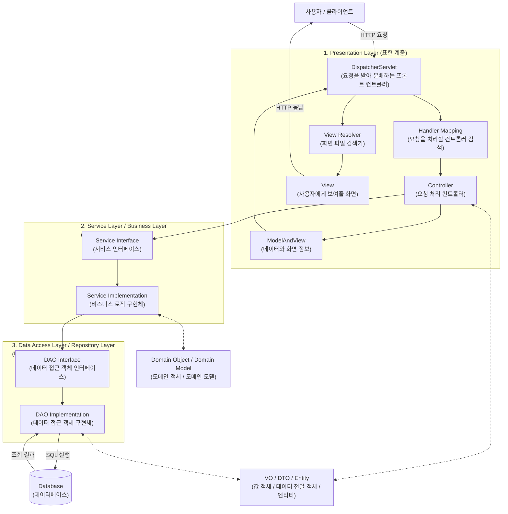
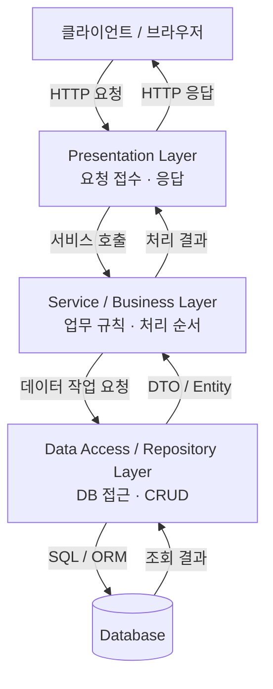
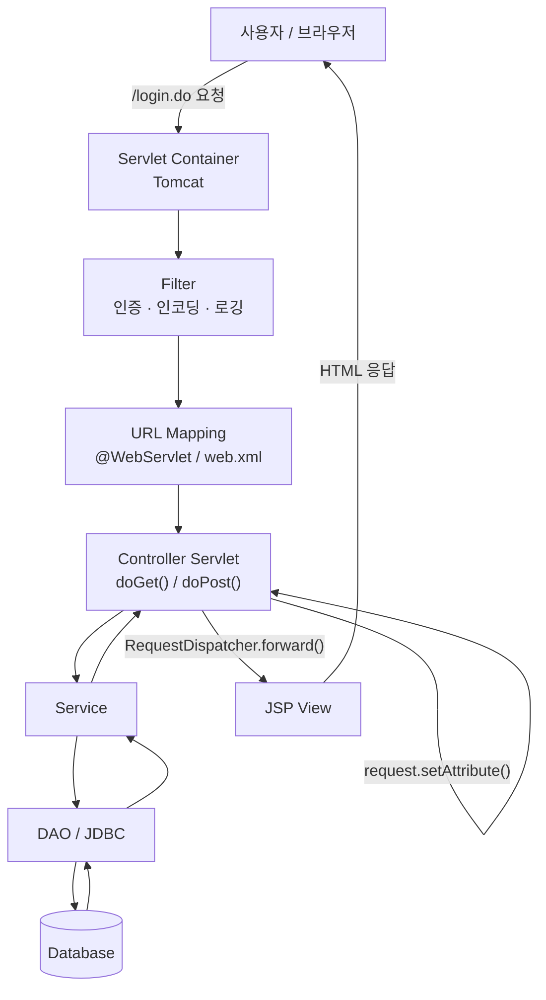
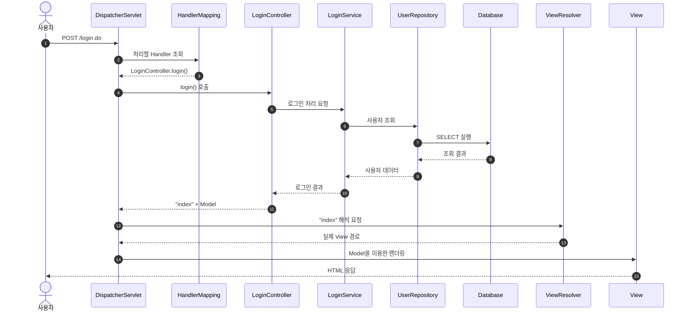

# 엔터프라이즈 3계층과 Spring MVC

## 1. 학습 범위

- 엔터프라이즈급 시스템의 3계층 구조
- Presentation, Service, Data Access Layer의 역할
- Servlet MVC 요청 처리 흐름
- Spring MVC 요청 처리 흐름
- `DispatcherServlet`, `HandlerMapping`, `ViewResolver`의 역할
- Gradle의 역할
- Servlet MVC와 Spring MVC의 차이

> 강의 전사 내용을 시험 기준으로 정리하고, 오해하기 쉬운 부분은 `실무 보정`으로 구분

---

## 2. 엔터프라이즈급 시스템

### 개념

**엔터프라이즈급 시스템**: 기업의 대규모 업무를 처리하기 위해 여러 팀이 계층별로 나누어 개발·운영하는 시스템

### 왜 계층을 나누는가

- 한 클래스가 요청 처리, 업무 판단, SQL 실행까지 모두 담당하면 코드가 복잡해짐
- 화면이나 데이터베이스 기술이 변경될 때 전체 코드를 함께 수정해야 함
- 여러 개발팀이 동시에 작업하기 어려움
- 각 계층의 책임을 분리하여 개발·테스트·유지보수를 쉽게 만들기 위한 구조

### 전체 구조





### 실행 예시

사용자가 로그인을 요청한 상황

1. Presentation Layer가 아이디와 비밀번호 수신
2. Service Layer가 로그인 업무 규칙 수행
3. Data Access Layer가 데이터베이스에서 회원 조회
4. Service Layer가 로그인 성공 여부 판단
5. Presentation Layer가 성공 화면 또는 실패 결과 응답

---

## 3. Presentation Layer

### 개념

**Presentation Layer**: 클라이언트의 요청을 받고 시스템의 처리 결과를 응답하는 계층

### 비유

은행의 `창구` 역할

- 고객의 요청 접수
- 담당 업무로 연결
- 처리 결과 전달

### 핵심 역할

- URL과 HTTP Method에 맞는 Controller 연결
- 요청 데이터 수신
- Service 호출
- View에 전달할 데이터 저장
- HTML 또는 JSON 응답

### 대표 구성요소

- `DispatcherServlet`
- `HandlerMapping`
- `Controller`
- `Model`
- `ViewResolver`
- `View`

### 핵심 객체 표시

```java
@Controller
public class LoginController {
    // 요청을 처리할 메서드
}
```

### 시험 답안

> Presentation Layer는 클라이언트의 요청을 받고 Controller에 연결하며 처리 결과를 응답하는 계층이다.

### 주의점

- 대부분 웹으로 구현되지만 Presentation Layer가 반드시 웹이어야 하는 것은 아님
- Spring 전체가 Presentation Layer인 것은 아님
- Spring MVC는 Spring 시스템 중 Presentation Layer 구현에 사용되는 기술

---

## 4. Service Layer

### 개념

**Service Layer / Business Layer**: 시스템의 실제 업무 규칙과 처리 순서를 구현하는 계층

### 왜 필요한가

Controller가 업무 규칙까지 직접 처리하면 다음 문제가 발생

- Controller 코드 증가
- 같은 업무 규칙을 여러 Controller에서 중복 작성
- 웹이 아닌 다른 방식으로 기능을 사용할 때 재사용하기 어려움
- 여러 DB 작업을 하나의 업무 단위로 관리하기 어려움

### 로그인 예시

- 아이디와 비밀번호 검증
- 탈퇴·휴면·잠금 회원 확인
- 로그인 실패 횟수 증가
- 로그인 성공 기록 저장
- 여러 Repository 호출 순서 조정
- 트랜잭션 관리

### 핵심 객체 표시

```java
@Service
public class LoginService {
    // 로그인 업무 규칙
}
```

### 시험 답안

> Service Layer는 비즈니스 로직을 처리하고 여러 데이터 접근 작업의 순서와 트랜잭션을 관리하는 계층이다.

---

## 5. Data Access Layer

### 개념

**Data Access Layer / Repository Layer**: 데이터베이스 연결과 데이터의 조회·저장·수정·삭제를 담당하는 계층

### 핵심 역할

- DB 연결
- `SELECT`, `INSERT`, `UPDATE`, `DELETE` 수행
- 조회 결과를 DTO 또는 Entity로 변환
- Service Layer에 결과 반환

### 대표 기술

- JDBC
- Spring JDBC
- MyBatis
- JPA

### Servlet과 Spring의 차이

```text
Servlet 방식
개발자가 DAO 클래스와 JDBC 코드를 직접 작성

Spring 방식
JPA, MyBatis, Spring JDBC 등을 이용하여 반복적인 DB 접근 코드 감소
```

### 핵심 객체 표시

```java
@Repository
public class UserRepository {
    // 데이터베이스 접근
}
```

### 시험 답안

> Data Access Layer는 DAO의 역할을 수행하며 데이터베이스 연동과 CRUD를 담당하는 계층이다.

---

## 6. DTO, VO, Entity

### DTO

**DTO(Data Transfer Object)**: 계층 또는 객체 사이에서 전달할 데이터를 담는 객체

```text
Controller → Service → Repository
            DTO 이동
```

### VO

**VO(Value Object)**: 하나의 값을 표현하는 객체

- 강의에서는 DTO와 비슷한 데이터 운반 객체로 설명
- 실무에서는 값의 불변성과 값 동등성을 강조하는 별도 개념으로 사용 가능

### Entity

**Entity**: 데이터베이스 테이블의 데이터와 연결되는 영속 객체

### 구분

| 객체 | 중심 역할 |
| --- | --- |
| DTO | 데이터 전달 |
| VO | 값 표현 |
| Entity | DB 데이터와 매핑 |

### 시험 기준

> DTO 또는 VO는 이동해야 할 데이터를 담아 계층 사이에 전달하는 객체이다.

---

## 7. Servlet MVC

### 개념

**Servlet MVC**: Servlet이 Controller 역할을 수행하고 JSP가 View 역할을 수행하는 웹 애플리케이션 구조

### 요청 처리 흐름



### 작은 예제

```java
@WebServlet("/login.do")
public class LoginController extends HttpServlet {

    @Override
    protected void doPost(
            HttpServletRequest request,
            HttpServletResponse response) throws Exception {

        String id = request.getParameter("id");

        request.setAttribute("userId", id);

        RequestDispatcher dispatcher =
                request.getRequestDispatcher("/Index.jsp");

        dispatcher.forward(request, response);
    }
}
```

### 예상 결과

`POST /login.do` 요청 발생 시 `LoginController`의 `doPost()`가 실행되고, `userId`가 저장된 동일한 request를 `Index.jsp`가 사용

### 그 결과가 나온 이유

1. `@WebServlet("/login.do")`가 URL을 Servlet에 매핑
2. POST 요청이므로 `doPost()` 실행
3. `request.getParameter("id")`가 요청값 추출
4. `request.setAttribute()`가 화면용 데이터 저장
5. `forward()`가 동일한 request를 JSP에 전달

### 특징

- Controller 단위: Servlet 클래스·객체
- URL 매핑: `@WebServlet` 또는 `web.xml`
- 화면 이동: `RequestDispatcher.forward()`
- 요청 파라미터와 View 경로를 개발자가 직접 처리

---

## 8. Spring MVC

### 개념

**Spring MVC**: `DispatcherServlet`을 중심으로 요청을 Controller 메서드에 연결하고 View 또는 데이터를 응답하는 MVC 프레임워크

### 왜 필요한가

요청과 Controller가 많아지면 모든 매핑과 공통 처리를 각 Servlet에 직접 구현하기 어려움

- 모든 요청을 한곳에서 접수
- 적절한 Controller 메서드 검색
- View 경로 해석
- 공통 기능과 요청 처리 구조 표준화

### 주요 구성요소

| 구성요소 | 역할 |
| --- | --- |
| `DispatcherServlet` | 모든 요청을 가장 먼저 받는 Front Controller |
| `HandlerMapping` | 요청을 처리할 Controller 메서드 검색 |
| `Controller` | Service를 호출하여 요청 처리 |
| `Model` | View에 전달할 데이터 저장 |
| `ModelAndView` | Model과 논리적 View 이름을 함께 보관 |
| `ViewResolver` | 논리적 View 이름을 실제 View 경로로 해석 |
| `View` | HTML 화면 렌더링 |

### `/login.do` 요청 처리 순서



### 번호로 암기

1. 클라이언트가 `/login.do` 요청
2. `DispatcherServlet`이 요청 접수
3. `HandlerMapping`이 Controller 메서드 검색
4. `DispatcherServlet`이 Controller 메서드 호출
5. Controller가 Service와 Repository를 이용하여 처리
6. Controller가 논리적 View 이름과 Model 반환
7. `ViewResolver`가 실제 View 경로 해석
8. View 렌더링 후 HTTP 응답

### 작은 예제

```java
@Controller
public class LoginController {

    @PostMapping("/login.do")
    public String login(LoginDTO dto, Model model) {
        model.addAttribute("user", dto);
        return "index";
    }
}
```

### 예상 결과

Controller가 반환한 `"index"`를 `ViewResolver`가 실제 View 경로로 해석

```text
논리적 View 이름: index

JSP 설정 예:      /WEB-INF/views/index.jsp
Mustache 설정 예: templates/index.mustache
```

### 그 결과가 나온 이유

- Controller는 전체 파일 경로 대신 논리적 이름 `index` 반환
- `DispatcherServlet`이 반환값 수신
- `ViewResolver`가 prefix와 suffix 등을 적용하여 View 결정
- 선택된 View가 Model의 데이터를 이용해 HTML 렌더링

### 주의점

- `ViewResolver`는 View 파일을 새로 생성하지 않음
- `index`라는 이름을 실제 View 경로로 해석
- Controller가 반드시 `String`만 반환하는 것은 아님
- `ModelAndView`, `ResponseEntity`, 객체 등도 반환 가능
- `@RestController` 또는 `@ResponseBody`로 JSON을 반환하면 일반적인 ViewResolver 과정 생략

---

## 9. Model과 ModelAndView

### String과 Model 방식

```java
public String home(Model model) {
    model.addAttribute("message", "안녕하세요");
    return "index";
}
```

- `Model`: 화면에 전달할 데이터
- `"index"`: 논리적 View 이름

### ModelAndView 방식

```java
public ModelAndView home() {
    ModelAndView mv = new ModelAndView();
    mv.addObject("message", "안녕하세요");
    mv.setViewName("index");
    return mv;
}
```

- 하나의 객체에 데이터와 View 이름 저장
- 두 방식 모두 Spring MVC에서 사용 가능

---

## 10. Servlet MVC와 Spring MVC 비교

| 구분 | Servlet MVC | Spring MVC |
| --- | --- | --- |
| 최초 요청 수신 | Servlet Container | `DispatcherServlet` |
| Controller 단위 | Servlet 클래스·객체 | Controller 메서드 |
| URL 매핑 | `@WebServlet`, `web.xml` | `@GetMapping`, `@PostMapping` 등 |
| Handler 검색 | Container의 URL 매핑 | `HandlerMapping` |
| View 이동 | `RequestDispatcher.forward()` | 논리적 View 이름 반환 |
| View 경로 결정 | 개발자가 직접 지정 | `ViewResolver` |
| 반복 처리 | 개발자가 직접 작성하는 부분이 많음 | Framework가 공통 처리 |
| 적합한 구조 | 비교적 단순한 웹 시스템 | 역할 분담이 많은 구조에 유리 |

### 한 줄 흐름 비교

```text
Servlet MVC
요청 → URL Mapping → Controller Servlet → forward → JSP

Spring MVC
요청 → DispatcherServlet → HandlerMapping → Controller 메서드
     → ViewResolver → View
```

### 가장 중요한 관계

Spring MVC도 Servlet 기술을 기반으로 동작

```text
Servlet API
└── DispatcherServlet
    └── Spring MVC 요청 처리
```

따라서 `Servlet과 Spring MVC는 완전히 관계없는 기술`이라는 설명은 부정확

---

## 11. Gradle

### 개념

**Gradle**: 프로젝트의 컴파일, 테스트, 패키징과 외부 라이브러리 의존성을 관리하는 빌드 도구

> 정확한 명칭은 `Grade`가 아니라 `Gradle`

### 왜 필요한가

라이브러리를 개발자가 하나씩 검색하여 다운로드하면 다음 문제가 발생

- 버전 충돌
- 필요한 추가 라이브러리 누락
- 팀원마다 서로 다른 개발 환경 사용
- 빌드 과정 반복 수행

Gradle 설정 파일에 필요한 라이브러리를 선언하면 동일한 설정으로 프로젝트 구성 가능

### 주요 역할

- 외부 라이브러리 다운로드
- Java 코드 컴파일
- 테스트 실행
- JAR 또는 WAR 패키징
- Spring Boot 애플리케이션 실행
- 플러그인과 Java 버전 관리

### 주요 파일

```text
build.gradle
```

### 작은 예제

```gradle
dependencies {
    implementation 'org.springframework.boot:spring-boot-starter-web'
    implementation 'org.springframework.boot:spring-boot-starter-data-jpa'
    runtimeOnly 'com.mysql:mysql-connector-j'
    testImplementation 'org.springframework.boot:spring-boot-starter-test'
}
```

### 예상 결과

Gradle Refresh 또는 빌드를 실행하면 선언된 의존성을 확인하고 필요한 라이브러리를 다운로드한 후 프로젝트 빌드에 사용

### 캐시 위치 주의

```text
Gradle 기본 캐시: ~/.gradle/caches
Maven 기본 저장소: ~/.m2/repository
```

Gradle이 항상 `.m2` 폴더에 라이브러리를 저장하는 것은 아님

---

## 12. Spring Framework와 Spring Boot

### Spring Framework

**Spring Framework**: 의존성 주입, MVC, 트랜잭션, 데이터 접근 등 엔터프라이즈 애플리케이션 구축 기능 제공

### Spring Boot

**Spring Boot**: Spring 프로젝트의 초기 설정과 실행 환경을 자동화하는 도구

### Spring Boot의 주요 특징

- 자동 설정
- Starter Dependency
- 내장 Tomcat
- 독립 실행 가능한 애플리케이션
- `application.properties` 또는 `application.yml`을 이용한 설정

### 실무 보정

- Spring Boot가 XML 설정을 기술적으로 완전히 금지하는 것은 아님
- XML보다 Annotation, Java Config, 자동 설정을 주로 사용하는 방향
- Spring은 대규모 시스템에 강점이 있지만 작은 시스템에서도 사용 가능
- 시스템 규모만으로 Servlet 또는 Spring을 기계적으로 선택하지 않음

---

## 13. 시험용 핵심 답안

### 엔터프라이즈 3계층

> 엔터프라이즈 시스템은 Presentation Layer, Service Layer, Data Access Layer로 역할을 나누어 구축한다.

### Presentation Layer

> 클라이언트의 요청을 받고 Controller에 연결하며 처리 결과를 응답하는 계층이다.

### Service Layer

> 비즈니스 로직을 처리하고 여러 데이터 접근 작업의 순서와 트랜잭션을 관리하는 계층이다.

### Data Access Layer

> DAO 역할을 수행하며 데이터베이스 연동과 CRUD를 담당하는 계층이다.

### DispatcherServlet

> 모든 요청을 가장 먼저 받아 Spring MVC의 전체 처리 흐름을 관리하는 Front Controller이다.

### HandlerMapping

> 요청 URL과 HTTP Method에 매핑된 Controller 메서드를 찾아주는 객체이다.

### ViewResolver

> Controller가 반환한 논리적 View 이름을 실제 View 경로로 해석하는 객체이다.

### Gradle

> 프로젝트의 컴파일·테스트·패키징과 외부 라이브러리 의존성을 관리하는 빌드 도구이다.

### Servlet MVC와 Spring MVC의 차이

> Servlet MVC는 URL에 매핑된 Controller Servlet이 요청을 직접 처리하지만, Spring MVC는 DispatcherServlet이 HandlerMapping과 ViewResolver를 이용하여 Controller 메서드와 View를 연결한다.

---

## 14. 최종 암기 흐름

```text
[3계층]
Presentation → Service → Data Access → Database

[Servlet MVC]
요청 → Tomcat → @WebServlet → Controller Servlet
     → DAO → request.setAttribute() → forward() → JSP

[Spring MVC]
요청 → DispatcherServlet → HandlerMapping → Controller 메서드
     → Service → Repository → 논리적 View 이름
     → ViewResolver → View → 응답

[Gradle]
build.gradle → 의존성 확인 → 라이브러리 다운로드
             → 컴파일 → 테스트 → 패키징
```

## 15. 혼동 주의

| 잘못 외우기 쉬운 표현 | 정확한 표현 |
| --- | --- |
| ViewResolver가 `index.jsp`를 생성 | 논리적 이름을 실제 View 경로로 해석 |
| Spring MVC는 Servlet과 무관 | `DispatcherServlet` 자체가 Servlet |
| Controller는 반드시 String만 반환 | String 외에 `ModelAndView`, 객체 등도 반환 가능 |
| Gradle은 라이브러리 | Gradle은 빌드·의존성 관리 도구 |
| Gradle 라이브러리는 항상 `.m2`에 저장 | 기본 Gradle 캐시는 `~/.gradle/caches` |
| Presentation Layer는 무조건 웹 | 대부분 웹이지만 반드시 웹일 필요는 없음 |
| Spring Boot는 XML을 사용할 수 없음 | XML보다 자동 설정과 Annotation을 주로 사용 |
