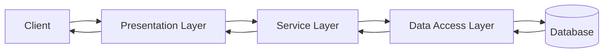
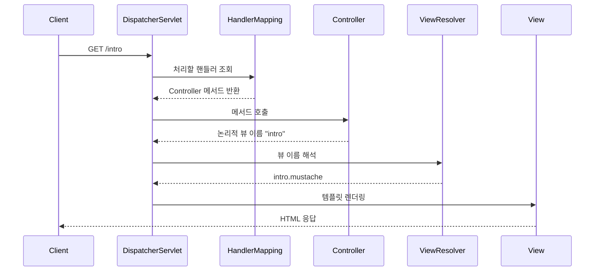

# Spring Boot와 Spring MVC 기초

Spring Boot 프로젝트 생성부터 Spring MVC 기반 화면 이동까지 한 문서로 정리한 학습 자료

> 자동 전사 과정에서 잘못 인식된 용어를 공식 기술명으로 보정하고, 강의의 단순화된 설명과 실제 기술 동작이 다른 부분은 `기술 보정`에서 별도 구분

## 목차

- [1. 시험 핵심 요약](#1-시험-핵심-요약)
- [2. Spring Boot 프로젝트 생성](#2-spring-boot-프로젝트-생성)
- [3. 3계층 아키텍처](#3-3계층-아키텍처)
- [4. 데이터 접근 계층](#4-데이터-접근-계층)
- [5. 프레젠테이션 계층](#5-프레젠테이션-계층)
- [6. HTTP 메시지와 메서드](#6-http-메시지와-메서드)
- [7. Spring MVC 처리 흐름](#7-spring-mvc-처리-흐름)
- [8. MVC와 REST API](#8-mvc와-rest-api)
- [9. 프로젝트 폴더 구조](#9-프로젝트-폴더-구조)
- [10. 설정 파일](#10-설정-파일)
- [11. 주요 어노테이션](#11-주요-어노테이션)
- [12. Mustache 화면 이동 실습](#12-mustache-화면-이동-실습)
- [13. 기술 보정](#13-기술-보정)
- [14. 최종 체크리스트](#14-최종-체크리스트)

## 1. 시험 핵심 요약

| 주제 | 핵심 내용 |
| --- | --- |
| 3계층 아키텍처 | Presentation, Service, Data Access 계층으로 역할 분리 |
| Data Access Layer | DB 연결과 CRUD 처리, DAO·Repository 역할 |
| DataSource | DB 주소, 포트, 데이터베이스명, 계정, 비밀번호 등 연결 정보 |
| Spring MVC | `DispatcherServlet`이 요청을 받고 적절한 컨트롤러 메서드로 전달 |
| View Resolver | 컨트롤러가 반환한 논리적 뷰 이름을 실제 뷰 파일과 연결 |
| REST API | 뷰 문서 대신 JSON 등의 데이터를 HTTP 응답 본문에 반환 |
| HTTP 메시지 | 시작 줄, 헤더, 빈 줄, 본문으로 구성 |
| 상태 코드 | `2xx` 성공, `3xx` 리다이렉션, `4xx` 클라이언트 오류, `5xx` 서버 오류 |
| 정적 파일 | `src/main/resources/static`에 저장 |
| 템플릿 파일 | `src/main/resources/templates`에 저장 |
| 프로젝트 설정 | `application.properties` 또는 `application.yml` 사용 |
| 빌드 설정 | `build.gradle`에서 플러그인과 의존성 관리 |
| 단위 테스트 | `src/test/java`에서 JUnit으로 작성 |
| 요청 매핑 | `@GetMapping`, `@PostMapping` 등으로 URI와 HTTP 메서드 연결 |

## 2. Spring Boot 프로젝트 생성

**Spring Initializr**: Spring Boot 프로젝트의 초기 구조와 빌드 설정을 생성하는 도구

- 접속 주소: [start.spring.io](https://start.spring.io/)
- Project: `Gradle`
- Language: `Java`
- Java: `17`
- Packaging: `Jar`
- Configuration: `Properties`

### 2.1 주요 메타데이터

| 항목 | 의미 | 예시 |
| --- | --- | --- |
| Group | 조직 또는 도메인을 뒤집은 식별자 | `com.example` |
| Artifact | 빌드 결과물과 프로젝트의 기본 이름 | `article-project-c` |
| Name | 프로젝트 표시 이름 | `article-project-c` |
| Package name | Java 기본 패키지 | `com.example.articleproject` |

### 2.2 의존성

| 의존성 | 역할 |
| --- | --- |
| Spring Web | Spring MVC와 내장 웹 서버를 이용한 웹 애플리케이션 개발 |
| Spring Data JPA | Repository 추상화를 이용한 데이터 접근 |
| H2 Database | 개발·테스트용 인메모리 관계형 데이터베이스 |
| Mustache | 서버에서 HTML을 생성하는 템플릿 엔진 |

프로젝트 생성 후 압축을 풀고 IntelliJ IDEA에서 최상위 프로젝트 폴더를 `Open`으로 열기

```text
article-project-c/
├── build.gradle
├── gradlew
├── gradlew.bat
├── settings.gradle
└── src/
```

> 제출 시 프로젝트 폴더 전체를 압축하되, 불필요한 빌드 결과물과 IDE 캐시는 제외

## 3. 3계층 아키텍처

**3계층 아키텍처(Three-Layered Architecture)**: 애플리케이션을 역할에 따라 세 계층으로 분리하는 구조

| 계층 | 주요 책임 | 대표 구성요소 |
| --- | --- | --- |
| Presentation Layer | HTTP 요청 수신, 입력 검증, 응답 생성 | Controller |
| Service Layer | 핵심 업무 규칙과 트랜잭션 처리 | Service |
| Data Access Layer | 데이터베이스 접근과 영속성 처리 | Repository, DAO |



계층 분리의 장점:

- 역할과 책임의 명확한 구분
- 특정 계층 변경이 다른 계층에 미치는 영향 감소
- 기능별 테스트와 유지보수 용이
- 팀 단위 병렬 개발에 유리

## 4. 데이터 접근 계층

**DAO(Data Access Object)**: 데이터베이스 접근 코드를 분리하는 객체

**Repository**: 도메인 객체의 저장과 조회를 컬렉션처럼 추상화하는 구성요소

Spring 생태계에서 사용할 수 있는 대표 기술:

- Spring JDBC
- MyBatis
- JPA
- Hibernate
- Spring Data JPA

### 4.1 DataSource

**DataSource**: 애플리케이션이 데이터베이스 연결을 획득할 수 있도록 연결 정보를 관리하는 객체 또는 설정

주요 연결 정보:

- DBMS 호스트 또는 IP 주소
- 포트 번호
- 데이터베이스 이름
- 사용자 계정
- 비밀번호
- JDBC 드라이버와 URL

예시:

```properties
spring.datasource.url=jdbc:h2:mem:testdb
spring.datasource.driver-class-name=org.h2.Driver
spring.datasource.username=sa
spring.datasource.password=
```

> 실제 프로젝트의 비밀번호와 API 키는 GitHub에 커밋하지 않고 환경 변수나 별도 비밀 관리 수단 사용

## 5. 프레젠테이션 계층

**Presentation Layer**: 클라이언트의 요청을 받아 필요한 계층을 호출하고 처리 결과를 응답으로 만드는 영역

은행 창구에 비유한 처리 흐름:

1. 고객의 요청 접수
2. 내부 담당 부서에 처리 요청
3. 처리 결과 수신
4. 고객에게 결과 전달

Spring Boot 웹 애플리케이션에서는 Spring MVC와 내장 웹 서버를 사용하여 이 계층을 구현할 수 있음

## 6. HTTP 메시지와 메서드

### 6.1 HTTP 메시지 구조

```text
Start Line
Headers

Body
```

요청 시작 줄:

```http
GET /intro HTTP/1.1
```

- HTTP 메서드: `GET`
- 요청 대상: `/intro`
- HTTP 버전: `HTTP/1.1`

응답 시작 줄:

```http
HTTP/1.1 200 OK
```

- HTTP 버전: `HTTP/1.1`
- 상태 코드: `200`
- 이유 문구: `OK`

### 6.2 HTTP 메서드와 CRUD

| CRUD | HTTP 메서드 | 용도 |
| --- | --- | --- |
| Create | `POST` | 새 자원 생성 |
| Read | `GET` | 자원 조회 |
| Update | `PUT`, `PATCH` | 자원 전체 또는 일부 수정 |
| Delete | `DELETE` | 자원 삭제 |

`PUT`과 `PATCH`의 일반적인 구분:

- `PUT`: 자원의 전체 표현을 교체하는 의미로 사용
- `PATCH`: 자원의 일부 속성을 변경하는 의미로 사용

### 6.3 상태 코드

| 범위 | 의미 | 예시 |
| --- | --- | --- |
| `2xx` | 요청 성공 | `200 OK`, `201 Created` |
| `3xx` | 리다이렉션 | `302 Found` |
| `4xx` | 클라이언트 측 요청 오류 | `400 Bad Request`, `404 Not Found` |
| `5xx` | 서버 내부 오류 | `500 Internal Server Error` |

### 6.4 GET 요청이 만들어지는 대표 상황

- 브라우저 주소 표시줄에 URL 입력
- `<a href="...">` 링크 클릭
- 서버의 리다이렉트 응답을 받은 브라우저가 지정된 URL로 재요청

폼은 `method` 속성으로 `GET` 또는 `POST` 지정 가능

```html
<form action="/login" method="post">
  <!-- 입력 요소 -->
</form>
```

## 7. Spring MVC 처리 흐름

**Spring MVC**: Model, View, Controller 역할을 분리하는 Spring의 웹 프레임워크



주요 구성요소:

- **DispatcherServlet**: 모든 MVC 요청을 받는 프런트 컨트롤러
- **HandlerMapping**: 요청 URI와 HTTP 메서드에 맞는 핸들러 탐색
- **Controller**: 요청 처리와 다음 단계 결정
- **ViewResolver**: 논리적 뷰 이름을 실제 템플릿과 연결
- **View**: 모델 데이터를 사용하여 HTML 생성

Mustache를 사용하는 경우 컨트롤러가 `"intro"`를 반환하면 기본적으로 `templates/intro.mustache`를 찾아 렌더링

## 8. MVC와 REST API

| 구분 | MVC 화면 응답 | REST API 데이터 응답 |
| --- | --- | --- |
| 대표 어노테이션 | `@Controller` | `@RestController` |
| 일반적인 반환값 | 논리적 뷰 이름과 Model | 객체, 컬렉션, `ResponseEntity` |
| 응답 본문 | 렌더링된 HTML | 주로 JSON |
| 화면 렌더링 위치 | 서버와 브라우저가 역할 분담 | React 등의 프런트엔드 |

REST 컨트롤러 예시:

```java
@RestController
@RequestMapping("/api/users")
public class UserController {

    @GetMapping("/{id}")
    public UserResponse findUser(@PathVariable Long id) {
        return new UserResponse(id, "홍길동");
    }
}
```

응답 객체는 Jackson에 의해 JSON으로 직렬화될 수 있음

```json
{
  "id": 1,
  "name": "홍길동"
}
```

## 9. 프로젝트 폴더 구조

```text
src/
├── main/
│   ├── java/
│   │   └── com/example/articleproject/
│   │       ├── ArticleProjectApplication.java
│   │       └── controller/
│   │           └── MainController.java
│   └── resources/
│       ├── static/
│       ├── templates/
│       │   ├── index.mustache
│       │   └── intro.mustache
│       └── application.properties
└── test/
    └── java/
```

### 9.1 `src/main`

- `java`: 애플리케이션의 Java 소스 코드
- `resources/static`: CSS, JavaScript, 이미지, 정적 HTML 등의 정적 자원
- `resources/templates`: Mustache, Thymeleaf 등 서버 템플릿 파일
- `application.properties`: 애플리케이션 환경 설정

### 9.2 `src/test`

**JUnit**: Java 코드의 단위 테스트를 작성하고 실행하는 테스트 프레임워크

- 애플리케이션 코드와 테스트 코드 분리
- 클래스 또는 기능 단위 검증
- 다른 계층과 연동하기 전 독립적인 오류 확인

## 10. 설정 파일

| 위치 | 대상 | 대표 설정 |
| --- | --- | --- |
| `build.gradle` | Gradle 빌드 | 플러그인, 의존성, Java 버전 |
| `application.properties` | Spring Boot 애플리케이션 | 서버 포트, DataSource, 로그 수준 |
| IntelliJ `Settings` | IDE | JDK, Gradle 실행 방식, 플러그인 |

서버 포트 변경:

```properties
server.port=8081
```

실행 후 접속 주소:

```text
http://localhost:8081/
```

`server.port`가 없으면 일반적으로 기본 포트 `8080` 사용

## 11. 주요 어노테이션

### 11.1 계층별 컴포넌트

| 어노테이션 | 의미 |
| --- | --- |
| `@Component` | 일반적인 Spring 관리 객체 등록 |
| `@Controller` | MVC 컨트롤러 등록 |
| `@RestController` | 응답 본문에 데이터를 작성하는 컨트롤러 등록 |
| `@Service` | 서비스 계층의 컴포넌트 등록 |
| `@Repository` | 데이터 접근 계층의 컴포넌트 등록과 예외 변환 지원 |

**Spring Bean**: Spring IoC 컨테이너가 생성하고 생명주기를 관리하는 객체

### 11.2 요청 매핑

| 어노테이션 | HTTP 메서드 |
| --- | --- |
| `@GetMapping` | `GET` |
| `@PostMapping` | `POST` |
| `@PutMapping` | `PUT` |
| `@PatchMapping` | `PATCH` |
| `@DeleteMapping` | `DELETE` |

매핑 경로는 `/`로 시작하는 형태 권장

```java
@GetMapping("/intro")
```

## 12. Mustache 화면 이동 실습

### 12.1 컨트롤러

`src/main/java/.../controller/MainController.java`

```java
package com.example.articleproject.controller;

import org.springframework.stereotype.Controller;
import org.springframework.web.bind.annotation.GetMapping;

@Controller
public class MainController {

    @GetMapping("/")
    public String home() {
        return "index";
    }

    @GetMapping("/intro")
    public String intro() {
        return "intro";
    }
}
```

실행 흐름:

- `GET /` → `home()` → `index.mustache`
- `GET /intro` → `intro()` → `intro.mustache`

### 12.2 홈 화면

`src/main/resources/templates/index.mustache`

```html
<!doctype html>
<html lang="ko">
<head>
  <meta charset="UTF-8">
  <meta name="viewport" content="width=device-width, initial-scale=1.0">
  <title>홈</title>
</head>
<body>
  <header>
    <h1>게시판 시스템</h1>
    <nav>
      <a href="/">홈</a>
      <a href="/intro">대학 소개</a>
    </nav>
  </header>

  <main>
    <p>게시판 시스템에 오신 것을 환영합니다.</p>
  </main>
</body>
</html>
```

### 12.3 소개 화면

`src/main/resources/templates/intro.mustache`

```html
<!doctype html>
<html lang="ko">
<head>
  <meta charset="UTF-8">
  <meta name="viewport" content="width=device-width, initial-scale=1.0">
  <title>대학 소개</title>
</head>
<body>
  <header>
    <h1>게시판 시스템</h1>
    <nav>
      <a href="/">홈</a>
      <a href="/intro">대학 소개</a>
    </nav>
  </header>

  <main>
    <p>대학 소개 페이지입니다.</p>
  </main>
</body>
</html>
```

### 12.4 실행 확인

1. `ArticleProjectApplication`의 `main()` 실행
2. 콘솔에서 애플리케이션 시작 메시지 확인
3. 브라우저에서 `http://localhost:8081/` 접속
4. `대학 소개` 클릭 후 `/intro` 화면 확인
5. `홈` 클릭 후 `/` 화면 확인

문제 발생 시 확인 항목:

- Java 17 선택 여부
- Gradle 동기화 완료 여부
- Mustache 의존성 추가 여부
- 템플릿 파일의 위치와 확장자
- `application.properties`의 포트 번호
- 매핑 경로의 `/` 누락 여부
- 동일 포트를 사용하는 다른 프로세스 존재 여부

## 13. 기술 보정

자동 전사 원문에는 강의 중 단순화된 표현과 잘못 인식된 용어가 포함되어 있어 다음과 같이 보정

### 13.1 Servlet과 Spring

- Servlet을 단순히 구기술, Spring을 신기술로 구분하는 것은 부정확
- Servlet API는 Java 웹 요청과 응답을 처리하는 기반 기술
- Spring MVC는 Servlet 기술 위에서 요청 매핑, 데이터 바인딩, 검증, 예외 처리 등의 추상화 제공
- 프로젝트 규모만으로 기술을 선택하기보다 요구사항, 팀 역량, 보안, 유지보수성, 생태계를 함께 고려

### 13.2 `@Controller`

- `@Controller`를 붙이는 것은 `Controller` 인터페이스를 직접 `implements`하는 것과 동일하지 않음
- 현대 Spring MVC는 어노테이션 기반 핸들러 메서드를 탐색하여 호출
- 컨트롤러 메서드가 항상 `String`만 반환해야 하는 것은 아님
- `String`은 일반적으로 논리적 뷰 이름으로 사용할 수 있지만 `ModelAndView`, `ResponseEntity` 등 다양한 반환 형식 지원

### 13.3 `@RestController`

```java
@RestController = @Controller + @ResponseBody
```

- 반환값을 뷰 이름으로 해석하지 않고 기본적으로 HTTP 응답 본문에 작성
- 객체 반환 시 메시지 컨버터가 JSON 등으로 직렬화

### 13.4 REST

- JSON을 반환한다는 사실만으로 RESTful API가 완성되는 것은 아님
- 자원 중심 URI, HTTP 메서드 의미, 상태 코드, 무상태성 등의 원칙을 함께 고려

### 13.5 HTTP 시작 줄

- 요청 시작 줄에는 메서드, 요청 대상, HTTP 버전 포함
- 응답 시작 줄에는 HTTP 버전, 상태 코드, 이유 문구 포함
- 응답 시작 줄에 프런트엔드 주소가 들어간다는 설명은 부정확

### 13.6 CSRF, CORS, 인증, HTTPS

- **CSRF**: 로그인된 사용자의 권한을 악용하여 의도하지 않은 요청을 보내게 만드는 공격
- **CORS**: 브라우저가 다른 출처의 자원 요청을 허용할지 결정하는 정책
- **인증**: 요청을 보낸 사용자의 신원 확인
- **HTTPS**: 전송 구간의 암호화와 서버 인증 제공

단순한 공용 키 문자열 하나로 프런트엔드와 백엔드의 신뢰가 모두 보장되는 것은 아님

### 13.7 JPA와 Hibernate

- **JPA**: Java 객체와 관계형 데이터베이스를 매핑하기 위한 표준 명세
- **Hibernate**: JPA를 구현하는 대표적인 ORM 프레임워크
- **Spring Data JPA**: JPA 기반 Repository 구현을 단순화하는 Spring Data 모듈

## 14. 최종 체크리스트

- [ ] 3계층의 이름과 각 역할 설명
- [ ] DataSource에 필요한 정보 설명
- [ ] Spring MVC 요청 처리 순서 설명
- [ ] `@Controller`와 `@RestController` 비교
- [ ] HTTP 요청과 응답 시작 줄 구분
- [ ] HTTP 메서드와 CRUD 연결
- [ ] 상태 코드 범위별 의미 구분
- [ ] `static`과 `templates` 폴더 용도 구분
- [ ] `build.gradle`, `application.properties`, IDE 설정의 대상 구분
- [ ] `@Component`, `@Service`, `@Repository`, `@Controller` 설명
- [ ] `@GetMapping("/")`의 의미 설명
- [ ] `/`와 `/intro` 화면 이동 실습 완료
