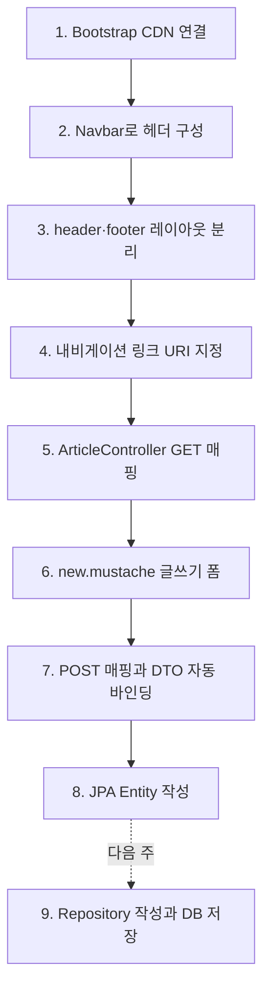
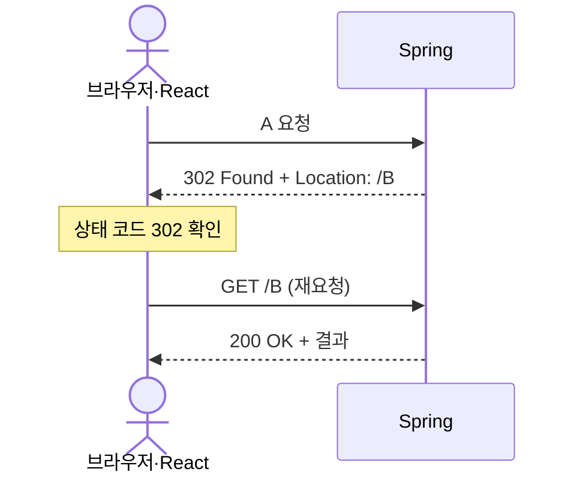
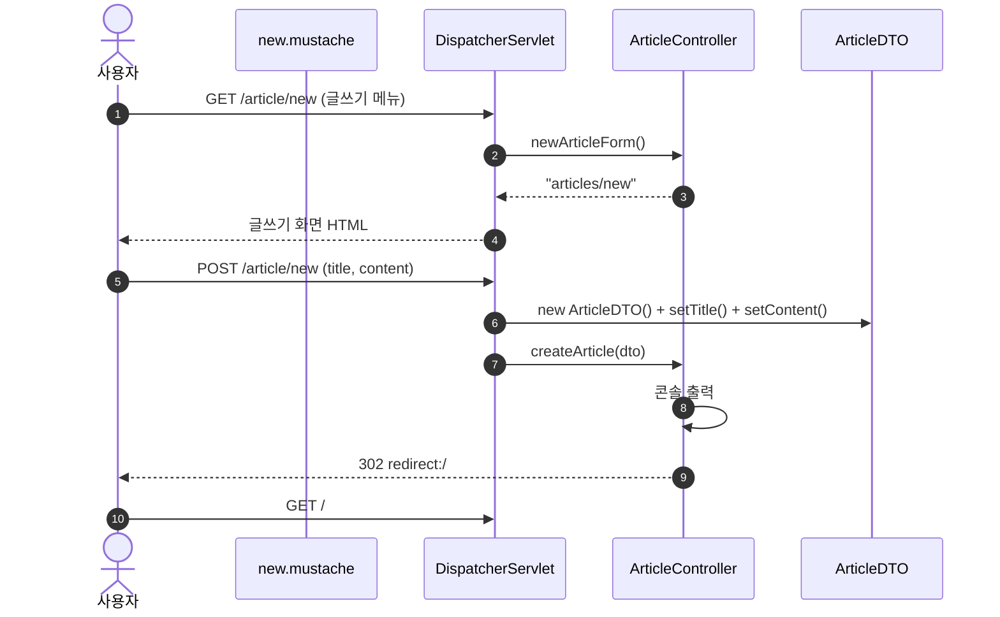
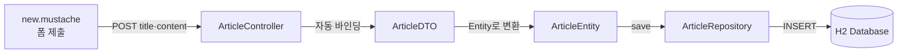
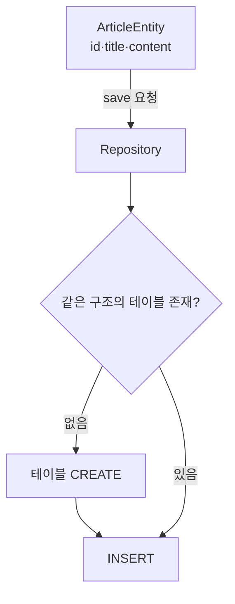

# 게시판 글쓰기와 JPA 기초

Bootstrap으로 화면을 꾸미고, Mustache 레이아웃을 분리한 뒤, 게시판 글쓰기 폼의 데이터를 DTO로 받고 JPA Entity를 준비하는 수업 정리

> 자동 전사에서 잘못 인식된 용어를 공식 명칭으로 보정 (`CDM` → CDN, `머스타치` → Mustache, `bto` → DTO, `NTT` → Entity, `레파지토리` → Repository, `자카르타` → `jakarta`, `롬복·원복` → Lombok)
>
> 강의의 단순화된 설명과 실제 기술 동작이 다른 부분은 [16. 기술 보정](#16-기술-보정)에서 별도 구분
>
> 실습 코드는 `~/springworkspace/articleProjectC` 프로젝트 기준. 이름·학번 등 개인정보는 `이름 학번`으로 대체

## 목차

- [1. 학습 범위](#1-학습-범위)
- [2. 이번 주 학습 순서](#2-이번-주-학습-순서)
- [3. 실습 프로젝트 구조](#3-실습-프로젝트-구조)
- [4. Bootstrap과 CDN](#4-bootstrap과-cdn)
- [5. 공통 레이아웃 분리](#5-공통-레이아웃-분리)
- [6. 내비게이션 링크와 GET 요청](#6-내비게이션-링크와-get-요청)
- [7. 게시판 컨트롤러 분리](#7-게시판-컨트롤러-분리)
- [8. 글쓰기 폼](#8-글쓰기-폼)
- [9. 파라미터의 두 종류](#9-파라미터의-두-종류)
- [10. 폼 데이터 처리: Servlet과 Spring](#10-폼-데이터-처리-servlet과-spring)
- [11. DTO와 getter·setter·Lombok](#11-dto와-gettersetterlombok)
- [12. JPA 개요](#12-jpa-개요)
- [13. 추상 클래스와 인터페이스](#13-추상-클래스와-인터페이스)
- [14. Entity 작성](#14-entity-작성)
- [15. 다음 수업과 시험 일정](#15-다음-수업과-시험-일정)
- [16. 기술 보정](#16-기술-보정)
- [17. 시험 핵심 정리](#17-시험-핵심-정리)
- [18. 예상 문제](#18-예상-문제)
- [19. 최종 체크리스트](#19-최종-체크리스트)

---

## 1. 학습 범위

- CSS 프레임워크 Bootstrap의 CDN 연결
- Bootstrap Navbar·Form·Button 컴포넌트 활용
- Mustache Partial을 이용한 header·footer 분리
- 내비게이션 링크의 요청 URI 지정
- GET 요청이 발생하는 세 가지 상황과 상태 코드 해석
- 게시판 전용 `ArticleController` 작성
- 같은 URI를 GET·POST로 구분하는 매핑
- 폼 `name` 속성과 DTO 필드의 자동 바인딩
- 파라미터의 두 종류: Query String, Path Variable
- getter·setter 자동 생성과 Lombok
- JPA의 핵심 구성요소: Entity, Repository
- 추상 클래스와 인터페이스 복습
- `@Entity`, `@Id`, `@GeneratedValue`, `@Column`

---

## 2. 이번 주 학습 순서



| 단계 | 작업 | 결과 파일 |
| --- | --- | --- |
| 1 | Bootstrap CSS·JS CDN 연결 | `index.mustache` → 이후 `layouts/` 이동 |
| 2 | Navbar 컴포넌트 복사 | `layouts/header.mustache` |
| 3 | 공통 영역 분리 | `layouts/header.mustache`, `layouts/footer.mustache` |
| 4 | 로고·Home·자기소개·글쓰기 링크 지정 | `layouts/header.mustache` |
| 5 | 게시판 컨트롤러 추가 | `controller/ArticleController.java` |
| 6 | 글쓰기 화면 작성 | `templates/articles/new.mustache` |
| 7 | 폼 데이터를 DTO로 수신 | `dto/ArticleDTO.java` |
| 8 | DB 테이블과 연결될 객체 준비 | `entity/ArticleEntity.java` |
| 9 | Repository로 DB 저장 (다음 주) | `repository/` |

---

## 3. 실습 프로젝트 구조

### 3.1 전체 트리

`build/`, `.gradle/`, `.idea/` 등 빌드 결과물과 IDE 설정 폴더는 제외

```text
articleProjectC/
├── build.gradle                         # Gradle 빌드·의존성 설정
├── settings.gradle                      # 프로젝트 이름: articleProjectC
├── gradlew, gradlew.bat                 # Gradle Wrapper 실행 스크립트
├── gradle/wrapper/                      # Wrapper JAR·버전 설정
├── HELP.md                              # Spring Initializr 안내 문서
└── src/
    ├── main/
    │   ├── java/com/dongyang/articleProjectC/
    │   │   ├── ArticleProjectCApplication.java   # main() 실행 클래스
    │   │   ├── controller/
    │   │   │   ├── MainController.java          # "/", "/intro"        (Week08)
    │   │   │   └── ArticleController.java       # "/article/new"       (Week09)
    │   │   ├── dto/
    │   │   │   └── ArticleDTO.java              # 폼 데이터 운반 객체  (Week09)
    │   │   ├── entity/
    │   │   │   └── ArticleEntity.java           # DB 테이블 매핑 객체  (Week09)
    │   │   └── repository/                      # 빈 패키지, 다음 주 작성
    │   └── resources/
    │       ├── application.properties           # 애플리케이션 설정
    │       ├── static/                          # 정적 파일 (현재 비어 있음)
    │       └── templates/                       # Mustache 뷰 문서 루트
    │           ├── index.mustache               # "/" 화면
    │           ├── intro.mustache               # "/intro" 화면
    │           ├── layouts/
    │           │   ├── header.mustache          # 공통 머리말 + Navbar
    │           │   └── footer.mustache          # 공통 꼬리말 + Bootstrap JS
    │           └── articles/
    │               └── new.mustache             # 글쓰기 화면
    └── test/java/com/dongyang/articleProjectC/
        └── ArticleProjectCApplicationTests.java # 컨텍스트 로딩 테스트
```

### 3.2 패키지와 계층의 대응

| 패키지·폴더 | 역할 | 계층 | 대표 어노테이션 |
| --- | --- | --- | --- |
| `controller` | 요청 수신, 뷰 이름 반환 | Presentation | `@Controller` |
| `dto` | 폼 데이터를 Controller로 운반 | 계층 간 전달 | 없음 |
| `entity` | DB 테이블 구조와 매핑 | Data Access | `@Entity` |
| `repository` | DB 저장·조회 (다음 주) | Data Access | Spring Data JPA 인터페이스 |
| `templates` | 서버에서 HTML을 생성하는 뷰 | View | Mustache 문법 |
| `static` | 가공 없이 전달되는 CSS·JS·이미지 | View | 없음 |

- 수업 규모가 작아 **역할별** 패키지 구성 (`controller`, `dto`, `entity`, `repository`)
- 실제 프로젝트의 기본 원칙은 **도메인(기능)별** 패키지 구성 (예: `article/`, `member/` 아래에 각각 controller·dto·entity)

### 3.3 Week08 대비 변경점

| 구분 | 파일 |
| --- | --- |
| 추가 | `controller/ArticleController.java` |
| 추가 | `dto/ArticleDTO.java` |
| 추가 | `entity/ArticleEntity.java` |
| 추가 | `repository/` 패키지 (빈 상태) |
| 추가 | `templates/layouts/header.mustache`, `templates/layouts/footer.mustache` |
| 추가 | `templates/articles/new.mustache` |
| 변경 | `index.mustache`, `intro.mustache`: 전체 HTML → Partial 포함 구조 |
| 유지 | `MainController.java`, `ArticleProjectCApplication.java`, `build.gradle` |

### 3.4 프로젝트 설정 확인값

`build.gradle`과 `application.properties`에서 직접 확인한 값

| 항목 | 값 |
| --- | --- |
| Spring Boot | `4.1.1` |
| Java Toolchain | `21` |
| Group | `com.dongyang` |
| 기본 패키지 | `com.dongyang.articleProjectC` |
| 주요 의존성 | `spring-boot-starter-webmvc`, `spring-boot-starter-data-jpa`, `spring-boot-starter-mustache`, `spring-boot-h2console`, `h2` |
| `application.properties` | `spring.application.name=articleProjectC` 한 줄 |
| 서버 포트 | `server.port` 미설정 → 기본 `8080` |

- Spring Boot 4부터 웹 MVC 스타터 이름이 `spring-boot-starter-web`에서 `spring-boot-starter-webmvc`로 변경
- Week08 정리본의 `server.port=8081`은 현재 프로젝트에 없는 설정 → 접속 주소 `http://localhost:8080/`
- 8081 포트가 필요하면 `application.properties`에 `server.port=8081` 추가

---

## 4. Bootstrap과 CDN

### 4.1 CSS 프레임워크

**CSS 프레임워크**: 자주 쓰는 레이아웃·버튼·폼·내비게이션 스타일과 동작을 미리 만들어 둔 CSS·JavaScript 모음

| 이름 | 특징 |
| --- | --- |
| Tailwind CSS | 작은 유틸리티 클래스를 조합하는 방식 |
| Bootstrap | 완성된 컴포넌트를 복사해 바로 사용하는 방식 |
| MUI 등 | React 전용 컴포넌트 라이브러리 |

- 수업 선택: 사용법이 가장 단순한 **Bootstrap**
- 기말 프로젝트(React)에서는 MUI, Tailwind CSS, Bootstrap 중 자유 선택

### 4.2 버전 선택

- 강의 시점의 최신 메이저 버전은 안정화 전 단계로 설명
- 바로 아래의 안정 버전 **5.3.x** 선택
- 실습 프로젝트의 실제 버전: `5.3.8`

> 소프트웨어는 갓 나온 최신 버전보다 검증이 끝난 안정 버전 선택이 일반적

### 4.3 연결 방식

| 방식 | 내용 | 장점 | 단점 |
| --- | --- | --- | --- |
| 파일 다운로드 | CSS·JS 파일을 받아 `static/`에 두고 연결 | 오프라인 개발 가능 | 파일 관리·버전 교체 부담 |
| CDN | 인터넷 주소의 CSS·JS를 직접 연결 | 설치 없이 즉시 사용 | 네트워크 연결 필요 |

**CDN(Content Delivery Network)**: 여러 지역의 서버에 파일을 복제해 두고 가까운 서버에서 빠르게 전달하는 네트워크

- Spring 개발은 Gradle 빌드 과정에서 원래 네트워크가 필요하므로 CDN 방식 선택
- CSS: `<link>` 태그로 `<head>` 안에 연결
- JS: `<script>` 태그로 `</body>` 직전에 연결

```html
<!-- head 안: Bootstrap CSS -->
<link href="https://cdn.jsdelivr.net/npm/bootstrap@5.3.8/dist/css/bootstrap.min.css"
      rel="stylesheet"
      integrity="sha384-..." crossorigin="anonymous">

<!-- body 끝: Bootstrap JS (Popper 포함 bundle) -->
<script src="https://cdn.jsdelivr.net/npm/bootstrap@5.3.8/dist/js/bootstrap.bundle.min.js"
        integrity="sha384-..." crossorigin="anonymous"></script>
```

- `integrity`: 받은 파일이 변조되지 않았는지 확인하는 해시값
- `bootstrap.bundle`: 드롭다운 위치 계산에 필요한 Popper 포함

### 4.4 사이트 사용 순서

1. getbootstrap.com 접속
2. 오른쪽 상단 버전 메뉴에서 `5.3.x` 선택
3. `Get started` → `Include via CDN`의 HTML 예제 복사 (코드 블록 오른쪽 상단 복사 아이콘)
4. `templates/index.mustache`의 기존 내용을 지우고 붙여넣기
5. `<title>`에 이름·학번 작성
6. 오른쪽 메뉴 `Components` → `Navbar` 예제 복사 → `<body>` 시작 부분에 붙여넣기

> 예제 옆 번개 모양 아이콘: 해당 코드를 별도 편집 창에서 수정·실행해 보는 기능

### 4.5 Navbar 구조

```html
<nav class="navbar navbar-expand-lg bg-body-tertiary">
  <div class="container-fluid">
    <a class="navbar-brand" href="/">이름 학번</a>            <!-- 로고 자리 -->
    <button class="navbar-toggler" ...>...</button>          <!-- 모바일 메뉴 버튼 -->
    <div class="collapse navbar-collapse" id="navbarSupportedContent">
      <ul class="navbar-nav me-auto mb-2 mb-lg-0">
        <li class="nav-item"> ... </li>                       <!-- 메인 메뉴 하나 -->
        <li class="nav-item dropdown">                        <!-- 드롭다운 메뉴 -->
          <a class="nav-link dropdown-toggle" ...>Message Board</a>
          <ul class="dropdown-menu">                          <!-- 서브 메뉴 -->
            <li><a class="dropdown-item" href="/article/new">Write</a></li>
            <li><hr class="dropdown-divider"></li>            <!-- 구분선 -->
          </ul>
        </li>
      </ul>
      <form class="d-flex" role="search"> ... </form>         <!-- 검색 폼 -->
    </div>
  </div>
</nav>
```

| 클래스 | 의미 |
| --- | --- |
| `navbar-brand` | 로고 영역. 클릭 시 첫 페이지 이동이 일반적 |
| `navbar-nav` > `nav-item` | 메인 메뉴. `<li>` 하나가 메뉴 하나 |
| `dropdown`, `dropdown-menu` | 클릭 시 펼쳐지는 서브 메뉴 (JavaScript 동작) |
| `dropdown-divider` | 서브 메뉴 사이 가로 구분선 |
| `navbar-expand-lg` | 넓은 화면에서 펼치고 좁은 화면에서 접힘 (미디어 쿼리) |
| `bg-body-tertiary` | 밝은 배경색 |
| `bg-dark` + `data-bs-theme="dark"` | 어두운 배경과 밝은 글자 |

- 메뉴 추가: `<li class="nav-item">...</li>` 블록 하나를 복사해 추가
- 강의 요구: 어두운 배경으로 변경 → 배경색 관련 클래스(`bg-*`) 교체
- 현재 프로젝트 상태: `bg-body-tertiary` 유지

---

## 5. 공통 레이아웃 분리

### 5.1 개념

**레이아웃 분리(모듈화)**: 모든 페이지에 반복되는 header·footer를 별도 파일로 떼어 두고 각 페이지에서 포함시키는 방식

**Mustache Partial**: 다른 템플릿 파일의 내용을 현재 위치에 끼워 넣는 Mustache 문법

### 5.2 필요한 이유

- 메뉴 수정 시 `header.mustache` 한 파일만 수정
- 이 header를 포함하는 모든 페이지에 자동 반영
- 각 페이지에는 고유한 본문만 남아 가독성 향상
- 유지보수 비용 감소

같은 목적의 기술 비교

| 기술 | 포함 방법 |
| --- | --- |
| JSP | `<%@ include file="header.jsp" %>` |
| React | `import Header from './Header'` 후 `<Header />` |
| Mustache | `{{>layouts/header}}` |

### 5.3 웹 페이지의 세 영역

```text
┌──────────────────────────────┐
│ header  : 로고, 내비게이션 바    │ ← 모든 페이지 공통
├──────────────────────────────┤
│ main    : 페이지별 주요 콘텐츠    │ ← 페이지마다 다름
├──────────────────────────────┤
│ footer  : 저작권 표시           │ ← 모든 페이지 공통
└──────────────────────────────┘
```

- footer에 빠지면 안 되는 항목: 저작권 표시 (Copyright)

### 5.4 분리 기준

| 파일 | 옮기는 범위 |
| --- | --- |
| `layouts/header.mustache` | `<!doctype html>`부터 `</nav>`까지 (CSS `<link>` 포함) |
| `layouts/footer.mustache` | 저작권 `<h3>`부터 `</html>`까지 (JS `<script>` 포함) |
| 각 페이지 | 페이지 고유 본문만 |

`templates/layouts/header.mustache` (요약)

```html
<!doctype html>
<html lang="en">
<head>
    <meta charset="utf-8">
    <meta name="viewport" content="width=device-width, initial-scale=1">
    <title>이름 학번</title>
    <link href="https://cdn.jsdelivr.net/npm/bootstrap@5.3.8/dist/css/bootstrap.min.css" rel="stylesheet" ...>
</head>

<body>
<nav class="navbar navbar-expand-lg bg-body-tertiary">
    ...
</nav>
```

`templates/layouts/footer.mustache`

```html
<h3>COPYRIGHT</h3>
<script src="https://cdn.jsdelivr.net/npm/bootstrap@5.3.8/dist/js/bootstrap.bundle.min.js" ...></script>
</body>
</html>
```

- header가 `<html>`·`<body>`를 열고 footer가 닫는 쌍 구조
- 두 파일 중 하나만 포함하면 HTML 구조가 깨짐

### 5.5 Partial 문법

```mustache
{{>layouts/header}}

<h1>Hello, world!</h1>

{{>layouts/footer}}
```

- 열기: 중괄호 두 개 `{{` (IntelliJ가 닫는 `}}` 자동 생성)
- `>`: 포함(include) 표시
- 경로 기준: 뷰 문서 루트 `src/main/resources/templates/`
- 확장자 `.mustache` 생략
- 폴더명 정확히 작성: `layouts` (끝의 `s` 누락 주의)
- 강의 기준 표기: `{{>`와 경로 사이 공백 없이 작성

### 5.6 각 페이지 적용

`index.mustache`

```mustache
{{>layouts/header}}

<h1>Hello, world!</h1>

{{>layouts/footer}}
```

`intro.mustache`

```mustache
{{>layouts/header}}

<h1>This university is...</h1>

{{>layouts/footer}}
```

### 5.7 예상 결과

- `/`와 `/intro` 모두 같은 Navbar와 저작권 표시가 있는 화면
- 본문만 각각 `Hello, world!`, `This university is...`로 차이

### 5.8 그 결과가 나온 이유

1. 컨트롤러가 뷰 이름 `index` 반환
2. ViewResolver가 `templates/index.mustache` 선택
3. Mustache 엔진이 `{{>layouts/header}}` 위치에 `templates/layouts/header.mustache` 내용 삽입
4. 본문 출력
5. `{{>layouts/footer}}` 위치에 footer 내용 삽입
6. 완성된 HTML 한 장이 응답 본문으로 전송

---

## 6. 내비게이션 링크와 GET 요청

### 6.1 링크 주소 지정

| 메뉴 | `href` | 실행 메서드 | 응답 뷰 |
| --- | --- | --- | --- |
| 로고 (이름 학번) | `/` | `MainController.home()` | `index.mustache` |
| Home | `/` | `MainController.home()` | `index.mustache` |
| 자기소개 (introduce) | `/intro` | `MainController.in()` | `intro.mustache` |
| 게시판 → 글쓰기 (Write) | `/article/new` | `ArticleController.newArticleForm()` | `articles/new.mustache` |

- `href`에는 뷰 파일명이 아닌 **요청 URI** 작성
- 로고 링크: `index` (×) → `/` (○)
- 이유: 요청은 DispatcherServlet → HandlerMapping → Controller → ViewResolver → View 순서로 처리되므로 브라우저가 알아야 할 값은 매핑된 URI
- 실제 요청 주소: `http://서버주소:포트/intro`, 코드에는 서버 주소 생략 후 URI만 작성
- 슬래시 `/` 누락 시 오답 처리 (강의 기준)

### 6.2 GET 요청이 발생하는 세 가지 상황

| 상황 | HTTP 메서드 | 이유 |
| --- | --- | --- |
| 주소창에 URL 입력 후 Enter | GET | 브라우저 기본 요청 방식 |
| `<a href>` 하이퍼링크 클릭 | GET | `<a>` 태그에는 `method` 속성이 없음 |
| redirect 응답 후 재요청 | GET (일반적) | 브라우저가 `Location` 주소로 새 요청 |

- `<form>`만 `method` 속성으로 GET·POST 선택 가능
- 정리: 메서드를 특별히 지정할 수 없는 상황은 대부분 GET

### 6.3 redirect 동작



- 서버가 `redirect` 코드를 만나면 즉시 응답: "B를 다시 요청하시오"
- 클라이언트가 응답 시작줄의 상태 코드 `302` 확인 후 지정된 주소로 재요청

### 6.4 상태 코드 해석 (클라이언트 관점)

응답 메시지에서 가장 먼저 도착하는 시작줄의 **상태 코드**로 처리 결과 판단

| 범위 | 의미 | 클라이언트(React 등)의 해석 |
| --- | --- | --- |
| `2xx` | 성공 | `200`: 요청 처리 성공 |
| `3xx` | 리다이렉션 | `302`: 안내된 주소로 다시 요청 |
| `4xx` | 클라이언트 측 오류 | `404`: 없는 주소를 요청함 |
| `5xx` | 서버 측 오류 | `500`: 서버 문제로 처리 실패 |

- 요청 메시지 시작줄: **HTTP 메서드** 포함
- 응답 메시지 시작줄: HTTP 메서드 없음, **상태 코드** 포함

---

## 7. 게시판 컨트롤러 분리

### 7.1 컨트롤러를 나누는 이유

- 질문: 서비스 3,000개의 컨트롤러 메서드를 `MainController` 하나에 모두 작성 가능 여부
- 답: 가능
- 문제: 수정할 메서드를 찾는 일 자체가 부담
- 해결: 같은 도메인(카테고리)의 요청 처리 메서드를 별도 클래스로 분리

| 클래스 | 담당 |
| --- | --- |
| `MainController` | 첫 화면, 소개 화면 등 기본 페이지 |
| `ArticleController` | 게시판 관련 요청 |

- 클래스 이름 끝의 `Controller`는 관례일 뿐 필수 아님

### 7.2 계층별 Bean 어노테이션 복습

**Bean**: Spring 컨테이너가 생성하고 관리하는 Java 객체

| 계층 | 어노테이션 | 비고 |
| --- | --- | --- |
| Presentation | `@Controller`, `@RestController` | 요청 처리 |
| Service | `@Service` | 비즈니스 로직 |
| Data Access | `@Repository` | Spring Data JPA 사용 시 직접 붙일 일은 드묾 |
| 공통 | `@Component` | 계층 구분 없는 일반 Bean |

- `@Component`만 붙여도 Bean 생성은 가능
- 어느 계층에서 일하는 Bean인지 명확히 드러내는 세 어노테이션 사용 권장

### 7.3 @Controller와 @RestController

| 구분 | `@Controller` | `@RestController` |
| --- | --- | --- |
| 반환값의 의미 | 뷰 이름 (`String`) | 응답 본문에 담길 데이터 |
| 뷰 선택 | ViewResolver가 템플릿 선택 | ViewResolver 거치지 않음 |
| 응답 본문 | 렌더링된 HTML | JSON 등 데이터 |
| 사용 상황 | 서버에서 화면을 만드는 MVC | React 등 프런트엔드와 연동하는 REST API |

`@RestController`의 의미

- 백엔드에서 뷰를 만들지 않음
- 컨트롤러 처리 결과를 응답 메시지 본문에 바로 담아 응답
- 이 방식을 **REST API**라고 부름
- React는 응답의 JSON 데이터를 받아 컴포넌트의 `props`로 전달하고 화면 렌더링
- 실습은 중간고사 이후 진행, 의미는 지금 숙지

### 7.4 ArticleController (GET)

```java
package com.dongyang.articleProjectC.controller;

import org.springframework.stereotype.Controller;
import org.springframework.web.bind.annotation.GetMapping;

@Controller
public class ArticleController {

    @GetMapping("/article/new")
    public String newArticleForm() {
        return "articles/new";
    }
}
```

- `@Controller`: 이 클래스로 Presentation 계층의 Bean 생성
- `@GetMapping("/article/new")`: GET 방식 `/article/new` 요청과 연결
- 반환 타입 `String`: `@Controller`의 뷰 이름 반환 방식
- `"articles/new"`: `templates/articles/new.mustache`로 forward 하라는 의미
- `public`은 생략 가능하지만 수업에서는 명시

### 7.5 이름 규칙

| 대상 | 이름 | 형태 |
| --- | --- | --- |
| 요청 URI | `/article/new` | 단수 `article` |
| 템플릿 하위 폴더 | `templates/articles/` | 복수 `articles` |
| 반환 뷰 이름 | `articles/new` | 폴더/파일명, 확장자 생략 |

- URI와 폴더명의 `s` 차이 혼동 주의

---

## 8. 글쓰기 폼

### 8.1 템플릿 생성

1. `templates`에서 New → Directory → `articles`
2. `articles`에서 New → File → `new.mustache`
3. header·footer Partial 복사
4. 사이에 `<h1>` 제목과 폼 작성

### 8.2 Bootstrap 폼 수정

Bootstrap `Forms` → `Form controls`의 첫 번째 예제(Email address + Example textarea)를 가져와 수정

| 원본 | 수정 |
| --- | --- |
| `<label>Email address</label>` | `제목` |
| `<input type="email">` | `type="text"` |
| `placeholder="name@example.com"` | `placeholder="제목 입력"` |
| `<label>Example textarea</label>` | `내용` |
| (없음) | 입력 요소마다 `name` 속성 추가 |
| (없음) | `<form>`으로 전체 감싸기 |
| (없음) | 제출 버튼 추가 (`Components` → `Buttons`) |

### 8.3 폼에 반드시 필요한 요소

| 요소 | 이유 |
| --- | --- |
| `<form action method>` | 데이터를 보낼 URI와 HTTP 메서드 지정 |
| 입력 요소의 `name` 속성 | 파라미터의 **키(이름)**. 없으면 전송되지 않음 |
| `type="submit"` 버튼 | 폼 제출 실행 |

### 8.4 완성 코드

`templates/articles/new.mustache`

```mustache
{{> layouts/header }}

<h1>Message Board Writing</h1>
    <form action="/article/new" method="post">
    <div class="mb-3">
        <label for="exampleFormControlInput1" class="form-label">Title</label>
        <input type="text" name="title" class="form-control" id="exampleFormControlInput1" placeholder="Enter the title">
    </div>
    <div class="mb-3">
        <label for="exampleFormControlTextarea1" class="form-label">Contents</label>
        <textarea name="content" class="form-control" id="exampleFormControlTextarea1" rows="3"></textarea>
    </div>
        <button type="submit" class="btn btn-info">Submit</button>

    </form>

{{> layouts/footer }}
```

- 강의 예시: 제목 `게시판 글쓰기`, 버튼 글자 `완료`, 노란색 `btn-warning`
- 프로젝트: 영문 문구와 `btn-info` 사용 (버튼 색은 자유)
- `mb-3`: 아래쪽 여백 (margin-bottom)
- 화면이 붙어 보이면 컨테이너·여백 클래스 추가로 개선

### 8.5 같은 URI, 다른 HTTP 메서드

| 요청 | 메서드 | 처리 |
| --- | --- | --- |
| 메뉴의 글쓰기 클릭 | `GET /article/new` | 글쓰기 화면 응답 |
| 폼의 제출 버튼 클릭 | `POST /article/new` | 입력 데이터 처리 |

- 이미 사용한 URI를 폼 `action`에 다시 사용 가능
- 이유: HTTP 메서드가 다르면 서로 다른 핸들러로 매핑
- Servlet의 같은 클래스 안 `doGet()`·`doPost()` 구분과 같은 원리

---

## 9. 파라미터의 두 종류

**파라미터(Parameter)**: 클라이언트가 요청하면서 서버로 함께 넘기는 데이터

### 9.1 Query String

**Query String(쿼리 파라미터)**: `?` 뒤에 `키=값` 쌍을 `&`로 이어 붙여 보내는 방식

```text
/login?id=hong&pw=1234
/search?query=spring&sort=date
```

- 키가 있으므로 값의 의미를 구분 가능 (`1234`가 아이디인지 비밀번호인지)
- 폼 전송의 `name=값`도 같은 키·값 구조
- 검색 사이트 주소창에서 `?` 뒤의 여러 쌍 확인 가능

### 9.2 Path Variable

**Path Variable(경로 변수)**: 키 없이 **값만** URL 경로의 일부로 보내는 방식

상품 상세 페이지 예시

```text
product 테이블: product_id (PK) = 1, 2, 3, 4, 5, 6

목록에서 3번 상품 클릭
→ 서버에 "product_id가 3인 레코드를 SELECT 해 주세요" 요청
→ SELECT * FROM product WHERE product_id = 3
→ 재고·상세 설명까지 담은 상세 화면 응답
```

| 방식 | 요청 주소 |
| --- | --- |
| Query String | `/products?productId=3` |
| Path Variable | `/products/3` |

### 9.3 비교

| 구분 | Query String | Path Variable |
| --- | --- | --- |
| 형태 | `?key=value&key2=value2` | `/resource/value` |
| 키 | 있음 | 없음 (위치로 의미 결정) |
| 주된 용도 | 검색·필터·정렬·폼 값 | 특정 자원 식별 (게시글 번호, 상품 번호) |
| Servlet 읽기 | `request.getParameter("key")` | URI 문자열 직접 분석 |
| Spring 읽기 (예고) | `@RequestParam` 또는 DTO | `@PathVariable` |

> 시험 답안: 파라미터의 종류는 **Query String**과 **Path Variable**

---

## 10. 폼 데이터 처리: Servlet과 Spring

### 10.1 Servlet 방식 (복습)

제목 `하이`, 내용 `첫 글입니다` 입력 후 제출 시

```text
POST /article/new
title=하이&content=첫 글입니다
```

```java
// 1단계: 파라미터 꺼내기
String title = request.getParameter("title");     // "하이"
String content = request.getParameter("content"); // "첫 글입니다"

// 2단계: DTO 객체 생성 후 setter로 값 저장
ArticleDTO dto = new ArticleDTO();
dto.setTitle(title);
dto.setContent(content);

// 3단계: DAO에 DTO를 넘기며 INSERT 요청
ArticleDAO dao = new ArticleDAO();
dao.insert(dto);
```

### 10.2 Spring 방식

```java
@PostMapping("/article/new")
public String createArticle(ArticleDTO dto) {
    System.out.println("title" + dto.getTitle());
    System.out.println("content" + dto.getContent());
    return "redirect:/";
}
```

- 매개변수 자리에 `ArticleDTO` 타입 변수만 선언
- Spring이 컨트롤러 호출 전에 대신 수행하는 작업
  1. 요청 파라미터 읽기 (`getParameter`)
  2. `new ArticleDTO()`로 객체 생성
  3. 파라미터 이름과 같은 필드의 setter 호출
  4. 값이 채워진 객체를 `dto` 매개변수에 전달
- 코드가 없어도 동작이 사라진 것이 아니라 개발자 대신 Spring이 수행

**데이터 바인딩(Data Binding)**: 요청 파라미터 값을 객체의 필드에 자동으로 채워 넣는 기능

### 10.3 바인딩 조건

```text
폼 name 속성      DTO 필드(setter)
name="title"   ↔  private String title  / setTitle()
name="content" ↔  private String content / setContent()
```

- 폼의 `name`과 DTO 필드 이름이 같아야 연결
- 폼 요소가 10개라면 10개 모두 일치 여부 확인
- 이름 불일치 시 해당 필드는 `null`

### 10.4 실행 확인

1. 애플리케이션 실행
2. 게시판 → 글쓰기 클릭 → `new.mustache` 화면 확인
3. 제목·내용 입력 (강의에서는 인코딩 문제 가능성을 피하려고 영어 입력)
4. 제출 버튼 클릭
5. IntelliJ 실행 콘솔 확인

예상 결과 (실행 전)

```text
titlehello
contentmy first article
```

- `"title" + dto.getTitle()`은 구분 기호 없이 이어 붙임 → `"title: " + ...` 형태로 바꾸면 읽기 쉬움
- 콘솔에 `null` 출력 시 폼 `name`과 DTO 필드 이름 불일치 확인

### 10.5 강의와 프로젝트의 반환값 차이

| 구분 | 반환 | 브라우저 결과 |
| --- | --- | --- |
| 강의 시점 | 뷰 문자열 미지정 | Whitelabel Error Page (정상, 콘솔 확인이 목적) |
| 프로젝트 | `"redirect:/"` | 첫 화면으로 재요청 → `index.mustache` |

- `redirect:/`: POST 처리 후 GET `/`로 다시 요청하게 하는 PRG(Post/Redirect/Get) 패턴

### 10.6 전체 흐름



---

## 11. DTO와 getter·setter·Lombok

### 11.1 ArticleDTO

`dto/ArticleDTO.java`

```java
package com.dongyang.articleProjectC.dto;

public class ArticleDTO {

    private String title;
    private String content;

    public String getTitle() {
        return title;
    }

    public void setTitle(String title) {
        this.title = title;
    }

    public String getContent() {
        return content;
    }

    public void setContent(String content) {
        this.content = content;
    }

}
```

- 위치: 기본 패키지 아래 새 역할 `dto` 패키지
- 필드: `private` 선언 (캡슐화)
- 외부 접근: `public` getter·setter
- 클래스 이름의 `DTO`는 관례일 뿐 필수 아님

### 11.2 IntelliJ의 getter·setter 생성

1. 클래스 중괄호 안에서 우클릭 → `Generate...` (macOS `⌘N`, Windows `Alt+Insert`)
2. `Getter and Setter` 선택
3. 필드 다중 선택
   - 연속 선택: 첫 항목 클릭 → `Shift` + 마지막 항목 클릭
   - 개별 선택: `Ctrl`(macOS `⌘`) + 클릭
4. `OK`

| Eclipse | IntelliJ |
| --- | --- |
| `Source` → `Generate Getters and Setters` | `Generate...` → `Getter and Setter` |
| 체크박스로 선택 | `Shift`·`Ctrl` 다중 선택 |

### 11.3 Lombok

**Lombok**: 어노테이션만 붙이면 getter·setter·생성자·`toString()` 등을 컴파일 시점에 자동 생성하는 라이브러리

- 필요한 이유: getter·setter·생성자·`toString()` 작성이 매우 자주 반복
- 사용 순서: `build.gradle`의 `dependencies`에 선언만 추가 → Gradle이 다운로드·연결 (직접 JAR 다운로드 불필요)

```gradle
dependencies {
    compileOnly 'org.projectlombok:lombok'
    annotationProcessor 'org.projectlombok:lombok'
}
```

| 어노테이션 | 생성 내용 |
| --- | --- |
| `@Getter` | 모든 필드의 getter |
| `@Setter` | 모든 필드의 setter |
| `@NoArgsConstructor` | 매개변수 없는 생성자 |
| `@AllArgsConstructor` | 모든 필드를 받는 생성자 |
| `@ToString` | `toString()` |
| `@Data` | getter·setter·`toString()`·`equals()`·`hashCode()` 등 묶음 |

예시 (실행 전, 현재 프로젝트에는 Lombok 미적용)

```java
@Getter
@Setter
public class ArticleDTO {
    private String title;
    private String content;
}
```

- 지금은 원리 이해를 위해 IntelliJ 기능으로 직접 생성
- 이후 실습에서 Lombok으로 대체 예정
- IntelliJ에서 Lombok 플러그인과 Annotation Processing 활성화 필요할 수 있음

---

## 12. JPA 개요

### 12.1 용어

**JPA(Jakarta Persistence API)**: Java 객체와 관계형 데이터베이스 테이블을 연결(매핑)하기 위한 표준 명세

**Hibernate**: JPA 명세를 실제로 구현한 대표적인 ORM 프레임워크

**Spring Data JPA**: JPA 기반 Repository 구현을 인터페이스 선언만으로 처리하게 해 주는 Spring 모듈

**ORM(Object-Relational Mapping)**: 객체와 테이블 사이의 변환을 자동 처리하는 기술

### 12.2 핵심 구성요소와 Servlet 비유

| JPA | 역할 | Servlet 수업의 대응 |
| --- | --- | --- |
| Repository | DB 연결과 SQL 실행 담당 | DAO (JDBC 4단계: 드라이버 로딩 → 연결 → SQL 실행 → 해제) |
| Entity | Repository에 전달하는 데이터 객체 | DTO (+ 테이블 구조 정보) |

### 12.3 DTO를 Entity로 바꾸는 이유

- 가장 편한 방법: 컨트롤러가 받은 DTO를 Repository에 그대로 전달
- 하지만 JPA Repository는 **Entity 타입만** 받도록 설계
- 비유: 신용카드만 받는 가게에 현금을 낼 수 없음 → 가게(JPA) 규칙에 맞춰 신용카드(Entity)로 바꿔서 지불

```text
ArticleDTO                ArticleEntity
┌──────────────┐  getter  ┌──────────────┐
│ title = 하이  │ ───────→ │ id = null    │
│ content = .. │ ───────→ │ title = 하이  │
└──────────────┘          │ content = .. │
                          └──────────────┘
                                 │
                                 ▼
                    Repository.save(entity) → INSERT
```

### 12.4 저장까지의 전체 흐름



- Week09 완료: 폼 → DTO 바인딩, Entity 클래스 작성
- 다음 주: DTO → Entity 변환, Repository 작성, DB 저장 확인

---

## 13. 추상 클래스와 인터페이스

Repository 작성 전 필요한 Java 문법 복습

### 13.1 추상 메서드

**추상 메서드(Abstract Method)**: 중괄호 본문 없이 선언만 있는 메서드

```java
abstract void eat();   // 본문 { } 자체가 없음
```

- `void eat() { }`: 본문이 비어 있는 일반 메서드 (추상 메서드 아님)
- `abstract void eat();`: 본문이 아예 없는 추상 메서드

### 13.2 추상 메서드를 가질 수 있는 두 종류

| 구분 | 추상 클래스 | 인터페이스 |
| --- | --- | --- |
| 선언 | `abstract class` | `interface` |
| 일반 메서드 포함 | 가능 | 원칙적으로 불가 (수업 기준) |
| 추상 메서드 없이 선언 | 가능 | 해당 없음 |
| `abstract` 키워드 | 필요 | 생략 가능 |
| 구성 | 필드, 생성자, 일반·추상 메서드 | 추상 메서드와 상수 |
| 상속 키워드 | `extends` | `implements` |
| 다중 상속 | 클래스 하나만 | 여러 인터페이스 구현 가능 |
| 직접 객체 생성 | 불가 | 불가 |

### 13.3 객체를 직접 만들 수 없는 이유

- 본문이 없는 불완전한 메서드를 가진 설계도로는 객체를 찍어낼 수 없음
- 서브 클래스가 추상 메서드를 **반드시** 오버라이딩해 본문을 채운 뒤 그 서브 클래스로 객체 생성

```java
interface Person {
    void eat();               // public abstract 생략
}

class Student implements Person {
    @Override
    public void eat() {
        System.out.println("학생이 먹는다");
    }
}

Person p = new Student();     // ○
Person q = new Person();      // × 컴파일 오류
```

### 13.4 왜 만드는가: 규격화

- 일반 상속의 오버라이딩: 서브 클래스의 **선택** 사항
- 추상 메서드의 오버라이딩: 서브 클래스의 **강제** 사항 (안 하면 컴파일 오류)
- 결과: `Person`을 구현한 클래스는 열어 보지 않아도 `eat()`이 반드시 존재
- 여러 서브 클래스를 같은 이름의 메서드로 통일 → 규격화
- Spring Framework에는 인터페이스·추상 클래스로 선언된 부분이 매우 많음

### 13.5 인터페이스의 확장

```java
interface Person {
    void eat();
}

interface Police extends Person {     // 인터페이스가 인터페이스를 확장
    void arrest();
}

class MyPolice implements Police {
    @Override
    public void eat() { }

    @Override
    public void arrest() { }          // 두 메서드 모두 오버라이딩해야 객체 생성 가능
}
```

| 관계 | 키워드 |
| --- | --- |
| 클래스 → 클래스 | `extends` |
| 클래스 → 인터페이스 | `implements` |
| 인터페이스 → 인터페이스 | `extends` |

### 13.6 JPA Repository와의 연결

Spring Data JPA가 제공하는 Repository 인터페이스

| 인터페이스 | 특징 |
| --- | --- |
| `CrudRepository<T, ID>` | 기본 CRUD 메서드 (`save`, `findById`, `findAll`, `deleteById` 등) |
| `JpaRepository<T, ID>` | CRUD + 페이징·정렬·일괄 처리 등 추가 |

- 둘 중 하나를 `extends` 하는 **새 인터페이스**를 선언
- 구현 클래스는 Spring Data JPA가 실행 시점에 자동 생성

다음 주 작성 예상 형태 (실행 전)

```java
public interface ArticleRepository
        extends CrudRepository<ArticleEntity, Long> {
}
```

- `ArticleEntity`: 다룰 Entity 타입
- `Long`: Entity의 `@Id` 필드 타입

---

## 14. Entity 작성

### 14.1 패키지 준비

기본 패키지 아래 역할별 패키지 미리 생성

```text
com.dongyang.articleProjectC
├── controller   # 컨트롤러 Bean
├── dto          # 계층 간 데이터 이동
├── entity       # JPA Entity
└── repository   # JPA Repository
```

### 14.2 ArticleEntity

`entity/ArticleEntity.java`

```java
package com.dongyang.articleProjectC.entity;

import jakarta.persistence.Column;
import jakarta.persistence.Entity;
import jakarta.persistence.GeneratedValue;
import jakarta.persistence.GenerationType;
import jakarta.persistence.Id;

@Entity
public class ArticleEntity {

    @Id
    @GeneratedValue(strategy = GenerationType.IDENTITY)
    private Long id;

    @Column
    private String title;

    @Column
    private String content;
}
```

### 14.3 어노테이션

| 어노테이션 | 패키지 | 의미 |
| --- | --- | --- |
| `@Entity` | `jakarta.persistence` | 이 클래스가 DB 테이블과 연결되는 Entity임을 선언 |
| `@Id` | `jakarta.persistence` | 붙은 필드를 기본키(PK)로 지정 |
| `@GeneratedValue` | `jakarta.persistence` | PK 값 자동 생성 (`IDENTITY`: DB의 auto increment) |
| `@Column` | `jakarta.persistence` | 일반 컬럼으로 매핑 |

- `@Id`는 필드 이름과 무관: 필드가 `productId`여도 어노테이션은 `@Id`
- `@Column`은 생략해도 기본 매핑되지만 수업은 명시하는 정석 방식

### 14.4 DTO와 Entity의 차이

| 구분 | DTO | Entity |
| --- | --- | --- |
| 목적 | 데이터 이동 | 데이터 이동 + 테이블 매핑 |
| 어노테이션 | 없음 | `@Entity`, `@Id` 등 |
| 테이블과의 관계 | 없음 | 구조가 곧 테이블 구조 |
| 테이블이 없을 때 | 해당 없음 | 설정에 따라 Entity 구조로 테이블 생성 |
| 테이블이 있을 때 | 해당 없음 | 데이터만 INSERT |



### 14.5 id 필드를 추가한 이유

- 테이블의 레코드를 유일하게 구별할 PK 필요
- `title`·`content`는 중복 가능 → PK 불가
- PK 전용 필드 `id` 추가
- 타입 `Long`: 8바이트 정수. 레코드가 늘어날 때마다 자동 증가할 값
- 결과: 3개 컬럼(`id`, `title`, `content`) 테이블

### 14.6 자동 증가 동작

**auto increment**: INSERT 할 때마다 PK 값을 DB가 자동으로 1씩 증가시켜 부여하는 기능 (MySQL Workbench의 `AI` 체크박스)

| 저장 순서 | Entity의 id | DB에 저장된 id | title |
| --- | --- | --- | --- |
| 1 | `null` | `1` | 하이 |
| 2 | `null` | `2` | 둘째 글 |
| 3 | `null` | `3` | 셋째 글 |

- 첫 번째 값은 `0`이 아닌 `1`
- Entity의 `id`는 비워 둔 채(`null`) 저장 → **직접 값을 넣지 않음**

### 14.7 예상 테이블 구조

예상 결과 (실행 전, Spring Boot 기본 이름 규칙 기준)

```sql
CREATE TABLE article_entity (
    id      BIGINT AUTO_INCREMENT PRIMARY KEY,
    title   VARCHAR(255),
    content VARCHAR(255)
);
```

- 테이블 이름: Entity 클래스 이름 기반 (`ArticleEntity` → `article_entity`)
- 다른 이름 사용: `@Table(name = "board")` 같은 어노테이션 추가 (다음 주 예정)

---

## 15. 다음 수업과 시험 일정

### 15.1 다음 수업

- `ArticleRepository` 인터페이스 작성
- DTO → Entity 변환 메서드 작성
- `save()`로 실제 DB 저장
- H2 Database에서 데이터 확인

### 15.2 일정·공지

- 중간고사: 강의 기준 **다다음 주**, 수업 시간에 실시
- 출제 범위: 수업 시간에 다룬 내용 전체 (Servlet 리뷰 + Spring)
- 기말 프로젝트: 중간고사 직후 시작
  - **2인 1조** (1인·3인 불가)
  - React 프런트엔드 + Spring 백엔드 풀스택
  - CSS 라이브러리 자유 선택 (MUI, Tailwind CSS, Bootstrap 등)

---

## 16. 기술 보정

| 강의 설명 | 정확한 설명 |
| --- | --- |
| `@Controller` 메서드는 무조건 `String` 반환 | 뷰 이름 `String`이 일반적이지만 `ModelAndView`, `ResponseEntity`, `@ResponseBody` 객체 등도 가능 |
| `@RestController`면 반환 타입이 `String`이 아니어도 됨 | `@RestController` = `@Controller` + `@ResponseBody`. 반환 객체를 메시지 컨버터가 JSON 등으로 변환 |
| 스프링 컨테이너가 DTO를 만들어 setter 호출 | 정확히는 DispatcherServlet의 HandlerAdapter가 인자 처리기와 `WebDataBinder`로 객체 생성·바인딩 |
| Entity가 테이블을 생성 | Entity는 매핑 정보 제공. 테이블 생성은 JPA 구현체(Hibernate)가 `spring.jpa.hibernate.ddl-auto` 설정에 따라 수행. 내장 H2에서는 기본 `create-drop` |
| 테이블 이름은 Entity 클래스 이름 | Spring Boot 기본 규칙에서 `ArticleEntity` → `article_entity`로 변환 |
| `@GeneratedValue` = auto increment | `strategy = GenerationType.IDENTITY`일 때 DB의 auto increment·identity 컬럼 사용. 다른 전략(`SEQUENCE` 등)도 존재 |
| 인터페이스에는 일반 메서드 추가 불가 | Java 8 이후 `default`·`static`, Java 9 이후 `private` 메서드 허용. 필드는 `public static final` 상수 |
| Mustache Partial은 띄어쓰기 불가 | 시험·실습은 강의 기준 `{{>layouts/header}}` 형태가 안전. 프로젝트의 `new.mustache`처럼 `{{> layouts/header }}` 형태도 사용 중 |
| redirect 재요청은 GET | `302`·`303`에서 일반적으로 GET 재요청. `307`·`308`은 원래 메서드 유지 |
| React가 `302`를 받으면 재요청 | 브라우저 `fetch`는 기본적으로 리다이렉트를 자동으로 따라감. REST API에서는 redirect 대신 상태 코드와 JSON 응답이 일반적 |
| 한글은 인코딩 문제로 깨질 수 있음 | Spring Boot는 기본 UTF-8 요청·응답 인코딩 제공. 강의의 영어 입력은 확인 편의를 위한 선택 |
| Repository = DAO, Entity = DTO | 입문용 비유. Repository는 컬렉션처럼 다루는 저장소 추상화, Entity는 식별자와 상태를 가진 영속 객체 |

---

## 17. 시험 핵심 정리

교수님이 시험 출제를 직접 언급하거나 답을 요구하며 강조한 내용

| 주제 | 핵심 답 |
| --- | --- |
| GET 요청 발생 상황 | 주소창 입력, `<a>` 링크 클릭, redirect 재요청 |
| `<a>` 태그의 HTTP 메서드 | `method` 속성이 없어 항상 GET |
| 응답 메시지 시작줄 | HTTP 메서드 없음, 상태 코드 포함 |
| 상태 코드 | `200` 성공, `302` 리다이렉트, `404` 클라이언트 측 오류, `500` 서버 오류 |
| 링크 `href` 값 | 뷰 파일명이 아닌 매핑된 요청 URI (`/`, `/intro`) |
| 매핑 경로 | 앞의 `/` 누락 시 오답 |
| 파라미터 종류 | Query String, Path Variable |
| Spring의 폼 처리 | 매개변수에 DTO 타입 선언 → 자동 생성·바인딩 |
| 바인딩 조건 | 폼 `name` = DTO 필드 이름 |
| getter·setter | IntelliJ `Generate` 또는 Lombok |
| Lombok 추가 방법 | `build.gradle`에 의존성 선언 → Gradle이 처리 |
| `@RestController` | 뷰 대신 데이터를 응답 본문에 담는 REST API용 |
| 계층별 어노테이션 | `@Controller`, `@Service`, `@Repository`, `@Component` |
| 추상 메서드 보유 가능 | 추상 클래스, 인터페이스 |
| 인터페이스 상속 키워드 | 클래스는 `implements`, 인터페이스끼리는 `extends` |
| JPA 핵심 두 요소 | Entity, Repository |
| Entity 어노테이션 | `@Entity`, `@Id`, `@GeneratedValue`, `@Column` |
| auto increment 첫 값 | `1` |
| Mustache Partial | `{{>layouts/header}}`, 경로는 `templates` 기준, 확장자 생략 |

---

## 18. 예상 문제

### 18.1 단답

1. 사용자가 브라우저 주소창에 URL을 입력해 만든 요청의 HTTP 메서드는?
2. `<a>` 태그로 만든 요청이 항상 GET인 이유는?
3. 파라미터의 두 종류는?
4. `/products/3`에서 `3`처럼 키 없이 값만 경로에 붙는 파라미터 방식은?
5. Spring에서 폼 데이터를 DTO로 자동으로 받기 위해 맞춰야 하는 것은?
6. JPA에서 DAO 역할에 해당하는 구성요소와 DTO 역할에 해당하는 구성요소는?
7. 추상 메서드를 포함할 수 있는 클래스의 두 종류는?
8. PK로 지정할 필드에 붙이는 어노테이션은?
9. `@GeneratedValue(strategy = GenerationType.IDENTITY)`로 처음 저장한 레코드의 `id` 값은?
10. Mustache에서 `templates/layouts/footer.mustache`를 포함하는 문법은?

<details>
<summary>정답</summary>

1. GET
2. `<a>` 태그에는 `<form>`과 달리 `method` 속성이 없기 때문
3. Query String, Path Variable
4. Path Variable
5. 폼 입력 요소의 `name` 속성과 DTO의 필드(setter) 이름
6. Repository, Entity
7. 추상 클래스, 인터페이스
8. `@Id`
9. `1`
10. `{{>layouts/footer}}`

</details>

### 18.2 OX

1. 같은 URI `/article/new`를 GET과 POST에 각각 매핑할 수 있다.
2. 응답 메시지 시작줄에는 HTTP 메서드가 포함된다.
3. 내비게이션 로고의 `href`에는 `index`를 쓴다.
4. 인터페이스로 직접 `new` 하여 객체를 만들 수 있다.
5. 인터페이스가 다른 인터페이스를 `extends` 할 수 있다.
6. Entity의 `id` 필드는 저장 전에 개발자가 직접 값을 넣어야 한다.

<details>
<summary>정답</summary>

1. O — HTTP 메서드가 다르면 다른 메서드로 매핑
2. X — 응답 시작줄은 HTTP 버전, 상태 코드, 이유 문구
3. X — 매핑된 요청 URI `/`
4. X — 구현 클래스로 객체 생성
5. O
6. X — `@GeneratedValue`로 자동 부여, 직접 넣지 않음

</details>

### 18.3 코드 빈칸

```java
@__________
public class ArticleController {

    @__________("/article/new")
    public String newArticleForm() {
        return "__________";
    }

    @__________("/article/new")
    public String createArticle(__________ dto) {
        return "redirect:/";
    }
}
```

<details>
<summary>정답</summary>

`Controller`, `GetMapping`, `articles/new`, `PostMapping`, `ArticleDTO`

</details>

```java
@__________
public class ArticleEntity {

    @__________
    @__________(strategy = GenerationType.IDENTITY)
    private Long id;

    @__________
    private String title;
}
```

<details>
<summary>정답</summary>

`Entity`, `Id`, `GeneratedValue`, `Column`

</details>

---

## 19. 최종 체크리스트

- [ ] Bootstrap 5.3.x CSS·JS CDN 연결 위치 설명
- [ ] Navbar의 로고·메인 메뉴·드롭다운 구조 설명
- [ ] header·footer 분리 범위와 Partial 문법 작성
- [ ] 링크 `href`에 요청 URI를 쓰는 이유 설명
- [ ] GET 요청이 발생하는 세 가지 상황 암기
- [ ] 상태 코드 2xx·3xx·4xx·5xx 의미 구분
- [ ] `ArticleController`의 GET·POST 매핑 작성
- [ ] URI `article`과 템플릿 폴더 `articles` 구분
- [ ] 폼의 `action`, `method`, `name`, submit 버튼 확인
- [ ] Query String과 Path Variable 비교
- [ ] Servlet의 3단계 처리와 Spring 자동 바인딩 비교
- [ ] 콘솔에서 DTO 값 출력 확인
- [ ] getter·setter 생성 방법과 Lombok 역할 설명
- [ ] Entity와 Repository의 역할을 DTO·DAO에 비유해 설명
- [ ] 추상 클래스와 인터페이스 차이 설명
- [ ] `@Entity`, `@Id`, `@GeneratedValue`, `@Column` 의미 설명
- [ ] auto increment 첫 값과 `id`를 직접 넣지 않는 이유 설명
