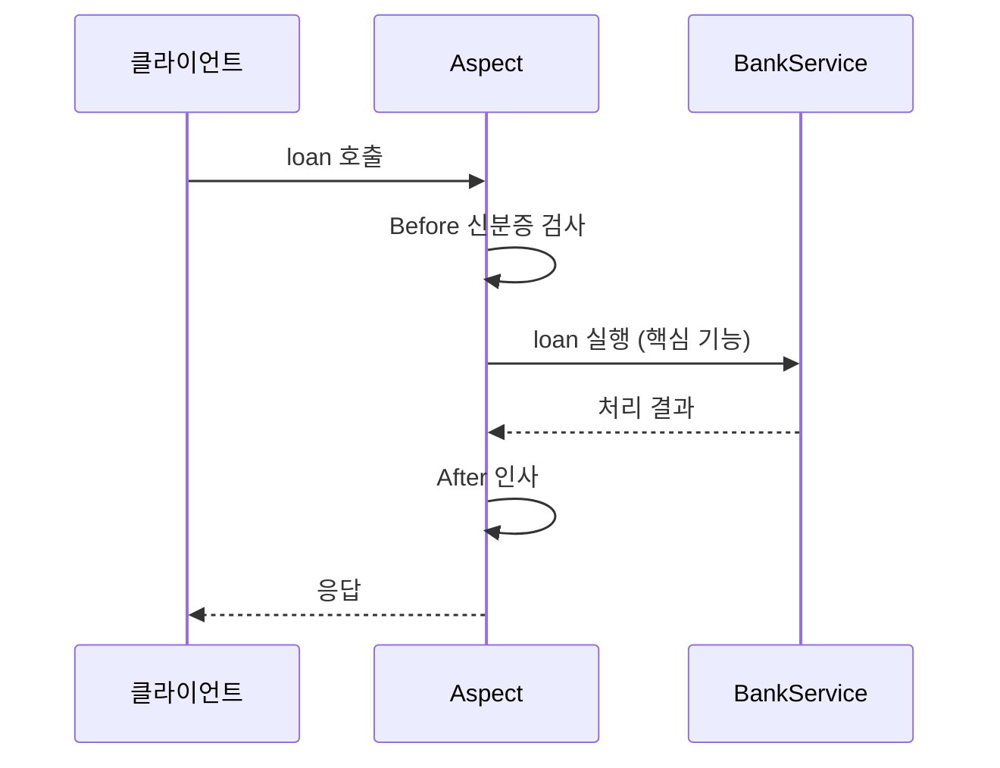
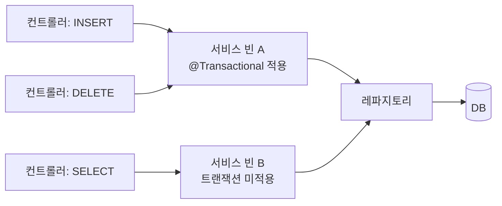

# 13주차: 필터·인터셉터·AOP·서비스 레이어·REST

## 1. 컨테이너 2종

> **쉬운 정의:** 서블릿 컨테이너는 요청·응답을 받는 문지기, 스프링 컨테이너는 객체(빈)를 만들어 관리하는 창고

- **서블릿 컨테이너**: 서블릿 생명주기 관리, DispatcherServlet이 이 안에서 동작
- **스프링 컨테이너**: 빈 생성과 의존성 주입 관리
- 스프링 시스템에는 두 컨테이너 공존

---

## 2. 필터와 인터셉터

> **쉬운 정의:** 모든 요청에 공통으로 필요한 전처리를 한곳에 모아 둔 검문소

- 인코딩, 보안 같은 공통 전처리를 컨트롤러마다 구현하면 중복 발생
- 앞단에서 한 번만 처리하면 뒷단은 핵심 업무에 집중 가능
  - 비유: 은행 입구 경비원이 신분 확인 → 창구 직원은 생략
- 검문소를 끼우는 위치에 따라 이름 구분: 필터, 인터셉터


| 구분 | 필터 | 인터셉터 |
|---|---|---|
| 위치 | 클라이언트 ↔ DispatcherServlet | DispatcherServlet ↔ 컨트롤러 |
| 소속 | 서블릿 컨테이너 | 스프링 MVC |
| 대표 작업 | 인코딩, CORS 등 보안 정책 | 로그, 트랜잭션, 예외 처리 (AOP 성격) |

### 2-1. 인코딩

> **쉬운 정의:** 글자를 네트워크로 보내기 위해 바이트로 바꾸는 약속

- 송신·수신 인코딩이 일치해야 한글이 깨지지 않음
- 서블릿 방식: 컨트롤러마다 `request.setCharacterEncoding("UTF-8")` 선호출 필요
- 필터에서 한 번 설정하면 컨트롤러의 반복 호출 불필요
- **보충**: 한글은 UTF-8 기준 3바이트 (EUC-KR은 2바이트), 스프링 부트는 인코딩 필터를 기본 등록

### 2-2. CORS

> **쉬운 정의:** 다른 주소에서 온 요청을 서버가 받아 줄지 정하는 규칙

- **오리진**: 프로토콜 + IP + 포트, 브라우저는 같은 오리진끼리만 데이터 공유 허용
- 프론트(React/Vite 기본 5173)와 백엔드(Spring 기본 8080)는 IP가 같아도 포트가 달라 다른 오리진
- 백엔드에 프론트 주소를 허용 오리진으로 등록해야 통신 가능 (대안: 프록시 중계)
- 보안 정책이므로 필터 단계의 대표 작업

**아주 간단한 핵심 예시**

```java
// 프론트 주소(localhost:5173)에서 오는 /api 요청 허용
@Configuration
public class WebConfig implements WebMvcConfigurer {
    @Override
    public void addCorsMappings(CorsRegistry registry) {
        registry.addMapping("/api/**").allowedOrigins("http://localhost:5173");
    }
}
```

- **예상 결과 (실행 전)**: 5173에서 보낸 `/api` 요청이 차단 없이 통과
- **주의**: 스프링 시큐리티 사용 시 시큐리티 설정에도 CORS 허용 필요

---

## 3. AOP

> **쉬운 정의:** 반복되는 부가 작업을 따로 빼 두고, 필요한 순간에 시스템이 대신 끼워 넣게 하는 기법

- 업무 메서드는 핵심 기능과 부가 기능으로 구성
  - **핵심 기능**: 비즈니스 로직 (본 작업)
  - **부가 기능**: 생략할 수 없고 반복이 잦은 작업 (보안, 로깅, 트랜잭션)
- 부가 기능을 메서드마다 구현하면 중복 발생 → 분리해서 시스템이 대신 실행
  - **Advice**: 분리한 부가 기능 모듈
  - **Before / After**: 핵심 기능 실행 전 / 후
  - **적용 대상**: 메서드 이름 패턴(예: `loan*`)이나 어노테이션으로 일괄 지정
- OOP는 객체 중심, AOP는 관점(Aspect) 중심 설계
- 구현 라이브러리: Spring AOP, AspectJ

| 메서드 | 핵심 기능 | 부가 기능 |
|---|---|---|
| 대출 | 대출 처리 | 신분증 검사(전), 인사(후) |
| 출금 | 출금 처리 | 신분증 검사(전), 인사(후) |
| 동전 교환 | 동전 교환 | 인사(후) |



**아주 간단한 핵심 예시**

```java
// 은행 서비스의 메서드 전후에 부가 기능을 끼워 넣는 Aspect
@Aspect
@Component
public class BankAspect {

    // loan으로 시작하는 메서드 실행 전에 신분증 검사
    @Before("execution(* com.example.bank.BankService.loan*(..))")
    public void checkId() {
        System.out.println("신분증 검사");
    }

    // BankService의 모든 메서드 실행 후 인사
    @After("execution(* com.example.bank.BankService.*(..))")
    public void greet() {
        System.out.println("안녕히 가세요");
    }
}
```

- **예상 결과 (실행 전)**: `loan` 계열 호출 시 `신분증 검사` → 대출 처리 → `안녕히 가세요`
- **주의**: `spring-boot-starter-aop` 의존성 필요

### 3-1. 로깅

> **쉬운 정의:** 서버가 한 일을 파일에 남기는 기록

- `System.out.println`은 콘솔 일시 출력, 파일에는 남지 않음
- 로그 파일은 해킹 등 사고 시 침해 위치를 추적하는 근거
- 모든 메서드가 아닌 중요한 메서드에만 선택 적용

### 3-2. 트랜잭션

> **쉬운 정의:** 여러 DB 작업을 "전부 성공하거나 전부 없던 일로" 묶는 단위

- 사례: 카드 결제 승인 후 주문 INSERT 직전에 장애 → 결제만 되고 주문 내역 없음
- **롤백**: 장애 시 앞서 처리한 작업을 취소하고 원상 복구
- **커밋**: 끝까지 성공해 확정
- 데이터를 변경하는 작업에만 필요, 시스템이 클수록 불필요한 적용은 부하 증가

| 작업 | 트랜잭션 | 이유 |
|---|---|---|
| INSERT | 필요 | 필드 11번째에서 실패하면 앞의 10개를 되돌려야 함 |
| DELETE | 필요 | 3건 중 2번째에서 실패하면 첫 삭제를 복원해야 함 |
| SELECT | 불필요 | 데이터 변경이 없어 실패 시 다시 읽으면 됨 |

- **보충**: 읽기 전용 메서드는 `@Transactional(readOnly = true)` 사용 가능

---

## 4. 서비스 레이어

> **쉬운 정의:** 컨트롤러와 레파지토리 사이에서 업무 처리와 트랜잭션을 맡는 중간 층

- 기존 수업은 2계층(컨트롤러 + 레파지토리), 3계층은 중간에 서비스 층 추가
- **유지보수**: 컨트롤러 메서드 N개가 레파지토리에 직접 연결되면 DB 교체 시 N곳 수정, 서비스를 거치면 서비스 빈과 레파지토리 연결 1곳만 수정
- **AOP 적용 위치**
  - 레파지토리: 쿼리 메서드뿐이라 트랜잭션 적용에 부적합
  - 컨트롤러 전체: SELECT까지 적용되어 비효율
  - 서비스 빈: 목적별로 나눠 필요한 곳에만 적용 가능
- 결과: 쓰기용 빈과 읽기용 빈을 분리, 트랜잭션은 쓰기용에만 적용



- 서비스 빈은 `@Service`, 주입 방향은 레파지토리 → 서비스 → 컨트롤러
- `@Transactional`은 메서드 단위, 클래스에 붙이면 클래스 내 모든 메서드에 적용
- 패키지 구성: 수업은 역할별(controller/service/repository), 실무는 도메인·기능별 분류가 일반적

**아주 간단한 핵심 예시**

```java
// 레파지토리를 주입받아 글 저장 업무를 처리하는 서비스 빈
@Service
public class ArticleService {
    private final ArticleRepository repository;

    // 생성자 주입으로 레파지토리 연결
    public ArticleService(ArticleRepository repository) {
        this.repository = repository;
    }

    // 저장 도중 예외가 발생하면 롤백
    @Transactional
    public Article create(Article article) {
        return repository.save(article);
    }
}
```

- **예상 결과 (실행 전)**: `create` 중 예외 발생 시 저장 취소, 정상 종료 시 커밋
- **주의**: 컨트롤러는 레파지토리가 아닌 `ArticleService`를 주입받아 호출

---

## 5. REST 컨트롤러

> **쉬운 정의:** 화면이 아닌 데이터를 응답으로 돌려주는 컨트롤러

- 풀스택 구조에서 프론트는 서버가 준 데이터로 UI를 직접 구성
- `@Controller`: 뷰 이름(String) 반환 → 뷰 리졸버 → 화면 생성
- `@RestController`: 반환 타입 제한 없음, 반환값을 응답 메시지 바디에 탑재
- HTTP 메시지 구조: 시작 줄(상태 코드 포함) → 헤더 → 빈 줄 → 바디

> **쉬운 정의 (`ResponseEntity`):** 응답의 상태 코드·헤더·바디를 직접 채워 보내는 응답 상자

**아주 간단한 핵심 예시**

```java
// 글 상세 조회: 상태 코드 200과 바디를 직접 구성해 응답
@GetMapping("/api/articles/{id}")
public ResponseEntity<Article> show(@PathVariable Long id) {
    Article article = articleService.show(id);
    return ResponseEntity.status(HttpStatus.OK).body(article);
}
```

- **예상 결과 (실행 전)**: 상태 코드 200, 바디에 글 데이터(JSON)

---

## 6. 인증과 권한 (다음 주 주제)

> **쉬운 정의:** 인증은 "누구인지 확인", 권한은 "무엇을 할 수 있는지 구분"

- **인증**: 허가된 사용자인지 확인
- **권한**: 허가된 사용자 중 역할(관리자, 일반 회원)에 따라 가능한 행동 구분
- 인증 통과 후 권한 판단 순서
