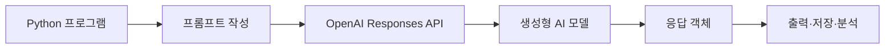
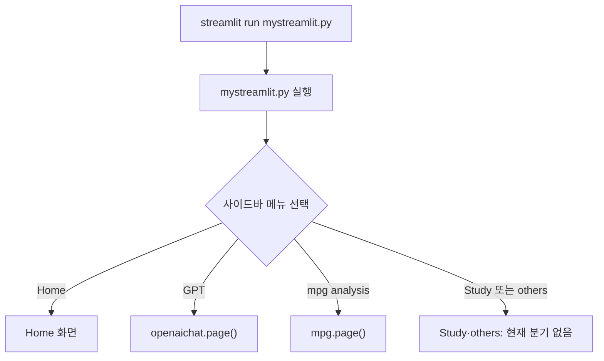

# Week10 — Python에서 OpenAI API 활용

## 학습 목표

- Python 프로그램과 생성형 AI 서비스의 연결 구조 이해
- API Key를 환경 변수에 안전하게 저장하고 불러오는 방법 이해
- OpenAI Python SDK와 Responses API를 이용한 기본 질문 전송
- 토큰 사용량을 이용한 API 비용 계산
- Pandas 분석 결과를 프롬프트에 포함해 AI로 해석하는 흐름 이해
- Streamlit의 사이드바 메뉴와 페이지 함수 연결 구조 이해
- `mpg.py`의 필터링·다중 선택·그룹 집계 코드 이해
- 파일별 역할과 코드 구역을 주석으로 구분하는 방법 이해

---

## 1. 전체 동작 구조

**API(Application Programming Interface)**: 서로 다른 프로그램이 정해진 방식으로 요청과 응답을 주고받게 하는 연결 규칙



핵심 흐름:

> 사용자 입력 → 프롬프트 작성 → API 요청 → 모델 처리 → 응답 수신 → Python에서 활용

### 왜 API가 필요한가

- Python 프로그램 안에서 AI 모델의 기능 사용
- 생성된 문장을 화면에 출력하거나 파일·데이터베이스에 저장
- 데이터 분석 결과 요약, 분류, 설명 자동화
- 웹 서비스나 앱의 기능으로 AI 응답 연결

---

## 2. API Key

**API Key**: OpenAI API 요청을 보낸 사용자 또는 프로젝트를 인증하는 비밀 값

```text
OpenAI Platform
      │
      ├─ API Key 발급
      ▼
Windows 환경 변수
OPENAI_API_KEY=비밀값
      │
      ▼
OpenAI Python SDK
      │
      ▼
Responses API 호출
```

### 발급 위치

- [OpenAI Platform API Keys](https://platform.openai.com/api-keys)
- 생성 직후 안전한 위치에 보관
- 코드, 노트북 출력, GitHub 저장소, 캡처 화면에 실제 키 포함 금지

OpenAI 공식 보안 권장 사항:

- 코드에 API Key 직접 작성 금지
- 환경 변수 또는 비밀 관리 서비스 사용
- 만료 기간 설정과 정기적인 키 교체
- 새 키 적용 확인 후 기존 키 폐기

참고: [OpenAI API Key 보안 권장 사항](https://developers.openai.com/api/docs/guides/production-best-practices#api-keys)

---

## 3. Windows 환경 변수 설정

환경 변수 이름은 반드시 `OPENAI_API_KEY` 사용

### Anaconda Prompt 또는 명령 프롬프트

```bat
setx OPENAI_API_KEY "새로_발급한_API_Key"
```

- 명령 실행 후 새 Anaconda Prompt 또는 Jupyter Notebook 실행
- `setx`를 실행한 현재 창에는 값이 즉시 반영되지 않을 수 있음
- 실제 키가 보이는 `echo %OPENAI_API_KEY%` 사용 지양

### Python에서 안전하게 설정 여부 확인

```python
import os

api_key_exists = bool(os.getenv("OPENAI_API_KEY"))
print(api_key_exists)
```

예상 결과:

```text
True
```

`True`는 값이 존재한다는 뜻이며, 실제 API Key는 화면에 표시하지 않음.

### 자주 발생하는 오류

| 오류 | 원인 | 확인 방법 |
| --- | --- | --- |
| `KeyError: 'OPENAI_API_KEY'` | 환경 변수 없음 | 새 터미널·Jupyter 재실행 후 `os.getenv()` 확인 |
| 인증 오류 | 잘못되거나 폐기된 키 | Platform에서 키 상태 확인 |
| 키가 화면에 출력됨 | `print(api_key)` 또는 `echo` 실행 | 출력 기록 삭제 후 키 폐기·재발급 |

---

## 4. OpenAI Python SDK 설치

### 터미널

```bash
python -m pip install openai
```

### Jupyter Notebook

```python
%pip install openai
```

설치 확인:

```bash
python -m pip show openai
```

> [!NOTE]
> 원본 HTML의 `brotli` 제거와 `brotlicffi` 설치 과정은 당시 Windows·Anaconda 환경의 의존성 문제를 해결하기 위한 기록. 모든 환경에서 필요한 일반 설치 단계는 아님.

---

## 5. Responses API 기본 호출

### 작은 예제

```python
from openai import OpenAI

# OPENAI_API_KEY 환경 변수를 자동으로 사용
client = OpenAI()

response = client.responses.create(
    model="gpt-5.6-luna",
    input="Python이 무엇인지 초보자에게 쉽게 설명해줘."
)

print(response.output_text)
```

공식 Python SDK도 `OpenAI()` 객체 생성 후 `client.responses.create()`로 요청하는 방식을 사용. 참고: [OpenAI API Python Quickstart](https://developers.openai.com/api/docs/quickstart#install-the-openai-sdk-and-run-an-api-call)

### 코드 실행 흐름

1. `OpenAI` 클래스 import
2. `client = OpenAI()`로 API 통신 객체 생성
3. `model`과 `input`을 담아 Responses API에 요청
4. 응답 객체를 `response`에 저장
5. `response.output_text`에서 최종 생성 문장 추출

### 주요 값

| 코드 | 의미 |
| --- | --- |
| `OpenAI()` | API 요청을 담당하는 클라이언트 객체 생성 |
| `model="gpt-5.6-luna"` | 요청에 사용할 모델 지정 |
| `input="..."` | 모델에 전달할 질문 또는 지시 |
| `response` | 모델 출력과 사용량 정보가 담긴 응답 객체 |
| `response.output_text` | 응답 객체에서 최종 텍스트만 추출 |

**`gpt-5.6-luna`**: 비용에 민감한 대량 작업을 위한 GPT-5.6 계열 모델. Responses API 지원. 참고: [GPT-5.6 Luna 모델 문서](https://developers.openai.com/api/docs/models/gpt-5.6-luna)

### 원본 HTML에 기록된 응답의 핵심

- Python을 컴퓨터에게 일을 시키기 위한 프로그래밍 언어로 설명
- 쉬운 문법, 데이터 분석, AI, 자동화 등의 활용 분야 제시
- `print("안녕하세요!")`와 간단한 덧셈 예제 포함

> 위 내용은 원본 HTML에 저장된 실행 결과의 요약이며, 이 문서를 만들면서 API를 다시 호출한 결과가 아님.

---

## 6. 토큰 사용량과 비용

**토큰(token)**: 모델이 입력과 출력을 처리할 때 사용하는 텍스트 단위. 단어 수와 정확히 일치하지 않으며 언어와 문장 구성에 따라 달라짐.

사용량 확인:

```python
usage = response.usage

print("입력 토큰:", usage.input_tokens)
print("출력 토큰:", usage.output_tokens)
print("전체 토큰:", usage.total_tokens)
```

### 비용 공식

```text
입력 비용 = 입력 토큰 수 × 입력 100만 토큰당 가격 ÷ 1,000,000
출력 비용 = 출력 토큰 수 × 출력 100만 토큰당 가격 ÷ 1,000,000
총비용    = 입력 비용 + 출력 비용
```

`gpt-5.6-luna` Standard·short context 기준 가격은 2026-11-03 현재 입력 `$0.20`, 출력 `$1.20`/100만 토큰. 가격은 변경될 수 있으므로 실행 전 [공식 API 가격표](https://developers.openai.com/api/docs/pricing) 확인 필요.

```python
INPUT_PRICE_PER_MILLION = 0.20
OUTPUT_PRICE_PER_MILLION = 1.20

input_cost = usage.input_tokens * INPUT_PRICE_PER_MILLION / 1_000_000
output_cost = usage.output_tokens * OUTPUT_PRICE_PER_MILLION / 1_000_000
total_cost = input_cost + output_cost

print(f"입력 비용: ${input_cost:.6f}")
print(f"출력 비용: ${output_cost:.6f}")
print(f"총비용: ${total_cost:.6f}")
```

### 원본 HTML의 예시 계산

- 입력: 19토큰 → `19 × $0.20 ÷ 1,000,000 = $0.0000038`
- 출력: 325토큰 → `325 × $1.20 ÷ 1,000,000 = $0.0003900`
- 합계: `$0.0003938`

주의점:

- 모델과 처리 방식에 따른 가격 차이
- 272K 초과 입력은 long context 가격 적용 가능
- 캐시 입력, 캐시 쓰기, 도구 호출에 별도 요금 적용 가능
- 단순 예측보다 실제 응답의 `usage` 기준 계산 권장

---

## 7. 데이터 분석 결과를 AI로 해석하기

### 분석 목표

1. `mpg.csv` 불러오기
2. `manufacturer`를 `mfr`로 변경
3. 도심 연비 `cty`와 고속도로 연비 `hwy`의 평균 계산
4. 통합 연비를 A·B·C 등급으로 분류
5. 등급별 자동차 수 계산
6. 집계 결과를 프롬프트에 넣어 AI 해석 요청

### 7.1 데이터 분석

```python
import pandas as pd
import numpy as np

mpg = pd.read_csv("mpg.csv")
mpg = mpg.rename(columns={"manufacturer": "mfr"})

# 도심 연비와 고속도로 연비의 평균
mpg["mean"] = (mpg["cty"] + mpg["hwy"]) / 2

# 30 이상: A, 20 이상 30 미만: B, 20 미만: C
mpg["class"] = np.where(
    mpg["mean"] >= 30,
    "A",
    np.where(mpg["mean"] >= 20, "B", "C")
)

class_count = mpg["class"].value_counts()
print(class_count)
```

원본 HTML에 기록된 결과:

```text
class
B    118
C    106
A     10
```

### 분류 흐름 추적

| `mean` 값 | 첫 번째 조건 `>= 30` | 두 번째 조건 `>= 20` | 최종 등급 |
| ---: | --- | --- | --- |
| 31.0 | 참 | 검사하지 않음 | A |
| 25.5 | 거짓 | 참 | B |
| 18.0 | 거짓 | 거짓 | C |

`np.where()`의 바깥 조건에서 A를 먼저 판정한 뒤, A가 아닌 값만 안쪽 조건으로 B와 C를 구분.

### 7.2 분석 결과를 프롬프트로 만들기

```python
prompt = f"""
다음은 자동차 연비 데이터의 분석 결과입니다.

연비 등급별 자동차 수:
{class_count.to_string()}

등급 기준:
- A: 통합 연비 30 이상
- B: 통합 연비 20 이상 30 미만
- C: 통합 연비 20 미만

이 분석 결과를 데이터 분석을 처음 배우는 학생이 이해하기 쉽게 설명해주세요.

다음 내용을 포함해주세요.
1. 가장 많은 등급
2. 각 등급의 특징
3. 전체적인 자동차 연비 분포
"""
```

**f-string**: 문자열 안의 `{class_count.to_string()}` 자리에 실제 집계 결과를 삽입하는 문자열 작성 방식

### 7.3 AI에 해석 요청

```python
response = client.responses.create(
    model="gpt-5.6-luna",
    input=prompt
)

print("[AI 분석 결과]")
print(response.output_text)
```

### 원본 HTML 결과 해석

전체 234대 기준:

| 등급 | 자동차 수 | 비율 | 해석 |
| --- | ---: | ---: | --- |
| A | 10 | 약 4.3% | 통합 연비 30 이상, 가장 적은 구간 |
| B | 118 | 약 50.4% | 통합 연비 20 이상 30 미만, 가장 많은 구간 |
| C | 106 | 약 45.3% | 통합 연비 20 미만, B등급 다음으로 많은 구간 |

핵심 해석:

- B등급이 118대로 가장 많음
- B등급과 C등급의 합계는 224대, 전체의 약 95.7%
- A등급은 10대로 매우 적음
- 이 데이터에서는 통합 연비 30 미만 자동차가 대부분

> AI는 주어진 집계 결과를 자연어로 설명하는 역할. 등급 수 계산 자체는 Pandas가 수행하며, AI 응답의 숫자와 원본 집계 결과가 일치하는지 반드시 확인.

---

## 8. 전체 실행 코드

```python
import os
import numpy as np
import pandas as pd
from openai import OpenAI

if not os.getenv("OPENAI_API_KEY"):
    raise RuntimeError("OPENAI_API_KEY 환경 변수를 설정하세요.")

client = OpenAI()

mpg = pd.read_csv("mpg.csv")
mpg = mpg.rename(columns={"manufacturer": "mfr"})
mpg["mean"] = (mpg["cty"] + mpg["hwy"]) / 2
mpg["class"] = np.where(
    mpg["mean"] >= 30,
    "A",
    np.where(mpg["mean"] >= 20, "B", "C")
)

class_count = mpg["class"].value_counts()

prompt = f"""
다음 자동차 연비 등급별 개수를 초보자가 이해하기 쉽게 설명해주세요.

{class_count.to_string()}

등급 기준:
- A: 통합 연비 30 이상
- B: 통합 연비 20 이상 30 미만
- C: 통합 연비 20 미만

가장 많은 등급, 각 등급의 특징, 전체 분포를 포함해주세요.
"""

response = client.responses.create(
    model="gpt-5.6-luna",
    input=prompt
)

print(response.output_text)
print(response.usage)
```

이 코드를 실행하기 위한 조건:

- `openai`, `pandas`, `numpy` 설치
- `OPENAI_API_KEY` 환경 변수 설정
- 실행 폴더에 `mpg.csv` 존재
- API 사용이 가능한 OpenAI 프로젝트와 결제·사용 한도 설정

---

## 9. Streamlit 프로젝트 구조

추가로 제공된 세 파일은 하나의 Streamlit 앱을 구성하는 모듈.

```text
myStreamlit/
├── mystreamlit.py   # 앱 시작점, 사이드바 메뉴, 페이지 연결
├── openaichat.py    # GPT 메뉴 화면
└── mpg.py           # mpg 데이터 조회·집계 화면
```

### 파일 연결 관계



**모듈 분리**: 메뉴와 공통 화면은 `mystreamlit.py`, 세부 기능은 각각의 파일에 배치하는 구조

### 실행 순서

1. `mystreamlit.py`에서 `openaichat`, `mpg` 모듈 import
2. 메인 제목과 사이드바 출력
3. 사용자가 메뉴 선택
4. 선택 결과에 따라 `openaichat.page()` 또는 `mpg.page()` 호출
5. 각 모듈의 `page()` 함수가 담당 화면 출력

---

## 10. `mpg.py` — 데이터 분석 화면

### 주요 기능

- `mpg.csv`를 DataFrame으로 불러오기
- 제조사 한 개 또는 여러 개 선택
- 선택한 제조사의 데이터 필터링
- 제조사별 평균 고속도로 연비 계산
- 그룹 기준·분석 컬럼·집계 함수를 사용자가 선택

### 구역별 주석을 추가한 전체 코드

```python
# ==================================================
# 1. 패키지 import
# ==================================================
import streamlit as st
import pandas as pd
import numpy as np
import matplotlib.pyplot as plt
import seaborn as sns


# ==================================================
# 2. mpg 분석 페이지 함수
# ==================================================
def page():
    # ----------------------------------------------
    # 2-1. 페이지 제목과 원본 데이터 출력
    # ----------------------------------------------
    st.title("mpg.py_index")

    mpg = pd.read_csv(
        "/Users/ma/Downloads/Doit_Python-main/Data/mpg.csv"
    )
    st.dataframe(mpg)

    # ----------------------------------------------
    # 2-2. 코드에서 지정한 제조사 조회
    # ----------------------------------------------
    company = "hyundai"

    # 문자열 안에 값을 직접 작성하는 방법
    # result1 = mpg.query('manufacturer == "hyundai"')

    # @를 사용해 Python 변수 company의 값을 참조
    result1 = mpg.query("manufacturer == @company")

    st.title("#쿼리를 직접 작성")
    st.dataframe(result1)

    # ----------------------------------------------
    # 2-3. 제조사 한 개 선택
    # ----------------------------------------------
    userInput = st.selectbox(
        "selectbox",
        mpg["manufacturer"].unique().tolist()
    )

    # Boolean indexing으로 선택한 제조사만 필터링
    result2 = mpg[mpg["manufacturer"] == userInput]
    st.dataframe(result2)

    # ----------------------------------------------
    # 2-4. 제조사 여러 개 선택
    # ----------------------------------------------
    userInput_2 = st.multiselect(
        "multiselect",
        mpg["manufacturer"].unique().tolist()
    )

    # 여러 값과 비교할 때는 == 대신 isin() 사용
    result3 = mpg[mpg["manufacturer"].isin(userInput_2)]
    st.dataframe(result3)

    # ----------------------------------------------
    # 2-5. query()를 사용한 다중 선택 결과 조회
    # ----------------------------------------------
    st.title(userInput_2)
    result4 = mpg.query("manufacturer == @userInput_2")
    st.dataframe(result4)

    # ----------------------------------------------
    # 2-6. 선택한 제조사별 평균 고속도로 연비
    # ----------------------------------------------
    result4_1 = result4.groupby("manufacturer").agg(
        mean_hwy=("hwy", "mean")
    )
    st.dataframe(result4_1)

    # ----------------------------------------------
    # 2-7. 사용자 선택에 따른 동적 그룹 집계
    # ----------------------------------------------
    var1 = st.selectbox(
        "도시 연비, 고속도로 연비",
        ["manufacturer", "drv", "trans", "category"]
    )
    var2 = st.selectbox(
        "choose column",
        ["hwy", "cty"]
    )
    var3 = st.selectbox(
        "value",
        ["mean", "max", "min", "count"]
    )

    # var1: 그룹 기준, var2: 계산 대상, var3: 집계 함수
    result5 = mpg.groupby(var1).agg(
        metric=(var2, var3)
    )
    st.dataframe(result5)


# ==================================================
# 3. mpg.py를 직접 실행했을 때의 시작점
# ==================================================
if __name__ == "__main__":
    page()
    st.text("mpg.py가 직접 실행됨")
```

### 코드 구역별 역할

| 구역 | 입력 | 처리 | 출력 |
| --- | --- | --- | --- |
| 원본 데이터 | `mpg.csv` | `pd.read_csv()` | 전체 DataFrame |
| 고정 제조사 | `company = "hyundai"` | `query()` | Hyundai 데이터 |
| 단일 선택 | `selectbox` | `== userInput` | 선택한 제조사 데이터 |
| 다중 선택 | `multiselect` | `isin(userInput_2)` | 여러 제조사 데이터 |
| 평균 연비 | 다중 선택 결과 | `groupby()` + `mean` | 제조사별 평균 `hwy` |
| 동적 집계 | `var1`, `var2`, `var3` | `groupby().agg()` | 사용자 지정 통계 |

### 데이터 처리 검증

제공된 `/Users/ma/Downloads/Doit_Python-main/Data/mpg.csv`로 화면 이외의 Pandas 처리 구문을 실행한 결과:

- 전체 데이터: 234행
- `hyundai` 조회: `query()`와 Boolean indexing 모두 14행
- `hyundai`, `audi` 다중 조회: `isin()`과 `query()` 모두 32행
- 두 다중 조회 결과: 동일한 DataFrame
- 제조사별 집계 그룹: 15개

Streamlit 화면은 실행하지 않았지만, 핵심 필터링과 그룹 집계 코드가 실제 데이터에서 동작함을 확인.

### `selectbox`와 `multiselect`

**`st.selectbox()`**: 목록에서 하나의 값 선택

```python
userInput = st.selectbox(
    "selectbox",
    mpg["manufacturer"].unique().tolist()
)
```

`userInput`에는 문자열 하나가 저장되므로 `==` 비교 사용.

**`st.multiselect()`**: 목록에서 여러 값을 선택

```python
userInput_2 = st.multiselect(
    "multiselect",
    mpg["manufacturer"].unique().tolist()
)
```

`userInput_2`에는 리스트가 저장되므로 `isin()` 사용.

```python
result3 = mpg[mpg["manufacturer"].isin(userInput_2)]
```

### 동적 그룹 집계 흐름

사용자 선택 예시:

```text
var1 = "manufacturer"  # 제조사별 그룹
var2 = "hwy"           # 고속도로 연비 계산
var3 = "mean"          # 평균 계산
```

실행되는 핵심 코드:

```python
result5 = mpg.groupby(var1).agg(
    metric=(var2, var3)
)
```

위 선택값을 직접 대입한 것과 같은 의미:

```python
result5 = mpg.groupby("manufacturer").agg(
    metric=("hwy", "mean")
)
```

### 주의점

- CSV 경로가 사용자 컴퓨터의 절대경로로 고정된 상태
- 다른 컴퓨터나 폴더에서 실행할 경우 `FileNotFoundError` 가능
- 다중 선택 전에는 `userInput_2`가 빈 리스트이므로 `result3`, `result4`도 빈 DataFrame
- `numpy`, `matplotlib.pyplot`, `seaborn`은 현재 코드에서 직접 사용되지 않음
- `st.title(userInput_2)`보다 선택값 표시 목적의 `st.write(userInput_2)`가 의미상 더 명확

---

## 11. `openaichat.py` — GPT 화면

현재 파일은 OpenAI API 호출 코드 없이 화면 제목만 출력하는 초기 구조.

### 구역별 주석을 추가한 전체 코드

```python
# ==================================================
# 1. 패키지 import
# ==================================================
import streamlit as st


# ==================================================
# 2. mystreamlit.py에서 호출할 GPT 페이지
# ==================================================
def page():
    st.title("openAI Chat")


# ==================================================
# 3. openaichat.py 단독 실행 화면
# ==================================================
def main():
    st.title("openaichat.py run")


# ==================================================
# 4. 파일을 직접 실행했을 때의 시작점
# ==================================================
if __name__ == "__main__":
    main()
```

### `page()`와 `main()`의 차이

| 실행 방법 | `__name__` 값 | 실행 함수 | 화면 제목 |
| --- | --- | --- | --- |
| `mystreamlit.py`에서 import | `openaichat` | 메뉴 선택 시 `page()` | `openAI Chat` |
| `openaichat.py` 직접 실행 | `__main__` | `main()` | `openaichat.py run` |

### 현재 구현 범위

- 포함: GPT 페이지 제목
- 미포함: 질문 입력창, OpenAI 클라이언트, Responses API 호출, 답변 출력, 대화 기록

따라서 `GPT` 메뉴를 선택해도 현재는 `openAI Chat` 제목만 표시. 앞에서 학습한 `OpenAI()`와 `client.responses.create()`는 아직 이 파일에 연결되지 않은 상태.

---

## 12. `mystreamlit.py` — 메인 앱과 메뉴 라우팅

### 구역별 주석을 추가한 전체 코드

```python
# ==================================================
# 1. 패키지와 페이지 모듈 import
# ==================================================
import streamlit as st
import openaichat
import mpg


# ==================================================
# 2. 메인 페이지 제목 함수
# ==================================================
def page():
    st.title("StreamlitStudy")


# ==================================================
# 3. 메인 화면 출력
# ==================================================
page()


# ==================================================
# 4. 사이드바 구성
# ==================================================
st.sidebar.title("StreamlitStudy")
st.sidebar.image("https://github.com/")

selected_menu = st.sidebar.selectbox(
    "Choose your menu",
    ["Home", "GPT", "mpg analysis", "Study", "others"]
)


# ==================================================
# 5. 선택한 메뉴에 따른 페이지 연결
# ==================================================
if selected_menu == "Home":
    st.text("Home")

elif selected_menu == "GPT":
    st.text("GPT")
    openaichat.page()

elif selected_menu == "mpg analysis":
    st.text("mpg analysis")
    mpg.page()
```

### 메뉴 라우팅

**라우팅(routing)**: 사용자의 선택에 따라 실행할 화면 또는 함수를 결정하는 처리

```text
Home         → st.text("Home")
GPT          → openaichat.page()
mpg analysis → mpg.page()
Study        → 현재 처리 코드 없음
others       → 현재 처리 코드 없음
```

### import 시 `__main__` 구역이 실행되지 않는 이유

`mystreamlit.py`가 `import mpg`를 실행하면 `mpg.py`의 `__name__`은 `"mpg"`.

```python
if __name__ == "__main__":
    page()
```

조건이 거짓이므로 import 순간에는 `mpg.page()`가 자동 실행되지 않음. 사용자가 `mpg analysis`를 선택했을 때 `mystreamlit.py`가 명시적으로 `mpg.page()` 호출.

동일하게 `openaichat.py`의 `main()`도 import만으로 실행되지 않음.

### 주의점

- `Study`, `others` 메뉴에 대응하는 `elif` 구문이 없어 선택 시 세부 내용 없음
- `st.sidebar.image("https://github.com/")`는 이미지 파일 주소가 아니라 웹페이지 주소
- 모듈 파일 세 개가 같은 폴더에 있어야 `import openaichat`, `import mpg` 성공
- 함수와 파일 이름을 다르게 유지하면 import 구조 파악이 쉬움

---

## 13. Streamlit 앱 실행

### 필요한 패키지

```bash
python -m pip install streamlit pandas numpy matplotlib seaborn openai
```

### 실행 명령

```bash
cd /Users/ma/Downloads/Doit_Python-main/Data/Streamlit/myStreamlit
streamlit run mystreamlit.py
```

### 예상 동작

1. 브라우저에 `StreamlitStudy` 제목 표시
2. 왼쪽 사이드바에 메뉴 표시
3. `GPT` 선택 시 `openAI Chat` 제목 표시
4. `mpg analysis` 선택 시 전체 mpg 데이터와 분석 위젯 표시
5. 제조사나 집계 조건 변경 시 선택값에 맞는 DataFrame 표시

> 예상 동작은 코드 정적 분석을 기준으로 작성. 이번 문서 작업에서는 Streamlit 서버와 OpenAI API를 실제로 실행하지 않음.

### 세 파일과 Week10 API 내용의 관계

```text
mystreamlit.py
    └─ GPT 메뉴
        └─ openaichat.page()
            └─ 현재: 제목만 출력
            └─ 확장 지점: Responses API 호출 코드

mystreamlit.py
    └─ mpg analysis 메뉴
        └─ mpg.page()
            ├─ mpg.csv 분석
            └─ 향후 분석 결과를 AI 프롬프트로 전달 가능
```

OpenAI API 연결 위치는 `openaichat.page()` 내부가 가장 자연스러움. 공식 Python 예제도 `OpenAI()` 객체와 `client.responses.create()`를 이용. 참고: [OpenAI API Python Quickstart](https://developers.openai.com/api/docs/quickstart#install-the-openai-sdk-and-run-an-api-call)

---

## 14. 핵심 정리

| 항목 | 핵심 내용 |
| --- | --- |
| API Key | API 사용자 인증용 비밀 값 |
| 환경 변수 | 키를 코드와 분리해 보관하는 방법 |
| `OpenAI()` | 환경 변수의 키를 사용하는 클라이언트 객체 |
| `responses.create()` | 모델에 입력을 보내 응답을 생성하는 메서드 |
| `output_text` | 생성된 최종 텍스트 |
| `usage` | 입력·출력·전체 토큰 사용량 |
| f-string | 데이터 분석 결과를 프롬프트에 삽입하는 방법 |
| 검증 | AI 설명과 Pandas 집계 결과의 일치 여부 확인 |
| `mystreamlit.py` | 메뉴 표시와 세부 페이지 연결 |
| `openaichat.py` | GPT 화면 모듈, 현재는 제목만 구현 |
| `mpg.py` | 제조사 필터링과 그룹 집계 화면 |
| `selectbox` | 하나의 선택값 반환 |
| `multiselect` | 여러 선택값을 리스트로 반환 |
| `isin()` | Series의 값이 선택 목록에 포함되는지 검사 |
| `groupby().agg()` | 그룹별 통계 계산 |

### 시험·복습 포인트

- 환경 변수 이름: `OPENAI_API_KEY`
- 호출 순서: `OpenAI()` → `client.responses.create()` → `response.output_text`
- 비용 계산: `토큰 수 × 100만 토큰당 가격 ÷ 1,000,000`
- 분석 흐름: 데이터 불러오기 → 파생 변수 생성 → 등급 분류 → 집계 → 프롬프트 작성 → AI 해석
- 보안 원칙: API Key 출력·공유·Git 커밋 금지
- Streamlit 실행 흐름: `mystreamlit.py` → 메뉴 선택 → 각 모듈의 `page()`
- 단일 선택 비교: `==`, 다중 선택 비교: `isin()`
- 동적 집계 구성: 그룹 기준 `var1` + 분석 컬럼 `var2` + 집계 함수 `var3`

---

## 참고 자료

- [OpenAI API Python Quickstart](https://developers.openai.com/api/docs/quickstart#install-the-openai-sdk-and-run-an-api-call)
- [GPT-5.6 Luna 모델 문서](https://developers.openai.com/api/docs/models/gpt-5.6-luna)
- [OpenAI API 가격표](https://developers.openai.com/api/docs/pricing)
- [OpenAI API Key 보안 권장 사항](https://developers.openai.com/api/docs/guides/production-best-practices#api-keys)

> API 예제와 가격 정보 확인일: 2026-11-03
