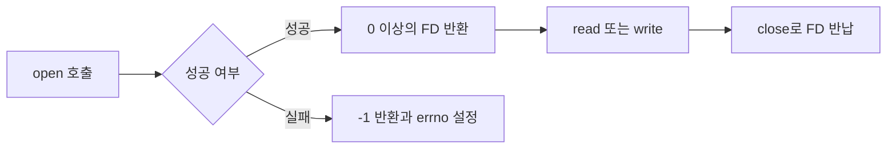
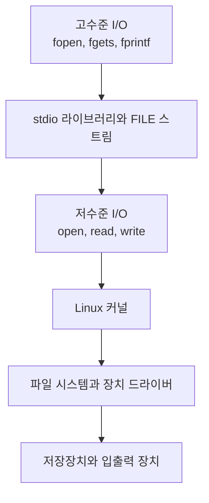
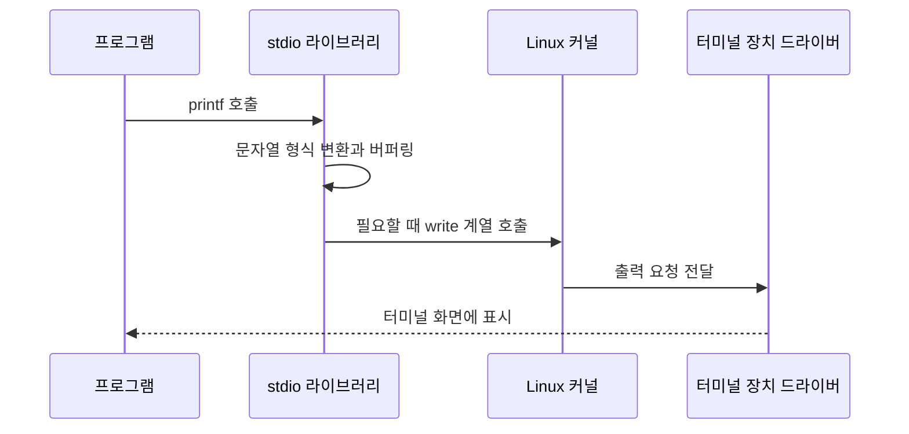

# 시스템 프로그래밍 핵심 개념 정리

| 항목 | 내용 |
| --- | --- |
| 과목 | 시스템 프로그래밍 |
| 학번 | 20230892 |
| 이름 | 마성혁 |

> [!NOTE]
> 이 문서는 강의 자료의 파일 처리 내용과 기존 정리본을 바탕으로 작성했으며, Linux 커널 및 Linux man-pages의 GitHub 소스와 공식 매뉴얼을 함께 참고함

## 목차

1. [시스템 프로그래밍과 시스템 프로그래머](#1-시스템-프로그래밍과-시스템-프로그래머)
2. [Linux에서 파일의 의미](#2-linux에서-파일의-의미)
3. [man 명령](#3-man-명령)
4. [FD 파일 디스크립터](#4-fd-파일-디스크립터)
5. [저수준 파일 처리와 고수준 파일 처리](#5-저수준-파일-처리와-고수준-파일-처리)
6. [`O_`와 `S_I`의 의미](#6-o_와-s_i의-의미)
7. [커널과 라이브러리](#7-커널과-라이브러리)
8. [핵심 요약](#8-핵심-요약)

---

## 1. 시스템 프로그래밍과 시스템 프로그래머

### 1.1 시스템 프로그래밍

**시스템 프로그래밍(System Programming)**: 운영체제가 제공하는 기능을 이용하여 시스템 자원을 다루는 프로그램을 개발하는 분야

- 프로세스와 스레드 관리
- 메모리 관리
- 파일과 디렉터리 처리
- 장치와 네트워크 사용
- 프로세스 간 통신과 동기화
- 성능, 안정성, 보안을 고려한 프로그램 작성

대표적인 시스템 프로그램:

- 운영체제 구성 요소와 장치 드라이버
- 셸과 시스템 유틸리티
- 컴파일러와 디버거
- 네트워크 서버 프로그램

### 1.2 시스템 프로그래머

**시스템 프로그래머(System Programmer)**: 운영체제와 가까운 계층에서 동작하는 프로그램을 설계하고 구현하는 개발자

필요한 주요 지식:

- C/C++ 등의 프로그래밍 언어
- 운영체제와 Linux 구조
- 시스템 호출과 라이브러리
- 프로세스, 메모리, 파일 시스템
- 동시성, 네트워크, 보안

### 1.3 프로그램과 하드웨어 사이의 구조


일반적인 응용 프로그램은 하드웨어를 직접 제어하지 않음. 프로그램이 시스템 호출을 실행하면 커널이 요청을 검사하고, 파일 시스템이나 장치 드라이버를 통해 실제 작업 수행

---

## 2. Linux에서 파일의 의미

**Linux 파일**: 데이터 저장뿐 아니라 여러 시스템 자원을 공통된 입출력 방식으로 다루기 위한 인터페이스

Linux에서는 일반 파일 외에도 디렉터리, 장치, 파이프, 소켓 등을 파일과 비슷한 방식으로 처리함. 이를 흔히 **모든 것은 파일이다**라는 설계 철학으로 설명함

> [!IMPORTANT]
> 모든 커널 객체가 실제 디스크 파일이라는 뜻은 아님. 여러 자원을 `open`, `read`, `write`, `close`와 같은 공통 인터페이스로 다룰 수 있다는 의미

### 2.1 주요 파일 유형

| 유형 | 설명 | 예 |
| --- | --- | --- |
| 일반 파일 | 텍스트, 실행 코드, 이미지 등의 데이터 저장 | `report.txt`, `a.out` |
| 디렉터리 | 파일 이름과 inode의 연결 정보 관리 | `/home`, `/etc` |
| 장치 파일 | 커널의 장치 드라이버를 통해 장치에 접근 | `/dev/null`, `/dev/tty` |
| 파이프 | 프로세스 사이의 단방향 데이터 전달 | `prog1 \| prog2` |
| 소켓 | 프로세스 간 통신과 네트워크 통신 | UNIX socket, TCP socket |
| 심볼릭 링크 | 다른 경로를 가리키는 특수 파일 | `ln -s 원본 링크` |

### 2.2 파일을 구성하는 주요 개념

| 개념 | 의미 |
| --- | --- |
| 경로명 | 사용자가 파일을 찾을 때 사용하는 이름 |
| inode | 파일 종류, 권한, 소유자, 크기, 시간, 데이터 위치 등의 정보 저장 |
| 열린 파일 설명 | 현재 파일 위치와 상태 플래그 등 열린 파일의 상태 저장 |
| FD | 프로세스가 열린 파일을 가리킬 때 사용하는 정수 번호 |

---

## 3. man 명령

**`man` 명령**: Linux 명령어, 시스템 호출, 라이브러리 함수, 설정 파일 등의 설명서를 확인하는 명령

### 3.1 기본 형식

```bash
man [section] page
```

### 3.2 사용 예

```bash
man ls          # ls 명령 설명
man 2 open      # 시스템 호출 open 설명
man 3 fopen     # C 라이브러리 함수 fopen 설명
man -k file     # file이라는 키워드가 포함된 매뉴얼 검색
man -f open     # open과 일치하는 매뉴얼의 간단한 설명
```

같은 이름이 여러 섹션에 존재할 수 있으므로 시스템 호출과 라이브러리 함수를 구분하려면 섹션 번호를 지정하는 것이 좋음

```bash
man 2 open      # Section 2: 시스템 호출
man 3 fopen     # Section 3: 라이브러리 함수
```

### 3.3 주요 섹션

| 섹션 | 내용 | 예 |
| ---: | --- | --- |
| 1 | 실행 프로그램과 셸 명령 | `ls`, `cp`, `man` |
| 2 | 커널이 제공하는 시스템 호출 | `open`, `read`, `write` |
| 3 | 라이브러리 함수 | `fopen`, `printf`, `malloc` |
| 4 | 특수 파일과 장치 | `null`, `tty` |
| 5 | 파일 형식과 규약 | `passwd`, `proc` |
| 6 | 게임 | 게임 프로그램 |
| 7 | 기타 규약과 개요 | `inode`, `signal` |
| 8 | 시스템 관리 명령 | `mount`, `iptables` |

### 3.4 화면 조작

| 키 | 기능 |
| --- | --- |
| `Space`, `Page Down` | 다음 화면 |
| `b` | 이전 화면 |
| `/검색어` | 내용 검색 |
| `n` | 다음 검색 결과 |
| `q` | 종료 |

---

## 4. FD 파일 디스크립터

**FD(File Descriptor, 파일 디스크립터)**: 프로세스가 열어 둔 파일이나 입출력 자원을 식별하는 0 이상의 작은 정수

`open()`이 성공하면 FD를 반환하며, `read()`, `write()`, `close()`는 이 FD를 사용함. `open()`이 실패하면 `-1`을 반환하고 `errno`에 오류 원인 저장

### 4.1 기본 파일 디스크립터

프로그램이 시작될 때 일반적으로 다음 세 FD가 열려 있음

| FD | POSIX 매크로 | 이름 | 기본 연결 대상 |
| ---: | --- | --- | --- |
| `0` | `STDIN_FILENO` | 표준 입력 | 키보드 |
| `1` | `STDOUT_FILENO` | 표준 출력 | 터미널 화면 |
| `2` | `STDERR_FILENO` | 표준 오류 | 터미널 화면 |

### 4.2 파일을 여는 흐름



```c
#include <fcntl.h>
#include <stdio.h>
#include <unistd.h>

int main(void)
{
    int fd = open("data.txt", O_RDONLY);

    if (fd == -1) {
        perror("open");
        return 1;
    }

    /* read(fd, ...)를 사용하여 파일 읽기 */

    if (close(fd) == -1) {
        perror("close");
        return 1;
    }

    return 0;
}
```

### 4.3 커널 내부의 연결 관계

```text
[사용자 프로세스]                 [커널]

변수 fd = 3
     │
     └──▶ 파일 디스크립터 테이블 ──▶ 열린 파일 설명 ──▶ inode
             [0] 표준 입력          현재 파일 위치       파일 유형
             [1] 표준 출력          접근 모드            권한
             [2] 표준 오류          상태 플래그          소유자
             [3] data.txt                                크기
```

- 파일 디스크립터 테이블은 프로세스마다 별도로 관리
- 열린 파일 설명에는 현재 파일 위치와 상태 플래그 저장
- `dup()`이나 `fork()` 후에는 서로 다른 FD가 같은 열린 파일 설명을 공유할 수 있음

---

## 5. 저수준 파일 처리와 고수준 파일 처리

### 5.1 저수준과 고수준의 기준

저수준과 고수준은 **하드웨어 직접 접근 여부가 아니라 추상화 수준**을 의미함

> [!WARNING]
> 저수준 파일 처리가 SSD, 키보드 등의 하드웨어를 직접 조작한다는 뜻은 아님. `open`, `read`, `write`는 커널에 작업을 요청하며, 실제 장치 처리는 커널과 장치 드라이버가 담당



### 5.2 비교

| 비교 항목 | 저수준 파일 처리 | 고수준 파일 처리 |
| --- | --- | --- |
| 대표 함수 | `open`, `read`, `write`, `lseek`, `close` | `fopen`, `fread`, `fwrite`, `fgets`, `fprintf`, `fclose` |
| 주요 헤더 | `<fcntl.h>`, `<unistd.h>` | `<stdio.h>` |
| 파일 식별 | `int`형 FD | `FILE *` 스트림 |
| 처리 방식 | 바이트 단위의 세밀한 제어 | 문자, 문자열, 형식화된 데이터 처리 |
| 버퍼링 | stdio 사용자 공간 버퍼를 사용하지 않음 | 라이브러리의 사용자 공간 버퍼 사용 |
| 이식성 | POSIX 운영체제 의존성이 큼 | C 표준 라이브러리 기반으로 이식성이 높음 |
| 주요 용도 | 장치, 파이프, 소켓, 세밀한 파일 제어 | 일반 파일과 텍스트 처리 |

### 5.3 같은 파일을 여는 두 방법

저수준 파일 처리:

```c
int fd = open("data.txt", O_RDONLY);

if (fd == -1) {
    perror("open");
}
```

고수준 파일 처리:

```c
FILE *fp = fopen("data.txt", "r");

if (fp == NULL) {
    perror("fopen");
}
```

고수준의 `FILE *`는 내부적으로 FD, 사용자 공간 버퍼, 파일 끝과 오류 상태 등의 정보를 관리함. `fileno()`를 사용하면 스트림이 사용하는 FD를 얻을 수 있고, `fdopen()`을 사용하면 기존 FD를 스트림과 연결할 수 있음

### 5.4 버퍼링의 의미

고수준 I/O는 작은 데이터를 매번 커널에 전달하지 않고 사용자 공간의 버퍼에 모았다가 한 번에 전달할 수 있음

```text
버퍼링하지 않는 경우
데이터 1 → 커널 요청
데이터 2 → 커널 요청
데이터 3 → 커널 요청

버퍼링하는 경우
데이터 1 ┐
데이터 2 ├─ 사용자 공간 버퍼 → 한 번의 커널 요청
데이터 3 ┘
```

저수준 I/O에 버퍼가 전혀 없다는 뜻은 아님. stdio의 사용자 공간 버퍼를 사용하지 않을 뿐이며, 커널과 저장장치는 별도의 캐시나 버퍼를 사용할 수 있음

---

## 6. `O_`와 `S_I`의 의미

### 6.1 `open()` 시스템 호출

```c
#include <fcntl.h>

int open(const char *pathname, int flags);
int open(const char *pathname, int flags, mode_t mode);
```

| 인자 | 의미 |
| --- | --- |
| `pathname` | 열거나 생성할 파일의 경로 |
| `flags` | 읽기·쓰기 방식과 추가 동작 |
| `mode` | 새 파일을 만들 때 요청할 권한 |

성공 시 FD 반환, 실패 시 `-1` 반환

### 6.2 `O_RDONLY`의 `O_`

`O_`는 `open()`과 관련된 접근 모드와 옵션 상수에 붙는 접두사

| 플래그 | 의미 |
| --- | --- |
| `O_RDONLY` | 읽기 전용 |
| `O_WRONLY` | 쓰기 전용 |
| `O_RDWR` | 읽기와 쓰기 |
| `O_CREAT` | 파일이 없으면 생성 |
| `O_APPEND` | 항상 파일 끝에 추가 |
| `O_TRUNC` | 기존 파일 내용을 제거하고 크기를 0으로 변경 |

POSIX는 각 상수의 기능을 정의하지만 `O_`의 공식 영문 확장어를 별도로 규정하지 않음. 따라서 **open 관련 옵션을 나타내는 접두사**로 이해하는 것이 정확함

접근 방식 하나와 필요한 추가 플래그를 `|` 연산자로 결합:

```c
int flags = O_WRONLY | O_CREAT | O_TRUNC;
```

> [!CAUTION]
> `O_RDONLY`는 Linux에서 값이 `0`일 수 있으므로 일반적인 독립 비트처럼 검사하면 안 됨. 접근 모드를 확인할 때는 `O_ACCMODE`를 함께 사용

### 6.3 `S_IRWXU`의 `S_I`

`S_I`는 `<sys/stat.h>`에 정의된 파일 상태와 모드 비트 관련 상수에 공통으로 붙는 전통적인 접두사

- `S`: 일반적으로 `stat`과 관련된 표기로 이해
- `I`: 일반적으로 `inode`와 관련된 표기로 이해
- POSIX에서 `S_I` 두 글자의 공식 확장어를 별도로 정의하지는 않음

`S_IRWXU`의 각 부분:

```text
S_I + R + W + X + U
      │   │   │   └─ User, 파일 소유자
      │   │   └───── Execute, 실행
      │   └───────── Write, 쓰기
      └───────────── Read, 읽기
```

```c
S_IRWXU = S_IRUSR | S_IWUSR | S_IXUSR = 0700
```

### 6.4 권한 상수

| 대상 | 읽기·쓰기·실행 | 읽기 | 쓰기 | 실행 |
| --- | --- | --- | --- | --- |
| 소유자 | `S_IRWXU` | `S_IRUSR` | `S_IWUSR` | `S_IXUSR` |
| 그룹 | `S_IRWXG` | `S_IRGRP` | `S_IWGRP` | `S_IXGRP` |
| 기타 사용자 | `S_IRWXO` | `S_IROTH` | `S_IWOTH` | `S_IXOTH` |

대표적인 8진수 권한:

| 권한 | 기호 | 의미 |
| ---: | --- | --- |
| `0700` | `rwx------` | 소유자만 읽기·쓰기·실행 |
| `0600` | `rw-------` | 소유자만 읽기·쓰기 |
| `0644` | `rw-r--r--` | 소유자 읽기·쓰기, 나머지는 읽기 |
| `0755` | `rwxr-xr-x` | 소유자 모든 권한, 나머지는 읽기·실행 |

### 6.5 파일 생성 예

```c
#include <fcntl.h>
#include <sys/stat.h>

int fd = open(
    "report.txt",
    O_WRONLY | O_CREAT | O_TRUNC,
    S_IRUSR | S_IWUSR | S_IRGRP | S_IROTH
);
```

위 코드는 다음 동작을 요청함

1. `report.txt`를 쓰기 전용으로 열기
2. 파일이 없으면 새로 생성
3. 파일이 있으면 기존 내용을 제거
4. 새 파일의 권한으로 `0644` 요청

실제 권한은 프로세스의 `umask` 영향을 받음

```text
최종 권한 = mode & ~umask
```

예를 들어 `mode`가 `0666`, `umask`가 `0022`이면 최종 권한은 `0644`

---

## 7. 커널과 라이브러리

### 7.1 커널

**커널(Kernel)**: 운영체제의 핵심 부분으로 시스템 자원을 관리하고 사용자 프로그램의 요청을 처리하는 소프트웨어

주요 역할:

- 프로세스 실행 순서 관리
- 가상 메모리와 물리 메모리 관리
- 파일 시스템 관리
- 장치 드라이버를 통한 하드웨어 제어
- 네트워크 통신과 접근 권한 관리

커널은 높은 권한을 가진 **커널 모드**에서 실행됨. 사용자 프로그램은 커널 함수를 마음대로 실행할 수 없으며, 시스템 호출을 통해 필요한 작업 요청

### 7.2 라이브러리

**라이브러리(Library)**: 자주 사용하는 기능을 함수와 데이터로 묶어 여러 프로그램에서 재사용할 수 있게 만든 코드 집합

Linux의 대표적인 라이브러리:

- `libc`: C 표준 함수와 POSIX 기능 제공
- `stdio`: `printf`, `fopen`, `fgets` 등의 표준 입출력 기능
- `pthread`: 스레드 관련 기능
- `libm`: 수학 함수

라이브러리 함수는 다음 두 방식으로 동작할 수 있음

1. 사용자 공간에서 계산을 끝내고 결과 반환
2. 커널 기능이 필요하면 내부에서 시스템 호출 실행

### 7.3 커널과 라이브러리 비교

| 구분 | 커널 | 라이브러리 |
| --- | --- | --- |
| 실행 영역 | 커널 공간 | 주로 사용자 공간 |
| 실행 권한 | 커널 모드 | 사용자 모드 |
| 주요 역할 | 시스템 자원 관리와 보호 | 재사용 함수와 편리한 API 제공 |
| 프로그램의 접근 | 시스템 호출 | 일반 함수 호출 |
| 예 | 스케줄러, VFS, 장치 드라이버 | libc, stdio, pthread, libm |

### 7.4 `printf()`가 화면에 출력되기까지



`printf()`는 라이브러리 함수이고 `write()`는 커널 기능을 요청하는 저수준 인터페이스라는 차이

---

## 8. 핵심 요약

| 주제 | 핵심 내용 |
| --- | --- |
| 시스템 프로그래밍 | 운영체제와 가까운 계층에서 시스템 자원을 다루는 프로그래밍 |
| Linux 파일 | 여러 시스템 자원을 공통 입출력 인터페이스로 다루기 위한 개념 |
| `man` | 명령, 시스템 호출, 라이브러리 함수 등의 설명서 조회 |
| FD | 열린 파일이나 입출력 자원을 가리키는 0 이상의 정수 |
| 저수준 I/O | FD와 `open`, `read`, `write`, `close` 중심의 파일 처리 |
| 고수준 I/O | `FILE *`와 `fopen`, `fgets`, `fprintf`, `fclose` 중심의 파일 처리 |
| `O_` | `open()` 관련 접근 모드와 옵션의 접두사 |
| `S_I` | 파일 상태와 모드 비트 관련 상수의 전통적인 접두사 |
| 커널 | 시스템 자원을 관리하고 시스템 호출을 처리하는 운영체제의 핵심 |
| 라이브러리 | 재사용 가능한 함수와 편리한 API를 제공하는 코드 집합 |

### 시험 답안용 짧은 정리

> 저수준과 고수준 파일 처리는 하드웨어 직접 접근 여부가 아니라 추상화 수준으로 구분한다. 저수준 파일 처리는 FD와 `open`, `read`, `write`, `close`를 사용하여 커널의 파일 기능에 가까운 방식으로 접근한다. 고수준 파일 처리는 `FILE *` 스트림과 `fopen`, `fgets`, `fprintf`, `fclose`를 사용하며 버퍼링과 형식 변환 같은 편의 기능을 제공한다. 두 방식 모두 실제 하드웨어 처리는 커널과 장치 드라이버에 요청한다.

---

## 참고 자료

### 제공 자료

- `file.ppt`: 파일 처리, 표준 입출력, 저수준 파일 처리, FD와 접근 권한 강의 자료
- `submit.txt`: 과제 7개 항목의 기존 초안
- `linux-file-io-notes/README.md`: 강의 자료를 최신 C 문법에 맞게 보정한 GitHub용 파일 처리 정리

### GitHub 소스

- [Linux 커널 fcntl.h](https://github.com/torvalds/linux/blob/master/include/uapi/asm-generic/fcntl.h)
- [Linux 커널 stat.h](https://github.com/torvalds/linux/blob/master/include/uapi/linux/stat.h)
- [glibc fcntl-linux.h 미러](https://github.com/bminor/glibc/blob/master/sysdeps/unix/sysv/linux/bits/fcntl-linux.h)
- [Linux man-pages open(2) 소스](https://github.com/mkerrisk/man-pages/blob/master/man2/open.2)

### 공식 매뉴얼

- [man(1)](https://man7.org/linux/man-pages/man1/man.1.html)
- [open(2)](https://man7.org/linux/man-pages/man2/open.2.html)
- [syscalls(2)](https://man7.org/linux/man-pages/man2/syscalls.2.html)
- [stdio(3)](https://man7.org/linux/man-pages/man3/stdio.3.html)
- [POSIX fcntl.h](https://pubs.opengroup.org/onlinepubs/007904875/basedefs/fcntl.h.html)
- [POSIX sys/stat.h](https://pubs.opengroup.org/onlinepubs/007904875/basedefs/sys/stat.h.html)
