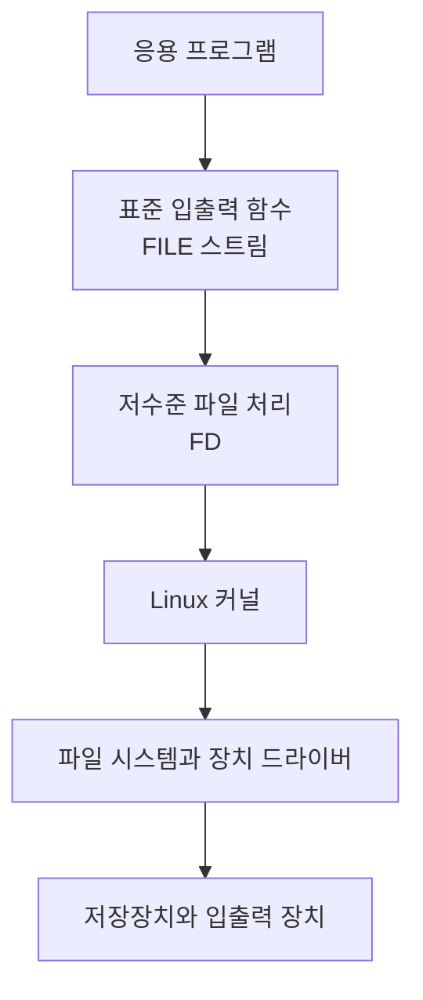

## PPT 구성

| 슬라이드 | 주제 |
| ---: | --- |
| 1 | 파일 처리 소개 |
| 2~4 | 표준 입출력 함수 |
| 5~12 | 저수준 파일 처리와 `open`, `close` |
| 13~15 | `creat` |
| 16~24 | `read`, `write`, 읽기·쓰기 포인터 |
| 25~30 | `lseek`와 임의 접근 |
| 31~33 | 표준 입력·출력·오류 |
| 34~37 | 파일의 표현과 `dup`, `dup2` |
| 38~47 | 파일 상태, `stat`, `access`, `umask` |
| 48~57 | 디렉터리 관련 함수 |
| 58~68 | 링크, 삭제, 이름 변경 |
| 69~70 | `fcntl` |

## 목차

1. [파일 처리 방식](#1-파일-처리-방식)
2. [표준 입출력 함수](#2-표준-입출력-함수)
3. [저수준 파일 처리](#3-저수준-파일-처리)
4. [`open`과 `close`](#4-open과-close)
5. [`creat`](#5-creat)
6. [`read`와 `write`](#6-read와-write)
7. [`lseek`와 임의 접근](#7-lseek와-임의-접근)
8. [표준 입력·출력·오류](#8-표준-입력출력오류)
9. [파일의 표현과 FD 복사](#9-파일의-표현과-fd-복사)
10. [파일 상태와 접근 권한](#10-파일-상태와-접근-권한)
11. [디렉터리 관련 함수](#11-디렉터리-관련-함수)
12. [링크·삭제·이름 변경](#12-링크삭제이름-변경)
13. [`fcntl`](#13-fcntl)
14. [함수 빠른 정리](#14-함수-빠른-정리)
15. [PPT 예제의 기술 보정](#15-ppt-예제의-기술-보정)
16. [과제 보충 개념](#16-과제-보충-개념)

---

## 1. 파일 처리 방식

Linux C 프로그램에서 파일을 처리하는 방식은 크게 두 가지로 구분할 수 있음

| 구분 | 표준 입출력 | 저수준 파일 처리 |
| --- | --- | --- |
| 기준 | C 표준 라이브러리 | POSIX 시스템 호출 인터페이스 |
| 파일 표현 | `FILE *` 스트림 | 정수형 파일 디스크립터 FD |
| 대표 함수 | `fopen`, `fgetc`, `fprintf`, `fclose` | `open`, `read`, `write`, `close` |
| 버퍼 | stdio 사용자 공간 버퍼 사용 | stdio 사용자 공간 버퍼를 사용하지 않음 |
| 장점 | 문자열과 형식 입출력이 편리함 | 바이트 단위의 세밀한 제어 가능 |



> [!IMPORTANT]
> PPT의 “I/O 장치에 직접 접근”은 하드웨어를 프로그램이 직접 제어한다는 뜻이 아님. 저수준 파일 처리는 stdio보다 커널 인터페이스에 가까우며, 실제 하드웨어 처리는 커널과 장치 드라이버가 담당함

---

## 2. 표준 입출력 함수

> PPT 슬라이드 2~4

**표준 입출력 함수(ANSI C Standard I/O)**: 정수형 FD 대신 `FILE *` 스트림을 사용하는 C 표준 라이브러리 함수

### 2.1 주요 함수

| 기능 | 함수 |
| --- | --- |
| 파일 열기·닫기 | `fopen`, `fclose` |
| 문자 입출력 | `fgetc`, `fputc` |
| 문자열 입출력 | `fgets`, `fputs` |
| 서식 입출력 | `fscanf`, `fprintf` |
| 파일 위치 이동 | `fseek`, `ftell`, `rewind` |

```c
#include <stdio.h>

FILE *fopen(const char *path, const char *mode);
int fclose(FILE *stream);

int fgetc(FILE *stream);
int fputc(int c, FILE *stream);

char *fgets(char *s, int size, FILE *stream);
int fputs(const char *s, FILE *stream);

int fseek(FILE *stream, long offset, int whence);
long ftell(FILE *stream);
void rewind(FILE *stream);
```

### 2.2 텍스트 파일 복사

PPT의 예제는 원본 파일을 읽어 대상 파일로 한 문자씩 복사하는 프로그램

<details>
<summary>현대 C 문법으로 보정한 예제</summary>

```c
#include <stdio.h>
#include <stdlib.h>

int main(int argc, char *argv[])
{
    FILE *src;
    FILE *dst;
    int ch;

    if (argc < 3) {
        fprintf(stderr, "Usage: %s source destination\n", argv[0]);
        return 1;
    }

    src = fopen(argv[1], "r");
    if (src == NULL) {
        perror("fopen: source");
        return 1;
    }

    dst = fopen(argv[2], "w");
    if (dst == NULL) {
        perror("fopen: destination");
        fclose(src);
        return 1;
    }

    while ((ch = fgetc(src)) != EOF)
        fputc(ch, dst);

    fclose(src);
    fclose(dst);
    return 0;
}
```

</details>

`fgetc()`의 반환값을 `char`가 아닌 `int`로 받아야 `EOF`와 실제 문자 값을 구분할 수 있음

---

## 3. 저수준 파일 처리

> PPT 슬라이드 5~6

**UNIX 파일 접근 프리미티브**: 파일과 입출력 자원을 다루기 위해 커널이 제공하는 기본 시스템 호출 인터페이스

| 함수 | 의미 |
| --- | --- |
| `open` | 파일 열기 또는 생성 |
| `creat` | 빈 파일 생성 |
| `close` | 열린 파일 닫기 |
| `read` | 파일에서 데이터 읽기 |
| `write` | 파일에 데이터 쓰기 |
| `lseek` | 파일의 읽기·쓰기 위치 이동 |
| `unlink` | 파일 이름 제거 |
| `remove` | 파일 또는 빈 디렉터리 제거 |
| `fcntl` | 열린 파일의 속성 제어 |

### 3.1 기본 흐름

```c
#include <fcntl.h>
#include <unistd.h>

int main(void)
{
    int fd;
    ssize_t nread;
    char buffer[1024];

    fd = open("data", O_RDONLY);
    if (fd == -1)
        return 1;

    nread = read(fd, buffer, sizeof(buffer));
    if (nread == -1) {
        close(fd);
        return 1;
    }

    close(fd);
    return 0;
}
```

```text
open 또는 creat → read 또는 write → close
```

---

## 4. `open`과 `close`

> PPT 슬라이드 7~12

### 4.1 `open`

**`open`**: 기존 파일을 열거나 플래그에 따라 새 파일을 만드는 시스템 호출

```c
#include <fcntl.h>
#include <sys/stat.h>
#include <sys/types.h>

int open(const char *pathname, int flags);
int open(const char *pathname, int flags, mode_t mode);
```

| 인자 | 의미 |
| --- | --- |
| `pathname` | 열 파일의 경로 |
| `flags` | 접근 방식과 추가 동작 |
| `mode` | 새 파일을 생성할 때 요청할 권한 |

- 성공: 0 이상의 FD 반환
- 실패: `-1` 반환, `errno` 설정

### 4.2 접근 방식 플래그

세 접근 방식 중 하나를 선택

| 플래그 | 의미 |
| --- | --- |
| `O_RDONLY` | 읽기 전용 |
| `O_WRONLY` | 쓰기 전용 |
| `O_RDWR` | 읽기·쓰기 |

필요한 추가 플래그를 비트 OR 연산자 `|`로 결합

| 플래그 | 의미 |
| --- | --- |
| `O_CREAT` | 파일이 없으면 생성, `mode` 필요 |
| `O_APPEND` | 쓸 때마다 파일 끝에 추가 |
| `O_TRUNC` | 기존 파일을 쓰기용으로 열 때 크기를 0으로 변경 |
| `O_EXCL` | `O_CREAT`와 함께 사용하며 파일이 이미 있으면 실패 |

```c
int fd = open(
    "report.txt",
    O_WRONLY | O_CREAT | O_TRUNC,
    0644
);
```

### 4.3 `O_`의 의미

`O_`는 `open()` 관련 접근 모드와 옵션 상수에 붙는 접두사. POSIX는 각 상수의 동작을 정의하지만 `O_`의 공식 영문 확장어를 별도로 규정하지 않음

> [!CAUTION]
> Linux에서 `O_RDONLY`는 값이 `0`일 수 있음. 접근 모드를 확인할 때는 `flags & O_ACCMODE` 사용

### 4.4 파일 생성 권한

| 대상 | 읽기·쓰기·실행 | 읽기 | 쓰기 | 실행 |
| --- | --- | --- | --- | --- |
| 소유자 | `S_IRWXU` | `S_IRUSR` | `S_IWUSR` | `S_IXUSR` |
| 그룹 | `S_IRWXG` | `S_IRGRP` | `S_IWGRP` | `S_IXGRP` |
| 기타 | `S_IRWXO` | `S_IROTH` | `S_IWOTH` | `S_IXOTH` |

```c
mode_t mode = S_IRUSR | S_IWUSR | S_IRGRP | S_IROTH;
/* 0644, rw-r--r-- */
```

`S_I`는 `<sys/stat.h>`의 파일 상태와 모드 비트 상수에 사용되는 전통적인 접두사. 흔히 `stat`과 inode 관련 표기로 설명하지만 POSIX에서 공식 확장어를 정의하지는 않음

### 4.5 `close`

**`close`**: 열린 FD를 닫고 프로세스의 파일 디스크립터를 반납하는 시스템 호출

```c
#include <unistd.h>

int close(int fd);
```

- 성공: `0`
- 실패: `-1`
- 프로세스가 동시에 열 수 있는 FD 수에는 제한이 있으므로 사용 후 닫아야 함

<details>
<summary>파일 존재 여부 확인 예제</summary>

```c
#include <fcntl.h>
#include <stdio.h>
#include <unistd.h>

int main(int argc, char *argv[])
{
    int fd;

    if (argc < 2) {
        fprintf(stderr, "Usage: %s filename\n", argv[0]);
        return 1;
    }

    fd = open(argv[1], O_RDONLY);
    if (fd == -1) {
        perror("open");
        return 1;
    }

    printf("File \"%s\" found.\n", argv[1]);
    close(fd);
    return 0;
}
```

</details>

---

## 5. `creat`

> PPT 슬라이드 13~15

**`creat`**: 파일을 쓰기 전용으로 생성하거나 기존 파일의 크기를 0으로 만드는 시스템 호출

```c
#include <fcntl.h>
#include <sys/stat.h>

int creat(const char *pathname, mode_t mode);
```

다음 두 호출은 같은 동작

```c
int fd1 = creat("newfile", 0644);
int fd2 = open("newfile", O_WRONLY | O_CREAT | O_TRUNC, 0644);
```

- 파일이 없으면 생성
- 파일이 있으면 기존 내용을 제거
- 파일을 쓰기 전용으로 개방
- 성공하면 FD, 실패하면 `-1` 반환

<details>
<summary>파일 생성 후 문자열 기록 예제</summary>

```c
#include <fcntl.h>
#include <stdio.h>
#include <string.h>
#include <unistd.h>

int main(int argc, char *argv[])
{
    const char *message = "This is a test.\n";
    int fd;
    ssize_t count;

    if (argc < 2) {
        fprintf(stderr, "Usage: %s filename\n", argv[0]);
        return 1;
    }

    fd = creat(argv[1], 0644);
    if (fd == -1) {
        perror("creat");
        return 1;
    }

    count = write(fd, message, strlen(message));
    if (count == -1)
        perror("write");

    close(fd);
    return count == -1 ? 1 : 0;
}
```

</details>

---

## 6. `read`와 `write`

> PPT 슬라이드 16~24

### 6.1 `read`

**`read`**: 열린 파일에서 지정한 최대 바이트 수만큼 프로그램 버퍼로 복사하는 시스템 호출

```c
#include <unistd.h>

ssize_t read(int fd, void *buffer, size_t count);
```

| 반환값 | 의미 |
| ---: | --- |
| 양수 | 실제 읽은 바이트 수 |
| `0` | EOF 도달 |
| `-1` | 오류 |

요청한 크기보다 적은 바이트를 읽는 경우도 있으므로 반환값 확인 필요

### 6.2 `write`

**`write`**: 프로그램 버퍼의 데이터를 열린 파일에 기록하는 시스템 호출

```c
#include <unistd.h>

ssize_t write(int fd, const void *buffer, size_t count);
```

| 반환값 | 의미 |
| ---: | --- |
| 0 이상의 값 | 실제 기록한 바이트 수 |
| `-1` | 오류 |

반환값이 요청한 `count`보다 작을 수 있으므로 중요한 프로그램에서는 남은 데이터를 다시 기록해야 함

### 6.3 읽기·쓰기 포인터

커널은 열린 파일 설명에 현재 파일 위치를 저장함

```text
파일 내용: A B C D E F
현재 위치: ^

read(fd, buffer, 3)

읽은 내용: A B C
새 위치:       ^
```

- `read`: 읽은 바이트 수만큼 위치 전진
- `write`: 기록한 바이트 수만큼 위치 전진
- `lseek`: 위치를 원하는 곳으로 이동

### 6.4 문자 수 세기

```c
ssize_t nread;
long long total = 0;
char buffer[1024];

while ((nread = read(fd, buffer, sizeof(buffer))) > 0)
    total += nread;

if (nread == -1)
    perror("read");
```

### 6.5 파일 끝에 내용 추가

```c
int fd = open("log.txt", O_WRONLY | O_APPEND);
```

`O_APPEND`를 사용하면 각 `write()` 직전에 커널이 파일 끝으로 이동하므로 여러 프로세스가 함께 기록할 때 수동 `lseek()`보다 안전함

### 6.6 저수준 파일 복사

<details>
<summary>read와 write를 사용한 복사 예제</summary>

```c
#include <fcntl.h>
#include <stdio.h>
#include <unistd.h>

#define BUFSIZE 4096

int main(int argc, char *argv[])
{
    char buffer[BUFSIZE];
    int src;
    int dst;
    ssize_t nread;

    if (argc < 3) {
        fprintf(stderr, "Usage: %s source destination\n", argv[0]);
        return 1;
    }

    src = open(argv[1], O_RDONLY);
    if (src == -1) {
        perror("open: source");
        return 1;
    }

    dst = open(argv[2], O_WRONLY | O_CREAT | O_TRUNC, 0644);
    if (dst == -1) {
        perror("open: destination");
        close(src);
        return 1;
    }

    while ((nread = read(src, buffer, sizeof(buffer))) > 0) {
        ssize_t written = 0;

        while (written < nread) {
            ssize_t result = write(
                dst,
                buffer + written,
                (size_t)(nread - written)
            );

            if (result == -1) {
                perror("write");
                close(src);
                close(dst);
                return 1;
            }

            written += result;
        }
    }

    if (nread == -1)
        perror("read");

    close(src);
    close(dst);
    return nread == -1 ? 1 : 0;
}
```

</details>

### 6.7 버퍼 크기와 효율

- 매우 작은 버퍼: 시스템 호출 횟수가 증가하여 느려질 수 있음
- 적절한 크기의 버퍼: 한 번에 많은 데이터를 처리하여 호출 횟수 감소
- 지나치게 큰 버퍼: 메모리 사용량이 커지며 항상 성능이 비례해 증가하지는 않음

---

## 7. `lseek`와 임의 접근

> PPT 슬라이드 25~30

**`lseek`**: 열린 파일의 현재 위치를 원하는 바이트 위치로 이동하는 시스템 호출

```c
#include <sys/types.h>
#include <unistd.h>

off_t lseek(int fd, off_t offset, int whence);
```

| `whence` | 기준 위치 |
| --- | --- |
| `SEEK_SET` | 파일 시작 |
| `SEEK_CUR` | 현재 위치 |
| `SEEK_END` | 파일 끝 |

```c
lseek(fd, 0, SEEK_SET);   /* 파일 시작으로 이동 */
lseek(fd, 10, SEEK_CUR);  /* 현재 위치에서 10바이트 뒤 */
lseek(fd, -5, SEEK_END);  /* 파일 끝에서 5바이트 앞 */
```

- 성공: 새 파일 위치 반환
- 실패: `(off_t)-1` 반환
- 파이프와 소켓처럼 위치 개념이 없는 FD에는 사용할 수 없음

### 7.1 파일 크기 확인

```c
off_t size = lseek(fd, 0, SEEK_END);

if (size == (off_t)-1)
    perror("lseek");
```

`lseek`가 현재 위치를 바꾸므로 기존 위치를 보존해야 한다면 먼저 저장하고 다시 복원

### 7.2 파일 홀

파일 끝보다 뒤로 이동한 다음 데이터를 기록하면 중간의 빈 구간인 **파일 홀(file hole)**이 생성될 수 있음

```c
lseek(fd, 1024, SEEK_END);
write(fd, "A", 1);
```

파일 홀은 읽을 때 0으로 보이지만 파일 시스템에서는 실제 데이터 블록을 할당하지 않을 수 있음

---

## 8. 표준 입력·출력·오류

> PPT 슬라이드 31~33

프로그램 시작 시 일반적으로 세 FD가 자동으로 열림

| FD | 매크로 | 이름 | 기본 연결 대상 |
| ---: | --- | --- | --- |
| `0` | `STDIN_FILENO` | 표준 입력 | 키보드 |
| `1` | `STDOUT_FILENO` | 표준 출력 | 터미널 화면 |
| `2` | `STDERR_FILENO` | 표준 오류 | 터미널 화면 |

### 8.1 셸 재지향

```bash
program < input.txt             # 표준 입력을 파일에서 받기
program > output.txt            # 표준 출력을 파일로 보내기
program 2> error.txt            # 표준 오류를 파일로 보내기
program > output.txt 2> error.txt
program1 | program2             # 앞 프로그램의 출력을 다음 프로그램의 입력으로 연결
```

### 8.2 표준 입력을 표준 출력으로 복사

```c
char buffer[256];
ssize_t count;

while ((count = read(STDIN_FILENO, buffer, sizeof(buffer))) > 0)
    write(STDOUT_FILENO, buffer, (size_t)count);
```

오류와 안내 메시지는 `STDERR_FILENO` 또는 `stderr`에 출력하면 표준 출력을 파일로 재지향해도 터미널에서 확인 가능

---

## 9. 파일의 표현과 FD 복사

> PPT 슬라이드 34~37

### 9.1 파일 관리 구조

```text
[사용자 프로세스]                  [커널]

변수 fd = 3
    │
    └──▶ 파일 디스크립터 테이블 ──▶ 열린 파일 설명 ──▶ inode
            [0] 표준 입력           현재 오프셋        파일 유형
            [1] 표준 출력           상태 플래그        권한
            [2] 표준 오류           접근 모드          소유자
            [3] data.txt                              크기
```

| 구조 | 저장 내용 |
| --- | --- |
| 파일 디스크립터 테이블 | 프로세스별 FD와 열린 파일 설명의 연결 |
| 열린 파일 설명 | 현재 파일 위치, 상태 플래그, 접근 모드 |
| inode | 파일 유형, 권한, 소유자, 크기, 데이터 위치 |

### 9.2 `dup`와 `dup2`

**`dup`와 `dup2`**: 기존 FD를 다른 번호의 FD로 복사하는 시스템 호출

```c
#include <unistd.h>

int dup(int oldfd);
int dup2(int oldfd, int newfd);
```

| 함수 | 동작 |
| --- | --- |
| `dup(oldfd)` | 사용하지 않는 가장 작은 FD 번호로 복사 |
| `dup2(oldfd, newfd)` | 지정한 `newfd` 번호로 복사 |

복사된 FD들은 같은 열린 파일 설명을 가리키므로 현재 파일 위치와 상태 플래그 공유

### 9.3 표준 출력 재지향

```c
int fd = open("output.txt", O_WRONLY | O_CREAT | O_TRUNC, 0644);

if (fd != -1) {
    dup2(fd, STDOUT_FILENO);
    close(fd);
    write(STDOUT_FILENO, "file output\n", 12);
}
```

`dup2(fd, STDOUT_FILENO)` 실행 후 FD 1이 터미널 대신 `output.txt`를 가리킴

---

## 10. 파일 상태와 접근 권한

> PPT 슬라이드 38~47

### 10.1 `stat`, `fstat`, `lstat`

**`stat` 계열**: 파일의 유형, 권한, 소유자, 크기, 시간 등의 상태 정보 조회

```c
#include <sys/stat.h>

int stat(const char *path, struct stat *buffer);
int fstat(int fd, struct stat *buffer);
int lstat(const char *path, struct stat *buffer);
```

| 함수 | 대상 |
| --- | --- |
| `stat` | 경로가 가리키는 실제 파일 |
| `fstat` | 열린 FD가 가리키는 파일 |
| `lstat` | 심볼릭 링크 자체 |

`struct stat`의 주요 멤버:

| 멤버 | 의미 |
| --- | --- |
| `st_mode` | 파일 유형과 접근 권한 |
| `st_ino` | inode 번호 |
| `st_nlink` | 하드 링크 수 |
| `st_uid`, `st_gid` | 소유자와 그룹 ID |
| `st_size` | 파일 크기 |
| `st_atime` | 마지막 접근 시간 |
| `st_mtime` | 마지막 내용 수정 시간 |
| `st_ctime` | 마지막 상태 변경 시간 |

### 10.2 파일 유형 판별

| 매크로 | 판별 대상 |
| --- | --- |
| `S_ISREG(mode)` | 일반 파일 |
| `S_ISDIR(mode)` | 디렉터리 |
| `S_ISCHR(mode)` | 문자 장치 |
| `S_ISBLK(mode)` | 블록 장치 |
| `S_ISFIFO(mode)` | FIFO |
| `S_ISLNK(mode)` | 심볼릭 링크 |
| `S_ISSOCK(mode)` | 소켓 |

```c
struct stat info;

if (stat("data.txt", &info) == -1) {
    perror("stat");
} else if (S_ISREG(info.st_mode)) {
    printf("regular file\n");
}
```

### 10.3 `access`

**`access`**: 실제 사용자 ID와 실제 그룹 ID를 기준으로 파일 접근 가능 여부 확인

```c
#include <unistd.h>

int access(const char *pathname, int mode);
```

| 모드 | 확인 내용 |
| --- | --- |
| `F_OK` | 파일 존재 여부 |
| `R_OK` | 읽기 가능 여부 |
| `W_OK` | 쓰기 가능 여부 |
| `X_OK` | 실행 가능 여부 |

검사 후 실제 사용 사이에 파일 상태가 바뀔 수 있으므로 보안 판단에서는 `access()` 결과만 믿지 않고 실제 `open()` 결과 처리 필요

### 10.4 `umask`

**`umask`**: 새 파일이나 디렉터리를 만들 때 제거할 권한 비트를 지정하는 프로세스 속성

```c
#include <sys/stat.h>

mode_t umask(mode_t mask);
```

```text
최종 권한 = 요청한 mode & ~umask
```

예시:

```text
요청 권한: 0666
umask:     0022
최종 권한: 0644  rw-r--r--
```

`umask`는 권한을 추가하지 않고 요청한 권한에서 특정 비트만 제거

---

## 11. 디렉터리 관련 함수

> PPT 슬라이드 48~57

### 11.1 디렉터리 스트림

| 함수 | 역할 |
| --- | --- |
| `opendir` | 디렉터리 열기 |
| `readdir` | 다음 디렉터리 항목 읽기 |
| `closedir` | 디렉터리 닫기 |
| `rewinddir` | 디렉터리 읽기 위치를 처음으로 이동 |

```c
#include <dirent.h>

DIR *opendir(const char *name);
struct dirent *readdir(DIR *directory);
int closedir(DIR *directory);
void rewinddir(DIR *directory);
```

`struct dirent`의 주요 멤버:

- `d_ino`: inode 번호
- `d_name`: 파일 이름

<details>
<summary>디렉터리 목록 출력 예제</summary>

```c
#include <dirent.h>
#include <stdio.h>

int main(int argc, char *argv[])
{
    const char *path = argc > 1 ? argv[1] : ".";
    struct dirent *entry;
    DIR *directory = opendir(path);

    if (directory == NULL) {
        perror("opendir");
        return 1;
    }

    while ((entry = readdir(directory)) != NULL)
        printf("%s\n", entry->d_name);

    closedir(directory);
    return 0;
}
```

</details>

### 11.2 현재 작업 디렉터리

```c
#include <unistd.h>

char *getcwd(char *buffer, size_t size);
int chdir(const char *path);
```

- `getcwd`: 현재 작업 디렉터리 경로 조회
- `chdir`: 현재 프로세스의 작업 디렉터리 변경

```c
char path[1024];

if (getcwd(path, sizeof(path)) != NULL)
    printf("%s\n", path);
```

### 11.3 디렉터리 생성과 삭제

```c
#include <sys/stat.h>
#include <unistd.h>

int mkdir(const char *pathname, mode_t mode);
int rmdir(const char *pathname);
```

- `mkdir`: 새 디렉터리 생성, `umask` 영향 적용
- `rmdir`: 비어 있는 디렉터리만 삭제 가능

---

## 12. 링크·삭제·이름 변경

> PPT 슬라이드 58~68

### 12.1 하드 링크

**하드 링크**: 같은 inode를 가리키는 새로운 파일 이름

```c
#include <unistd.h>

int link(const char *oldpath, const char *newpath);
```

```text
name1 ─┐
       ├──▶ 같은 inode ──▶ 같은 파일 데이터
name2 ─┘
```

- 원본 이름을 삭제해도 다른 하드 링크가 남아 있으면 데이터 유지
- 일반적으로 다른 파일 시스템으로 만들 수 없음
- 디렉터리에 대한 하드 링크 생성은 제한됨

### 12.2 `unlink`

**`unlink`**: 디렉터리에서 파일 이름을 제거하고 링크 수를 감소시키는 시스템 호출

```c
#include <unistd.h>

int unlink(const char *pathname);
```

링크 수가 0이 되고 어떤 프로세스도 파일을 열고 있지 않을 때 실제 데이터 제거

### 12.3 심볼릭 링크

**심볼릭 링크**: 다른 파일의 경로 문자열을 저장하는 별도의 파일

```c
#include <unistd.h>

int symlink(const char *target, const char *linkpath);
ssize_t readlink(const char *path, char *buffer, size_t size);
```

| 구분 | 하드 링크 | 심볼릭 링크 |
| --- | --- | --- |
| inode | 원본과 공유 | 별도의 inode 사용 |
| 저장 내용 | 같은 파일 데이터 참조 | 대상 경로 문자열 |
| 파일 시스템 경계 | 일반적으로 불가능 | 가능 |
| 대상 삭제 후 | 다른 링크로 데이터 접근 가능 | 끊어진 링크가 될 수 있음 |

`readlink()`는 문자열 끝의 `\0`을 자동으로 추가하지 않으므로 반환값을 이용해 직접 처리해야 함

### 12.4 `remove`와 `rename`

```c
#include <stdio.h>

int remove(const char *pathname);
int rename(const char *oldpath, const char *newpath);
```

- `remove`: 파일 또는 빈 디렉터리 제거
- `rename`: 같은 파일 시스템 안에서 이름이나 경로 변경
- 셸의 `mv`는 같은 파일 시스템에서는 `rename`을 사용할 수 있음
- 다른 파일 시스템으로 이동할 때는 복사 후 원본 삭제 방식 필요

---

## 13. `fcntl`

> PPT 슬라이드 69~70

**`fcntl`**: 열린 FD의 속성을 조회하거나 변경하는 파일 제어 함수

```c
#include <fcntl.h>

int fcntl(int fd, int command, ...);
```

| 명령 | 기능 |
| --- | --- |
| `F_DUPFD` | 지정한 값 이상의 사용하지 않는 FD로 복사 |
| `F_GETFD` | FD 자체의 플래그 조회 |
| `F_SETFD` | FD 자체의 플래그 설정 |
| `F_GETFL` | 파일 상태 플래그 조회 |
| `F_SETFL` | 변경 가능한 파일 상태 플래그 설정 |

### 13.1 접근 모드 확인

```c
int flags = fcntl(fd, F_GETFL);

if (flags == -1) {
    perror("fcntl");
} else {
    switch (flags & O_ACCMODE) {
    case O_RDONLY:
        printf("read only\n");
        break;
    case O_WRONLY:
        printf("write only\n");
        break;
    case O_RDWR:
        printf("read and write\n");
        break;
    }
}
```

`O_RDONLY`가 0일 수 있으므로 `flags & O_RDONLY` 방식으로 검사하지 않음

---

## 14. 함수 빠른 정리

| 분류 | 함수 | 주요 헤더 | 실패 시 반환 |
| --- | --- | --- | --- |
| 표준 파일 열기·닫기 | `fopen`, `fclose` | `<stdio.h>` | `NULL`, `EOF` |
| 저수준 열기·닫기 | `open`, `creat`, `close` | `<fcntl.h>`, `<unistd.h>` | `-1` |
| 읽기·쓰기 | `read`, `write` | `<unistd.h>` | `-1` |
| 위치 이동 | `lseek` | `<unistd.h>` | `(off_t)-1` |
| FD 복사 | `dup`, `dup2` | `<unistd.h>` | `-1` |
| 파일 상태 | `stat`, `fstat`, `lstat` | `<sys/stat.h>` | `-1` |
| 접근 확인 | `access` | `<unistd.h>` | `-1` |
| 권한 마스크 | `umask` | `<sys/stat.h>` | 이전 마스크 반환 |
| 디렉터리 스트림 | `opendir`, `readdir`, `closedir` | `<dirent.h>` | `NULL` 또는 `-1` |
| 작업 디렉터리 | `getcwd`, `chdir` | `<unistd.h>` | `NULL`, `-1` |
| 디렉터리 생성·삭제 | `mkdir`, `rmdir` | `<sys/stat.h>`, `<unistd.h>` | `-1` |
| 링크 | `link`, `unlink`, `symlink`, `readlink` | `<unistd.h>` | `-1` |
| 삭제·이름 변경 | `remove`, `rename` | `<stdio.h>` | `-1` |
| 파일 제어 | `fcntl` | `<fcntl.h>` | `-1` |

컴파일 예:

```bash
gcc -std=c11 -Wall -Wextra -o file_copy file_copy.c
./file_copy source.txt destination.txt
```

---

## 15. PPT 예제의 기술 보정

PPT는 개념과 흐름을 이해하는 데 사용하고, 코드 작성 시에는 다음 항목을 보정해야 함

| PPT의 오래된 표현 | 보정 | 이유 |
| --- | --- | --- |
| `main()` | `int main(void)` 또는 `int main(int argc, char *argv[])` | C99 이후 암시적 `int` 사용 불가 |
| `char ch`로 `fgetc()` 결과 저장 | `int ch` 사용 | `EOF`와 문자 `0xFF` 구분 |
| `while (!feof(fp))` | `while ((ch = fgetc(fp)) != EOF)` | `feof`는 읽기 실패 후에 참이 됨 |
| `opendir(...) < 0` | `opendir(...) == NULL` | 포인터 함수는 실패 시 `NULL` 반환 |
| `getcwd(...) < 0` | `getcwd(...) == NULL` | 포인터 함수는 실패 시 `NULL` 반환 |
| `ssize_t`를 `%d`로 출력 | `%zd` 사용 | 자료형 크기 일치 |
| `off_t`를 `%d`로 출력 | 적합한 형식과 캐스팅 사용 | 64비트 환경에서 크기 불일치 방지 |
| 둥근 따옴표 `“ ”` | 일반 따옴표 `" "` | C 소스 컴파일 오류 방지 |
| `write` 한 번이면 전부 기록된다고 가정 | 반환값만큼 처리하고 남은 데이터 재시도 | 부분 쓰기 가능 |

---

## 16. 과제 보충 개념

다음 항목은 PPT의 직접적인 중심 범위가 아니므로 과제 문항에 맞춰 간단히 보충함

### 16.1 시스템 프로그래밍과 시스템 프로그래머

**시스템 프로그래밍**: 운영체제가 제공하는 기능을 이용해 프로세스, 메모리, 파일, 장치, 네트워크 등의 시스템 자원을 다루는 프로그램을 개발하는 분야

**시스템 프로그래머**: 운영체제와 가까운 계층의 소프트웨어를 설계하고 구현하는 개발자

### 16.2 Linux에서 파일

Linux는 일반 파일뿐 아니라 디렉터리, 장치, 파이프, 소켓 등을 파일과 비슷한 인터페이스로 처리함. “모든 것은 파일이다”라는 표현은 모든 자원이 실제 디스크 파일이라는 뜻이 아니라 공통 입출력 방식으로 다룰 수 있다는 의미

### 16.3 `man` 명령

```bash
man 2 open      # 시스템 호출
man 3 fopen     # 라이브러리 함수
man -k file     # 키워드 검색
```

- Section 1: 실행 프로그램과 셸 명령
- Section 2: 시스템 호출
- Section 3: 라이브러리 함수
- Section 5: 파일 형식
- Section 8: 시스템 관리 명령

### 16.4 커널과 라이브러리

| 구분 | 커널 | 라이브러리 |
| --- | --- | --- |
| 실행 영역 | 커널 공간 | 주로 사용자 공간 |
| 역할 | CPU, 메모리, 파일, 장치 등의 자원 관리 | 재사용 가능한 함수와 편리한 API 제공 |
| 접근 | 시스템 호출 | 일반 함수 호출 |
| 예 | 스케줄러, VFS, 장치 드라이버 | libc, stdio, pthread, libm |

`printf()`는 stdio 라이브러리에서 형식 변환과 버퍼링을 처리하고, 실제 출력이 필요하면 `write` 계열을 통해 커널에 요청함

---

## 참고 자료

### 중심 자료

- `file.ppt`: 파일 처리 70개 슬라이드

### 보조 자료

- `submit.txt`: 과제 문항 초안
- `linux-file-io-notes/README.md`: PPT 예제를 현대 C 문법에 맞게 보정한 기존 GitHub용 정리

