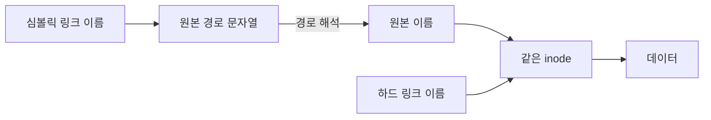
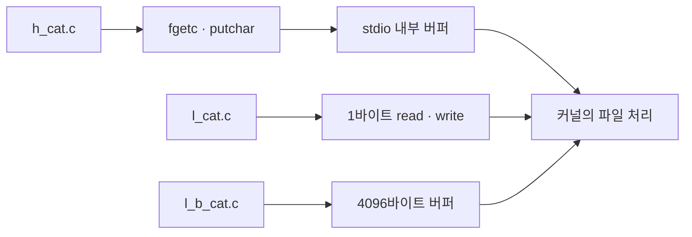
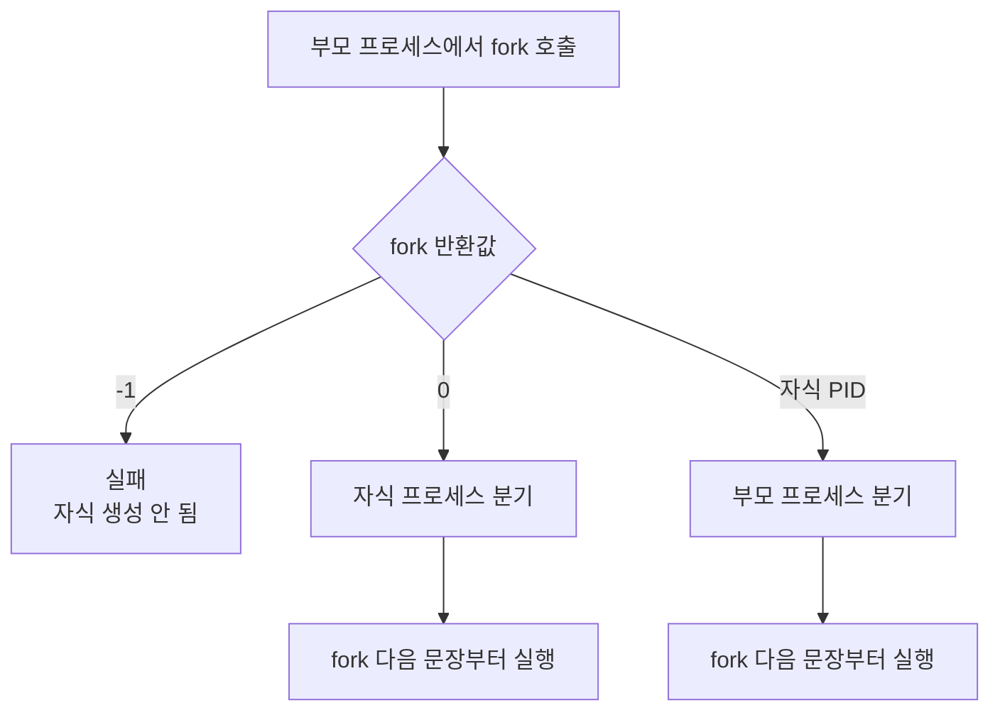
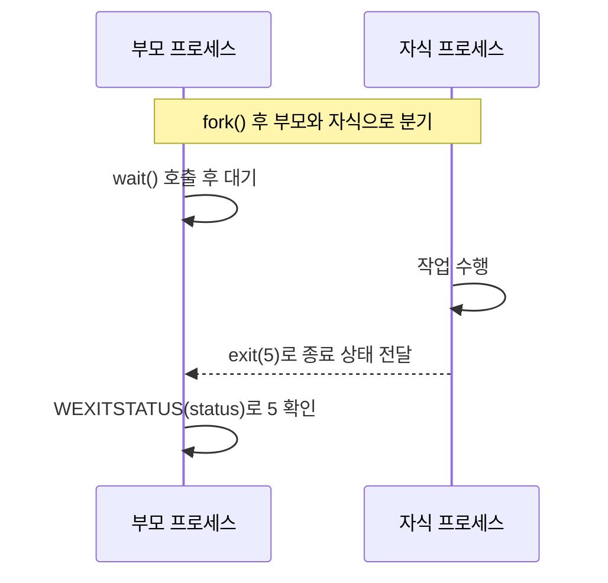
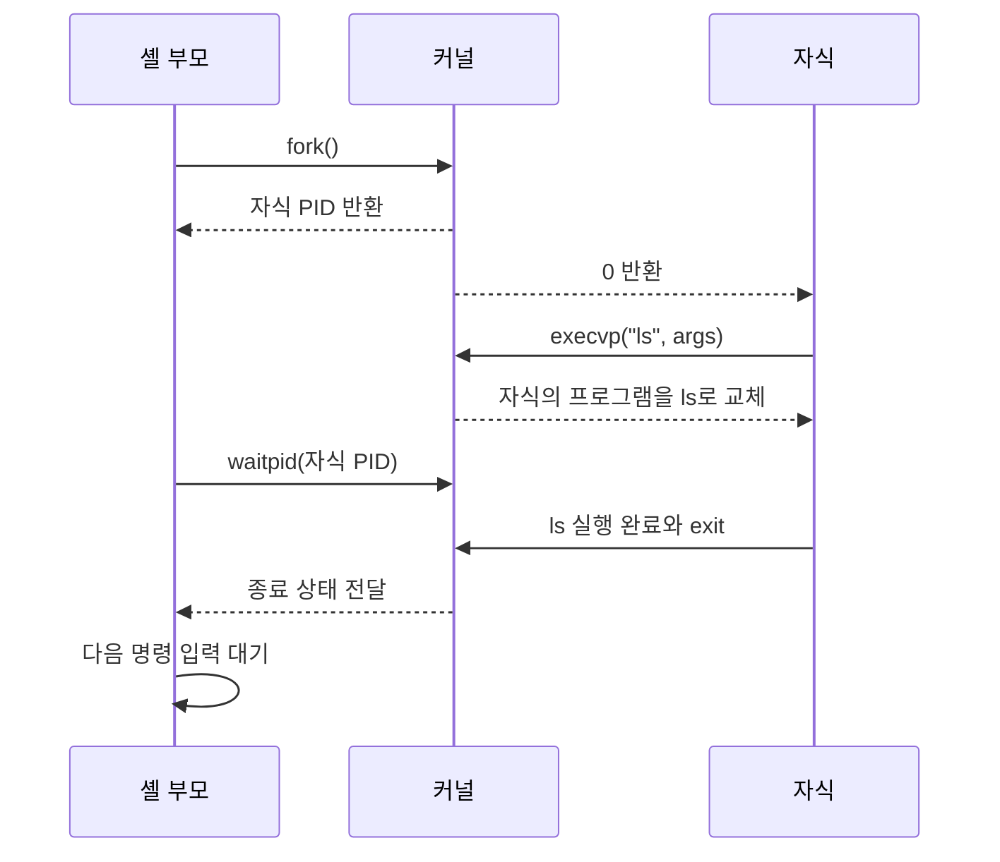
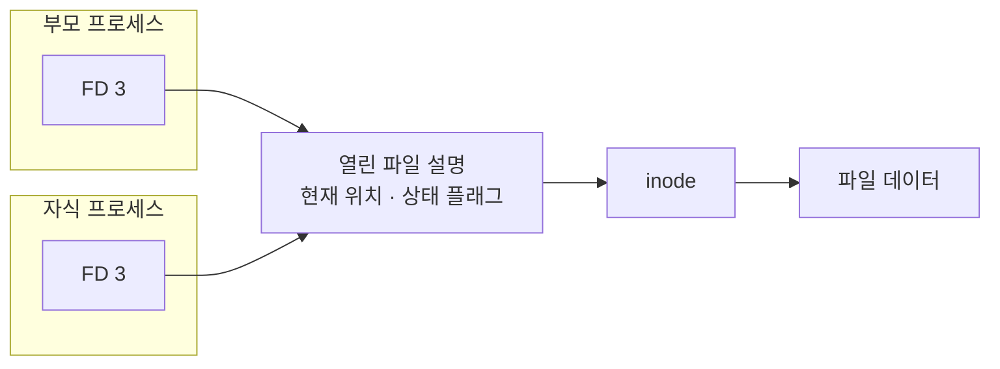

# Week10 - 디렉터리와 프로세스

| 항목 | 내용 |
| --- | --- |
| 과목 | 시스템 프로그래밍 |
| 주제 | 디렉터리, 링크, 프로세스 제어 |
| 핵심 함수 | `mkdir`, `rmdir`, `link`, `unlink`, `fcntl`, `fork`, `exit`, `wait`, `exec` |
| 실습 자료 | `cat비교파일`, `process`, `디렉터리와프로세스_1103.pdf` |

> [!NOTE]
> 강의 PDF의 개념과 실습 흐름을 중심으로 구성한 정리. 제공된 C 파일의 의도는 유지하되, 현대 C 컴파일러에서 오류가 발생하는 구식 문법과 오타는 별도 항목에서 보정

## 목차

1. [학습 목표](#1-학습-목표)
2. [디렉터리 구조](#2-디렉터리-구조)
3. [디렉터리 시스템 호출](#3-디렉터리-시스템-호출)
4. [링크와 파일 삭제](#4-링크와-파일-삭제)
5. [`fcntl` 파일 제어](#5-fcntl-파일-제어)
6. [`cat` 구현 방식 비교](#6-cat-구현-방식-비교)
7. [프로그램과 프로세스](#7-프로그램과-프로세스)
8. [`fork` 프로세스 생성](#8-fork-프로세스-생성)
9. [`exit`와 `atexit`](#9-exit와-atexit)
10. [`wait`와 프로세스 동기화](#10-wait와-프로세스-동기화)
11. [`exec` 프로그램 교체](#11-exec-프로그램-교체)
12. [`fork`, `exec`, `wait` 결합](#12-fork-exec-wait-결합)
13. [간단한 셸](#13-간단한-셸)
14. [파일 기술자 상속](#14-파일-기술자-상속)
15. [프로세스 식별번호](#15-프로세스-식별번호)
16. [제공 자료의 코드 보정](#16-제공-자료의-코드-보정)
17. [실습 순서](#17-실습-순서)
18. [핵심 요약](#18-핵심-요약)

---

## 1. 학습 목표

- 디렉터리와 파일 이름의 연결 구조 이해
- 하드 링크와 심볼릭 링크의 차이 구분
- 디렉터리·링크 관련 시스템 호출 사용
- 고수준 I/O와 저수준 I/O의 처리 방식 비교
- `fork`, `exit`, `wait`, `exec`의 역할과 실행 흐름 이해
- 부모·자식 프로세스의 반환값과 종료 상태 해석
- `fork` 후 파일 기술자와 파일 위치 공유 방식 이해
- 간단한 셸의 `입력 → fork → exec → wait` 구조 파악

### 전체 학습 구조


디렉터리와 파일 기술자를 먼저 이해한 뒤, 프로세스가 파일을 상속하고 새 프로그램을 실행하는 과정으로 연결

---

## 2. 디렉터리 구조

**디렉터리(directory)**: 파일 이름과 inode 번호의 연결 정보를 저장하는 특수한 파일

```text
파일 이름 ── 디렉터리 항목 ── inode ── 데이터 블록
```


파일 이름 자체에 데이터가 들어 있는 것이 아니라, 디렉터리 항목이 inode 번호를 통해 실제 데이터 위치로 연결

| 용어 | 의미 |
| --- | --- |
| 하위 디렉터리 | 다른 디렉터리 안에 포함된 디렉터리 |
| 현재 디렉터리 `.` | 프로세스가 현재 작업 중인 디렉터리 |
| 부모 디렉터리 `..` | 현재 디렉터리의 상위 디렉터리 |
| 절대 경로 | `/`에서 시작하는 전체 경로 |
| 상대 경로 | 현재 작업 디렉터리를 기준으로 한 경로 |

### 경로 예

```text
/home/mas1208/Week10        # 절대 경로
./process                   # 현재 디렉터리 기준
../Week09                   # 부모 디렉터리 기준
```

---

## 3. 디렉터리 시스템 호출

### 3.1 주요 함수

| 함수 | 기능 | 성공 | 실패 |
| --- | --- | ---: | ---: |
| `mkdir(path, mode)` | 새 디렉터리 생성 | `0` | `-1` |
| `rmdir(path)` | 빈 디렉터리 삭제 | `0` | `-1` |
| `rename(old, new)` | 파일·디렉터리 이름 또는 위치 변경 | `0` | `-1` |

```text
#include <sys/stat.h>
int mkdir(const char *pathname, mode_t mode);

#include <unistd.h>
int rmdir(const char *pathname);

#include <stdio.h>
int rename(const char *oldpath, const char *newpath);
```

### 3.2 `mkdir` 구현

```c
/* file: file_mkdir.c */
#include <stdio.h>
#include <sys/stat.h>

int main(int argc, char *argv[])
{
    if (argc != 2) {
        fprintf(stderr, "사용법: %s 디렉터리명\n", argv[0]);
        return 1;
    }

    if (mkdir(argv[1], 0777) == -1) {
        perror("mkdir");
        return 1;
    }

    return 0;
}
```

```bash
gcc -std=c11 -Wall -Wextra -o f_md file_mkdir.c
./f_md testdir
ls -ld testdir
```

> [!IMPORTANT]
> `0777`은 요청 권한. 실제 생성 권한은 `mode & ~umask`로 결정되므로 일반적인 `umask 0022` 환경에서는 `0755`가 될 수 있음

### 3.3 `rmdir` 구현

```c
/* file: file_rmdir.c */
#include <stdio.h>
#include <unistd.h>

int main(int argc, char *argv[])
{
    if (argc != 2) {
        fprintf(stderr, "사용법: %s 디렉터리명\n", argv[0]);
        return 1;
    }

    if (rmdir(argv[1]) == -1) {
        perror("rmdir");
        return 1;
    }

    return 0;
}
```

```bash
gcc -std=c11 -Wall -Wextra -o f_rd file_rmdir.c
./f_rd testdir
```

**주의**: `rmdir()`은 비어 있는 디렉터리만 삭제 가능

### 3.4 `rename` 예

```c
/* file: file_rename.c */
#include <stdio.h>

int main(int argc, char *argv[])
{
    if (argc != 3) {
        fprintf(stderr, "사용법: %s 기존이름 새이름\n", argv[0]);
        return 1;
    }

    if (rename(argv[1], argv[2]) == -1) {
        perror("rename");
        return 1;
    }

    return 0;
}
```

같은 파일 시스템 안의 이름 변경은 일반적으로 원자적으로 처리. 서로 다른 파일 시스템 사이의 이동은 `rename()`만으로 처리할 수 없음

---

## 4. 링크와 파일 삭제

### 4.1 하드 링크와 심볼릭 링크

| 구분 | 하드 링크 | 심볼릭 링크 |
| --- | --- | --- |
| 함수 | `link()` | `symlink()` |
| 저장 대상 | 원본과 같은 inode | 대상 경로 문자열 |
| inode | 원본과 공유 | 별도 inode |
| 파일 시스템 경계 | 일반적으로 불가능 | 가능 |
| 원본 이름 삭제 후 | 다른 하드 링크로 접근 가능 | 끊어진 링크가 될 수 있음 |
| 디렉터리 링크 | 일반 사용자 생성 제한 | 가능 |

```text
하드 링크
name1 ─┐
       ├── inode ── 데이터
name2 ─┘

심볼릭 링크
linkname ── "원본 경로" ── 원본 inode ── 데이터
```



하드 링크는 inode에 직접 연결되고, 심볼릭 링크는 먼저 저장된 경로를 해석한 뒤 원본 이름을 찾아감

### 4.2 주요 함수

```text
#include <unistd.h>

int link(const char *oldpath, const char *newpath);
int symlink(const char *target, const char *linkpath);
int unlink(const char *pathname);
```

- `link`: 기존 파일에 대한 새 하드 링크 이름 생성
- `symlink`: 대상 경로 문자열을 저장하는 심볼릭 링크 생성
- `unlink`: 디렉터리에서 파일 이름 제거 및 링크 수 감소
- 링크 수가 `0`이고 어떤 프로세스도 파일을 열고 있지 않을 때 실제 데이터 제거

### 4.3 `ln`과 비슷한 프로그램

```c
/* file: file_link.c */
#include <stdio.h>
#include <unistd.h>

int main(int argc, char *argv[])
{
    if (argc != 3) {
        fprintf(stderr, "사용법: %s 원본 새링크\n", argv[0]);
        return 1;
    }

    if (link(argv[1], argv[2]) == -1) {
        perror("link");
        return 1;
    }

    return 0;
}
```

### 4.4 `rm`과 비슷한 프로그램

```c
/* file: file_rm.c */
#include <stdio.h>
#include <unistd.h>

int main(int argc, char *argv[])
{
    if (argc != 2) {
        fprintf(stderr, "사용법: %s 파일명\n", argv[0]);
        return 1;
    }

    if (unlink(argv[1]) == -1) {
        perror("unlink");
        return 1;
    }

    return 0;
}
```

---

## 5. `fcntl` 파일 제어

**`fcntl`**: 이미 열려 있는 파일 기술자의 속성과 상태 플래그를 조회하거나 변경하는 함수

```text
#include <fcntl.h>

int fcntl(int fd, int cmd, ...);
```

| 명령 | 기능 |
| --- | --- |
| `F_GETFL` | `open()`에서 설정된 파일 상태 플래그 조회 |
| `F_SETFL` | `O_APPEND`, `O_NONBLOCK` 등 변경 가능한 상태 플래그 설정 |
| `F_GETFD` | 파일 기술자 플래그 조회 |
| `F_SETFD` | `FD_CLOEXEC` 같은 파일 기술자 플래그 설정 |

### `close-on-exec` 설정

```c
/* file: set_cloexec.c */
#include <fcntl.h>
#include <stdio.h>
#include <unistd.h>

int main(void)
{
    int fd = open("test.txt", O_RDONLY);
    if (fd == -1) {
        perror("open");
        return 1;
    }

    int flags = fcntl(fd, F_GETFD);
    if (flags == -1 || fcntl(fd, F_SETFD, flags | FD_CLOEXEC) == -1) {
        perror("fcntl");
        close(fd);
        return 1;
    }

    close(fd);
    return 0;
}
```

**`FD_CLOEXEC`**: 이후 `exec()`에 성공할 때 해당 파일 기술자를 자동으로 닫도록 지정하는 플래그

---

## 6. `cat` 구현 방식 비교

제공된 `h_cat.c`, `l_cat.c`, `l_b_cat.c`는 동일한 파일을 서로 다른 입출력 방식으로 출력하는 비교 실습

| 파일 | 파일 열기 | 읽기·출력 | 버퍼 특징 |
| --- | --- | --- | --- |
| `h_cat.c` | `fopen()` | `fgetc()`, `putchar()` | `stdio` 내부 버퍼 사용 |
| `l_cat.c` | `open()` | `read(..., 1)`, `write(..., 1)` | 바이트마다 시스템 호출 가능 |
| `l_b_cat.c` | `open()` | 최대 4096바이트씩 `read`, `write` | 호출 횟수 감소, 부분 쓰기 처리 |



세 프로그램은 같은 결과를 출력하지만, 커널에 입출력을 요청하는 횟수와 버퍼를 관리하는 위치에 차이 발생

### 처리 흐름

```text
h_cat
프로그램 → fgetc/putchar → stdio 버퍼 → read/write → 커널

l_cat
프로그램 → read(1바이트)/write(1바이트) → 커널

l_b_cat
프로그램 → read(4096바이트)/write(읽은 크기) → 커널
```

`fgetc()`를 한 번씩 호출하더라도 `stdio`가 내부 버퍼를 사용하므로 매 문자마다 시스템 호출이 발생한다는 뜻은 아님. 반면 `l_cat.c`는 실제로 `read()`와 `write()`를 한 바이트씩 호출하여 시스템 호출 횟수가 많아질 수 있음

### 컴파일과 실행

```bash
cat > test.txt
abc efg
cat 명령테스트
# Enter 후 Ctrl+D

gcc -std=c11 -Wall -Wextra -o h_cat h_cat.c
./h_cat test.txt

gcc -std=c11 -Wall -Wextra -o l_cat l_cat.c
./l_cat test.txt

gcc -std=c11 -Wall -Wextra -o l_b_cat l_b_cat.c
./l_b_cat test.txt
```

세 프로그램의 출력은 같지만 입출력 계층과 시스템 호출 횟수에 차이 발생

---

## 7. 프로그램과 프로세스

**프로그램(program)**: 디스크에 저장된 실행 가능한 코드와 데이터

**프로세스(process)**: 메모리에 적재되어 실행 중인 프로그램

```text
프로그램 실행 파일
      │ 실행
      ▼
┌─────────────────────┐
│ 코드 영역           │
│ 초기화된 데이터     │
│ BSS                 │
│ 힙                  │
│ 스택                │
│ 명령줄 인수·환경변수│
└─────────────────────┘
         프로세스
```

셸에서 명령을 실행할 때마다 필요한 프로세스 생성

```bash
cat file1 file2    # cat 프로세스 1개
ls | wc -l         # 파이프 양쪽에 프로세스 2개
```

### 주요 프로세스 함수

| 함수 | 역할 |
| --- | --- |
| `fork()` | 호출한 프로세스를 바탕으로 자식 프로세스 생성 |
| `exec...()` | 현재 프로세스의 프로그램 이미지를 새 프로그램으로 교체 |
| `wait()` | 자식 종료 대기 및 종료 상태 회수 |
| `exit()` | 현재 프로세스 정상 종료 처리 |

---

## 8. `fork` 프로세스 생성

```text
#include <unistd.h>

pid_t fork(void);
```

### 반환값

| 실행 주체 | 반환값 | 의미 |
| --- | ---: | --- |
| 부모 프로세스 | 자식 PID | 자식 생성 성공 |
| 자식 프로세스 | `0` | 현재 코드가 자식에서 실행 중 |
| 호출 실패 | `-1` | 자식 생성 실패 및 `errno` 설정 |

### 실행 흐름

```text
fork() 이전
부모 ── fork()

fork() 이후
부모 ── 다음 문장 실행  fork 반환값 = 자식 PID
자식 ── 다음 문장 실행  fork 반환값 = 0
```



같은 `fork()` 호출 결과를 부모와 자식이 서로 다른 값으로 받아 각자 실행할 분기를 결정

`fork()` 호출 전의 코드를 처음부터 다시 실행하는 것이 아니라, **`fork()` 바로 다음 문장부터 부모와 자식이 각각 실행**

### 보정된 `forkprocess.c`

```c
/* file: forkprocess.c */
#include <stdio.h>
#include <unistd.h>

int main(void)
{
    printf("Calling fork\n");
    fflush(stdout);

    pid_t pid = fork();

    if (pid == 0) {
        printf("I'm the child process\n");
    } else if (pid > 0) {
        printf("I'm the parent process\n");
    } else {
        perror("fork");
        return 1;
    }

    return 0;
}
```

부모와 자식 중 어느 쪽의 문장이 먼저 출력될지는 스케줄링에 따라 달라질 수 있음

---

## 9. `exit`와 `atexit`

### 9.1 `exit`

```text
#include <stdlib.h>

void exit(int status);
```

**종료 상태(exit status)**: 프로세스가 부모나 셸에 전달하는 실행 결과 값

- 관례상 `0`: 성공
- 관례상 `0`이 아닌 값: 오류 또는 특별한 종료 상태
- `exit()` 실행 시 표준 입출력 버퍼 정리, 열려 있는 스트림 종료, `atexit()` 함수 실행
- 셸에서 `$?`로 직전 프로그램의 종료 상태 확인

```bash
./exitprocess
echo $?
```

```c
/* file: exitprocess.c */
#include <stdio.h>
#include <stdlib.h>

int main(void)
{
    int exit_status;

    printf("enter exit status: ");
    if (scanf("%d", &exit_status) != 1) {
        fputs("숫자를 입력하세요.\n", stderr);
        return 1;
    }

    exit(exit_status);
}
```

### 9.2 `atexit`

**`atexit`**: 정상 종료 과정에서 호출할 함수를 등록하는 함수

```c
/* file: atexitprocess.c */
#include <stdio.h>
#include <stdlib.h>

static void exitfunc1(void)
{
    puts("This is exit function 1.");
}

static void exitfunc2(void)
{
    puts("This is exit function 2.");
}

int main(void)
{
    if (atexit(exitfunc1) != 0 || atexit(exitfunc2) != 0) {
        fputs("atexit registration failed\n", stderr);
        return 1;
    }

    puts("This is main function.");
    return 0;
}
```

등록한 순서의 역순으로 실행

```text
This is main function.
This is exit function 2.
This is exit function 1.
```

---

## 10. `wait`와 프로세스 동기화

```text
#include <sys/wait.h>

pid_t wait(int *status);
pid_t waitpid(pid_t pid, int *status, int options);
```

**프로세스 동기화**: 부모가 자식의 종료 시점을 기다리고 종료 정보를 회수하는 처리

### 종료 상태 매크로

| 매크로 | 의미 |
| --- | --- |
| `WIFEXITED(status)` | 자식이 정상적으로 종료했는지 확인 |
| `WEXITSTATUS(status)` | 정상 종료한 자식의 종료 상태 추출 |
| `WIFSIGNALED(status)` | 시그널로 종료했는지 확인 |
| `WTERMSIG(status)` | 종료 원인이 된 시그널 번호 추출 |

### 보정된 `waitprocess.c`

```c
/* file: waitprocess.c */
#include <stdio.h>
#include <stdlib.h>
#include <sys/wait.h>
#include <unistd.h>

int main(void)
{
    pid_t pid = fork();

    if (pid == -1) {
        perror("fork");
        return 1;
    }

    if (pid == 0) {
        sleep(4);
        exit(5);
    }

    int status;
    pid_t child = wait(&status);
    if (child == -1) {
        perror("wait");
        return 1;
    }

    if (WIFEXITED(status)) {
        printf("Exit status from %ld was %d\n",
               (long)child,
               WEXITSTATUS(status));
    }

    return 0;
}
```



부모가 `wait()`에서 멈춘 동안 자식은 계속 실행하며, 자식이 종료하면 부모가 깨어나 종료 상태를 회수

### 좀비와 고아 프로세스

**좀비 프로세스**: 자식은 종료했지만 부모가 아직 `wait()` 계열로 종료 정보를 회수하지 않은 상태

- 실행은 끝났지만 PID와 종료 상태 정보가 프로세스 테이블에 남음
- 부모가 `wait()` 또는 `waitpid()`를 호출하면 정보 회수 후 제거

**고아 프로세스**: 자식이 실행 중인 상태에서 부모가 먼저 종료한 프로세스

- PID 1 프로세스 또는 지정된 subreaper가 관리와 종료 정보 회수를 인계

---

## 11. `exec` 프로그램 교체

**`exec` 계열**: 현재 프로세스의 프로그램 이미지에 새 실행 파일을 적재하여 프로그램을 교체하는 함수군

```text
exec 이전                       exec 성공 이후
현재 PID + 기존 프로그램  ──→  같은 PID + 새 프로그램
```

- 새 프로세스를 생성하지 않음
- PID 유지
- 성공하면 기존 코드로 돌아오지 않음
- 실패하면 `-1` 반환 및 `errno` 설정

### 함수 이름 규칙

| 글자 | 의미 |
| --- | --- |
| `l` | 인수를 목록(list)으로 전달 |
| `v` | 인수를 배열(vector)로 전달 |
| `p` | 실행 파일을 `PATH`에서 검색 |
| `e` | 새 환경 변수 배열을 직접 전달 |

| 함수 | 경로 처리 | 인수 처리 |
| --- | --- | --- |
| `execl` | 전체 또는 상대 경로 지정 | 목록 |
| `execv` | 전체 또는 상대 경로 지정 | 배열 |
| `execlp` | `PATH` 검색 | 목록 |
| `execvp` | `PATH` 검색 | 배열 |

### 보정된 `execls.c`

```c
/* file: execls.c */
#include <stdio.h>
#include <unistd.h>

int main(void)
{
    puts("Executing execl.");

    execl("/bin/ls", "ls", "-l", (char *)NULL);

    perror("execl");
    return 1;
}
```

`execl()` 성공 시 이후의 `perror()`와 `return`은 실행되지 않음

### `execv` 형태

```c
/* file: execvls.c */
#include <stdio.h>
#include <unistd.h>

int main(void)
{
    char *const args[] = {"ls", "-l", NULL};

    puts("Executing execv.");
    execv("/bin/ls", args);

    perror("execv");
    return 1;
}
```

---

## 12. `fork`, `exec`, `wait` 결합

셸이 외부 명령을 실행할 때 사용하는 기본 구조

```text
셸 프로세스
    │
  fork()
    ├── 부모: waitpid()로 자식 종료 대기
    └── 자식: exec()로 명령 프로그램 교체
                    │
                  exit
                    │
부모가 종료 상태 회수 후 다음 명령 처리
```



`fork()`는 실행 주체를 둘로 만들고, `exec()`는 자식이 실행할 프로그램을 바꾸며, `waitpid()`는 부모와 자식의 종료 순서를 동기화

### 보정된 `forkexecls.c`

```c
/* file: forkexecls.c */
#include <stdio.h>
#include <sys/wait.h>
#include <unistd.h>

int main(void)
{
    pid_t pid = fork();

    if (pid == -1) {
        perror("fork");
        return 1;
    }

    if (pid == 0) {
        execl("/bin/ls", "ls", "-l", (char *)NULL);
        perror("execl");
        _exit(127);
    }

    if (waitpid(pid, NULL, 0) == -1) {
        perror("waitpid");
        return 1;
    }

    puts("ls completed");
    return 0;
}
```

자식의 `exec()` 실패 경로에서 `_exit(127)` 사용. `exit()`와 달리 부모에서 복제된 `stdio` 버퍼를 다시 정리하지 않고 즉시 종료

---

## 13. 간단한 셸

### 전체 흐름

```text
반복
  1. 프롬프트 출력
  2. 명령줄 입력
  3. 명령과 인수 분리
  4. fork()
  5. 자식: execvp()
  6. 부모: waitpid()
```

### 현대 C 문법으로 보정한 예

```c
/* file: simpleshell.c */
#include <stdio.h>
#include <stdlib.h>
#include <string.h>
#include <sys/wait.h>
#include <unistd.h>

#define LINE_SIZE 256
#define MAX_ARGS 50

int main(void)
{
    char line[LINE_SIZE];

    while (1) {
        fputs("shell> ", stdout);
        fflush(stdout);

        if (fgets(line, sizeof(line), stdin) == NULL)
            break;

        line[strcspn(line, "\n")] = '\0';

        char *args[MAX_ARGS];
        size_t count = 0;
        char *token = strtok(line, " \t");

        while (token != NULL && count + 1 < MAX_ARGS) {
            args[count++] = token;
            token = strtok(NULL, " \t");
        }
        args[count] = NULL;

        if (args[0] == NULL)
            continue;
        if (strcmp(args[0], "exit") == 0)
            break;

        pid_t pid = fork();
        if (pid == -1) {
            perror("fork");
            continue;
        }

        if (pid == 0) {
            execvp(args[0], args);
            perror("execvp");
            _exit(127);
        }

        if (waitpid(pid, NULL, 0) == -1)
            perror("waitpid");
    }

    return 0;
}
```

이 예제는 공백 기준의 단순 분리만 지원. 따옴표, 파이프, 재지향, 백그라운드 실행 등은 실제 셸 파서에 추가로 필요한 기능

> [!WARNING]
> PDF 예제의 `gets()`는 입력 크기를 제한할 수 없어 위험하며 현재 C 표준에서 제거. `fgets()`로 교체 필요

---

## 14. 파일 기술자 상속

### 14.1 `fork()` 후

- 부모의 파일 기술자 테이블을 자식이 복제
- 부모와 자식의 FD 번호는 각각 존재하지만 같은 **열린 파일 설명(open file description)**을 참조 가능
- 열린 파일 설명에 저장된 현재 파일 위치와 상태 플래그 공유

```text
부모 FD 3 ─┐
           ├── 열린 파일 설명 ── inode ── 데이터
자식 FD 3 ─┘       현재 위치 공유
```



부모와 자식의 FD 테이블은 따로 존재하지만 두 FD가 같은 열린 파일 설명을 가리키므로 현재 파일 위치를 함께 공유

예를 들어 부모가 10바이트를 읽은 후 `fork()`하고 자식이 다시 10바이트를 읽으면, 공유된 파일 위치는 총 20바이트만큼 전진

### 14.2 `exec()` 후

- 기본적으로 열려 있던 파일 기술자 유지
- `FD_CLOEXEC`가 설정된 파일 기술자는 `exec()` 성공 시 자동 종료
- 새 프로그램에 전달하면 안 되는 파일 기술자의 누출 방지에 사용

> [!CAUTION]
> 강의 PDF의 `fcntl(fd, F_SETFD, 0)`은 `close-on-exec`을 켜는 코드가 아니라 파일 기술자 플래그를 `0`으로 만들어 끄는 코드. 올바른 설정은 기존 플래그에 `FD_CLOEXEC`를 OR 연산하여 `F_SETFD`로 저장

---

## 15. 프로세스 식별번호

```text
#include <unistd.h>

pid_t getpid(void);   // 현재 프로세스 PID
pid_t getppid(void);  // 부모 프로세스 PID
```

```c
/* file: process_id.c */
#include <stdio.h>
#include <unistd.h>

int main(void)
{
    printf("PID: %ld\n", (long)getpid());
    printf("PPID: %ld\n", (long)getppid());
    return 0;
}
```

- PID: 한 시점에서 실행 중인 각 프로세스를 구분하는 번호
- PID 1: 사용자 공간의 최초 프로세스 역할을 하는 init 시스템. 현대 Linux에서는 주로 `systemd`
- 임시 파일 이름이 필요하면 단순히 PID를 붙이는 방법보다 충돌과 보안 문제를 처리하는 `mkstemp()` 사용 권장

---

## 16. 제공 자료의 코드 보정

수업 자료의 개념은 유효하지만 일부 예제는 오래된 C 문법과 오타 포함

| 원본 표현 | 보정 | 이유 |
| --- | --- | --- |
| `main()` 또는 `void main()` | `int main(void)` | 표준 C의 `main` 반환형 |
| 함수 사용 후 선언 | 사용 전에 원형 선언 또는 정의 | C99 이후 암시적 함수 선언 불가 |
| `execl("bin/ls", "ls". "-1", ...)` | `execl("/bin/ls", "ls", "-l", ...)` | 경로, 쉼표, 옵션 오타 |
| `execv("/bing/ls", argv)` | `execv("/bin/ls", argv)` | 실행 파일 경로 오타 |
| `if ((pid = fork()) < 0);` | 세미콜론 제거 | 조건문 본문이 빈 문장이 되는 오류 |
| `wait()` 헤더 누락 | `<sys/wait.h>` 추가 | 함수 선언 필요 |
| `exit()` 헤더 누락 | `<stdlib.h>` 추가 | 함수 선언 필요 |
| `gets(buf)` | `fgets(buf, sizeof(buf), stdin)` | 버퍼 오버플로 위험 및 표준에서 제거 |
| `fcntl(fd, F_SETFD, 0)` | `flags \| FD_CLOEXEC` 설정 | 원본은 close-on-exec을 끄는 동작 |
| `itoa()` 사용 | `snprintf()` 또는 `mkstemp()` | `itoa()`는 표준 C 함수가 아님 |
| 둥근 따옴표 `“ ”` | 일반 따옴표 `" "` | C 소스 코드로 컴파일 불가 |

제공된 `h_cat.c`, `l_cat.c`, `l_b_cat.c`는 현대 C 구문 검사 통과. `process` 폴더의 원본 파일은 위 문제들 때문에 일부가 그대로 컴파일되지 않으므로 보정된 예제 사용 필요

---

## 17. 실습 순서

### 17.1 디렉터리 실습

```bash
gcc -std=c11 -Wall -Wextra -o f_md file_mkdir.c
./f_md testdir
ls -ld testdir

gcc -std=c11 -Wall -Wextra -o f_rd file_rmdir.c
./f_rd testdir
```

### 17.2 프로세스 생성

```bash
gcc -std=c11 -Wall -Wextra -o forkprocess forkprocess.c
./forkprocess
```

출력 순서는 실행할 때마다 달라질 수 있으므로 부모와 자식의 문장 순서보다 `fork()` 반환값에 집중

### 17.3 종료 상태

```bash
gcc -std=c11 -Wall -Wextra -o exitprocess exitprocess.c
./exitprocess
echo $?
```

### 17.4 자식 종료 대기

```bash
gcc -std=c11 -Wall -Wextra -o waitprocess waitprocess.c
./waitprocess
```

약 4초 후 자식 PID와 종료 상태 `5` 출력

### 17.5 새 프로그램 실행

```bash
gcc -std=c11 -Wall -Wextra -o execls execls.c
./execls

gcc -std=c11 -Wall -Wextra -o forkexecls forkexecls.c
./forkexecls
```

---

## 18. 핵심 요약

| 주제 | 핵심 내용 |
| --- | --- |
| 디렉터리 | 파일 이름과 inode의 연결 정보 관리 |
| `mkdir`, `rmdir` | 디렉터리 생성과 빈 디렉터리 삭제 |
| 하드 링크 | 같은 inode를 가리키는 추가 이름 |
| 심볼릭 링크 | 대상 경로 문자열을 저장하는 별도 파일 |
| `unlink` | 파일 이름 제거와 링크 수 감소 |
| `fcntl` | 열린 파일과 파일 기술자의 속성 제어 |
| `fork` | 자식 프로세스 생성, 부모와 자식 모두 다음 문장부터 실행 |
| `exit` | 종료 상태를 전달하며 정상 종료 처리 |
| `wait` | 자식 종료 대기와 종료 상태 회수 |
| `exec` | 현재 PID를 유지한 채 프로그램 이미지 교체 |
| 셸 실행 구조 | `fork → 자식 exec / 부모 wait` |
| FD 상속 | `fork` 후 같은 열린 파일 설명과 현재 파일 위치 공유 가능 |

### 시험 답안용 짧은 정리

> `fork()`는 현재 프로세스를 바탕으로 자식 프로세스를 생성하며 부모에는 자식 PID, 자식에는 0을 반환한다. `exec()`는 새 프로세스를 생성하지 않고 현재 프로세스의 프로그램 이미지를 새 프로그램으로 교체한다. 부모는 `wait()` 계열 함수로 자식의 종료를 기다리고 종료 상태를 회수한다. 일반적인 셸은 `fork()`로 자식을 만든 뒤 자식에서 `exec()`로 명령을 실행하고 부모에서 `wait()`하는 구조를 사용한다.

---

## 참고 자료

- `디렉터리와프로세스_1103.pdf`: 디렉터리, 링크, 프로세스 제어 강의 자료
- `cat비교파일/h_cat.c`: 고수준 표준 I/O 예제
- `cat비교파일/l_cat.c`: 1바이트 저수준 I/O 예제
- `cat비교파일/l_b_cat.c`: 4096바이트 버퍼 저수준 I/O 예제
- `process/*.c`: `fork`, `exit`, `atexit`, `wait`, `exec` 실습 원본
