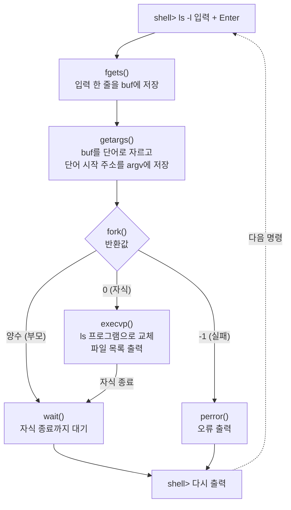
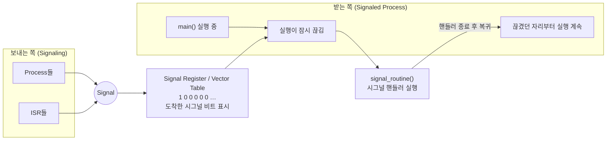
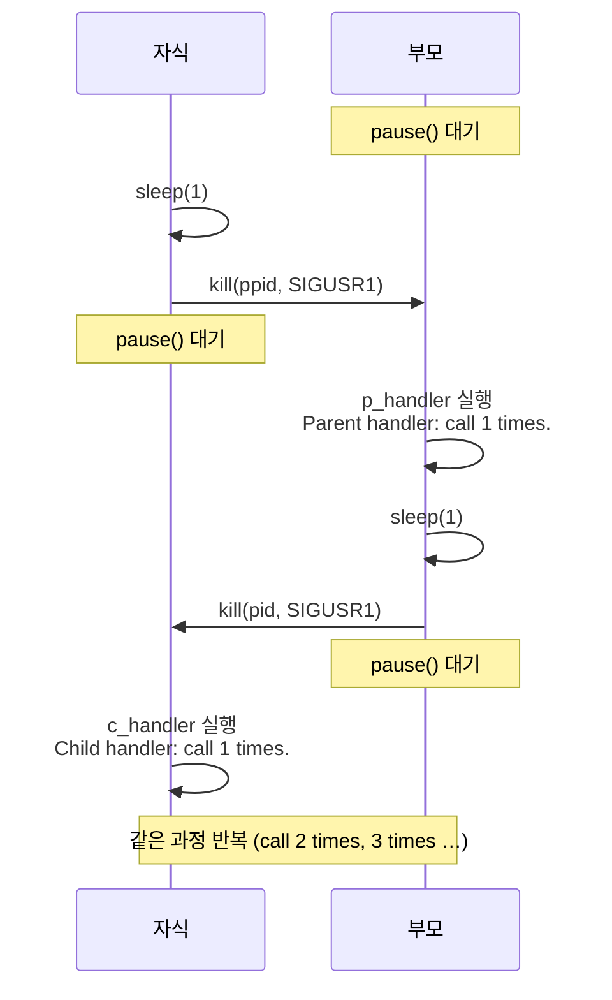

# 11주차 강의 정리: 미니 셸 복습과 시그널

- **강의 자료**: `간단한쉘.pdf` (11쪽), `시그널.pdf` (29쪽)
- **실습 코드**: `signal.zip` (시그널 예제 7개, 실습1 `alarmsignal.c` 미포함) → 점검 결과는 23절
- **수정본 코드**: [week11-signal/](week11-signal/) (컴파일 오류 수정 + `alarmsignal.c` 추가, 8개)
- **과목**: 시스템 프로그래밍
- **지난주**: 프로세스 생성과 실행, 첫 번째 Shell 만들기
- **이번 주**: 프로세스 간 통신(IPC)의 첫 주제, 시그널
- **이후 예고**: 파이프, 세마포어, 메시지 큐, 공유 메모리, 고급 프로세스 간 통신

---

## 1. 한눈에 보는 오늘 내용

| 구분 | 내용 |
|---|---|
| 셸 핵심 함수 3종 | `fork()`, `execvp()`, `wait()` |
| 셸 입력 처리 | `fgets()` → `buf`, `getargs()` → `argv` |
| 시그널 정의 | 다른 프로세스에 이벤트 발생을 알리는 소프트웨어 인터럽트 |
| 시그널 집합 | `sigemptyset`, `sigfillset`, `sigaddset`, `sigdelset` |
| 시그널 처리 | `sigaction` + `struct sigaction` |
| 시그널 전송 | `kill`, `raise`, `alarm`, (대기) `pause` |
| 시그널 차단 | `sigprocmask` (`SIG_BLOCK`, `SIG_UNBLOCK`, `SIG_SETMASK`) |
| 이전 상태 복귀 | `sigsetjmp`, `siglongjmp` |
| 실습 | `alarmsignal.c` (5초 뒤 `SIGALRM`) |

---

## 2. 미니 셸 복습 (간단한쉘.pdf)

### 셸과 프로세스

> **쉬운 정의:** 셸은 사용자가 입력한 명령을 받아서 대신 실행해 주는 접수대

- **셸(shell)**: 명령 한 줄을 읽고, 실행할 프로그램을 찾아 실행시키는 프로그램
- **프로세스(process)**: 실행 중인 프로그램
- **PID**: 프로세스마다 붙는 번호표

### 명령 한 줄의 처리 흐름



---

## 3. `buf`와 `argv`

### `buf`: 입력 한 줄이 들어가는 배열

- `ls -l` 입력 후 Enter → `fgets()`가 글자를 차례대로 저장
- `fgets()`는 줄바꿈 문자 `\n`까지 저장하고 마지막에 `\0` 추가

| `buf`의 칸 | 0 | 1 | 2 | 3 | 4 | 5 | 6 |
|---|---|---|---|---|---|---|---|
| `fgets()` 직후 | `l` | `s` | 공백 | `-` | `l` | `\n` | `\0` |
| `getargs()` 직후 | `l` | `s` | `\0` | `-` | `l` | `\0` | `\0` |

- `getargs()`: 2번 칸 공백과 5번 칸 줄바꿈을 `\0`으로 교체
- 결과: 한 배열 안에 `"ls"`와 `"-l"` 두 개의 C 문자열이 생김

### `argv`: 단어 시작 주소 목록

> **쉬운 정의:** 글자는 `buf`에 그대로 있고, `argv`는 각 단어가 어디서 시작하는지만 가리키는 주소록

| `argv`의 칸 | 저장한 값 | 그 주소에서 읽는 내용 |
|---|---|---|
| `argv[0]` | `&buf[0]` | `ls` |
| `argv[1]` | `&buf[3]` | `-l` |
| `argv[2]` | `NULL` | 주소 목록의 끝 |

- **`\0`**: 단어(문자열) 하나의 끝 표시
- **`NULL`**: 주소 목록(`argv` 배열)의 끝 표시
- `execvp()`는 `argv`를 `NULL`이 나올 때까지 읽음 → 마지막 `NULL` 누락 시 엉뚱한 메모리까지 인자로 읽는 오류

---

## 4. `fork()`: 부모·자식의 갈림길

> **쉬운 정의:** 현재 프로세스를 그대로 복제해 자식 프로세스를 하나 더 만드는 함수

```c
pid = fork();
```

- 호출은 한 번, 반환은 **두 번** (부모에서 한 번, 자식에서 한 번)
- 두 프로세스 모두 `fork()`를 마친 바로 그 자리부터 실행 계속

| 반환값 | 받는 쪽 | 의미 | 이후 동작 |
|---|---|---|---|
| 양수 (예: `4201`) | 부모 셸 | 새로 생긴 자식의 실제 PID | `wait(NULL)`로 대기 |
| `0` | 자식 | "나는 자식"이라는 분기 표시 | `execvp()`로 명령 실행 |
| `-1` | 부모 | 생성 실패 (자식 없음) | `perror()`로 오류 출력 |

- 주의: 자식이 받은 `0`은 자식의 PID가 아님, 자식의 실제 PID는 `getpid()`로 확인

### `fork()` 직후의 메모리

- 부모와 자식은 **각자의 메모리 주소 공간** 사용
- 처음에는 내용이 같음 (자식이 부모 메모리의 복사본을 가짐)

| 시점 | 부모의 `buf[0]` | 자식의 `buf[0]` |
|---|---|---|
| `fork()` 직후 | `'l'` | `'l'` |
| 자식이 자기 첫 글자를 `'X'`로 변경 | `'l'` | `'X'` |

- **쓰기 시 복사(Copy-on-Write, CoW)**: 리눅스의 `fork()` 최적화 기법
  - `fork()` 직후엔 실제 메모리 조각(페이지)을 복사하지 않고 부모·자식이 함께 읽음
  - 한쪽이 쓰려는 순간 그 조각만 복사 → 이후 서로 다른 내용 유지
  - 효과: `fork()` 직후 곧바로 `exec`하는 셸 같은 경우 불필요한 복사 비용 절약
- 결론: CoW는 **복사 시점을 늦추는 최적화**일 뿐, 프로그램 입장에서 보이는 결과는 "완전히 분리된 메모리"와 동일

---

## 5. `execvp()`: 자식의 프로그램 교체

> **쉬운 정의:** 지금 실행 중인 프로그램을 버리고, 같은 프로세스 안에서 다른 프로그램을 실행하는 함수

```c
execvp(argv[0], argv);
```

- 이름 풀이
  - `v` (vector): 인자를 `argv` 같은 **배열**로 전달
  - `p` (path): 환경 변수 `PATH`에 적힌 폴더들에서 프로그램(`ls`)을 **자동 검색**
- `"ls"`, `"-l"` 문자열은 새 프로그램(`ls`)의 `main(argc, argv)` 인자로 전달

| 자식에서 보는 것 | 호출 전 | 성공한 뒤 |
|---|---|---|
| 프로그램 | 미니 셸 | `ls` |
| 메모리 | 셸의 코드와 `buf`, `argv` | `ls`의 코드와 새 변수 공간 |
| PID | 4201 | **4201 (그대로)** |

- 핵심: `exec`는 **프로세스를 새로 만들지 않음**, 내용물(코드·데이터·스택)만 교체
- 성공 시 **반환하지 않음** → `execvp()` 다음 줄은 실패했을 때만 실행
- 강의 코드의 `perror("execvp failed"); exit(1);`이 실패 전용 코드인 이유

---

## 6. `wait()`: 다음 명령을 받는 시점

```c
wait(NULL);
```

| 시점 | 자식 | 부모 셸 |
|---|---|---|
| 명령 실행 중 | `ls`로 파일 목록 출력 | `wait()`에서 대기 |
| 명령이 끝난 뒤 | 종료 | 종료 기록을 거두고 `shell>` 출력 |

- **`NULL` 인자**: 자식의 자세한 종료 상태(정상 종료 여부, `exit` 코드)를 변수에 담을 필요가 없다는 뜻
  - 종료 상태가 필요하면 `int status; wait(&status);` 후 `WIFEXITED(status)`, `WEXITSTATUS(status)` 사용
- **종료 기록 거두기(reaping)**: 자식이 끝나도 커널은 종료 상태를 보관, 부모가 `wait()`로 가져가야 완전히 정리
  - 거두지 않은 자식 = **좀비 프로세스(zombie)**
- 이 미니 셸에서는 기다릴 자식이 한 번에 한 개뿐 → `wait()` 한 번이면 충분

---

## 7. 원본 코드의 세 갈래 분기

```c
pid = fork();
// 자식 분기: 명령 실행, 실패하면 오류 출력 후 종료
if (pid == 0) {
    execvp(argv[0], argv);
    perror("execvp failed");
    exit(1);
}
// 부모 분기: 자식의 일이 끝나면 다음 명령 받기
else if (pid > 0) {
    wait(NULL);
}
// 생성 실패 분기: fork() 실패 시 오류 출력
else {
    perror("fork failed");
}
```

- 자식 분기의 `exit(1)`이 빠지면 → `exec` 실패한 자식이 루프로 돌아가 **셸이 두 개**가 되는 버그 발생

### 참고용 전체 재구성

> 강의 PDF에는 `getargs()` 본문이 없음. 아래는 PDF 설명(공백·줄바꿈을 `\0`으로 교체, `argv` 끝에 `NULL`)에 맞춰 재구성한 예시

```c
#include <stdio.h>
#include <stdlib.h>
#include <string.h>
#include <unistd.h>
#include <sys/wait.h>
#define MAX 256

// 공백·줄바꿈을 '\0'으로 바꾸고 단어 시작 주소를 argv에 저장
int getargs(char *buf, char **argv) {
    int argc = 0;
    while (*buf) {
        // 구분 문자는 '\0'으로 바꿔 앞 단어를 끝냄
        if (*buf == ' ' || *buf == '\n' || *buf == '\t') {
            *buf++ = '\0';
            continue;
        }
        argv[argc++] = buf;                 // 단어 시작 주소 기록
        // 다음 구분 문자까지 건너뜀
        while (*buf && *buf != ' ' && *buf != '\n' && *buf != '\t')
            buf++;
    }
    argv[argc] = NULL;                      // 주소 목록의 끝 표시
    return argc;
}

// 입력 → 분해 → fork/exec/wait 반복
int main(void) {
    char buf[MAX];
    char *argv[50];
    pid_t pid;

    while (1) {
        printf("shell> ");
        fflush(stdout);
        // Ctrl-D(EOF)면 셸 종료
        if (fgets(buf, MAX, stdin) == NULL) break;
        // 빈 줄이면 다시 입력 받기
        if (getargs(buf, argv) == 0) continue;
        if (strcmp(argv[0], "exit") == 0) break;

        pid = fork();
        if (pid == 0) {
            execvp(argv[0], argv);
            perror("execvp failed");
            exit(1);
        } else if (pid > 0) {
            wait(NULL);
        } else {
            perror("fork failed");
        }
    }
    return 0;
}
```

- **실행 확인**: 이 정리 작성 중 macOS(Apple clang)에서 컴파일·실행

```
shell> crw-rw-rw-  1 root  wheel  0x3000002 Nov 10 14:24 /dev/null   ← ls -l /dev/null
shell>                                                                 ← sleep 1 (약 1초 뒤 프롬프트)
shell> execvp failed: No such file or directory                       ← no_such_command_12345
shell>
```

---

## 8. 미니 셸 터미널 실습

| 입력 | 관찰할 내용 | 일어나는 일 |
|---|---|---|
| `ls -l` | 파일 목록 출력 후 `shell>` 등장 | 자식이 `ls`로 교체 → 종료 → 부모 `wait()` 복귀 |
| `sleep 3` | 약 3초 뒤 `shell>` 등장 | 3초 동안 부모가 `wait()`에서 대기 |
| `no_such_command_12345` | 오류 출력 후 `shell>` 다시 등장 | `execvp()` 실패 → `perror` → 자식 `exit(1)` → 부모 복귀 |

- 실습 질문: `sleep 3` 실행 동안 `wait()`에 있는 프로세스는?

<details>
<summary>답 보기</summary>

- **부모 셸** 프로세스
- 자식은 `sleep` 프로그램으로 교체되어 3초를 세는 중, 부모는 그 자식의 종료를 `wait()`에서 대기

</details>

---

## 9. 시그널 개념 (시그널.pdf)

> **쉬운 정의:** 프로세스에게 "무슨 일이 생겼다"고 툭 건드려 알리는 짧은 알림

- **시그널(signal)**: 다른 프로세스에게 이벤트 발생을 알리는 **소프트웨어 인터럽트**
- **인터럽트**: 하던 일을 잠시 멈추고 급한 일을 먼저 처리하게 만드는 신호
  - 하드웨어 인터럽트: 키보드·타이머 같은 장치가 CPU에 보냄
  - 소프트웨어 인터럽트(시그널): 커널이나 다른 프로세스가 프로세스에 보냄
- 시그널 발생 예
  - 프로그램 실행 중 `Ctrl-C`(인터럽트 키) → 강제 종료
  - 백그라운드 작업 종료 → `kill` 명령 사용
- 시그널은 **번호 하나**만 전달 → 데이터를 주고받는 통신보다는 "알림"에 가까움

### 시그널 전달 구조 (PDF 6쪽 그림)



- **ISR(Interrupt Service Routine)**: 인터럽트를 처리하는 루틴, 그림에선 시그널을 보내는 주체 중 하나
- 도착한 시그널은 표(비트)에 기록 → 받는 프로세스가 실행될 때 해당 핸들러 수행 → 원래 자리로 복귀

### 시그널 동작 3가지

| 동작 | 설명 | 코드 설정 |
|---|---|---|
| 기본 동작 | 시그널마다 정해진 기본 행동 (대부분 종료, 일부 코어 덤프·무시·중단) | `SIG_DFL` |
| 무시 | 시그널을 버리고 프로그램 수행 계속 | `SIG_IGN` |
| 핸들러 실행 | 미리 등록한 함수 수행 후 복귀 | 함수 이름 |

- 예외: **`SIGKILL`, `SIGSTOP`은 무시·핸들러 등록 불가** (항상 기본 동작) → 관리자가 어떤 프로세스든 확실히 멈출 수 있게 하기 위함
- **코어 덤프(core dump)**: 비정상 종료 순간의 메모리 상태를 파일로 저장, 디버깅용

---

## 10. 주요 시그널 종류 (30여 가지)

### 자주 쓰는 시그널 ⭐

| 이름 | 번호(리눅스) | 발생 상황 | 기본 동작 |
|---|---|---|---|
| `SIGHUP` | 1 | 단말기 연결 끊김 | 종료 |
| `SIGINT` | 2 | 사용자가 `Ctrl-C` 입력 | 종료 |
| `SIGQUIT` | 3 | 사용자가 `Ctrl-\` 입력 | 코어 덤프 후 종료 |
| `SIGKILL` | 9 | 다른 프로세스를 강제 종료 | 종료 (막을 수 없음) |
| `SIGSEGV` | 11 | 유효하지 않은 메모리 주소 접근 | 코어 덤프 후 종료 |
| `SIGALRM` | 14 | `alarm()` 타이머 만료 | 종료 |
| `SIGTERM` | 15 | 종료 요청 (`kill` 명령 기본값) | 종료 |
| `SIGCHLD` | 17 | 자식 프로세스가 종료·중단 | 무시 |
| `SIGTSTP` | 20 | 사용자가 `Ctrl-Z` 입력 | 중단 |
| `SIGUSR1`, `SIGUSR2` | 10, 12 | 사용자 정의 용도 (커널은 사용 안 함) | 종료 |

- 번호는 시스템마다 다를 수 있음 → 코드에선 숫자 대신 **이름 상수** 사용
- `SIGKILL`(강제, 정리 기회 없음) vs `SIGTERM`(요청, 핸들러로 정리 작업 가능) 구분

### 나머지 시그널

| 이름 | 발생 상황 |
|---|---|
| `SIGILL` | 비정상적인 명령(illegal instruction) 수행 |
| `SIGTRAP` | 디버거(`ptrace`, sdb, adb)가 쓰는 특별한 시그널 |
| `SIGABRT` | `abort()` 호출, 코어 덤프 후 비정상 종료 |
| `SIGFPE` | 부동 소수점 오류 (오버플로·언더플로), 정수 0 나누기도 포함 |
| `SIGPIPE` | 읽는 쪽이 없는(종료된) 파이프·소켓에 쓰기 |
| `SIGSTKFLT` | 스택 오류 |
| `SIGCONT` | 중단된 프로세스 실행 재개, 실행 중이면 무시 |
| `SIGSTOP` | 프로세스 중단 (막을 수 없음) |
| `SIGTTIN` | 백그라운드 프로세스가 단말기에서 읽기 시도 |
| `SIGTTOU` | 백그라운드 프로세스가 단말기에 쓰기 시도 |
| `SIGURG` | 네트워크 연결에 긴급(대역 외) 데이터 도착 |
| `SIGSYS` | 잘못된 시스템 호출 |

- 전체 목록 확인 명령

```bash
kill -l
```

---

## 11. 시그널 집합

> **쉬운 정의:** 여러 시그널을 한 묶음으로 다루기 위한 "시그널 체크리스트"

- **시그널 집합(`sigset_t`)**: 시그널을 원소로 하는 집합
- 장점: 시그널을 하나씩 따로 처리하는 것보다 편리 (차단·핸들러 실행 중 봉쇄 목록에 사용)

```c
#include <signal.h>

/* 초기화 */
int sigemptyset(sigset_t *set);              // 빈 집합
int sigfillset(sigset_t *set);               // 모든 시그널 포함
/* 조작 */
int sigaddset(sigset_t *set, int signo);     // 시그널 하나 추가
int sigdelset(sigset_t *set, int signo);     // 시그널 하나 제거
```

- 추가 함수: `sigismember(set, signo)` → 포함 여부 확인 (PDF엔 없음)
- 주의: `sigset_t` 변수는 선언만 하면 쓰레기 값 → **반드시 `sigemptyset` 또는 `sigfillset`으로 먼저 초기화**

**아주 간단한 핵심 예시**

```c
sigset_t set;
sigemptyset(&set);          // { }
sigaddset(&set, SIGINT);    // { SIGINT }
sigaddset(&set, SIGQUIT);   // { SIGINT, SIGQUIT }
sigdelset(&set, SIGINT);    // { SIGQUIT }
```

---

## 12. 시그널 처리: `sigaction`

> **쉬운 정의:** "이 시그널이 오면 이렇게 행동하라"고 커널에 등록하는 함수

```c
#include <signal.h>
int sigaction(int signo, const struct sigaction *act,
              struct sigaction *oact);
```

| 인자 | 의미 |
|---|---|
| `signo` | 행동을 지정할 시그널 번호 (예: `SIGINT`) |
| `act` | 새로 지정할 행동 (`struct sigaction`) |
| `oact` | 이전 설정값을 받아 둘 곳, 필요 없으면 `NULL` |

- 반환값: 성공 `0`, 실패 `-1`

### `struct sigaction` 구조체

```c
struct sigaction {
    void (*sa_handler)(int);                         /* 함수, SIG_DFL 또는 SIG_IGN */
    void (*sa_sigaction)(int, siginfo_t *, void *);  /* 확장 시그널 핸들러 포인터 */
    sigset_t sa_mask;                                /* 핸들러 실행 중 봉쇄할 시그널 */
    int sa_flags;                                    /* 시그널 동작 변경자 */
};
```

- **`sa_handler`**: 시그널 도착 시 실행할 함수 주소, 또는 `SIG_DFL`(기본 동작)·`SIG_IGN`(무시)
- **`sa_sigaction`**: `SA_SIGINFO` 플래그 사용 시 쓰는 확장 핸들러, 보낸 프로세스 PID 등 추가 정보 수신
- **`sa_mask`**: 핸들러가 실행되는 동안 추가로 막아 둘 시그널 집합
  - 처리 중인 시그널 자신은 기본적으로 자동 봉쇄
- **`sa_flags`**: 동작 세부 옵션

| 플래그 | 의미 |
|---|---|
| `SA_NOCLDSTOP` | 자식이 중단(stop)될 때는 `SIGCHLD`를 받지 않음 |
| `SA_RESETHAND` | 핸들러가 한 번 실행되면 기본 동작(`SIG_DFL`)으로 되돌림 |
| `SA_RESTART` | 시그널 때문에 끊긴 시스템 호출(`read` 등)을 자동 재시작 |
| `SA_NODEFER` | 핸들러 실행 중에도 같은 시그널을 막지 않음 |
| `SA_SIGINFO` | `sa_handler` 대신 `sa_sigaction` 사용 |

### PDF 표기 보정

- PDF 9쪽 설명 목록의 `sa_handler: signal number`, `sa_sigaction: sigaction 구조체`, `sa_mask: 이전 설정값`은 앞 슬라이드(`sigaction` 인자 설명)가 잘못 복사된 것으로 보임 → 위 설명이 실제 의미
- PDF의 `void (*) (int) sa_handler(int);`는 문법 오류 → 올바른 선언은 `void (*sa_handler)(int);`
- 리눅스 실제 구현에선 `sa_handler`와 `sa_sigaction`이 공용체(union)로 겹쳐 있어 **둘 중 하나만** 지정

---

## 13. 핸들러 등록 예제: `handlesignal.c`

```c
/* handlesignal.c - sigaction example */
#include <stdio.h>
#include <signal.h>
#include <unistd.h>

void handler(int signo);

int main(void)
{
    struct sigaction act;
    int i = 0;

    act.sa_handler = handler;          // SIGINT가 오면 handler 실행
    sigfillset(&(act.sa_mask));        // 핸들러 실행 중엔 모든 시그널 봉쇄
    sigaction(SIGINT, &act, NULL);

    printf("SIGINT on\n");
    // 1초마다 경과 시간 출력
    while (1) {
        sleep(1);
        printf("sleep for %d sec(s).\n", ++i);
    }
}

// SIGINT 도착 시 호출
void handler(int signo)
{
    printf("handler: signo=%d\n", signo);
}
```

### PDF 실행 결과

```
SIGINT on
sleep for 1 sec(s).
sleep for 2 sec(s).
sleep for 3 sec(s).
handler: signo=2        <---- Ctrl-C 입력
sleep for 4 sec(s).
sleep for 5 sec(s).     <---- Ctrl-C 입력 (프로그램 종료)
```

### 결과 해석

- 첫 `Ctrl-C`: 종료 대신 `handler` 실행 → `signo=2`(`SIGINT` 번호) 출력 → 루프 계속
- 두 번째 `Ctrl-C`에서 종료된 이유 (추정)
  - 코드에서 `act.sa_flags`를 초기화하지 않음 → 지역 변수라 쓰레기 값
  - 쓰레기 값에 `SA_RESETHAND` 비트가 섞이면 첫 실행 후 기본 동작(종료)으로 복귀
  - 실습 환경에 따라 매번 핸들러가 실행될 수도 있음 → 이런 불확실성 제거를 위해 **`act.sa_flags = 0;` 명시 권장**
- macOS 실행 확인 (23절): 두 번째 `SIGINT`에도 `handler: signo=2`가 다시 출력되고 종료되지 않음
  - 코드 구조상 핸들러는 계속 유지되는 것이 정상 → PDF의 종료는 실습 서버(리눅스)의 쓰레기 `sa_flags` 영향이라는 추정과 부합
  - 리눅스 실습 서버에서는 직접 확인하지 않음
- 보충: `handler`는 `while` 루프 아무 위치에서나 끼어들어 실행됨 → 루프 코드와 핸들러가 "동시에" 도는 것처럼 보이는 이유

---

## 14. 시그널 무시 예제: `ignoresignal.c`

```c
act.sa_handler = SIG_IGN;              // SIGINT 무시
sigfillset(&(act.sa_mask));
sigaction(SIGINT, &act, NULL);
printf("SIGINT off\n");
```

### PDF 실행 결과

```
SIGINT off
sleep for 1 sec(s).
sleep for 2 sec(s).     <---- Ctrl-C 입력 (아무 일 없음)
sleep for 3 sec(s).
sleep for 4 sec(s).     <---- Ctrl-C 입력 (아무 일 없음)
sleep for 5 sec(s).
sleep for 6 sec(s).     <---- Ctrl-\ 입력 (종료)
```

- `Ctrl-C`(`SIGINT`): 무시하도록 설정 → 출력 계속
- `Ctrl-\`(`SIGQUIT`): 따로 설정하지 않음 → 기본 동작(코어 덤프 후 종료)
- 교훈: 시그널 설정은 **시그널마다 따로** 적용

---

## 15. 시그널 전송 함수

### `kill`: 다른 프로세스에 시그널 전송

```c
#include <sys/types.h>
#include <signal.h>
int kill(pid_t pid, int sig);
```

| `pid` 값 | 받는 대상 |
|---|---|
| 양수 | 해당 PID 프로세스 하나 |
| `0` | 호출한 프로세스와 같은 **프로세스 그룹**의 모든 프로세스 |
| `-1` | 1번(`init`)을 제외한 보낼 권한이 있는 모든 프로세스 (일반 사용자는 자기 프로세스 전체) |
| `-1`이 아닌 음수 | 프로세스 그룹 ID가 `\|pid\|`인 모든 프로세스 |

- 이름은 `kill`이지만 종료 전용이 아님 → **아무 시그널이나 보내는 함수**
- 셸 명령 `kill`도 같은 원리

```bash
kill -SIGUSR1 19688    # 19688번 프로세스에 SIGUSR1 전송
kill 19688             # 시그널 생략 시 SIGTERM
kill -9 19688          # SIGKILL (강제 종료)
```

### `pause`: 시그널이 올 때까지 대기

```c
#include <unistd.h>
int pause(void);
```

- 시그널이 도착해 **핸들러가 실행되고 끝나면** 반환 (반환값 `-1`)
- CPU를 쓰지 않고 잠든 상태로 대기 → `while(1);` 같은 바쁜 대기보다 효율적

### `raise`: 자기 자신에게 시그널 전송

```c
#include <signal.h>
int raise(int sig);
```

- `kill(getpid(), sig)`와 같은 효과 (단일 스레드 기준)

### `alarm`: 일정 시간 뒤 `SIGALRM` 예약

```c
#include <unistd.h>
unsigned int alarm(unsigned int secs);
```

- `secs`초 뒤 자기 자신에게 `SIGALRM` 전달
- 호출 즉시 반환 → 기다리는 동안 원래 작업 계속
- `alarm(0)`: 예약한 알람 취소
- 알람은 프로세스당 하나 → 다시 호출하면 이전 예약을 덮어씀, 반환값은 이전 알람의 남은 초

---

## 16. 부모·자식 핑퐁 예제: `sendsignal.c`

```c
pid = fork();
// 자식: 1초 뒤 부모에게 SIGUSR1 보내고 답장 대기
if (pid == 0) {
    act.sa_handler = c_handler;
    sigaction(SIGUSR1, &act, NULL);
    ppid = getppid();                  // 부모 PID
    while (1) {
        sleep(1);
        kill(ppid, SIGUSR1);
        pause();
    }
}
// 부모: 시그널 대기 후 1초 뒤 자식에게 답장
else if (pid > 0) {
    act.sa_handler = p_handler;
    sigaction(SIGUSR1, &act, NULL);
    while (1) {
        pause();
        sleep(1);
        kill(pid, SIGUSR1);
    }
}
```

### PDF 실행 결과

```
Parent handler: call 1 times.
Child handler: call 1 times.
Parent handler: call 2 times.
Child handler: call 2 times.
```

### 흐름



- 두 프로세스가 시그널로 **번갈아 실행 순서를 맞추는** 간단한 동기화
- 전역 변수 `i`가 부모·자식 모두 1, 2로 증가하는 이유: `fork()` 후 **각자 다른 메모리** → 각자의 `i`를 따로 증가 (4절 CoW와 연결)
- 주의 (경쟁 상태)
  - 부모의 `sigaction` 등록보다 자식의 첫 `kill`이 먼저 도착하면 부모가 기본 동작(종료)으로 끝날 수 있음
  - `kill`과 `pause` 사이에 시그널이 먼저 도착하면 `pause`가 영원히 대기할 수 있음
  - 실무 해결책: `sigprocmask`로 막아 두고 `sigsuspend`로 대기 (PDF 범위 밖)

---

## 17. `raise` 예제: `raisesignal.c`

```c
int a = 10, b = 0;
// 0으로 나누기 전에 직접 SIGFPE 발생
if (b == 0)
    raise(SIGFPE);
a = a / b;
```

```
부동 소수점 예외
```

- `SIGFPE`에 핸들러가 없음 → 기본 동작(코어 덤프 후 종료) → 셸이 `부동 소수점 예외` 출력
- 정수 나누기인데 이름이 "부동 소수점 예외"인 이유: `SIGFPE`가 산술 오류 전반을 담당하는 역사적 이름

---

## 18. 실습1: `alarmsignal.c` ⭐

```c
/* alarmsignal.c */
#include <stdio.h>
#include <signal.h>
#include <unistd.h>

void alarm_handler(int);
int alarm_flag = 0;

int main(void)
{
    struct sigaction act;

    act.sa_handler = alarm_handler;
    sigaction(SIGALRM, &act, NULL);

    alarm(5);           /* 5초 뒤 SIGALRM 예약 */
    pause();            /* 시그널이 올 때까지 대기 */
    // 핸들러가 플래그를 세웠으면 성공 메시지
    if (alarm_flag)
        printf("Passed a 5 secs.\n");
}

// SIGALRM 도착 시 플래그 설정
void alarm_handler(int sig)
{
    printf("Received a alarm signal.\n");
    alarm_flag = 1;
}
```

### PDF 실행 결과

```
Received a alarm signal.      ← 약 5초 뒤
Passed a 5 secs.
```

### 그 결과가 나온 이유

1. `sigaction`으로 `SIGALRM` → `alarm_handler` 등록
2. `alarm(5)` 즉시 반환, `pause()`에서 잠듦
3. 5초 뒤 커널이 `SIGALRM` 전달 → `alarm_handler` 실행 → 메시지 출력, `alarm_flag = 1`
4. 핸들러가 끝나면 `pause()` 반환 → `alarm_flag`가 1이므로 두 번째 메시지 출력

### 개선 포인트

- 핸들러 등록을 빼먹으면 → `SIGALRM` 기본 동작(종료), 셸에 `Alarm clock` 출력 후 끝
- 핸들러와 공유하는 전역 플래그는 `volatile sig_atomic_t alarm_flag = 0;`으로 선언하는 것이 정석
- `sigemptyset(&act.sa_mask); act.sa_flags = 0;` 초기화 추가 권장
- PDF 코드엔 `#include <unistd.h>`(`alarm`, `pause` 선언) 누락 → 추가 필요
- `signal.zip`에는 이 파일이 없음 → 위 코드로 [week11-signal/alarmsignal.c](week11-signal/alarmsignal.c) 작성, macOS에서 PDF와 같은 결과 확인

---

## 19. 시그널 차단: `sigprocmask`

> **쉬운 정의:** 시그널을 버리는 게 아니라 "잠깐 보류함"에 넣어 두었다가 나중에 받는 기능

```c
#include <signal.h>
int sigprocmask(int how, const sigset_t *set, sigset_t *oset);
```

| 인자 | 의미 |
|---|---|
| `how` | 동작 방식 (아래 표) |
| `set` | 대상 시그널 집합 |
| `oset` | 이전 마스크를 받아 둘 곳, 필요 없으면 `NULL` |

| `how` | 동작 | 새 마스크 |
|---|---|---|
| `SIG_BLOCK` | `set`의 시그널을 차단 목록에 **추가** | 현재 ∪ `set` |
| `SIG_UNBLOCK` | `set`의 시그널을 차단 목록에서 **제거** | 현재 − `set` |
| `SIG_SETMASK` | 차단 목록을 `set`으로 **통째로 교체** | `set` |

### 무시 vs 차단 ⭐ (시험 대비)

| 구분 | 무시 (`SIG_IGN`) | 차단 (`sigprocmask`) |
|---|---|---|
| 도착한 시그널 | 그냥 버림 | **보류(pending)** 상태로 보관 |
| 해제 후 | 아무 일 없음 | 보류된 시그널이 즉시 전달 |
| 용도 | 해당 시그널에 반응할 필요가 없을 때 | 중요 구간(critical region) 동안만 방해 금지 |

- 표준 시그널은 **개수를 세지 않음**: 차단 중에 같은 시그널이 여러 번 와도 보류는 **한 번**만 기록
- PDF 프로토타입의 `sigset_t *oset;`은 `)` 누락 오타

---

## 20. 차단 예제 1: `blocksignal.c`

```c
sigset_t set1, set2;

sigfillset(&set1);                     // set1 = 모든 시그널
sigemptyset(&set2);
sigaddset(&set2, SIGINT);              // set2 = { SIGINT }

printf("Critical region start.\n");
sigprocmask(SIG_BLOCK, &set1, NULL);   // 전부 차단
sleep(5);

printf("Less critical region start.\n");
sigprocmask(SIG_UNBLOCK, &set2, NULL); // SIGINT만 해제
sleep(5);

printf("Non critical region start.\n");
sigprocmask(SIG_UNBLOCK, &set1, NULL); // 전부 해제
sleep(5);
```

### PDF 실행 결과

```
$ ./a.out
Critical region start.         <---- Ctrl-C 입력
Less critical region start.    (여기서 종료)

$ ./a.out
Critical region start.         <---- Ctrl-\ 입력
Less critical region start.
Non critical region start.     (여기서 종료)
```

### 결과 해석

| 구간 | 차단 상태 | `Ctrl-C` | `Ctrl-\` |
|---|---|---|---|
| Critical | 전부 차단 | 보류 | 보류 |
| Less critical | `SIGINT`만 허용 | 해제 순간 보류분 전달 → **종료** | 계속 보류 |
| Non critical | 전부 허용 | — | 해제 순간 보류분 전달 → **종료** |

- 첫 실행: `Less critical...` 출력 직후 `SIGINT` 차단 해제 → 보류된 `SIGINT` 전달 → 종료
- 두 번째 실행: `SIGQUIT`은 마지막 전체 해제 때까지 보류 → `Non critical...` 출력 직후 종료
- 실제 쓰임: 파일 저장·DB 갱신처럼 중간에 끊기면 데이터가 깨지는 구간 보호
- PDF 주석의 파일명 `blockgignal.c`는 `blocksignal.c`의 오타

---

## 21. 차단 예제 2: `blocksigusr.c`

- 목표: `SIGUSR1`과 `SIGUSR2` 중 **`SIGUSR2`를 항상 먼저** 받기

```c
sigset_t set;

int main()
{
    struct sigaction act;

    sigemptyset(&set);
    sigaddset(&set, SIGUSR1);          // set = { SIGUSR1 }

    sigemptyset(&act.sa_mask);
    act.sa_flags = 0;
    act.sa_handler = handler1;
    sigaction(SIGUSR1, &act, NULL);    // SIGUSR1 → handler1

    act.sa_handler = handler2;
    sigaction(SIGUSR2, &act, NULL);    // SIGUSR2 → handler2

    sigprocmask(SIG_BLOCK, &set, NULL);  // SIGUSR1 차단

    // SIGUSR2가 와서 pause()가 풀린 뒤에야 SIGUSR1 해제
    while (1) {
        pause();
        sigprocmask(SIG_UNBLOCK, &set, NULL);
    }
}
```

### PDF 실행 결과

```
$ ./a.out &
[1] 19688
$ kill -SIGUSR1 19688
$ kill -SIGUSR1 19688
$ kill -SIGUSR2 19688
Got a SIGUSR2 signal
Got a SIGUSR1 signal
$ kill -SIGUSR2 19688
Got a SIGUSR2 signal
```

### 결과 해석

1. `SIGUSR1` 두 번 전송 → 차단 중이라 **보류 1개**로 합쳐짐, `pause()`는 계속 대기
2. `SIGUSR2` 전송 → `handler2` 실행 → `pause()` 반환
3. `SIGUSR1` 해제 → 보류된 `SIGUSR1` 전달 → `handler1` **한 번만** 실행
4. 이후 `SIGUSR2` → `handler2`만 실행 (보류된 `SIGUSR1` 없음)

- **실행 확인**: 이 정리 작성 중 macOS에서 같은 순서로 `kill` 전송, `SIGUSR1` 두 번이 `Got a SIGUSR1 signal` **한 번**으로 출력되는 것까지 PDF와 동일하게 확인
- 주의: 첫 해제 후 `SIGUSR1`을 다시 차단하지 않음 → "`SIGUSR2` 먼저" 규칙은 **첫 번째 회차에만** 성립
- `./a.out &`: `&`를 붙이면 백그라운드 실행 → 같은 터미널에서 `kill` 입력 가능, `[1] 19688`은 작업 번호와 PID

---

## 22. 이전 상태 복귀: `sigsetjmp` / `siglongjmp`

> **쉬운 정의:** 게임의 "세이브 포인트"를 만들어 두고, 시그널이 오면 그 지점으로 되돌아가는 기능

```c
#include <setjmp.h>
int sigsetjmp(sigjmp_buf env, int savesigs);
void siglongjmp(sigjmp_buf env, int val);
```

| 인자 | 의미 |
|---|---|
| `env` | 현재 위치(스택·레지스터 상태)를 저장할 `sigjmp_buf` 변수 |
| `savesigs` | 0이 아니면 현재 **시그널 마스크도 함께 저장** |
| `val` | 복귀 후 `sigsetjmp`가 반환할 값 |

### 반환값 규칙 ⭐

| 상황 | `sigsetjmp` 반환값 |
|---|---|
| 처음 직접 호출 (세이브) | `0` |
| `siglongjmp`로 되돌아옴 (로드) | `val` (0이 아닌 값) |

- 같은 `if (sigsetjmp(...) == 0)` 줄을 **두 번 지나가지만** 반환값으로 처음인지 복귀인지 구분
- `longjmp`와의 차이: `siglongjmp`는 저장해 둔 **시그널 마스크까지 복구**
  - 핸들러 실행 중엔 그 시그널이 자동 봉쇄됨
  - 핸들러에서 그냥 `longjmp`로 탈출하면 봉쇄가 풀리지 않아 다음 `Ctrl-C`가 안 먹힐 수 있음
- PDF의 `sigsetjmp_buf 형`은 `sigjmp_buf`의 오기

### 피보나치 예제

```c
sigjmp_buf jbuf;

int main()
{
    struct sigaction act;
    int cur_i, past_i, tmp_i;

    // 처음(0)일 때만 핸들러 등록, 복귀(1)일 땐 건너뜀
    if (sigsetjmp(jbuf, 1) == 0) {
        act.sa_handler = start;
        sigaction(SIGINT, &act, NULL);
    }
    cur_i = past_i = 1;
    // 1초마다 피보나치 수 출력
    while (1) {
        printf("%d\n", cur_i);
        tmp_i = cur_i;
        cur_i += past_i;
        past_i = tmp_i;
        sleep(1);
    }
}

// Ctrl-C 도착 시 세이브 포인트로 복귀
void start(int signo)
{
    fprintf(stderr, "Interrupted\n");
    siglongjmp(jbuf, 1);
}
```

### PDF 실행 결과

```
1
2
3          <---- Ctrl-C 입력
Interrupted
1
2
3
5
8
13         <---- Ctrl-\ 입력 (종료)
```

- `Ctrl-C` → `start` → `siglongjmp(jbuf, 1)` → `sigsetjmp`가 `1` 반환 → 등록 부분 건너뜀 → `cur_i = past_i = 1`부터 다시 출력
- 결과적으로 `Ctrl-C`가 "종료"가 아니라 **"처음부터 다시"** 버튼으로 동작
- `Ctrl-\`(`SIGQUIT`)는 설정 안 함 → 기본 동작으로 종료

---

## 23. signal.zip 실습 코드 점검

- **zip 구성**: PDF 예제 9개 중 7개 수록, 실습1 `alarmsignal.c`는 미수록
- **코드 내용**: PDF 슬라이드 코드와 같음, 다만 7개 모두 `void main()` 사용 + 오타·`#include` 누락 존재
- **수정본 위치**: [week11-signal/](week11-signal/) (원본 zip은 그대로 둠)

### 컴파일 오류와 수정

| 파일 | 원본 컴파일 (macOS clang) | 수정 내용 |
|---|---|---|
| `handlesignal.c` | 오류 | `sturct` → `struct` |
| `ignoresignal.c` | 오류 | `pinrtf` → `printf` |
| `sendsignal.c` | 오류 | `#include <signal.h>` 추가 (`struct sigaction`, `SIGUSR1`, `kill` 선언) |
| `raisesignal.c` | **성공** | 반환형만 정리 |
| `blocksignal.c` | 오류 | `#include <unistd.h>` 추가 (`sleep` 선언) |
| `blocksigusr.c` | 오류 | `#include <unistd.h>` 추가 (`pause` 선언) |
| `pibonacci.c` | 오류 | `sahandler` → `sa_handler`, `siglogjmp` → `siglongjmp`, `#include <unistd.h>` 추가 |
| `alarmsignal.c` | (zip에 없음) | PDF 21쪽 코드로 새로 작성 |

- 공통 수정: `void main()` → `int main(void)`, 줄바꿈 CRLF → LF
- **오타 3곳 + `<signal.h>` 누락**: 어떤 컴파일러에서도 오류
- **`<unistd.h>` 누락**: C99부터 금지된 **암시적 함수 선언**
  - 최신 clang, gcc 14 이상: 오류
  - 오래된 gcc: 경고만 출력하고 컴파일 진행 → 실습 서버에선 그냥 넘어갔을 가능성
- 수정본 8개 모두 오류·경고 없이 컴파일 확인

### 실행 결과 비교

- **실행 환경**: macOS, Apple clang 21
- **키 입력 대체**: `Ctrl-C` → `kill -INT`, `Ctrl-\` → `kill -QUIT`, 출력은 파일로 기록
- **기록 방식**: 아래 `<--` 줄은 시그널을 보낸 시점 (프로그램 시작 기준 초)

| 예제 | 보낸 시그널 | 실제 결과 | PDF와 비교 |
|---|---|---|---|
| `handlesignal` | 3.5초 INT, 5.6초 INT | 두 번 모두 `handler: signo=2`, 계속 실행 | **다름** (PDF는 두 번째에 종료) |
| `ignoresignal` | INT 2번, 6.6초 QUIT | INT 무시, QUIT에 종료 | 일치 |
| `raisesignal` | 없음 | `SIGFPE`로 즉시 종료 | 일치 |
| `alarmsignal` | 없음 | 약 5초 뒤 두 줄 출력, 정상 종료 | 일치 |
| `sendsignal` | 4.6초 INT | Parent/Child `call 1`, `call 2` 번갈아 출력 후 종료 | 일치 |
| `blocksignal` ① | 1초 INT | `Less critical` 출력 직후 종료 | 일치 |
| `blocksignal` ② | 1초 QUIT | `Non critical` 출력 직후 종료 | 일치 |
| `blocksigusr` | USR1, USR1, USR2, USR2 | USR2 → USR1(**한 번**) → USR2 | 일치 |
| `pibonacci` | 2.5초 INT, 8초 QUIT | `1 2 3` → `Interrupted` → `1 2 3 5 8 13` → 종료 | 일치 |

#### `handlesignal` 실행 기록 (PDF와 다른 유일한 예제)

```
SIGINT on 
sleep for 1 sec(s).
sleep for 2 sec(s).
sleep for 3 sec(s).
<-- 3.5s INT 전송
handler: signo=2
sleep for 4 sec(s).
sleep for 5 sec(s).
sleep for 6 sec(s).
<-- 5.6s INT 전송
handler: signo=2          ← PDF와 달리 두 번째에도 핸들러 실행
sleep for 7 sec(s).
sleep for 8 sec(s).
sleep for 9 sec(s).       (테스트 종료를 위해 강제 정리)
```

#### `blocksignal` 실행 기록

```
Critical region start.
<-- 1.0s INT 전송             ← 차단 중이라 보류
Less critical region start.   ← 직후 SIGINT 해제 → 보류분 전달 → 종료
```

```
Critical region start.
<-- 1.0s QUIT 전송            ← 보류
Less critical region start.   ← SIGINT만 해제, SIGQUIT은 계속 보류
Non critical region start.    ← 전체 해제 → 보류분 전달 → 종료
```

#### 결과 읽는 법

- **종료 코드 = 128 + 시그널 번호**: 시그널로 끝난 프로세스를 셸이 표시하는 관례
  - 130 = `SIGINT`(2), 131 = `SIGQUIT`(3), 136 = `SIGFPE`(8)
  - 확인 명령: 프로그램 종료 직후 `echo $?`
- `raisesignal`의 `부동 소수점 예외` 문구: 대화형 셸이 출력하는 메시지라 이번 기록엔 없음, 종료 코드 136으로 같은 결과 확인
- `sendsignal` 주의: 터미널 `Ctrl-C`는 같은 프로세스 그룹인 **부모·자식 모두**에게 전달
  - 이번 테스트처럼 부모에게만 `kill -INT`를 보내면 자식이 남음 → `ps`로 확인 후 정리 필요

---

## 24. 주의점

- **`main()` 반환형 생략**: PDF 예제의 `main()`, `signal.zip`의 `void main()`은 표준이 아닌 옛 문법 → 최신 컴파일러에서 경고 또는 오류 가능, `int main(void)` 권장
- **`struct sigaction` 초기화**: 지역 변수라 `sa_mask`, `sa_flags`가 쓰레기 값 → `sigemptyset(&act.sa_mask); act.sa_flags = 0;` 습관화
- **핸들러 안의 `printf`**: 강의 예제 편의상 사용, 엄밀히는 **비동기 시그널 안전(async-signal-safe)** 함수가 아님
  - 핸들러에선 플래그만 세우고 출력은 본문에서 하거나 `write()` 사용이 정석
- **공유 변수**: 핸들러와 본문이 함께 쓰는 전역 변수는 `volatile sig_atomic_t`
- **`SIGKILL`·`SIGSTOP`**: `sigaction`·`sigprocmask` 모두 적용 불가
- **시그널 합쳐짐**: 차단 중 같은 시그널 여러 번 → 한 번만 전달, 시그널로 "개수"를 세면 안 됨
- **`fork()`와 시그널 설정**: 자식은 부모의 핸들러 설정·차단 마스크를 물려받음, `exec` 후엔 핸들러가 기본 동작으로 초기화 (`SIG_IGN`은 유지)
- **`exec` 실패 처리**: `execvp()` 다음 줄엔 반드시 오류 출력 + `exit()`
