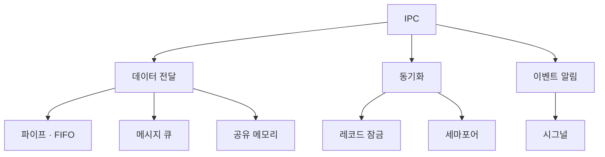
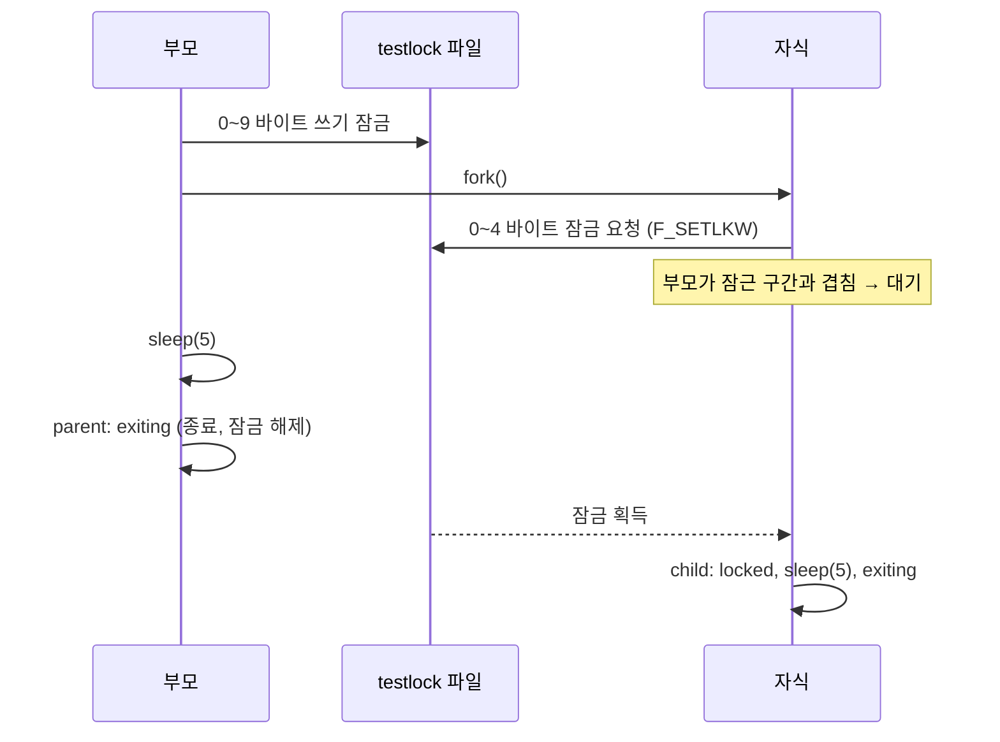
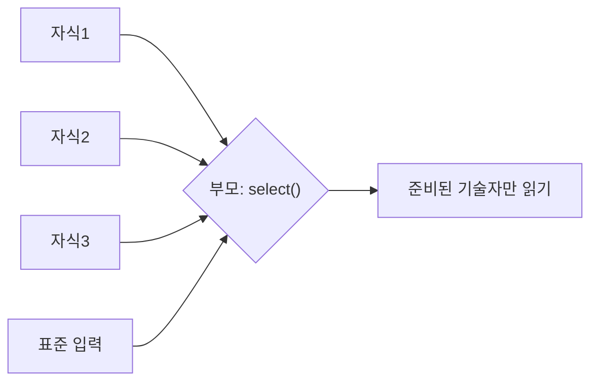
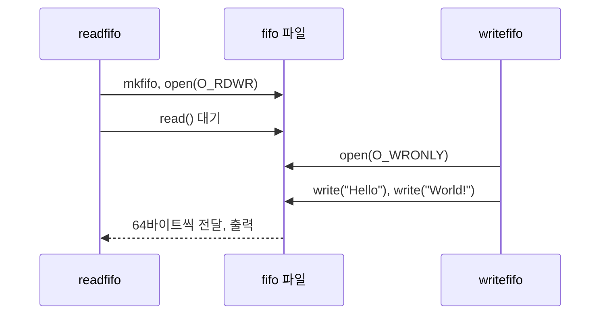
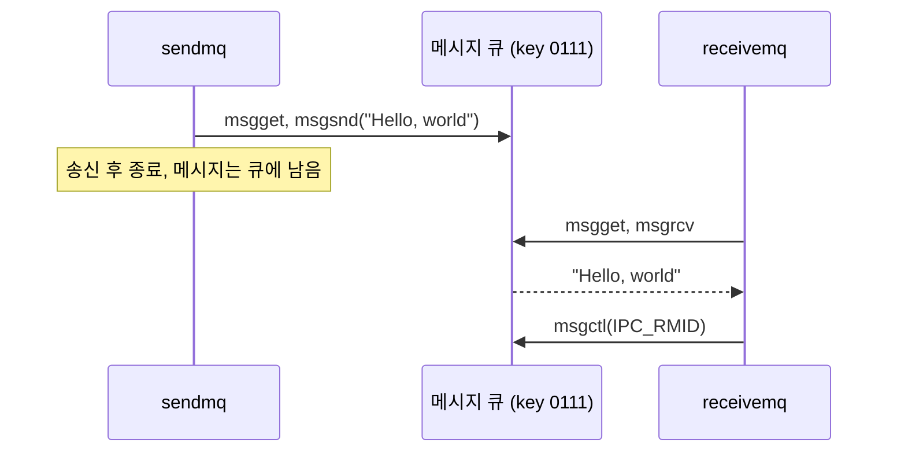
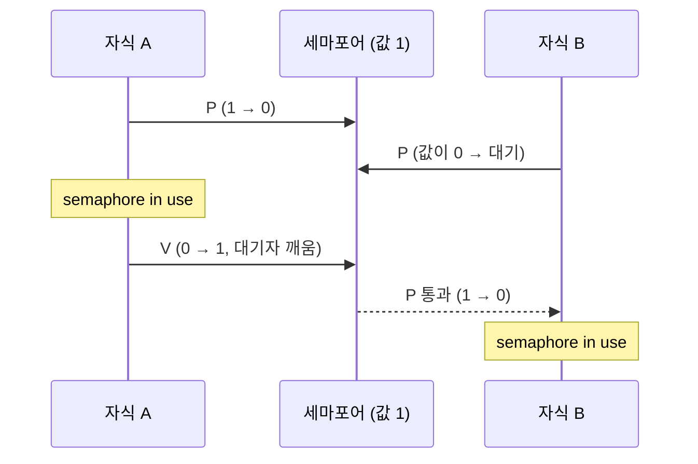

# 12주차 강의 정리: 프로세스 간 통신(IPC)

- **강의 자료**: `프로세스간 통신.pdf` (56쪽)
- **실습 코드**: `sam1117/` (`filelock.c`, `selfpipe.c`, `pipetest.c`, `iopipe.c`, `readfifo.c`, `writefifo.c`, `sendmq.c`, `receivemq.c`, `testsem.c`, `writeshm.c`, `readshm.c` 및 `_수정` 버전)
- **과목**: 시스템 프로그래밍
- **지난주**: 시그널 ([Week11.md](Week11.md))
- **이번 주**: 레코드 잠금, 파이프, FIFO, System V IPC(메시지 큐, 세마포어, 공유 메모리)
- **표기**: `(교안 외 보충)`은 교안에 없는 설명, `(교안 결과)`는 직접 실행하지 않고 교안에 적힌 결과

---

## 1. 한눈에 보는 내용

| 방식 | 핵심 | 관련 없는 프로세스 간 사용 | 대표 함수 | 쪽 |
|---|---|---|---|---|
| 레코드 잠금 | 파일 일부 구간 잠금 | 가능 | `fcntl` | 5~9 |
| 파이프 | 단방향 채널 | 불가 (부모·자식) | `pipe` | 10~20 |
| `popen` | 셸 명령에 파이프 연결 | 불가 | `popen`, `pclose` | 21~22 |
| FIFO | 이름 있는 파이프 | 가능 | `mkfifo` | 23~26 |
| 메시지 큐 | 유형 있는 메시지 전달 | 가능 | `msgget`, `msgsnd`, `msgrcv`, `msgctl` | 31~38 |
| 세마포어 | 동기화 (상호 배제) | 가능 | `semget`, `semop`, `semctl` | 39~49 |
| 공유 메모리 | 같은 메모리 영역 공유 | 가능 | `shmget`, `shmat`, `shmdt`, `shmctl` | 50~56 |

---

## 2. IPC 개요

> **쉬운 정의:** 서로 벽으로 막힌 프로세스들이 정보를 주고받도록 운영체제가 만들어 둔 통로

- **IPC(Inter-Process Communication)**: 격리된 프로세스끼리 데이터 교환, 협력, 동기화, 이벤트 알림을 하도록 운영체제가 제공하는 메커니즘
- **필요한 이유**: 프로세스마다 독립된 주소 공간 → 다른 프로세스의 메모리를 직접 읽고 쓸 수 없음
- **필요한 상황**
  - 웹 서버와 DB 서버 사이 데이터 전달
  - 부모·자식 프로세스 사이 결과 전달
  - 생산자-소비자 문제 (동기화 필요)
  - 대규모 애플리케이션의 모듈 간 정보 교환

### 교안의 IPC 8종

| 방식 | 설명 | 이번 강의 |
|---|---|---|
| 파일 | 파일에 기록하고 읽음, 단순하지만 느리고 동기화 필요 | 레코드 잠금 |
| 파이프 | 익명(부모-자식), 이름 있는(무관한 프로세스) | 파이프, FIFO |
| 메시지 큐 | OS 큐로 비동기 메시지 교환 | 다룸 |
| 공유 메모리 | 같은 메모리 공유, 빠르지만 동기화 필요 | 다룸 |
| 세마포어 | 자원 접근 조율, 경쟁 상태 방지 | 다룸 |
| 소켓 | TCP/UDP로 로컬·원격 통신 | 미포함 |
| 시그널 | 간단한 비동기 알림 | 11주차 |
| 메모리 매핑 | 파일을 메모리에 매핑해 공유 | 미포함 |



---

## 3. 파일: 레코드 잠금

> **쉬운 정의:** 파일 전체가 아니라 일부 구간에 "사용 중" 표지를 붙여 다른 프로세스의 접근을 막는 기능

### 잠금 종류

| 종류 | `l_type` | 다른 프로세스에 미치는 영향 |
|---|---|---|
| 읽기 잠금 | `F_RDLCK` | 해당 영역에 쓰기 잠금 불가 |
| 쓰기 잠금 | `F_WRLCK` | 해당 영역에 읽기·쓰기 잠금 모두 불가 |
| 해제 | `F_UNLCK` | 잠금 해제 |

### `fcntl()`

```c
int fcntl(int fd, int cmd, struct flock *lock);
```

| `cmd` | 동작 |
|---|---|
| `F_GETLK` | 잠금 정보 획득 (정보는 `lock`에 저장) |
| `F_SETLK` | 잠금 적용, 불가하면 즉시 `-1` 반환 |
| `F_SETLKW` | 잠금 적용, 불가하면 해제될 때까지 대기 |

| `struct flock` 멤버 | 의미 |
|---|---|
| `l_type` | 잠금 유형 |
| `l_whence` | 영역 기준 (`SEEK_SET`, `SEEK_CUR`, `SEEK_END`) |
| `l_start` | 영역 시작 위치 |
| `l_len` | 영역 길이 (바이트) |
| `l_pid` | `F_GETLK`일 때 잠근 프로세스 ID |

**아주 간단한 핵심 예시** (`filelock.c` 요약)

```c
struct flock lk;
lk.l_type = F_WRLCK;      // 쓰기 잠금
lk.l_whence = SEEK_SET;   // 파일 처음 기준
lk.l_start = 0;           // 0번 바이트부터
lk.l_len = 10;            // 10바이트 구간

// 잠글 수 없으면 풀릴 때까지 대기
fcntl(fd, F_SETLKW, &lk);
```

**예상 결과** (교안 결과)

```text
parent: locked record
parent: exiting
child: locked
child: exiting
```

**그 결과가 나온 이유**



- 자식이 부모의 잠금을 물려받지 않음 → 부모가 잠근 구간에 대해 별도로 잠금 요청 (교안 외 보충: `fcntl` 레코드 잠금은 `fork()`로 상속되지 않음)

**주의점**

- 교안이 든 단점: 파일 사용에 따른 자원 낭비·비효율, 경쟁 문제, 외부 접근에 의한 보안 문제
- 잠금은 협력하는 프로세스끼리만 효력 (교안 외 보충: 기본은 권고 잠금)
- 교안 오타: `shor l_whence` → `short l_whence`

---

## 4. 파이프

> **쉬운 정의:** 한쪽 끝에 넣으면 다른 쪽 끝으로 나오는 한 방향 관(튜브)

- **파이프**: UNIX 고유의 프로세스 간 통신 방식, 한 프로세스를 다른 프로세스와 잇는 **단방향** 채널
- 셸에서의 사용: `ls | wc -l` → `ls`의 표준 출력을 `wc -l`의 표준 입력에 연결해 현재 디렉터리의 파일 수 출력

### `pipe()`

```c
int pipe(int filedes[2]);
```

| 항목 | 내용 |
|---|---|
| `filedes[0]` | 읽기용 파일 기술자 |
| `filedes[1]` | 쓰기용 파일 기술자 |
| 반환값 | 성공 `0`, 실패 `0`이 아닌 값 (교안 외 보충: 실제로는 `-1`) |

| `errno` | 원인 |
|---|---|
| `EMFILE` | 프로세스가 파일 기술자를 너무 많이 사용 |
| `ENFILE` | 시스템 파일 테이블이 가득 참 |
| `EFAULT` | `filedes`가 유효하지 않음 |

### 부모·자식 파이프

**아주 간단한 핵심 예시** (`pipetest.c` 요약)

```c
int p[2];
char buf[16];
pipe(p);                          // p[0] 읽기 끝, p[1] 쓰기 끝

if (fork() == 0) {
    // 자식: 쓰기만 하므로 읽기 끝을 닫음
    close(p[0]);
    write(p[1], "Hello, world #1", 16);
} else {
    // 부모: 읽기만 하므로 쓰기 끝을 닫음
    close(p[1]);
    read(p[0], buf, 16);          // 자식이 쓸 때까지 대기
    printf("%s\n", buf);
}
```

**예상 결과** (교안 결과): 부모가 `Hello, world #1`, `Hello, world #2` 출력


**주의점**

- 쓰지 않는 쪽 끝은 `close()` (교안 외 보충: 쓰기 끝이 모두 닫혀야 읽는 쪽이 끝(EOF)을 알 수 있음)
- `selfpipe.c`: 한 프로세스가 자기 파이프에 쓰고 읽음 → 파이프 동작 확인용 (교안 결과: `Hello`, `World`)
- 고정 길이 `MSGSIZE 16`으로 읽고 씀 → `"Hello"`는 6바이트라 16바이트 쓰기가 문자열 범위를 넘어 읽음 (교안 코드의 한계)

### 봉쇄·비봉쇄 읽기/쓰기

| 구분 | 동작 |
|---|---|
| **봉쇄(blocking)** | 읽거나 쓸 수 있을 때까지 프로세스가 대기 |
| **비봉쇄(nonblocking)** | 대기하지 않고 즉시 반환 |

- 구현 방법 2가지
  - `fcntl(fd, F_SETFL, O_NONBLOCK)`: 해당 기술자를 비봉쇄로 설정
  - `select()`: 여러 기술자의 준비 상태를 한꺼번에 검사
- 교안 예제: 파이프 2개(`pp[0]`, `pp[1]`)로 부모·자식이 양방향 통신

### `select()`

> **쉬운 정의:** 여러 입력 통로 중 지금 읽을 수 있는 것이 있는지 한 번에 확인하는 함수

```c
int select(int n, fd_set *readfds, fd_set *writefds,
           fd_set *exceptfds, struct timeval *timeout);
```

| 매크로 | 기능 |
|---|---|
| `FD_SET` | 기술자를 집합에 추가 |
| `FD_CLR` | 기술자를 집합에서 제거 |
| `FD_ISSET` | 기술자가 집합에 속하는지 검사 |
| `FD_ZERO` | 집합 초기화 |



### `popen()`, `pclose()`

> **쉬운 정의:** 셸 명령 하나를 실행하고 그 입력 또는 출력을 파일처럼 읽고 쓰게 해 주는 함수

```c
FILE *popen(const char *command, const char *type);   // type: "r" 또는 "w"
int pclose(FILE *stream);
```

- `popen`: `pipe` + `fork`로 셸 명령의 입력 또는 출력을 파이프에 연결 후 실행
- `pclose`: 파이프와 명령 프로세스를 닫음

**아주 간단한 핵심 예시** (`iopipe.c`, 셸의 `who | wc -l`과 같은 효과)

```c
FILE *pin  = popen("who", "r");     // who의 출력을 읽음
FILE *pout = popen("wc -l", "w");   // wc -l의 입력에 씀

// who 출력을 한 줄씩 wc -l로 전달
while (fgets(buf, BUFSIZE, pin) != NULL)
    fputs(buf, pout);

pclose(pin);
pclose(pout);
```

**예상 결과** (교안 결과): `2` (교안 실행 당시 로그인 사용자 2명)

---

## 5. FIFO (명명 파이프)

> **쉬운 정의:** 이름(파일 경로)이 붙어서, 서로 모르는 프로세스도 찾아 쓸 수 있는 파이프

| 구분 | 익명 파이프 | FIFO |
|---|---|---|
| 식별 | 파일 기술자 | 파일 경로 |
| 수명 | 프로세스 종료 시 삭제 | inode가 있어 영구적 |
| 사용 범위 | 부모·자식 | 독립된 임의의 프로세스 |
| 처리 방식 | 선입선출 | 선입선출 |

```c
int mkfifo(const char *pathname, mode_t mode);   // 경로, 허가권
```

**아주 간단한 핵심 예시** (`readfifo.c`, `writefifo.c` 요약)

```c
// [읽는 쪽] FIFO 생성 후 메시지 대기
mkfifo("fifo", 0666);
fd = open("fifo", O_RDWR);
while (1) {
    read(fd, buf, 64);                       // 64바이트씩 수신
    printf("received message: %s\n", buf);
}

// [쓰는 쪽] 인자 하나당 64바이트씩 전송
fd = open("fifo", O_WRONLY);
for (i = 1; i < argc; i++) {
    strcpy(buf, argv[i]);
    write(fd, buf, 64);
}
```

**예상 결과** (교안 결과)

```text
$ ./readfifo &
$ ./writefifo Hello World!
received message : Hello
received message : World!
```

- `ls -la`에서 파일 종류가 `p`로 표시 (`prw-rw-r-- ... fifo`)



**주의점** (교안 외 보충)

- 이미 `fifo` 파일이 있으면 `mkfifo`가 실패 → 재실행 전 `rm fifo`
- `readfifo`는 무한 반복 → 백그라운드(`&`)로 실행하고 종료는 `kill`
- 메시지를 64바이트 고정 크기로 보내고 받음 → 메시지 경계 유지

---

## 6. System V IPC 개요

- **고급 IPC 3종**: 메시지 큐(메시지 전달), 세마포어(동기화), 공유 메모리(영역 공유)
- 공통 특징
  - 자원 요청 시 데이터 구조를 동적으로 생성
  - 명시적으로 삭제하지 않으면 시스템 종료 때까지 메모리에 존재
  - 독립된 프로세스 간 통신에 사용 가능

### 자원 구별: key와 식별자

| 구분 | key | 식별자(id) |
|---|---|---|
| 크기 | 32비트 | 32비트 |
| 비유 | 파일 경로 | 파일 기술자 |
| 정하는 쪽 | 프로그래머가 자유롭게 선택 | 커널이 부여 (시스템 내 고유) |
| 용도 | 서로 다른 프로세스가 같은 자원을 찾는 약속 | 생성 후 실제 접근 |

- `IPC_PRIVATE`: 다른 key와 겹치지 않는 유일한 자원 생성

### 사용 흐름과 함수


| 단계 | 메시지 큐 | 세마포어 | 공유 메모리 |
|---|---|---|---|
| 생성 | `msgget` | `semget` | `shmget` |
| 동작 | `msgsnd`, `msgrcv` | `semop` | `shmat`, `shmdt` |
| 제어 | `msgctl` | `semctl` | `shmctl` |

### 생성 함수의 `permflags`

| 플래그 | 의미 |
|---|---|
| `IPC_CREAT` | 자원이 없으면 생성 (교안 표기 `IPC_CREATE`는 오타) |
| `IPC_EXCL` | `IPC_CREAT`와 함께 사용, 자원이 **이미 존재하면** 실패 (교안 문구는 "존재하지 않으면"으로 적혀 있으나 정정) |
| 하위 9비트 | 접근 허가권 (실행 허가 제외) |

| 오류 코드 | 설명 |
|---|---|
| `EACCES` | 접근 권한 없음 (교안 표기 `EACCESS`) |
| `EEXIST` | 이미 존재하는 key로 생성 시도 |
| `EIDRM` | 삭제 표시된 자원 |
| `ENOENT` | 자원이 없고 생성도 요구하지 않음 |
| `ENOMEM` | 추가 자원 공간 부족 |
| `ENOSPC` | IPC 자원 수 최대 한도 초과 |

### 상태 확인과 삭제 명령

| 명령 | 기능 |
|---|---|
| `ipcs` | 시스템 전체의 고급 IPC 자원 정보 출력 |
| `ipcrm [msg\|sem\|shm] id` | 지정한 자원 제거 |

- 각 자원의 상태는 데이터 구조에 저장, 허가 정보는 `ipc_perm` (`cuid`, `cgid`, `uid`, `gid`, `mode`, `seq`)

---

## 7. 메시지 큐

> **쉬운 정의:** 보내는 쪽이 메시지를 넣어 두면 받는 쪽이 나중에 꺼내 가는 우체통

- **메시지 큐**: 프로세스 간 문자·바이트열 메시지를 전달하는 버퍼형 큐
- **파이프와의 차이**
  - 메시지 크기가 제한적
  - `select` 등 사용 불가
  - 유형·우선순위에 따라 메시지 관리 가능

### 함수

| 함수 | 기능 |
|---|---|
| `msgget(key, permflags)` | 큐 생성, 식별자 반환 (실패 `-1`) |
| `msgsnd(msqid, msgp, msgsz, msgflg)` | 큐에 메시지 추가 |
| `msgrcv(msqid, msgp, msgsz, msgtyp, msgflg)` | 큐에서 메시지 수신 |
| `msgctl(msqid, cmd, buf)` | 정보 조회·변경·삭제 |

- 메시지 구조: `mtype`(유형, 0보다 커야 함) + `mtext`(데이터)
- `msgflg`: `0` 또는 `IPC_NOWAIT` (설정 시 즉시 반환, 아니면 대기)

| `msgtyp` | 수신 대상 |
|---|---|
| `0` | 큐 맨 앞 메시지 |
| 양수 | 같은 유형의 첫 메시지 (`MSG_EXCEPT` 지정 시 다른 유형의 첫 메시지) |
| 음수 | 유형 값이 `|msgtyp|` 이하인 첫 메시지 |

| `msgctl`의 `cmd` | 동작 |
|---|---|
| `IPC_STAT` | 큐 정보를 `buf`에 저장 |
| `IPC_SET` | `msg_perm.uid`, `msg_perm.gid`, `msg_perm.mode`, `msg_qbytes` 변경 |
| `IPC_RMID` | 큐 즉시 삭제 |

**아주 간단한 핵심 예시** (`sendmq.c`, `receivemq.c` 요약)

```c
struct msgq_data { long type; char text[16]; };

// [송신] 큐 생성(또는 열기) 후 유형 1 메시지 추가
qid = msgget(0111, IPC_CREAT | 0666);
struct msgq_data s = {1, "Hello, world"};
msgsnd(qid, &s, strlen(s.text), 0);

// [수신] 유형 0 → 맨 앞 메시지, 읽은 뒤 큐 삭제
qid = msgget(0111, IPC_CREAT | 0666);
msgrcv(qid, &r, 16, 0, 0);
printf("received from message queue: %s\n", r.text);
msgctl(qid, IPC_RMID, 0);
```

**예상 결과** (교안 결과): `received from message queue: Hello, world`



**주의점**

- 두 프로그램이 같은 key(`0111`)를 써야 같은 큐에 접근
- `sendmq`는 큐를 삭제하지 않음 → 받는 쪽이 없으면 큐가 남음 → `ipcs`로 확인, `ipcrm msg id`로 삭제
- 교안 오타: `strucg msgbuf` → `struct msgbuf`

---

## 8. 세마포어

> **쉬운 정의:** 공유 자원의 열쇠 하나, 열쇠를 가진 프로세스만 들어가고 나머지는 기다림

- **세마포어**: 프로세스 간 효율적인 동기화 방식, 획득하면 공유 자원 접근 허용·못 얻으면 해제될 때까지 대기
- 기능: 공유 자원 접근 제어 (상호 배제 요건 충족)
- 파이프·메시지 큐: 대용량 전송에는 적합하나 자원 낭비가 커서 동기화 수단으로 부적합

### 구현과 연산

- 두 가지 연산을 가지는 정수 값
- 데이터 구조

| 멤버 | 의미 |
|---|---|
| `semval` | 세마포어 값 |
| `semzcnt` | 값이 0이 되기를 기다리는 프로세스 수 |
| `semncnt` | 값이 증가하기를 기다리는 프로세스 수 |
| `sempid` | 최근 연산을 수행한 프로세스 ID |

| 연산 | 동작 |
|---|---|
| `wait(S)` / `P(S)` | 값이 0이 아니면 1 감소, 0이면 0이 아닐 때까지 대기한 뒤 1 감소 |
| `signal(S)` / `V(S)` | 값을 1 증가, 대기 중인 프로세스가 있으면 하나를 깨움 |

```c
P(S);
// 공유 자원을 사용하는 임계 구역
V(S);
```

### 함수

| 함수 | 기능 |
|---|---|
| `semget(key, nsems, permflags)` | 세마포어 **집합** 생성 (`nsems`: 개수) |
| `semop(semid, sops, nsops)` | `sembuf` 배열에 지정한 연산 수행 |
| `semctl(semid, sem_num, cmd, arg)` | 정보 조회·변경·삭제 |

| `sem_op` 값 | 연산 | 동작 |
|---|---|---|
| 양수 | 증가 | `semval`에 더함, 항상 진행, 대기자 깨움 |
| `0` | 0 대기 | `semval`이 0이면 진행, 아니면 0이 될 때까지 대기 (`IPC_NOWAIT`면 즉시 오류) |
| 음수 | 감소 | `semval ≥ |sem_op|`이면 즉시 감소, 아니면 대기 (`IPC_NOWAIT`면 `EAGAIN`) |

| `semctl`의 `cmd` | 동작 |
|---|---|
| `IPC_STAT` / `IPC_SET` | 집합 정보 조회 / 변경 |
| `IPC_RMID` | 집합 즉시 삭제 |
| `GETVAL` / `SETVAL` | `sem_num`번 세마포어 값 조회 / 설정 |
| `GETALL` / `SETALL` | 모든 세마포어 값 조회 / 설정 |
| `GETPID`, `GETNCNT`, `GETZCNT` | `sempid`, `semncnt`, `semzcnt` 조회 |

- `semflg`: `IPC_NOWAIT`(즉시 반환), `SEM_UNDO`(프로세스 종료 시 이 연산을 커널이 자동으로 되돌림, 교안 문장은 "수행되지 않음"으로 적혀 있어 정정)

**아주 간단한 핵심 예시** (`testsem.c` 요약)

```c
// P: 세마포어 값을 1 감소 (0이면 대기)
void p(int semid) {
    struct sembuf b;
    b.sem_num = 0;
    b.sem_op = -1;
    b.sem_flg = SEM_UNDO;
    semop(semid, &b, 1);
}

// V: 세마포어 값을 1 증가 (대기자 깨움)
void v(int semid) {
    struct sembuf b;
    b.sem_num = 0;
    b.sem_op = 1;
    b.sem_flg = SEM_UNDO;
    semop(semid, &b, 1);
}

// 부모: 초기값 1로 설정 후 자식 3개 생성
arg.value = 1;
semctl(semid, 0, SETVAL, arg);
for (i = 0; i < 3; i++)
    if (!fork()) testsem(semid);    // 자식: p → 사용 → v → exit
sleep(10);
semctl(semid, 0, IPC_RMID, arg);    // 부모: 집합 삭제
```

**예상 결과** (교안 결과): 프로세스 3개가 한 번에 하나씩 순서대로 사용

```text
process 8107 : semaphore in use
process 8107 : putting semaphore
process 8108 : semaphore in use
process 8108 : putting semaphore
process 8109 : semaphore in use
process 8109 : putting semaphore
```



**주의점** (교안 코드 분석, 실행하지 않음)

- 부모의 `sleep(10)`은 고정 시간 → 자식 3개가 순서대로 최대 약 12초(`rand()%5`) 쓰면 삭제가 먼저 일어나 자식의 `semop`이 오류
- 초기값을 `1`로 두면 이진 세마포어(열쇠 1개), 더 큰 값은 동시 접근 허용 개수

---

## 9. 공유 메모리

> **쉬운 정의:** 여러 프로세스가 함께 보고 쓰는 칠판

- **공유 메모리**: 둘 이상의 프로세스가 특정 메모리 영역을 공유해 자료에 접근, 세 가지 고급 IPC 중 가장 유용
- 사용 순서: 영역 생성 → 내 주소 공간에 붙임 → 읽고 씀 → 떼어냄 → 삭제


### 함수

| 함수 | 기능 |
|---|---|
| `shmget(key, size, permflags)` | 영역 생성, 식별자 반환 (`size`: 최소 바이트 크기) |
| `shmat(shmid, shmaddr, shmflg)` | 영역을 호출 프로세스의 주소 공간에 붙임, 붙은 주소 반환 |
| `shmdt(shmaddr)` | 주소 공간에서 떼어냄 (성공 `0`) |
| `shmctl(shmid, cmd, buf)` | 정보 조회·변경·삭제 |

- `shmaddr`: `NULL`이면 시스템이 적당한 주소 선택
- `shmflg`: `SHM_RND`(가까운 주소에 부착), `SHM_RDONLY`(읽기 전용)
- `shmctl`의 `cmd`: `IPC_STAT`(정보 저장), `IPC_SET`(`shm_perm` 멤버 등 변경), `IPC_RMID`(즉시 삭제)

**아주 간단한 핵심 예시** (`writeshm.c`, `readshm.c` 요약)

```c
// [쓰는 쪽] 영역 생성 → 붙임 → 쓰기 → 떼어냄
shmid = shmget(0111, 1024, IPC_CREAT | 0666);
shmaddr = shmat(shmid, NULL, 0);
strcpy((char *)shmaddr, "Hello, world");
shmdt(shmaddr);

// [읽는 쪽] 같은 key로 접근 → 읽기 → 떼어냄 → 삭제
shmid = shmget(0111, 1024, IPC_CREAT | 0666);
shmaddr = shmat(shmid, NULL, 0);
printf("received from shared memory: %s\n", (char *)shmaddr);
shmdt(shmaddr);
shmctl(shmid, IPC_RMID, 0);
```

**예상 결과** (교안 결과): `received from shared memory: Hello, world`

**주의점**

- 읽고 쓰는 시점을 맞추는 장치가 없음 → 실제로는 세마포어로 동기화 (교안 4쪽: "동기화를 위해 세마포어 같은 도구가 필요")
- `./writeshm`을 먼저 실행해야 읽을 내용이 있음 (교안 외 보충)

---

## 10. 방식 비교

| 방식 | 전달 단위 | 관련 없는 프로세스 | 동기화 | 삭제 |
|---|---|---|---|---|
| 파이프 | 바이트 흐름 (단방향) | 불가 | 읽기 시 자연스럽게 대기 | 프로세스 종료 시 자동 |
| FIFO | 바이트 흐름 (선입선출) | 가능 | 읽기 시 자연스럽게 대기 | 파일이므로 직접 삭제 |
| 메시지 큐 | 유형 있는 메시지 | 가능 | 큐가 비면 대기 | `IPC_RMID` |
| 세마포어 | 데이터 전달 아님 | 가능 | 동기화 전용 | `IPC_RMID` |
| 공유 메모리 | 메모리 직접 접근 | 가능 | 별도 필요 (세마포어) | `IPC_RMID` |

---

## 11. 핵심 정리

- IPC 필요 이유: 프로세스의 독립된 주소 공간
- 레코드 잠금: `fcntl` + `struct flock`, `F_SETLKW`는 대기
- 파이프: `pipe(p)`, `p[0]` 읽기·`p[1]` 쓰기, 안 쓰는 끝은 `close`
- FIFO: `mkfifo`로 만든 이름 있는 파이프, 무관한 프로세스 간 통신
- System V IPC: key(약속)와 식별자(커널이 부여), 명시적으로 삭제 필요
- 메시지 큐: `msgget` → `msgsnd`/`msgrcv` → `msgctl(IPC_RMID)`
- 세마포어: `P`(감소·대기), `V`(증가·깨움)로 상호 배제
- 공유 메모리: `shmget` → `shmat` → `shmdt` → `shmctl(IPC_RMID)`
- 확인·정리 명령: `ipcs`, `ipcrm`
