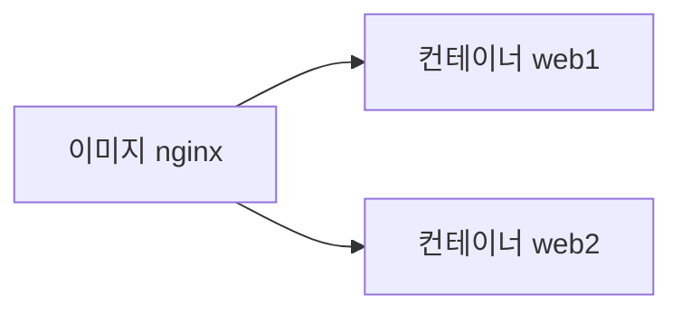
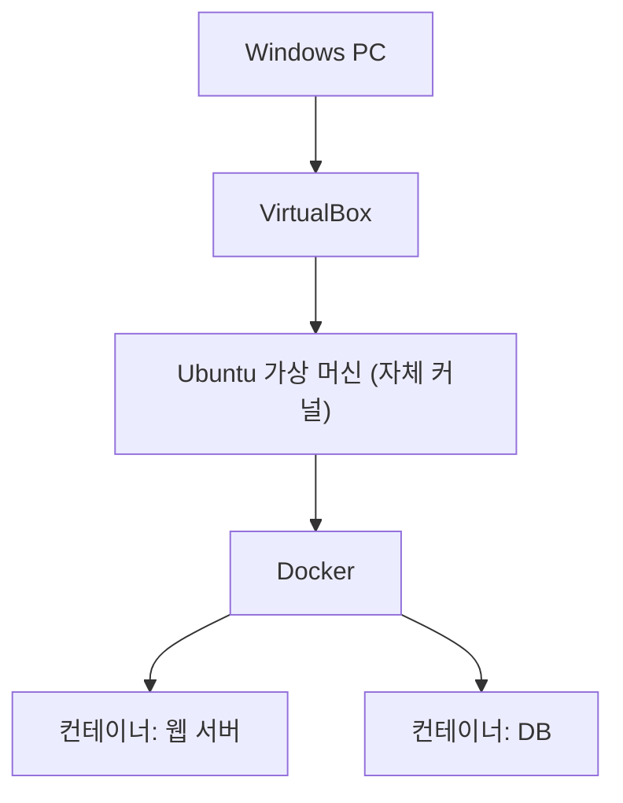
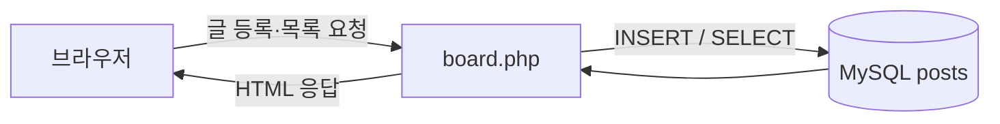
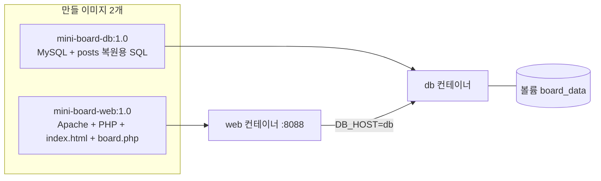
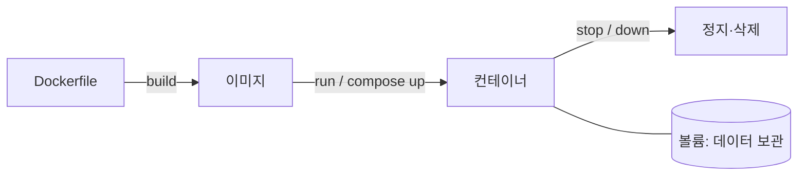

# Docker 입문 노트: VirtualBox Ubuntu 실습

- **환경**: Windows → VirtualBox의 Ubuntu 24.04 LTS → Docker
- **실행 위치**: 모든 명령은 Ubuntu 터미널, 결과 확인은 Ubuntu 안의 브라우저
- **검증**: 명령·코드는 제공받은 자료 기준, 실행 결과는 모두 "예상 결과 (실행 전)"
- **다루는 순서**: 개념 → 설치 → 명령어 → 리눅스 배포판 → 홈페이지·게시판 → Docker 이미지화

---

## 1. 도커 개념

> **쉬운 정의:** 도커는 프로그램과 그 프로그램이 돌아가는 환경을 하나의 상자(이미지)로 포장하고, 그 상자로 똑같은 프로그램을 여러 개 실행하는 도구

**아주 간단한 핵심 예시**

```bash
sudo docker pull nginx                                        # nginx 이미지 내려받기
sudo docker run -d --name web1 -p 127.0.0.1:8081:80 nginx     # 이미지로 컨테이너 실행
```

- **정확한 개념**: 이미지로 컨테이너를 만들어 실행하는 도구
- **필요한 이유**: 실습실 PC, 배포 서버 어디서든 같은 구성의 웹 서버 실행
- **비유**: 실행 파일 하나로 프로세스를 여러 개 만드는 것과 같이, 이미지 하나로 컨테이너 여러 개 생성



- **읽는 법**: 같은 이미지에서 독립된 컨테이너 두 개 생성, 하나를 멈춰도 다른 하나는 계속 동작

### 핵심 용어

| 용어 | 뜻 | 예시 |
|---|---|---|
| 이미지(Image) | 프로그램과 실행 환경을 담아 둔 패키지 | Nginx가 설치된 `nginx` 이미지 |
| 컨테이너(Container) | 이미지로 만든 실행 단위, 시작·중지 가능 | `web1`, `web2` 웹 서버 |
| Dockerfile | 사용자 정의 이미지를 만드는 절차를 적은 파일 | Apache와 PHP 이미지에 게시판 코드 복사 |
| Docker Hub | 이미지를 내려받고 올리는 대표 저장소 | `nginx`, `ubuntu`, `mysql` |
| 볼륨(Volume) | 컨테이너를 삭제·교체해도 데이터를 보관하는 저장 공간 | MySQL의 게시글 데이터 |
| Docker Compose | 여러 컨테이너의 실행 설정을 한 파일로 관리 | PHP 웹 서버와 MySQL 동시 실행 |

---

## 2. VirtualBox와 도커의 관계



| 구분 | 하는 일 |
|---|---|
| VirtualBox | Windows에서 Ubuntu를 별도 가상 머신으로 실행, Ubuntu는 자체 커널 사용 |
| Docker | Ubuntu 안에서 웹 서버·DB를 컨테이너로 실행·관리 |

- **핵심**: 컨테이너들은 그 Ubuntu의 리눅스 커널을 공유
- **역할 구분**: VirtualBox는 실습 환경 마련, 도커는 그 안의 서비스 실행·관리

---

## 3. 실습: 이미지 하나로 웹 서버 두 개

```bash
sudo docker pull nginx
sudo docker run -d --name web1 -p 127.0.0.1:8081:80 nginx
sudo docker run -d --name web2 -p 127.0.0.1:8082:80 nginx
sudo docker ps
```

- **예상 결과 (실행 전)**: 브라우저에서 `http://127.0.0.1:8081`, `http://127.0.0.1:8082` 각각 Nginx 기본 화면
- **그 결과가 나온 이유**
  - 두 컨테이너 모두 같은 `nginx` 이미지로 생성
  - 컨테이너 안의 Nginx는 각각 80번 포트 사용
  - Ubuntu에서는 8081, 8082로 구분해 접속
- **정지 실험**: `sudo docker stop web1` 후 새로고침 시 8081만 멈추고 8082는 계속 동작
- **다음 단계로 이어지는 구조**: PHP·Apache 컨테이너는 화면, MySQL 컨테이너는 게시글 저장, 볼륨은 데이터 보관, Compose는 둘을 함께 실행

---

## 4. Docker 설치 (Ubuntu 24.04 기준)

### 1단계. 터미널 열기와 Ubuntu 확인

- **터미널 열기**: `Ctrl + Alt + T`

```bash
cat /etc/os-release
```

- **예상 결과 (실행 전)**: 출력에 `Ubuntu 24.04` 표시
- **`sudo` 비밀번호**: Ubuntu 로그인 비밀번호, 입력 중 화면에 별표도 표시되지 않음, 입력 후 Enter

### 2단계. 설치 도구와 확인용 열쇠 준비

```bash
sudo apt update
sudo apt install ca-certificates curl
sudo install -m 0755 -d /etc/apt/keyrings
sudo curl -fsSL https://download.docker.com/linux/ubuntu/gpg -o /etc/apt/keyrings/docker.asc
sudo chmod a+r /etc/apt/keyrings/docker.asc
```

- **`Do you want to continue? [Y/n]`**: `y` 입력 후 Enter
- **`apt`**: Ubuntu의 프로그램 설치 도구
- **GPG 키**: Docker 설치 파일의 서명을 확인하는 열쿠
- **완료 기준**: 마지막 명령 뒤 터미널 입력 표시 복귀

### 3단계. Docker 공식 저장소 등록

> **쉬운 정의:** 저장소는 설치 파일을 내려받는 곳, 이 단계는 Ubuntu에 Docker를 어디서 받을지 알려 주는 일

- **입력 방법**: 첫 줄부터 `EOF`까지 전체를 한 번에 붙여넣기, 붙여넣기는 `Ctrl + Shift + V`, `EOF`에서 멈추면 Enter

```bash
sudo tee /etc/apt/sources.list.d/docker.sources <<EOF
Types: deb
URIs: https://download.docker.com/linux/ubuntu
Suites: $(. /etc/os-release && echo "${UBUNTU_CODENAME:-$VERSION_CODENAME}")
Components: stable
Architectures: $(dpkg --print-architecture)
Signed-By: /etc/apt/keyrings/docker.asc
EOF
```

```bash
sudo apt update
```

- **`apt update` 재실행 이유**: 방금 등록한 저장소의 설치 목록 읽기

### 4단계. Docker 설치

- **아래 명령은 한 줄**: Docker 본체와 Docker Compose 함께 설치

```bash
sudo apt install docker-ce docker-ce-cli containerd.io docker-buildx-plugin docker-compose-plugin
```

```bash
docker --version
docker compose version
```

- **예상 결과 (실행 전)**: 두 명령 모두 버전 번호 출력

### 5단계. 첫 컨테이너 실행

```bash
sudo docker run hello-world
```

- **하는 일**: `hello-world` 이미지 내려받기 → 컨테이너 생성·실행
- **예상 결과 (실행 전)**: `Hello from Docker!` 출력, 안내 문구 후 컨테이너 자동 종료
- **의미**: 설치와 실행 모두 성공

### 오류 대처

| 화면 문구 | 대처 |
|---|---|
| `permission denied` | 명령 앞 `sudo` 확인 후 `sudo docker run hello-world` 재실행 |
| `Cannot connect to the Docker daemon` | `sudo systemctl start docker` 후 테스트 명령 재실행 |
| `Unable to locate package docker-ce` | 3단계 `sudo apt update` 재실행, `download.docker.com` 관련 오류 확인 |

---

## 5. Docker 명령어 정리

> **기억할 것:** `run`은 새 컨테이너를 만들고, `start`는 이미 만들어 둔 컨테이너를 다시 켬

### 5-1. 설치와 실행 확인

| 명령어 | 하는 일 |
|---|---|
| `docker --version` | 설치된 Docker 명령 버전 확인 |
| `sudo docker info` | Docker 동작 여부와 시스템 정보 확인 |
| `sudo docker run --rm hello-world` | 테스트 컨테이너 실행, `Hello from Docker!`가 나오면 성공 |
| `docker run --help` | `run`에 붙일 수 있는 옵션 확인 |

- **`--rm`**: 컨테이너 종료 시 컨테이너 자동 삭제, 내려받은 이미지는 유지

### 5-2. 이미지 관리

| 명령어 | 하는 일 |
|---|---|
| `sudo docker search nginx` | Docker Hub에서 nginx 관련 이미지 검색 |
| `sudo docker pull nginx` | nginx 이미지 내려받기 |
| `sudo docker images` | Ubuntu에 저장된 이미지 목록 |
| `sudo docker build -t myweb:1.0 .` | 현재 폴더의 Dockerfile로 `myweb:1.0` 이미지 생성 |
| `sudo docker rmi nginx` | nginx 이미지 삭제, 그 이미지를 쓰는 컨테이너가 있으면 먼저 삭제 |

- **`build`의 `-t`**: 이미지 이름과 태그 지정
- **`build`의 마지막 `.`**: 현재 폴더를 빌드에 사용

### 5-3. 컨테이너 관리

| 명령어 | 하는 일 |
|---|---|
| `sudo docker run -d --name web1 -p 127.0.0.1:8080:80 nginx` | `web1` 컨테이너를 새로 만들어 실행 |
| `sudo docker ps` | 실행 중인 컨테이너 목록 |
| `sudo docker ps -a` | 중지된 컨테이너까지 전체 목록 |
| `sudo docker stop web1` | `web1` 정지 |
| `sudo docker start web1` | 정지된 `web1` 재시작 |
| `sudo docker restart web1` | `web1` 재시작 |
| `sudo docker logs web1` | 웹 서버 로그 확인 |
| `sudo docker exec -it web1 sh` | 실행 중인 `web1` 안에서 명령 입력, `exit`으로 복귀 |
| `sudo docker rm web1` | 중지된 `web1` 삭제 |

- **`-d`**: 백그라운드 실행, 터미널 계속 사용 가능
- **`-p 127.0.0.1:8080:80`**: Ubuntu의 8080번 포트를 컨테이너의 80번 포트에 연결, 접속은 Ubuntu 안의 브라우저 사용

### 5-4. 따라 해 보기: 웹 서버 켜고 끄기

```bash
sudo docker run -d --name web1 -p 127.0.0.1:8080:80 nginx
sudo docker ps
```

- **예상 결과 (실행 전)**: `http://127.0.0.1:8080`에서 `Welcome to nginx!`
- **참고**: `nginx` 이미지가 없으면 `run`이 자동으로 내려받음

```bash
sudo docker stop web1
sudo docker ps
sudo docker ps -a
```

- **예상 결과 (실행 전)**: `ps` 목록에서 `web1` 사라짐, `ps -a`에서는 `Exited` 상태

```bash
sudo docker start web1
```

- **예상 결과 (실행 전)**: 브라우저 새로고침 시 다시 접속 가능

```bash
sudo docker stop web1
sudo docker rm web1
```

- **용도**: 실습 후 정리

### 5-5. Docker Compose 명령어

- **실행 위치**: `compose.yaml`이 있는 폴더

| 명령어 | 하는 일 |
|---|---|
| `sudo docker compose up -d` | 설정 파일의 서비스를 백그라운드로 시작 |
| `sudo docker compose up -d --build` | 필요한 이미지를 빌드한 뒤 시작 |
| `sudo docker compose ps` | 서비스 실행 상태 |
| `sudo docker compose logs -f` | 새 로그가 나올 때마다 표시 |
| `sudo docker compose down` | 서비스를 멈추고 컨테이너와 프로젝트 네트워크 정리 |

- **주의점**: 이름 있는 볼륨에 MySQL 데이터를 저장했다면 `down`만으로는 데이터 유지, `-v`를 붙이면 Compose에서 선언한 볼륨까지 삭제될 수 있음, 게시글 보관 시 `down`만 사용

---

## 6. 우분투와 다른 리눅스 배포판

> **쉬운 정의:** 리눅스 배포판은 같은 핵심(커널)에 명령어, 설치 도구, 기본 설정을 묶어 쓸 수 있게 만든 제품 종류

- **리눅스 커널**: CPU, 메모리, 디스크 등을 관리하는 운영체제의 핵심
- **Ubuntu**: 배포판의 한 종류
- **공통점**: `ls`, `cd`, `pwd` 같은 명령은 다른 배포판에서도 익숙하게 사용
- **차이점**: 프로그램 설치 명령은 배포판마다 다름

### 대표 배포판

| 배포판 | 특징 | 설치 명령 |
|---|---|---|
| Ubuntu | Debian 기반, PC와 서버 실습에 모두 사용 | `apt install` |
| Debian | Ubuntu의 바탕, 안정성 중시 서버에서 자주 사용 | `apt install` |
| Linux Mint | 대표 에디션은 Ubuntu 기반, 그래픽 화면 중심의 개인 PC용 | `apt install` |
| Fedora | 새로운 리눅스 기술을 비교적 빠르게 적용 | `dnf install` |
| Rocky Linux | 기업용 RHEL 호환 목표, 서버 관리 실습에 적합 | `dnf install` |
| Alpine Linux | 기본 구성이 작고 가벼움, Docker 이미지 바탕으로 자주 사용 | `apk add` |
| Arch Linux | 구성 요소를 직접 선택, 새 버전 지속 제공 | `pacman -S` |

### Docker로 Debian·Fedora·Alpine 체험

| 해볼 일 | 명령 |
|---|---|
| Debian 터미널 | `sudo docker run --rm -it debian sh` |
| Fedora 터미널 | `sudo docker run --rm -it fedora sh` |
| Alpine 터미널 | `sudo docker run --rm -it alpine sh` |

```bash
cat /etc/os-release
uname -r
```

- **실행 순서**: 컨테이너 접속 후 두 명령 실행, `exit`으로 복귀 후 다음 배포판 실행
- **`cat /etc/os-release`**: 컨테이너 안 배포판 이름과 버전, 예상 결과 (실행 전) Debian·Fedora·Alpine 각각 다르게 표시
- **`uname -r`**: 실제 사용 커널 버전, 예상 결과 (실행 전) Ubuntu 터미널과 세 컨테이너에서 같은 값
- **같은 값이 나오는 이유**: 모두 VirtualBox 안 Ubuntu의 커널 공유

### 같은 프로그램, 다른 설치 명령 (nano 편집기)

| 배포판 | 설치 명령 |
|---|---|
| Debian | `apt update` 후 `apt install nano` |
| Fedora | `dnf install nano` |
| Alpine | `apk add nano` |

- **주의점**: `--rm`이므로 `exit` 시 컨테이너와 그 안에 설치한 nano도 함께 삭제

---

## 7. 간단한 홈페이지와 MySQL 게시판

> **쉬운 정의:** HTML은 화면, PHP는 화면과 DB 사이 심부름꾼, MySQL은 글을 보관하는 창고



| 구성 | 하는 일 |
|---|---|
| `index.html` | 홈페이지 표시, 게시판으로 연결 |
| `board.php` | 글쓰기 화면 표시, 글 저장, 목록 조회 |
| MySQL `posts` 테이블 | 글 번호, 제목, 내용 저장 |

- **웹 서버**: PHP 내장 웹 서버 사용

### 1단계. HTML 홈페이지 만들기

```bash
mkdir -p ~/mini-homepage
cd ~/mini-homepage
nano index.html
```

- **nano 저장**: `Ctrl+O` → Enter → `Ctrl+X`, 이후 `board.php`도 같은 방법

```html
<!DOCTYPE html>
<html lang="ko">
<head>
    <meta charset="UTF-8">
    <title>나의 미니 홈페이지</title>
</head>
<body>
    <h1>나의 미니 홈페이지</h1>
    <p>안녕하세요! 홈페이지에 오신 것을 환영합니다.</p>
    <p><a href="board.php">게시판으로 이동</a></p>
</body>
</html>
```

- **확인**: 파일 관리자에서 `mini-homepage`의 `index.html` 더블클릭, 인사말 확인
- **참고**: 게시판 링크는 4단계에서 `board.php`를 만든 뒤 동작

### 2단계. MySQL과 PHP 설치

```bash
sudo apt update
sudo apt install mysql-server php-cli php-mysql php-mbstring
sudo systemctl start mysql
```

| 패키지 | 역할 |
|---|---|
| `mysql-server` | 글을 저장할 데이터베이스 서버 |
| `php-cli` | PHP 실행 |
| `php-mysql` | PHP와 MySQL 연결 |
| `php-mbstring` | 한글 포함 글의 길이 확인 |

```bash
sudo mysql
```

- **예상 결과 (실행 전)**: `mysql>` 입력창 표시

### 3단계. MySQL에 게시글 테이블 만들기

- **`board_lab`**: 게시판용 데이터베이스 이름
- **`posts`**: 그 안에서 글을 보관할 테이블 이름

```sql
CREATE DATABASE board_lab CHARACTER SET utf8mb4;
USE board_lab;

CREATE TABLE posts (
    id INT AUTO_INCREMENT PRIMARY KEY,
    title VARCHAR(100) NOT NULL,
    content TEXT NOT NULL
);

INSERT INTO posts (title, content)
VALUES ('첫 번째 글', 'MySQL에 직접 저장한 글입니다.');

SELECT id, title, content FROM posts;
```

- **예상 결과 (실행 전)**: 조회 결과에 `첫 번째 글` 표시, MySQL의 저장·조회 성공

PHP 전용 계정 생성: 글 읽기(`SELECT`)와 추가(`INSERT`) 권한만 부여

```sql
CREATE USER 'board_app'@'localhost' IDENTIFIED BY 'BoardLab_2026!';
GRANT SELECT, INSERT ON board_lab.posts TO 'board_app'@'localhost';
EXIT;
```

- **주의점**: `BoardLab_2026!`는 로컬 실습용 예시 비밀번호, 다른 값을 쓰면 다음 단계 PHP 코드에도 같은 값 기재

### 4단계. PHP로 글 목록과 등록 기능 만들기

```bash
cd ~/mini-homepage
nano board.php
```

```php
<?php
$db = new PDO(
    'mysql:host=localhost;dbname=board_lab;charset=utf8mb4',
    'board_app',
    'BoardLab_2026!'
);

$error = '';
$title = '';
$content = '';

// 등록 버튼을 눌렀을 때만 실행합니다.
if ($_SERVER['REQUEST_METHOD'] === 'POST') {
    $title = trim((string) filter_input(INPUT_POST, 'title'));
    $content = trim((string) filter_input(INPUT_POST, 'content'));

    if ($title === '' || $content === '') {
        $error = '제목과 내용을 모두 입력하세요.';
    } elseif (mb_strlen($title, 'UTF-8') > 100 || mb_strlen($content, 'UTF-8') > 2000) {
        $error = '제목은 100자, 내용은 2,000자 이내로 입력하세요.';
    } else {
        $stmt = $db->prepare('INSERT INTO posts (title, content) VALUES (?, ?)');
        $stmt->execute([$title, $content]);

        header('Location: board.php', true, 303);
        exit;
    }
}

// 최신 글부터 가져옵니다.
$posts = $db->query('SELECT id, title, content FROM posts ORDER BY id DESC');
?>
<!DOCTYPE html>
<html lang="ko">
<head>
    <meta charset="UTF-8">
    <title>미니 게시판</title>
</head>
<body>
    <h1>미니 게시판</h1>
    <p><a href="index.html">홈으로 돌아가기</a></p>

    <h2>글 쓰기</h2>
    <?php if ($error !== ''): ?>
        <p><?= htmlspecialchars($error) ?></p>
    <?php endif; ?>

    <form action="board.php" method="post">
        <p>
            <label for="title">제목</label><br>
            <input id="title" name="title" maxlength="100" required
                   value="<?= htmlspecialchars($title) ?>">
        </p>
        <p>
            <label for="content">내용</label><br>
            <textarea id="content" name="content" rows="5" cols="40"
                      maxlength="2000" required><?= htmlspecialchars($content) ?></textarea>
        </p>
        <button type="submit">글 등록</button>
    </form>

    <hr>
    <h2>글 목록</h2>

    <?php foreach ($posts as $post): ?>
        <article>
            <h3><?= (int) $post['id'] ?>. <?= htmlspecialchars($post['title']) ?></h3>
            <p><?= nl2br(htmlspecialchars($post['content'])) ?></p>
        </article>
    <?php endforeach; ?>
</body>
</html>
```

- **파일 첫 줄**: `<?php`로 시작
- **`SELECT`**: 목록 읽기, **`INSERT`**: 새 글 저장
- **`VALUES (?, ?)`**: 물음표에 입력값을 따로 전달, SQL과 입력값 분리
- **`htmlspecialchars`**: 입력값을 화면에 안전하게 출력
- **`header('Location: board.php', true, 303)`**: 저장 후 게시판으로 이동, 새로고침해도 같은 글 재등록 방지

### 5단계. 웹 서버 켜고 브라우저에서 확인

```bash
cd ~/mini-homepage
php -l board.php
php -S 127.0.0.1:8000
```

- **`php -l board.php`**: 문법 검사, 예상 결과 (실행 전) `No syntax errors detected`
- **`php -S 127.0.0.1:8000`**: 웹 서버 시작, 터미널은 열어 둔 상태 유지
- **`127.0.0.1`**: 지금 사용 중인 Ubuntu 자신

**브라우저 확인 순서**

1. `http://127.0.0.1:8000/`에서 홈페이지 열기
2. 게시판으로 이동 클릭, MySQL에 직접 넣은 첫 번째 글 확인
3. 제목 `브라우저에서 작성한 글`, 내용 `게시판에서 저장한 두 번째 글입니다.` 입력 후 글 등록
4. 새 글이 목록 맨 위에 보이면 브라우저 → PHP → MySQL → 게시판 화면 연결 성공

**DB에 실제로 들어갔는지 확인** (새 터미널)

```bash
sudo mysql -e "SELECT id, title FROM board_lab.posts ORDER BY id DESC;"
```

- **예상 결과 (실행 전)**: 두 글의 제목 표시, 실습 완료
- **종료**: 웹 서버를 실행한 터미널에서 `Ctrl+C`, 등록한 글은 MySQL에 유지

---

## 8. 완성한 홈페이지와 MySQL을 Docker 이미지로 만들기



| 이미지 | 들어가는 내용 |
|---|---|
| `mini-board-web:1.0` | Apache, PHP, `index.html`, `board.php` |
| `mini-board-db:1.0` | MySQL, 기존 `posts` 테이블을 복원할 SQL 파일 |

- **DB 이미지에 들어가는 글**: 내보낸 시점의 게시글만 포함
- **Docker 실행 후 새로 쓴 글**: 볼륨에 저장
- **원본 보호**: 기존 Ubuntu의 홈페이지와 MySQL 데이터는 그대로 두고 복사본으로 실습

### 1단계. 홈페이지 복사와 게시글 내보내기

- **전제**: 프로젝트가 `~/mini-homepage`에 있음

```bash
mkdir -p ~/mini-homepage-docker/{web,db}
cd ~/mini-homepage-docker

cp ~/mini-homepage/index.html ~/mini-homepage/board.php web/
```

기존 MySQL에서 테이블 구조와 게시글을 SQL 파일로 내보내기

```bash
sudo mysqldump --single-transaction --no-tablespaces \
  --set-gtid-purged=OFF board_lab posts > db/01-board.sql
```

```bash
grep 'CREATE TABLE' db/01-board.sql
```

- **예상 결과 (실행 전)**: `CREATE TABLE `posts`` 표시

### 2단계. PHP가 Docker 안의 MySQL에 접속하도록 수정

```bash
nano web/board.php
```

- **수정 범위**: 파일 위쪽 `$db = new PDO(...)` 부분만 교체, 글쓰기·목록 코드는 그대로

```php
$db = new PDO(
    'mysql:host=' . getenv('DB_HOST') . ';dbname=board_lab;charset=utf8mb4',
    'board_app',
    getenv('DB_PASSWORD')
);
```

- **변경 이유**
  - 이전: PHP와 MySQL 모두 Ubuntu에서 실행되어 `localhost`로 연결
  - 이번: 별도 컨테이너에서 실행되므로 Compose의 MySQL 서비스 이름 `db`로 접속
  - 접속 정보는 코드에 적지 않고 환경 변수로 전달

### 3단계. Dockerfile 작성

> **쉬운 정의:** Dockerfile은 이미지를 만드는 순서를 적은 요리 레시피

- **저장**: `nano`에서 `Ctrl+O` → Enter → `Ctrl+X`

**웹 이미지** (`nano web/Dockerfile`)

```dockerfile
FROM php:8.4-apache-bookworm

RUN docker-php-ext-install pdo_mysql

COPY index.html board.php /var/www/html/
```

- **`FROM`**: 바탕이 되는 이미지, PHP와 Apache 포함
- **`RUN docker-php-ext-install pdo_mysql`**: PHP의 MySQL 연결 기능 추가
- **`COPY`**: 홈페이지와 게시판을 Apache 웹 폴더에 복사
- **참고**: 기존 코드의 `mbstring`은 이 기본 이미지에 포함

**DB 이미지** (`nano db/Dockerfile`)

```dockerfile
FROM mysql:8.4

COPY --chmod=0644 01-board.sql /docker-entrypoint-initdb.d/01-board.sql
```

- **`/docker-entrypoint-initdb.d/`**: MySQL이 비어 있는 데이터 볼륨으로 처음 시작할 때 읽는 폴더
- **결과**: 첫 시작 시 SQL 파일로 `posts`와 기존 게시글 복원

### 4단계. Docker Compose로 두 컨테이너 연결

비밀번호 파일 (`nano .env`)

```dotenv
DB_PASSWORD=BoardApp_Local_47
DB_ROOT_PASSWORD=BoardRoot_Local_82
```

- **용도**: 로컬 실습용 예시, 새 컨테이너의 MySQL에 사용되므로 기존 Ubuntu MySQL 비밀번호와 달라도 됨

설정 파일 (`nano compose.yaml`, 들여쓰기는 스페이스)

```yaml
services:
  web:
    build: ./web
    image: mini-board-web:1.0
    ports:
      - "127.0.0.1:8088:80"
    environment:
      DB_HOST: db
      DB_PASSWORD: ${DB_PASSWORD}
    depends_on:
      db:
        condition: service_healthy

  db:
    build: ./db
    image: mini-board-db:1.0
    environment:
      MYSQL_DATABASE: board_lab
      MYSQL_USER: board_app
      MYSQL_PASSWORD: ${DB_PASSWORD}
      MYSQL_ROOT_PASSWORD: ${DB_ROOT_PASSWORD}
    volumes:
      - board_data:/var/lib/mysql
    healthcheck:
      test:
        - CMD-SHELL
        - >-
          mysql --protocol=TCP -h 127.0.0.1 -u "$$MYSQL_USER"
          --password="$$MYSQL_PASSWORD" "$$MYSQL_DATABASE"
          -e "SELECT 1 FROM posts LIMIT 1"
      interval: 5s
      timeout: 5s
      retries: 24
      start_period: 30s

volumes:
  board_data:
```

| 설정 | 의미 |
|---|---|
| `ports: 127.0.0.1:8088:80` | Ubuntu의 8088번 포트를 웹 컨테이너 80번에 연결 |
| `DB_HOST: db` | PHP가 Compose 내부 네트워크로 `db` 서비스에 접속 |
| `depends_on ... service_healthy` | `posts` 테이블을 읽을 수 있을 때 웹 서버 시작 |
| `volumes: board_data` | MySQL 데이터를 볼륨에 보관 |
| `healthcheck` | `posts` 조회 성공 여부로 DB 준비 상태 확인 |

### 5단계. 이미지 만들고 게시판 확인

```bash
cd ~/mini-homepage-docker

sudo docker compose build
sudo docker image ls

sudo docker compose up -d
sudo docker compose ps
```

- **`build`**: 이미지 생성, **`up -d`**: 그 이미지로 컨테이너 실행
- **예상 결과 (실행 전)**: 이미지 목록에 `mini-board-web:1.0`, `mini-board-db:1.0`
- **참고**: 첫 실행은 MySQL 초기화로 잠시 걸릴 수 있음

**브라우저 확인 순서**

1. `http://127.0.0.1:8088` 열기
2. 게시판으로 이동 클릭, 기존 MySQL에서 가져온 글 확인
3. 제목 `Docker에서 작성한 글`로 새 글 등록
4. 컨테이너를 내렸다가 다시 올린 뒤 새로고침

```bash
sudo docker compose down
sudo docker compose up -d
```

- **예상 결과 (실행 전)**: 새 글이 그대로 표시, DB 연결과 볼륨 저장 성공
- **주의점**: 글을 보관하려면 `down`만 사용, `down -v`는 `board_data` 볼륨 삭제, 이후 빈 볼륨에서 재실행하면 이미지에 들어 있는 초기 SQL만 복원
- **공유 주의**: DB 이미지에는 처음 내보낸 게시글 포함, 수업용으로 공유할 때는 예제 게시글만 든 SQL로 DB 이미지 빌드

---

## 9. 주의점 모음

- **`run`과 `start`**: `run`은 새 컨테이너 생성, `start`는 기존 컨테이너 재시작
- **`--rm`**: 컨테이너 자동 삭제, 안에 설치하거나 저장한 내용도 함께 삭제
- **`down`과 `down -v`**: `-v`는 볼륨까지 삭제, 데이터 보관 시 사용 금지
- **포트 번호 구분**: 8000(PHP 내장 서버), 8080(nginx 단독 실습), 8081·8082(웹 서버 두 개), 8088(게시판 Compose)
- **`localhost`와 `db`**: 컨테이너 안에서는 `localhost`가 자기 자신, 다른 컨테이너는 서비스 이름으로 접속
- **초기 SQL 복원 시점**: 비어 있는 데이터 볼륨으로 처음 시작할 때만 실행
- **보충 (슬라이드에 없는 추정, 미확인)**: `.env`에 비밀번호가 들어 있으므로 git에 올릴 때 `.gitignore`에 추가
- **보충 (미확인)**: Compose의 `MYSQL_USER`로 생성되는 계정은 `board_lab` 전체 권한을 가질 수 있어, 3단계에서 만든 `SELECT`·`INSERT` 전용 계정과 권한이 다를 수 있음

---

## 10. 한 장 요약

| 하고 싶은 일 | 명령 |
|---|---|
| 설치 확인 | `docker --version`, `docker compose version`, `sudo docker run hello-world` |
| 이미지 받기 | `sudo docker pull 이미지이름` |
| 컨테이너 실행 | `sudo docker run -d --name 이름 -p 127.0.0.1:호스트포트:컨테이너포트 이미지` |
| 상태 보기 | `sudo docker ps`, `sudo docker ps -a` |
| 정지·시작·삭제 | `sudo docker stop 이름`, `sudo docker start 이름`, `sudo docker rm 이름` |
| 내 이미지 만들기 | `sudo docker build -t 이름:태그 .` |
| 여러 컨테이너 실행 | `sudo docker compose up -d` |
| 여러 컨테이너 종료(데이터 유지) | `sudo docker compose down` |



- **읽는 법**: Dockerfile로 이미지를 만들고, 이미지로 컨테이너를 실행하며, 데이터는 볼륨에 남음

---

## 출처

- Docker Docs, Docker Hub, Ubuntu 공식 문서, PHP·MySQL 공식 문서 (제공받은 원 설명의 출처 표기 기준)
