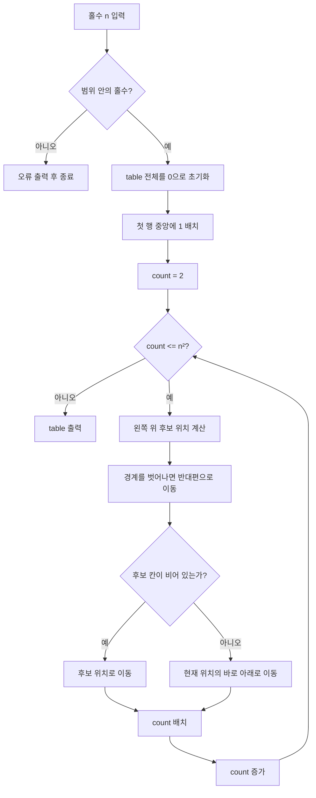

# Week 07 - 이차원 배열과 홀수 차수 마방진

## 학습 목표

- 마방진의 조건과 홀수 차수의 의미 이해
- 이차원 배열의 행·열 인덱스 구분
- 자연어 규칙을 변수, 조건문, 반복문으로 변환
- 배열의 경계를 벗어날 때 반대편으로 이동하는 처리 이해
- 이미 채워진 칸을 검사하기 위한 `0` 초기화의 역할 이해
- 마방진 생성 기능과 출력 기능의 함수 분리
- 입력 크기 `n`을 기준으로 시간·공간 복잡도 분석

## 강의자료 구성

| PDF 쪽 | 주요 내용 | 문서 반영 |
| ---: | --- | --- |
| 1~4 | 6주차 단계적 개선, 이진 탐색, 순차 탐색, 시간 복잡도 복습 | 기존 Week 06 내용으로 대체 |
| 5 | 마방진 문제 정의와 `3 × 3` 예시 | 문제 정의·예시 |
| 6 | 홀수 차수 마방진 생성 규칙 | Coxeter's Rule |
| 7 | 행·열 변수와 의사코드 | 알고리즘·실행 추적 |
| 8 | 입력, 검사, 초기화, 생성, 출력 절차 | 전체 프로그램 흐름 |
| 9 | `0` 초기화 질문과 함수 분리 실습 | 초기화 이유·함수 구현 |

> [!NOTE]
> PDF에는 `msquare0.txt`, `msquarefun0.txt`가 참고 파일명으로 제시되어 있지만 파일 본문은 포함되지 않음. 아래 전체 C 코드는 PDF의 규칙과 함수 원형을 실행 가능한 형태로 옮긴 학습용 구현

---

## 1. 마방진

### 문제 정의

**마방진(Magic Square)**: `1`부터 `n²`까지의 수를 `n × n` 배열에 한 번씩 배치하여 모든 행, 모든 열, 두 대각선의 합을 같게 만든 배열

입력과 출력:

| 구분 | 내용 |
| --- | --- |
| 입력 | 홀수 `n`, `0`으로 초기화된 `n × n` 이차원 배열 |
| 사용 값 | `1`부터 `n²`까지의 정수 |
| 출력 | 조건을 만족하는 `n × n` 마방진 |
| 행 인덱스 | `0`부터 `n - 1` |
| 열 인덱스 | `0`부터 `n - 1` |

### `3 × 3` 마방진

강의자료 예시:

```text
6  1  8
7  5  3
2  9  4
```

합 확인:

| 구분 | 계산 | 결과 |
| --- | --- | ---: |
| 첫 번째 행 | `6 + 1 + 8` | 15 |
| 두 번째 행 | `7 + 5 + 3` | 15 |
| 세 번째 행 | `2 + 9 + 4` | 15 |
| 첫 번째 열 | `6 + 7 + 2` | 15 |
| 두 번째 열 | `1 + 5 + 9` | 15 |
| 세 번째 열 | `8 + 3 + 4` | 15 |
| 왼쪽 위 → 오른쪽 아래 | `6 + 5 + 4` | 15 |
| 오른쪽 위 → 왼쪽 아래 | `8 + 5 + 2` | 15 |

### 마방진의 합

`1`부터 `n²`까지의 합:

```text
1 + 2 + ... + n² = n²(n² + 1) / 2
```

전체 합을 `n`개의 행이 같은 값으로 나누어 가지므로 한 행의 합은 다음과 같음:

```text
마방진의 합 = n(n² + 1) / 2
```

`n = 3`인 경우:

```text
3(3² + 1) / 2
= 3(10) / 2
= 15
```

> 위 공식은 강의자료의 `n = 3`, 합 `15` 예시를 일반식으로 정리한 보충 계산

---

## 2. Coxeter's Rule

**Coxeter's Rule**: `n`이 홀수일 때 마방진을 만드는 규칙

### 규칙 1: 첫 숫자 배치

첫 번째 행의 중앙에 `1` 배치:

```text
row = 0
col = (n - 1) / 2
table[row][col] = 1
```

`n = 3`인 경우:

```text
row = 0
col = (3 - 1) / 2 = 1
table[0][1] = 1
```

```text
0  1  0
0  0  0
0  0  0
```

### 규칙 2: 왼쪽 위 대각선 이동

현재 위치에서 행과 열을 각각 한 칸 감소:

```text
next_row = row - 1
next_col = col - 1
```

배열 밖으로 벗어날 경우 반대편으로 이동:

```text
if (next_row < 0)
    next_row = n - 1

if (next_col < 0)
    next_col = n - 1
```

이동 예시:

| 현재 위치 | 계산한 위치 | 경계 처리 후 위치 |
| --- | --- | --- |
| `(0, 1)` | `(-1, 0)` | `(n - 1, 0)` |
| `(1, 0)` | `(0, -1)` | `(0, n - 1)` |
| `(0, 0)` | `(-1, -1)` | `(n - 1, n - 1)` |

### 규칙 3: 이미 채워진 칸 처리

이동하려는 칸이 비어 있으면 해당 칸으로 이동:

```text
row = next_row
col = next_col
```

이동하려는 칸에 숫자가 있으면 현재 위치에서 바로 아래로 이동:

```text
row = row + 1
col은 그대로 유지
```

전체 위치 결정:

```text
if table[next_row][next_col] != 0
    row = row + 1
else
    row = next_row
    col = next_col
```

---

## 3. 핵심 변수

| 변수 | 역할 |
| --- | --- |
| `table` | 숫자를 저장하는 `n × n` 이차원 배열 |
| `n` | 마방진의 한 변의 길이 |
| `row` | 현재 숫자가 들어 있는 행 인덱스 |
| `col` | 현재 숫자가 들어 있는 열 인덱스 |
| `next_row` | 왼쪽 위로 이동한 다음 행 후보 |
| `next_col` | 왼쪽 위로 이동한 다음 열 후보 |
| `count` | 배열에 놓을 숫자, `2`부터 `n²`까지 증가 |

인덱스 방향:

```text
행 감소: 위쪽 이동
행 증가: 아래쪽 이동
열 감소: 왼쪽 이동
열 증가: 오른쪽 이동
```

왼쪽 위 대각선 이동:

```text
(row, col) -> (row - 1, col - 1)
```

---

## 4. 알고리즘

### 강의자료 의사코드

```text
입력: 0으로 초기화된 n × n 이차원 배열 table
출력: n × n 마방진

row = 0
col = (n - 1) / 2
table[row][col] = 1

for count = 2 to n × n
    next_row = row - 1
    next_col = col - 1

    if next_row < 0
        next_row = n - 1

    if next_col < 0
        next_col = n - 1

    if table[next_row][next_col] != 0
        row = row + 1
    else
        row = next_row
        col = next_col

    table[row][col] = count
```

### 전체 흐름



### 한 번의 반복에서 수행할 작업

1. 왼쪽 위의 다음 위치 계산
2. 음수가 된 행·열 인덱스 보정
3. 다음 위치의 값이 `0`인지 확인
4. 빈칸이면 다음 위치로 이동
5. 채워진 칸이면 현재 위치의 바로 아래로 이동
6. `count` 저장

---

## 5. `n = 3` 실행 추적

초기 상태:

```text
0  0  0
0  0  0
0  0  0
```

첫 번째 행의 중앙 `(0, 1)`에 `1` 배치:

```text
0  1  0
0  0  0
0  0  0
```

숫자별 위치 결정:

| 숫자 | 현재 위치 | 왼쪽 위 후보 | 처리 | 배치 위치 |
| ---: | --- | --- | --- | --- |
| 1 | - | - | 첫 행 중앙 | `(0, 1)` |
| 2 | `(0, 1)` | `(-1, 0)` | 행 경계 보정 | `(2, 0)` |
| 3 | `(2, 0)` | `(1, -1)` | 열 경계 보정 | `(1, 2)` |
| 4 | `(1, 2)` | `(0, 1)` | `1`이 있으므로 바로 아래 | `(2, 2)` |
| 5 | `(2, 2)` | `(1, 1)` | 빈칸 | `(1, 1)` |
| 6 | `(1, 1)` | `(0, 0)` | 빈칸 | `(0, 0)` |
| 7 | `(0, 0)` | `(-1, -1)` → `(2, 2)` | `4`가 있으므로 바로 아래 | `(1, 0)` |
| 8 | `(1, 0)` | `(0, -1)` | 열 경계 보정 | `(0, 2)` |
| 9 | `(0, 2)` | `(-1, 1)` | 행 경계 보정 | `(2, 1)` |

최종 결과:

```text
6  1  8
7  5  3
2  9  4
```

### 충돌 처리 핵심

`4`를 놓을 차례의 상태:

```text
현재 위치: (1, 2), 값 3
왼쪽 위 후보: (0, 1)
table[0][1] = 1
```

후보 칸에 `1`이 있으므로 후보 위치 사용 불가. 현재 위치 `(1, 2)`의 바로 아래 `(2, 2)`에 `4` 배치

---

## 6. 배열을 `0`으로 초기화하는 이유

생성 과정에서 다음 칸이 비어 있는지 아래 조건으로 검사:

```c
if (table[next_row][next_col] != 0)
```

`0` 초기화의 의미:

| 배열 값 | 의미 |
| ---: | --- |
| `0` | 아직 숫자가 없는 빈칸 |
| `1`부터 `n²` | 이미 숫자가 배치된 칸 |

초기화하지 않은 지역 배열에는 의미를 알 수 없는 값이 남을 수 있음. 빈칸이 아닌 것으로 잘못 판단할 경우 이동 규칙과 최종 마방진이 모두 깨질 수 있음

`0`을 빈칸 표시로 사용할 수 있는 이유:

- 실제 마방진에 들어가는 값은 `1`부터 `n²`
- 값 `0`은 실제 데이터 범위에 포함되지 않음
- 별도의 방문 배열 없이 빈칸 여부 확인 가능

---

## 7. 함수 분리

강의자료에서 제시한 함수 원형:

```c
void make_msquare(int table[][MAX_SIZE], int n);
void display(int table[][MAX_SIZE], int n);
```

함수별 역할:

| 함수 | 역할 | 변경 대상 |
| --- | --- | --- |
| `make_msquare()` | 배열 초기화와 마방진 생성 | `table`의 원소 |
| `display()` | 완성된 배열 출력 | 없음 |
| `main()` | 입력, 유효성 검사, 함수 호출 | 프로그램 전체 흐름 |

이차원 배열 매개변수에서 두 번째 크기가 필요한 이유:

```c
int table[][MAX_SIZE]
```

C에서 `table[row][col]`의 주소를 계산하려면 한 행에 몇 개의 원소가 있는지 필요. 따라서 열 크기 `MAX_SIZE`를 함수 매개변수에 명시

---

## 8. 전체 C 프로그램

PDF의 세 가지 규칙과 함수 원형을 실행 가능한 형태로 보완한 학습용 코드:

```c
#include <stdio.h>

#define MAX_SIZE 19

void make_msquare(int table[][MAX_SIZE], int n)
{
    int row;
    int col;
    int next_row;
    int next_col;
    int count;

    /* 0은 아직 숫자가 없는 빈칸을 의미 */
    for (row = 0; row < n; row++) {
        for (col = 0; col < n; col++) {
            table[row][col] = 0;
        }
    }

    /* 규칙 1: 첫 번째 행의 중앙에 1 배치 */
    row = 0;
    col = (n - 1) / 2;
    table[row][col] = 1;

    for (count = 2; count <= n * n; count++) {
        /* 규칙 2: 왼쪽 위 대각선 후보 위치 계산 */
        next_row = row - 1;
        next_col = col - 1;

        if (next_row < 0) {
            next_row = n - 1;
        }
        if (next_col < 0) {
            next_col = n - 1;
        }

        /* 규칙 3: 채워진 칸이면 현재 위치의 바로 아래로 이동 */
        if (table[next_row][next_col] != 0) {
            row = (row + 1) % n;
        } else {
            row = next_row;
            col = next_col;
        }

        table[row][col] = count;
    }
}

void display(int table[][MAX_SIZE], int n)
{
    int row;
    int col;

    for (row = 0; row < n; row++) {
        for (col = 0; col < n; col++) {
            printf("%4d", table[row][col]);
        }
        putchar('\n');
    }
}

int main(void)
{
    int table[MAX_SIZE][MAX_SIZE] = {0};
    int n;

    printf("홀수 차수 n 입력(1~%d): ", MAX_SIZE);

    if (scanf("%d", &n) != 1) {
        fprintf(stderr, "정수를 입력해야 합니다.\n");
        return 1;
    }

    if (n < 1 || n > MAX_SIZE || n % 2 == 0) {
        fprintf(stderr, "1 이상 %d 이하의 홀수를 입력해야 합니다.\n",
                MAX_SIZE);
        return 1;
    }

    make_msquare(table, n);
    display(table, n);

    return 0;
}
```

### PDF 의사코드와 보완 코드의 차이

| 항목 | PDF 의사코드 | 학습용 C 코드 |
| --- | --- | --- |
| 아래 이동 | `row++` | `row = (row + 1) % n` |
| 목적 | 현재 위치의 바로 아래로 이동 | 같은 동작과 함께 배열 범위 보호 |
| 입력 검사 | 범위와 홀수 여부 확인 지시 | `n < 1`, `n > MAX_SIZE`, `n % 2 == 0` 검사 |
| 초기화 | 전체 배열을 `0`으로 초기화 지시 | 중첩 반복문으로 직접 구현 |

---

## 9. 컴파일과 실행

컴파일:

```bash
cc -std=c11 -Wall -Wextra -pedantic msquare.c -o msquare
```

실행:

```bash
./msquare
```

입력:

```text
3
```

실행 결과:

```text
홀수 차수 n 입력(1~19):    6   1   8
   7   5   3
   2   9   4
```

짝수 입력 예시:

```text
홀수 차수 n 입력(1~19): 4
1 이상 19 이하의 홀수를 입력해야 합니다.
```

---

## 10. 시간·공간 복잡도

### 생성 시간

배열 초기화:

```text
n개의 행 × n개의 열 = n²번
```

숫자 배치:

```text
2부터 n²까지 약 n²번 반복
각 반복의 계산과 검사는 O(1)
```

따라서 생성 함수의 시간 복잡도:

```text
O(n²) + O(n²) = O(n²)
```

### 출력 시간

`n × n`개의 모든 원소를 출력하므로 `O(n²)`

### 공간

마방진을 저장하는 이차원 배열의 원소 수가 `n²`이므로 전체 저장 공간은 `O(n²)`. 배열을 제외한 `row`, `col`, `count` 등의 추가 변수는 `O(1)`

| 구분 | 복잡도 |
| --- | --- |
| 배열 초기화 | `O(n²)` |
| 마방진 생성 | `O(n²)` |
| 결과 출력 | `O(n²)` |
| 전체 시간 | `O(n²)` |
| 배열 저장 공간 | `O(n²)` |
| 배열 외 추가 공간 | `O(1)` |

---

## 11. 자주 혼동하는 부분

### `row`와 `col`

```text
table[row][col]
      행   열
```

- `row` 감소: 위로 이동
- `row` 증가: 아래로 이동
- `col` 감소: 왼쪽으로 이동
- 왼쪽 위 이동: `row - 1`, `col - 1`

### 경계 처리와 충돌 처리

서로 다른 조건:

| 처리 | 발생 조건 | 다음 위치 |
| --- | --- | --- |
| 경계 처리 | `next_row < 0` 또는 `next_col < 0` | 반대편 인덱스 `n - 1` |
| 충돌 처리 | 후보 칸의 값이 `0`이 아님 | 현재 칸의 바로 아래 |

경계 처리를 먼저 수행한 후 후보 칸의 충돌 여부 검사

### `n²`번이 아닌 `n² - 1`번 반복하는 이유

숫자 `1`은 반복문 전에 미리 배치. 반복문에서는 `2`부터 `n²`까지만 배치하므로 반복 횟수는 `n² - 1`

### 홀수 검사

```c
n % 2 != 0
```

홀수를 `2`로 나누면 나머지가 `1`. 이 강의자료의 Coxeter's Rule 적용 조건은 홀수 차수

---

## 12. 실습 문제

### 실습 1: `n = 3` 위치 추적

숫자 `1`부터 `9`까지 다음 값을 표로 작성:

- 현재 `row`, `col`
- 계산한 `next_row`, `next_col`
- 경계 처리 여부
- 충돌 처리 여부
- 실제 배치 위치

### 실습 2: `n = 5` 결과 검증

프로그램에 `5`를 입력한 후 다음 값 확인:

```text
마방진의 합 = 5(5² + 1) / 2 = 65
```

확인 항목:

- 각 행의 합이 `65`
- 각 열의 합이 `65`
- 두 대각선의 합이 `65`
- `1`부터 `25`까지 한 번씩 사용

### 실습 3: 함수 분리

다음 구조로 프로그램 작성:

```c
void make_msquare(int table[][MAX_SIZE], int n);
void display(int table[][MAX_SIZE], int n);
```

`main()`의 역할은 입력, 검사, 두 함수 호출로 제한

### 실습 4: 입력 오류 확인

다음 입력에 대한 처리 결과 확인:

| 입력 | 확인할 내용 |
| ---: | --- |
| `0` | 최소 범위 오류 |
| `4` | 짝수 오류 |
| `21` | `MAX_SIZE` 초과 오류 |
| `3` | 정상 마방진 출력 |

---

## 13. 시험 대비 체크리스트

- [ ] 마방진의 조건 설명
- [ ] `n = 3`일 때 마방진의 합 `15` 계산
- [ ] 홀수 차수 마방진의 세 가지 생성 규칙 설명
- [ ] 첫 번째 숫자의 위치 `(0, (n - 1) / 2)` 설명
- [ ] 왼쪽 위 이동을 `row - 1`, `col - 1`로 표현
- [ ] 음수 인덱스를 `n - 1`로 바꾸는 이유 설명
- [ ] 경계 처리와 충돌 처리의 차이 설명
- [ ] 충돌 시 현재 위치의 바로 아래로 이동하는 이유 설명
- [ ] 배열 전체를 `0`으로 초기화하는 이유 설명
- [ ] `table[row][col] != 0` 조건의 의미 설명
- [ ] `count = 2`부터 시작하는 이유 설명
- [ ] `count <= n * n` 반복 조건 설명
- [ ] `table[][MAX_SIZE]`에서 열 크기가 필요한 이유 설명
- [ ] `make_msquare()`와 `display()`의 역할 구분
- [ ] 전체 생성 시간 복잡도 `O(n²)` 도출
- [ ] 배열 저장 공간 복잡도 `O(n²)` 설명
