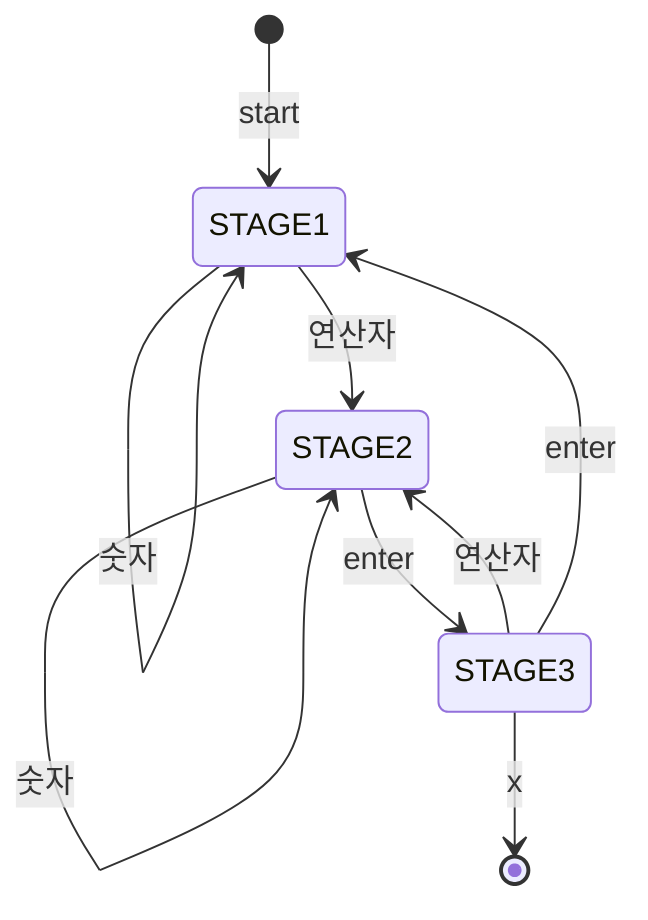
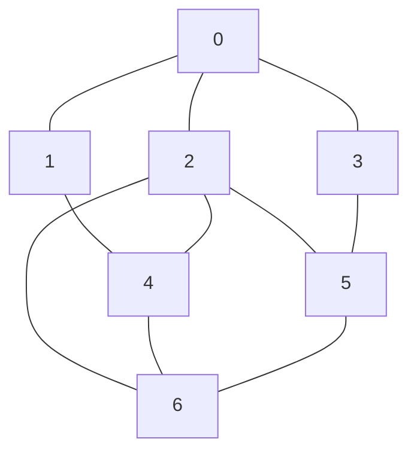

# 상태도 분석과 스택 활용 알고리즘

자료구조 9주차 수업(자료 C) 정리: 상태 전이도(STD)로 설계하는 정수 계산기, 스택 기반 수식 변환·계산, 회문 판별, 깊이 우선 탐색(DFS)

## 목차

- [1. 학습 범위](#1-학습-범위)
- [2. 상태 전이도 기반 정수 계산기](#2-상태-전이도-기반-정수-계산기)
- [3. 스택](#3-스택)
- [4. 중위표기식의 후위표기식 변환](#4-중위표기식의-후위표기식-변환)
- [5. 후위표기식 계산](#5-후위표기식-계산)
- [6. 회문 판별](#6-회문-판별)
- [7. 그래프 탐색 DFS](#7-그래프-탐색-dfs)
- [8. 공지사항](#8-공지사항)
- [9. 슬라이드 보정](#9-슬라이드-보정)
- [10. 검증 범위](#10-검증-범위)
- [11. 핵심 요약](#11-핵심-요약)

---

## 1. 학습 범위

- 상태 전이도(STD)로 알고리즘을 설계하는 방법
- 정수 계산기 `int_calculator()` 구현과 시뮬레이션
- 스택의 정의와 삽입·삭제 연산
- 중위표기식 → 후위표기식 변환 규칙 (괄호 없음 / 괄호 있음)
- 후위표기식 계산 알고리즘 `cal()`
- 배열 인덱스 방식과 스택 방식의 회문 판별
- 스택을 이용한 DFS (재귀 버전 / 반복 버전)

---

## 2. 상태 전이도 기반 정수 계산기

### 2.1 개념

**STD(State Transition Diagram)**: 입력에 따라 상태가 바뀌는 과정을 그림으로 표현한 알고리즘 설계 도구

- 상태: 원(STAGE)
- 전이: 입력이 적힌 화살표
- 시작 지점: `start`, 종료 지점: `end`

### 2.2 왜 필요한가

- 문제 해결 과정에 여러 상태가 섞이는 경우, `if` 중첩만으로는 흐름 추적이 어려움
- 상태와 전이를 먼저 그림으로 확정하면, 코드는 "현재 상태 + 입력 → 동작 + 다음 상태"의 반복으로 변환 가능

### 2.3 계산기 요구사항

- 입력: `0`~`9`로 이루어진 피연산자, 사칙연산자(`+ - * /`)
- `<Enter>` 입력 시 결과 출력
- `x` 입력 시 프로그램 종료
- 슬라이드 참조: `int_cal.c` (교재 335쪽~)

### 2.4 상태도



### 2.5 상태별 동작

| 현재 상태 | 입력 | 동작 | 다음 상태 |
| --- | --- | --- | --- |
| STAGE1 | 숫자 | `operand1 = get_int(operand1, c)` | STAGE1 |
| STAGE1 | 연산자 | `op = c`, `operand2 = 0` | STAGE2 |
| STAGE2 | 숫자 | `operand2 = get_int(operand2, c)` | STAGE2 |
| STAGE2 | Enter | `result = int_operation(...)`, `= result` 출력 | STAGE3 |
| STAGE3 | Enter | `operand1 = 0` | STAGE1 |
| STAGE3 | 연산자 | `op = c`, `operand1 = result`, `operand2 = 0` | STAGE2 |

- STAGE1: 첫 번째 피연산자 입력 중
- STAGE2: 연산자 입력 후 두 번째 피연산자 입력 중
- STAGE3: 결과 출력 완료. 연산자를 이어 입력하면 직전 결과로 계속 계산(연쇄 계산), Enter를 입력하면 새 계산 시작

### 2.6 코드

```c
#include <stdio.h>
#define STAGE1 0                // 상태 1: 첫 번째 피연산자 입력 중
#define STAGE2 1                // 상태 2: 두 번째 피연산자 입력 중
#define STAGE3 2                // 상태 3: 결과 출력 완료

void int_calculator(void);                          // 상태도를 구현한 계산기 본체
int int_operation(char op, int op1, int op2);       // 연산자에 따라 사칙연산 수행
int get_int(int current_operand, char c);           // 숫자 문자를 정수에 누적
int is_operator(char c);                            // 사칙연산자 여부 판별
int is_digit(char c);                               // 숫자 문자 여부 판별

int main(void)
{
    printf("계산기 프로그램을 시작합니다.\n");
    printf("정수형의 피연산자와 사칙연산자 중 하나를 입력하시오.\n");
    printf("결과를 받은 후 끝내려면 문자 x를 입력하시오\n");
    int_calculator();
    printf("\n계산기 프로그램을 종료합니다.\n");
    return 0;
}

void int_calculator(void)
{
    int operand1 = 0, operand2 = 0, result;     // 첫 번째 피연산자, 두 번째 피연산자, 계산 결과
    char op, c = '0';                           // op: 입력된 연산자, c: 방금 읽은 문자 (x가 아닌 값으로 초기화)
    int current_stage = STAGE1;                 // 현재 상태 (시작은 STAGE1)

    while (c != 'x') {                          // 목표: x가 입력될 때까지 문자를 한 글자씩 읽으며 상태 전이 반복
        c = getchar();                          // 키보드에서 문자 1개 입력
        if (current_stage == STAGE1) {          // 상태 1: 첫 번째 피연산자를 만드는 단계
            if (is_digit(c))                    // 숫자이면 첫 번째 피연산자에 자릿수 누적 (STAGE1 유지)
                operand1 = get_int(operand1, c);
            else if (is_operator(c)) {          // 연산자이면 저장하고 두 번째 피연산자 입력 단계로 이동
                op = c;
                current_stage = STAGE2;
                operand2 = 0;                   // 두 번째 피연산자 누적을 위해 초기화
            }
        }
        else if (current_stage == STAGE2) {     // 상태 2: 두 번째 피연산자를 만드는 단계
            if (is_digit(c))                    // 숫자이면 두 번째 피연산자에 자릿수 누적 (STAGE2 유지)
                operand2 = get_int(operand2, c);
            else if (c == '\n') {               // Enter이면 계산 실행 후 결과 출력 단계로 이동
                result = int_operation(op, operand1, operand2);
                printf("= %d", result);
                current_stage = STAGE3;
            }
        }
        else if (current_stage == STAGE3) {     // 상태 3: 결과를 보여준 뒤 다음 입력을 기다리는 단계
            if (c == '\n') {                    // Enter이면 새 계산 시작 (피연산자 초기화 후 STAGE1)
                operand1 = 0;
                current_stage = STAGE1;
            }
            else if (is_operator(c)) {          // 연산자이면 직전 결과로 이어서 계산 (연쇄 계산)
                op = c;
                current_stage = STAGE2;
                operand1 = result;              // 직전 결과를 첫 번째 피연산자로 사용
                operand2 = 0;
            }
        }
    }
}
```

### 2.7 보조 함수

```c
int int_operation(char op, int op1, int op2)
{
    int result;                                 // 연산 결과를 담을 변수
    switch (op) {                               // 목표: 연산자 문자(op)에 맞는 사칙연산 1가지 선택
        case '+': result = op1 + op2; break;    // 덧셈
        case '-': result = op1 - op2; break;    // 뺄셈
        case '*': result = op1 * op2; break;    // 곱셈
        case '/': result = op1 / op2; break;    // 나눗셈 (정수 나눗셈, 소수점 이하 버림)
    }
    return result;
}

int get_int(int current_operand, char c)
{
    int new_value = c - '0';      // 문자를 숫자로 변환 ('7' - '0' == 7)
    current_operand *= 10;        // 기존 값의 자릿수를 한 칸 올림
    current_operand += new_value; // 새 숫자를 일의 자리에 더함
    return current_operand;
}

int is_operator(char c)
{
    if (c == '+' || c == '-' || c == '*' || c == '/') return 1;   // 사칙연산자 중 하나이면 참
    else return 0;
}

int is_digit(char c)
{
    if (c >= '0' && c <= '9') return 1;   // 문자 '0'~'9' 범위이면 참
    else return 0;
}
```

**`get_int`**: 한 글자씩 들어오는 숫자 문자를 정수로 누적하는 함수

- `'2'` 입력 시: `0 * 10 + 2 = 2`
- 이어서 `'2'` 입력 시: `2 * 10 + 2 = 22`
- `c - '0'`: 문자 코드 간 차이로 숫자값 계산 (`'7' - '0' == 7`)

**`int_operation`**: 연산자와 두 피연산자를 받아 결과를 반환하는 함수

| 호출 | 결과 |
| --- | --- |
| `int_operation('+', 7, 3)` | `10` |
| `int_operation('-', 7, 3)` | `4` |
| `int_operation('*', 7, 3)` | `21` |
| `int_operation('/', 7, 3)` | `2` (정수 나눗셈, 소수점 이하 버림) |

### 2.8 시뮬레이션

입력: `22*4⏎` `-15⏎` `⏎` `25*4⏎` `x`

| 입력 | 상태 변화 | 변수 | 출력 |
| --- | --- | --- | --- |
| `2`, `2` | STAGE1 유지 | `operand1 = 22` | |
| `*` | STAGE1 → STAGE2 | `op = '*'` | |
| `4` | STAGE2 유지 | `operand2 = 4` | |
| Enter | STAGE2 → STAGE3 | `result = 88` | `= 88` |
| `-` | STAGE3 → STAGE2 | `op = '-'`, `operand1 = 88` | |
| `1`, `5` | STAGE2 유지 | `operand2 = 15` | |
| Enter | STAGE2 → STAGE3 | `result = 73` | `= 73` |
| Enter | STAGE3 → STAGE1 | `operand1 = 0` | |
| `2`, `5` | STAGE1 유지 | `operand1 = 25` | |
| `*`, `4`, Enter | STAGE1 → STAGE2 → STAGE3 | `result = 100` | `= 100` |
| `x` | 루프 종료 | | |

슬라이드 실행 화면 (Visual Studio 콘솔):

```text
계산기 프로그램을 시작합니다.
정수형의 피연산자와 사칙연산자 중 하나를 입력하시오.
결과를 받은 후 끝내려면 문자 x를 입력하시오
136/2
= 68-20
= 48*3
= 144
260/13
= 20x

계산기 프로그램을 종료합니다.
```

- `= 68-20`: 결과 `= 68` 직후 같은 줄에 사용자가 `-20`을 입력한 결과 (프로그램이 결과 뒤에 줄바꿈을 출력하지 않음)
- `= 144` 다음 줄에서 Enter만 입력하면 STAGE1 복귀, 이후 `260/13` 새 계산

### 2.9 주의점

- STAGE3에서 숫자 입력은 무시됨. Enter 없이 `25*4`를 입력하면 `2`, `5`가 버려지고 `*`부터 처리되어 직전 결과에 `* 4` 적용
  - 확인: `22*4⏎` `-15⏎` `25*4⏎` `x` 입력 시 출력 `= 88= 73= 292` (`73 * 4 = 292`)
- 0으로 나누기(`op2 == 0`)는 처리 코드 없음. C에서 정수 0 나누기는 미정의 동작
- `int_operation`의 `switch`에 `default` 없음. `op`가 사칙연산자 외 값이면 `result`가 초기화되지 않은 상태로 반환
- 상태도의 `.` 입력은 코드(`is_digit`)에서 처리하지 않음. 정수 전용 계산기

---

## 3. 스택

### 3.1 개념

**스택(Stack)**: 한쪽 끝(`top`)에서만 삽입과 삭제가 일어나는 선형 리스트

**LIFO(Last In First Out)**: 가장 나중에 들어간 데이터가 가장 먼저 나오는 구조

### 3.2 연산

필요 요소:

- `top`: 현재 스택 상태를 나타내는 변수 (빈 스택 = `-1`)
- `stack[]`: 데이터를 담는 배열

| 연산 | 절차 |
| --- | --- |
| 삽입(push, `add_stack`) | 스택이 full인지 확인 → `top++` → `stack[top] = data` |
| 삭제(pop, `delete_stack`) | 스택이 empty인지 확인 → 데이터 꺼내 사용 → `top--` |

### 3.3 구현 예

```c
#define MAX 100                 // 스택의 최대 크기
int stack[MAX];                 // 데이터를 담는 배열
int top = -1;                   // 가장 위 원소의 인덱스 (빈 스택 = -1)

int is_empty(void) { return top == -1; }        // 비었는지 검사
int is_full(void)  { return top == MAX - 1; }   // 가득 찼는지 검사

void add_stack(int data)
{
    if (is_full()) { printf("stack full\n"); return; }   // 가득 찼으면 삽입 거부 (배열 범위 초과 방지)
    stack[++top] = data;                                 // top을 올린 뒤 그 자리에 저장
}

int delete_stack(void)
{
    if (is_empty()) { printf("stack empty\n"); return -1; }  // 비었으면 삭제 거부 (빈 스택 접근 방지)
    return stack[top--];                                     // top 위치 값을 반환한 뒤 top 내림
}
```

- full 검사: 배열 범위를 넘는 쓰기 방지
- empty 검사: 빈 스택에서 꺼내는 오류 방지
- `stack[++top] = data` : `top++` 후 `stack[top] = data` 와 동일

---

## 4. 중위표기식의 후위표기식 변환

### 4.1 개념

연산자의 위치에 따른 수식 표기 방식:

| 표기 | 연산자 위치 | 예 |
| --- | --- | --- |
| 중위(infix) | 피연산자 사이 | `5 + 8 / 2` |
| 후위(postfix) | 피연산자 뒤 | `5 8 2 / +` |

### 4.2 왜 변환하는가

- 중위표기식은 연산자 우선순위 때문에 왼쪽에서 오른쪽으로 순서대로 계산되지 않음
- 중위표기식은 괄호를 가짐
- 후위표기식은 우선순위와 괄호가 순서 자체에 반영되어, 앞에서부터 한 번 읽는 것으로 계산 가능
- 컴파일러가 중위표기식을 후위표기식으로 변경하는 이유

변환 방법:

- 입력된 중위표기식을 읽어가며 처리
- 스택을 활용해 연산자 우선순위 반영
- 결과로 후위표기식 출력

### 4.3 변환 규칙 (1): 괄호 없는 경우

1. 피연산자는 그대로 출력
2. 스택이 비어 있을 때 만나는 연산자는 무조건 스택에 add
3. 처리하려는 연산자가 스택 top의 연산자보다 우선순위가 **높으면** 스택에 add
4. 그렇지 않으면 스택의 연산자를 delete하여 출력
5. 식을 끝까지 읽으면 스택의 연산자를 모두 delete하여 출력

### 4.4 변환 규칙 (2): 괄호 있는 경우

1. 왼쪽 괄호 `(`는 스택에 들어올 때 무조건 add. 스택에 들어온 뒤에는 우선순위가 가장 낮아져서 다음 연산자가 항상 add됨
2. 오른쪽 괄호 `)`는 왼쪽 괄호가 나올 때까지 스택 안의 모든 연산자를 출력. 괄호 자체는 출력하지 않음

### 4.5 예제 1: `5 + 8 / 2`

| 읽은 기호 | 동작 | 스택 (아래 → top) | 출력 |
| --- | --- | --- | --- |
| `5` | 출력 | (비어 있음) | `5` |
| `+` | 스택 비어 있음 → add | `+` | `5` |
| `8` | 출력 | `+` | `5 8` |
| `/` | `/`가 `+`보다 높음 → add | `+ /` | `5 8` |
| `2` | 출력 | `+ /` | `5 8 2` |
| 끝 | 스택 연산자 모두 delete | (비어 있음) | `5 8 2 / +` |

### 4.6 예제 2: `2 + ( 4 + 8 / ( 3 - 1 ) * 5 ) / 3`

| 읽은 기호 | 동작 | 스택 (아래 → top) | 출력 |
| --- | --- | --- | --- |
| `2` | 출력 | (비어 있음) | `2` |
| `+` | add | `+` | `2` |
| `(` | add | `+ (` | `2` |
| `4` | 출력 | `+ (` | `2 4` |
| `+` | add (`(` 위) | `+ ( +` | `2 4` |
| `8` | 출력 | `+ ( +` | `2 4 8` |
| `/` | add | `+ ( + /` | `2 4 8` |
| `(` | add | `+ ( + / (` | `2 4 8` |
| `3` | 출력 | `+ ( + / (` | `2 4 8 3` |
| `-` | add | `+ ( + / ( -` | `2 4 8 3` |
| `1` | 출력 | `+ ( + / ( -` | `2 4 8 3 1` |
| `)` | `(`까지 delete·출력, `(` 폐기 | `+ ( + /` | `2 4 8 3 1 -` |
| `*` | `/`가 `*`보다 낮지 않음 → `/` delete·출력 후 add | `+ ( + *` | `2 4 8 3 1 - /` |
| `5` | 출력 | `+ ( + *` | `2 4 8 3 1 - / 5` |
| `)` | `(`까지 delete·출력, `(` 폐기 | `+` | `2 4 8 3 1 - / 5 * +` |
| `/` | add | `+ /` | `2 4 8 3 1 - / 5 * +` |
| `3` | 출력 | `+ /` | `2 4 8 3 1 - / 5 * + 3` |
| 끝 | 스택 연산자 모두 delete | (비어 있음) | `2 4 8 3 1 - / 5 * + 3 / +` |

결과 후위표기식: `2 4 8 3 1 - / 5 * + 3 / +`

### 4.7 구현

```c
int prec(char op)               // 연산자 우선순위 반환 (스택 안에서 '(' 가 가장 낮음)
{
    if (op == '*' || op == '/') return 2;   // 곱셈·나눗셈: 높음
    if (op == '+' || op == '-') return 1;   // 덧셈·뺄셈: 낮음
    return 0;                               // '(' : 최저, 어떤 연산자든 위에 쌓을 수 있음
}

char stack_c[MAX];              // 연산자 보관용 char 스택
int top_c = -1;                 // char 스택의 top (빈 스택 = -1)
void push_c(char c) { stack_c[++top_c] = c; }       // 연산자 삽입
char pop_c(void)    { return stack_c[top_c--]; }    // 연산자 삭제 후 반환

void to_postfix(const char *infix, char *out)       // infix: 입력 중위표기식, out: 출력 후위표기식
{
    int k = 0;                  // out 배열에 기록할 위치
    top_c = -1;                 // 스택 비우기
    for (; *infix; infix++) {   // 목표: 중위표기식을 문자열 끝('\0')까지 한 글자씩 읽기
        char c = *infix;        // 현재 읽은 기호
        if (c == ' ') continue; // 공백은 건너뜀
        if (c >= '0' && c <= '9')                            // 피연산자이면
            out[k++] = c;                                    //   그대로 출력
        else if (c == '(')                                   // 왼쪽 괄호이면
            push_c(c);                                       //   무조건 스택에 삽입
        else if (c == ')') {                                 // 오른쪽 괄호이면
            while (top_c >= 0 && stack_c[top_c] != '(')      //   목표: '(' 를 만날 때까지 스택의 연산자를 모두 꺼내 출력
                out[k++] = pop_c();
            pop_c();                                         //   '(' 는 출력하지 않고 폐기
        }
        else {                                               // 연산자이면
            while (top_c >= 0 && prec(stack_c[top_c]) >= prec(c))   //   목표: 스택 top이 같거나 높은 우선순위인 동안 꺼내 출력
                out[k++] = pop_c();
            push_c(c);                                       //   현재 연산자를 스택에 삽입
        }
    }
    while (top_c >= 0) out[k++] = pop_c();                   // 목표: 식을 다 읽은 뒤 스택에 남은 연산자를 모두 출력
    out[k] = '\0';                                           // 문자열 종료 표시
}
```

- `prec(스택 top) >= prec(c)`: 스택 top이 같거나 높으면 먼저 출력. 같은 우선순위에서 왼쪽 연산자를 먼저 계산하기 위한 조건
- `stack_c`, `top_c`, `push_c`, `pop_c`: 문자(`char`)용 스택. 3.3의 `int` 스택(`stack`, `top`)과 구조는 같고 변수만 분리
- 피연산자는 한 자리 숫자 가정

---

## 5. 후위표기식 계산

### 5.1 알고리즘

문자배열에 저장된 후위표기식을 읽어가면서:

1. 피연산자는 스택에 넣음 (`add_stack`)
2. 연산자를 만나면 스택에서 피연산자 2개(`op2`, `op1` 순서)를 꺼내(`delete_stack`) 계산하고, 그 결과를 스택에 넣음 (`add_stack`)
3. 후위표기식 끝까지 반복하면 스택에 마지막으로 남은 값이 계산 결과

슬라이드 참조: `pcal.c`

- 먼저 꺼낸 값이 `op2`(오른쪽 피연산자), 나중에 꺼낸 값이 `op1`(왼쪽). 계산은 `op1 연산자 op2`. 순서를 바꾸면 `-`, `/` 결과가 달라짐

### 5.2 `cal()` 구현

```c
int cal(void)
{
    char symbol;                // 후위표기식에서 현재 읽은 기호
    int op1, op2, n = 0;        // op1: 왼쪽 피연산자, op2: 오른쪽 피연산자, n: pexpr 읽기 위치

    top = -1;                   // 스택 비우기
    symbol = pexpr[n++];        // 첫 기호 읽기
    while (symbol != '\0') {    // 목표: 후위표기식 끝('\0')까지 기호를 하나씩 처리
        if (symbol >= '0' && symbol <= '9')     // 피연산자이면
            add_stack(symbol - '0');            //   숫자로 변환해 스택에 삽입
        else {                                  // 연산자이면
            op2 = delete_stack();               //   먼저 꺼낸 값 = 오른쪽 피연산자
            op1 = delete_stack();               //   나중에 꺼낸 값 = 왼쪽 피연산자
            switch (symbol) {                   //   목표: 연산자 종류에 맞게 op1 (연산자) op2 계산 후 결과를 스택에 삽입
                case '+': add_stack(op1 + op2); break;
                case '-': add_stack(op1 - op2); break;
                case '*': add_stack(op1 * op2); break;
                case '/': add_stack(op1 / op2); break;
            }
        }
        symbol = pexpr[n++];    // 다음 기호 읽기
    }
    return delete_stack();      // 스택에 마지막으로 남은 값 = 수식 계산 결과
}
```

- 슬라이드의 `// 코드 채우기` 부분은 `while` 본문의 `if ~ else` 블록
- `pexpr`: 후위표기식을 담은 문자배열 (전역)

### 5.3 시뮬레이션: `2 + ( 4 + 8 / ( 3 - 1 ) * 5 ) / 3`

후위표기식 `2 4 8 3 1 - / 5 * + 3 / +`

| 읽은 기호 | 동작 | 스택 (아래 → top) |
| --- | --- | --- |
| `2` | push | `2` |
| `4` | push | `2 4` |
| `8` | push | `2 4 8` |
| `3` | push | `2 4 8 3` |
| `1` | push | `2 4 8 3 1` |
| `-` | `3 - 1 = 2` | `2 4 8 2` |
| `/` | `8 / 2 = 4` | `2 4 4` |
| `5` | push | `2 4 4 5` |
| `*` | `4 * 5 = 20` | `2 4 20` |
| `+` | `4 + 20 = 24` | `2 24` |
| `3` | push | `2 24 3` |
| `/` | `24 / 3 = 8` | `2 8` |
| `+` | `2 + 8 = 10` | `10` |

결과: `10`

### 5.4 스스로 하기: `(6 / (8 - 2 * 3)) + 8 / 4`

후위표기식: `6 8 2 3 * - / 8 4 / +`

| n | symbol | `cal()`에서 수행한 함수 | top |
| --- | --- | --- | --- |
| 0 | `6` | `add_stack(6)` | 0 |
| 1 | `8` | `add_stack(8)` | 1 |
| 2 | `2` | `add_stack(2)` | 2 |
| 3 | `3` | `add_stack(3)` | 3 |
| 4 | `*` | `delete_stack()` ×2 (3, 2) → `2 * 3 = 6` → `add_stack(6)` | 2 |
| 5 | `-` | `delete_stack()` ×2 (6, 8) → `8 - 6 = 2` → `add_stack(2)` | 1 |
| 6 | `/` | `delete_stack()` ×2 (2, 6) → `6 / 2 = 3` → `add_stack(3)` | 0 |
| 7 | `8` | `add_stack(8)` | 1 |
| 8 | `4` | `add_stack(4)` | 2 |
| 9 | `/` | `delete_stack()` ×2 (4, 8) → `8 / 4 = 2` → `add_stack(2)` | 1 |
| 10 | `+` | `delete_stack()` ×2 (2, 3) → `3 + 2 = 5` → `add_stack(5)` | 0 |
| 끝 | `\0` | `delete_stack()` → `5` 반환 | -1 |

- `top`은 해당 `symbol` 처리 직후의 값 (빈 스택 = `-1`)
- `delete_stack()` 괄호 안 숫자는 꺼낸 순서 (`op2`, `op1`)

---

## 6. 회문 판별

### 6.1 개념

**회문(palindrome)**: 앞에서부터 읽으나 뒤에서부터 읽으나 같은 문장 또는 단어

- 예: `rotator`, `mom`, `wow`, `noon`, `radar`, `level`
- 판별 방법: 단어 길이의 중간 위치를 기준으로 양쪽 끝에서부터 안쪽으로 비교

```text
r o t a t o r      (slen = 7, slen/2 = 3)
0 1 2 3 4 5 6
k=0: [0] r ↔ [6] r
k=1: [1] o ↔ [5] o
k=2: [2] t ↔ [4] t
가운데 [3] a 는 비교 불필요
```

### 6.2 배열 인덱스 방식 (`pal_basic.c` 참고)

```c
int palindrome_check(char *cword)
{
    int slen, k;                // slen: 단어 길이, k: 앞쪽에서 비교할 위치

    slen = strlen(cword);
    for (k = 0; k < slen / 2; k++) {                // 목표: 앞 절반만 순회하며 대칭 위치의 문자와 비교
        if (cword[k] != cword[slen - 1 - k])        // 앞의 k번째와 뒤의 k번째가 다르면
            return 0;                               //   하나라도 다르면 회문 아님
    }
    return 1;                                       // 끝까지 모두 같으면 회문
}
```

- 반복 횟수: `slen / 2`
- 짝수 길이(`noon`)와 홀수 길이(`rotator`) 모두 동일하게 처리

### 6.3 스택 방식 (`pal_stack.c` 참고, 교재 224쪽 확인학습 5-6)

**원리**: 각 문자를 모두 스택에 넣고 빼면, LIFO 특성에 의해 역순으로 나옴. 역순 문자열과 원래 단어를 비교

```c
int palindrome_stack(char *word)
{
    int i, slen, p = 1;         // i: 반복 인덱스, slen: 단어 길이, p: 회문 여부 (1 = 회문, 0 = 아님)
    char schar, ochar;          // schar: 스택에서 꺼낸 문자, ochar: 원래 단어의 문자

    top = -1;                   // 스택 비우기
    slen = strlen(word);
    for (i = 0; i < slen; i++)  // 목표: 단어의 모든 문자를 앞에서부터 스택에 삽입
        push(word[i]);

    for (i = 0; i < slen; i++) {    // 목표: 스택에서 꺼낸 문자(역순)와 원래 단어(정순)를 한 글자씩 비교
        schar = pop();          // 스택에서 나온 문자 (뒤에서부터)
        ochar = word[i];        // 원래 단어의 문자 (앞에서부터)
        if (schar != ochar) {   // 다르면 회문이 아니므로
            p = 0;              //   결과를 0으로 설정하고
            break;              //   비교 중단
        }
    }
    return p;                   // p == 1 이면 "True" 출력
}
```

| 단어 | 배열 인덱스 방식 | 스택 방식 |
| --- | --- | --- |
| `rotator` | 1 (회문) | 1 |
| `level` | 1 | 1 |
| `noon` | 1 | 1 |
| `stack` | 0 | 0 |
| `ab` | 0 | 0 |

- 스택 방식은 전체 길이를 비교(`slen`회). 인덱스 방식은 절반(`slen/2`회)

---

## 7. 그래프 탐색 DFS

### 7.1 개념

**DFS(Depth First Search, 깊이 우선 탐색)**: 시작 정점에서 갈 수 있는 한 방향으로 끝까지 들어간 뒤, 더 갈 곳이 없으면 되돌아와 다른 방향을 탐색하는 방법

- 되돌아오는 동작 = 스택의 후입선출 (재귀 호출 시스템 스택 또는 직접 만든 스택)
- 방문 여부를 `already_visited[]`로 기록해 같은 정점의 재방문과 무한 순환 방지

### 7.2 예제 그래프와 인접 리스트



간선: `0-1, 0-2, 0-3, 1-4, 2-4, 2-5, 2-6, 3-5, 4-6, 5-6` (무방향. 인접 리스트에는 양방향으로 저장)

| 정점 | 인접 리스트 |
| --- | --- |
| 0 | 1 → 2 → 3 → NULL |
| 1 | 0 → 4 → NULL |
| 2 | 0 → 4 → 5 → 6 → NULL |
| 3 | 0 → 5 → NULL |
| 4 | 1 → 2 → 6 → NULL |
| 5 | 2 → 3 → 6 → NULL |
| 6 | 2 → 4 → 5 → NULL |

자료구조 정의:

```c
#define MAX_V 50                       // 정점의 최대 수
typedef struct vertex *vertex_pointer; // 정점 노드를 가리키는 포인터 타입
struct vertex {
    int vertex_num;                    // 인접한 정점의 번호
    vertex_pointer link;               // 인접 리스트의 다음 노드 (끝이면 NULL)
};
vertex_pointer graph[MAX_V];           // 정점별 인접 리스트의 헤드
int already_visited[MAX_V];            // 방문 여부 (0 = 미방문, 1 = 방문)
```

### 7.3 재귀 버전

```c
void dfs(int s)
{
    vertex_pointer v;                       // 인접 리스트를 따라 이동할 포인터
    already_visited[s] = 1;                 // 현재 정점 s를 방문 처리
    printf("%d :: ", s);                    // 방문 순서 출력
    for (v = graph[s]; v != NULL; v = v->link)      // 목표: s의 인접 리스트를 처음부터 끝(NULL)까지 순회
        if (already_visited[v->vertex_num] == 0)    // 아직 방문하지 않은 인접 정점이면
            dfs(v->vertex_num);                     //   그 정점으로 재귀 호출 (깊이 우선으로 더 들어감)
}
```

### 7.4 반복(스택) 버전

반복문으로 스택의 활용이 드러나는 구현

```c
void dfs_stack(int s)
{
    vertex_pointer v;           // 인접 리스트를 따라 이동할 포인터
    int cur, i, cnt;            // cur: 이번에 꺼낸 정점, i: 반복 인덱스, cnt: tmp에 모은 정점 개수
    int tmp[MAX_V];             // 미방문 인접 정점을 임시로 모아두는 배열

    top = -1;                   // 스택 비우기
    push(s);                    // 시작 정점을 스택에 삽입
    while (!is_empty()) {       // 목표: 스택이 빌 때까지 정점을 꺼내 방문 (되돌아오기 = pop)
        cur = pop();
        if (already_visited[cur]) continue;     // 이미 방문한 정점이면 건너뜀 (중복 push 대비)
        already_visited[cur] = 1;               // 방문 처리
        printf("%d :: ", cur);

        // 인접 리스트 순서대로 방문하려면 역순으로 push 해야 함
        cnt = 0;
        for (v = graph[cur]; v != NULL; v = v->link)    // 목표: 인접 리스트 순회하며 미방문 정점만 tmp에 저장
            if (already_visited[v->vertex_num] == 0)
                tmp[cnt++] = v->vertex_num;
        for (i = cnt - 1; i >= 0; i--)                  // 목표: tmp를 뒤에서부터 push (리스트 첫 정점이 top에 오도록)
            push(tmp[i]);
    }
}
```

**역순 push 이유**: 스택은 나중에 넣은 것이 먼저 나옴. 인접 리스트의 첫 번째 정점을 가장 먼저 방문하려면 마지막에 push해야 함

### 7.5 실행 결과

```text
시작 정점 s를 입력하세요 (0~6): 0
[재귀 dfs(0)]  방문 순서: 0 :: 1 :: 4 :: 2 :: 5 :: 3 :: 6 ::
[스택 dfs(0)]  방문 순서: 0 :: 1 :: 4 :: 2 :: 5 :: 3 :: 6 ::
```

두 구현의 방문 순서 동일

### 7.6 스택 버전 추적 (시작 정점 0)

| 단계 | pop | 동작 | 스택 (아래 → top) |
| --- | --- | --- | --- |
| 시작 | | `push(0)` | `0` |
| 1 | 0 | 방문. 미방문 인접 1, 2, 3을 역순(3, 2, 1) push | `3 2 1` |
| 2 | 1 | 방문. 미방문 인접 4 push | `3 2 4` |
| 3 | 4 | 방문. 미방문 인접 2, 6을 역순(6, 2) push | `3 2 6 2` |
| 4 | 2 | 방문. 미방문 인접 5, 6을 역순(6, 5) push | `3 2 6 6 5` |
| 5 | 5 | 방문. 미방문 인접 3, 6을 역순(6, 3) push | `3 2 6 6 6 3` |
| 6 | 3 | 방문. 미방문 인접 없음 | `3 2 6 6 6` |
| 7 | 6 | 방문. 미방문 인접 없음 | `3 2 6 6` |
| 8~11 | 6, 6, 2, 3 | 모두 이미 방문 → `continue` | (비어 있음) |

방문 순서: `0 → 1 → 4 → 2 → 5 → 3 → 6`

### 7.7 주의점

- 스택 버전은 같은 정점이 스택에 중복으로 들어갈 수 있음 (위 추적의 `6`이 3회 push). 그래서 pop 시점에 `already_visited` 재확인이 필수
- 중복 push 때문에 스택 크기를 `MAX_V`로 잡으면 부족할 수 있음. 간선 수 이상의 크기 필요
- 재귀 버전은 정점 수가 매우 많으면 호출 깊이 초과(스택 오버플로) 위험

---

## 9. 슬라이드 보정

- **연산자 우선순위 비교 (규칙 3)**: 슬라이드 문구는 "높으면 add, 아니면 delete". 실제 구현은 add 조건이 될 때까지 **반복해서** delete
  - 예: `1+2*3-4` → `-` 도착 시 스택 `+ *`에서 `*` 출력, `+` 출력 후 `-` push. 결과 `1 2 3 * + 4 -`
- **같은 우선순위**: "높으면 add" 문구상 같은 경우는 delete 쪽. 구현에서 `>=` 비교 필요 (`8/2*3`을 왼쪽부터 계산하기 위함)
- **괄호**: `(`, `)` 모두 출력되지 않음
- **상태도의 `.`**: STAGE1·2 루프 화살표에 `.`이 적혀 있으나, 코드는 `0`~`9`만 숫자로 인식
- **STAGE3의 `x`**: 상태도는 STAGE3에서만 `end`로 이동. 코드는 `while (c != 'x')` 조건이므로 어느 상태에서든 `x` 입력 시 종료
- **한 자리 피연산자**: 후위표기식 변환·계산 예제는 한 자리 숫자만 가정 (`symbol - '0'`). 여러 자리 숫자는 구분자 처리 필요

---

## 10. 검증 범위

- 방법: 이 문서의 C 코드를 `gcc -Wall`로 컴파일하고 실행하여 출력 비교 (Linux 환경). 컴파일 경고 없음
- 확인한 항목
  - `int_calculator`: 입력 `136/2⏎-20⏎*3⏎⏎260/13⏎x` → `68`, `48`, `144`, `20` (슬라이드 실행 화면과 일치)
  - `int_calculator`: 입력 `22*4⏎-15⏎25*4⏎x` → `88`, `73`, `292` (2.9 주의점)
  - 후위 변환·계산: `5+8/2` → `582/+` = 9, `2+(4+8/(3-1)*5)/3` → `24831-/5*+3/+` = 10, `(6/(8-2*3))+8/4` → `6823*-/84/+` = 5, `1+2*3-4` → `123*+4-` = 3 (9장 보정 예시)
  - 5.4 시뮬레이션 표: 실행 추적 출력과 일치
  - 회문 판별: 두 방식 모두 6.3 표의 결과
  - DFS: 슬라이드 인접 리스트 재현, 재귀·스택 모두 `0 1 4 2 5 3 6`
- 실행하지 않은 항목: 4.6·7.6의 단계별 표는 변환 규칙을 손으로 적용한 추적. 최종 결과(후위표기식, 방문 순서)만 실행 결과와 대조
- 그림(7.2의 ASCII 그래프)은 개략도. 정확한 간선은 표와 간선 목록 기준

---

## 11. 핵심 요약

| 주제 | 핵심 |
| --- | --- |
| STD | 상태·전이를 그림으로 먼저 설계 → "상태 + 입력 → 동작 + 다음 상태"로 코딩 |
| 스택 | LIFO, `top`과 배열로 구현, push 전 full 검사·pop 전 empty 검사 |
| 중위 → 후위 | 피연산자 즉시 출력, 연산자는 스택 top과 우선순위 비교, `(`는 무조건 push, `)`는 `(`까지 pop |
| 후위 계산 | 피연산자 push, 연산자 만나면 2개 pop(`op2`, `op1`) 후 계산 결과 push |
| 회문 | 인덱스: 양 끝에서 `slen/2`회 비교 / 스택: 역순 출력과 원본 비교 |
| DFS | 한 방향 끝까지 → 되돌아옴. 재귀 = 시스템 스택, 반복 = 직접 스택(역순 push, pop 시 방문 재확인) |
