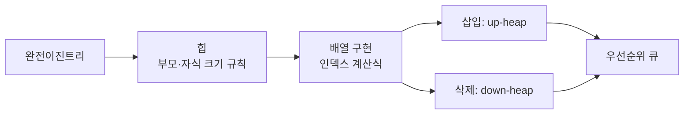
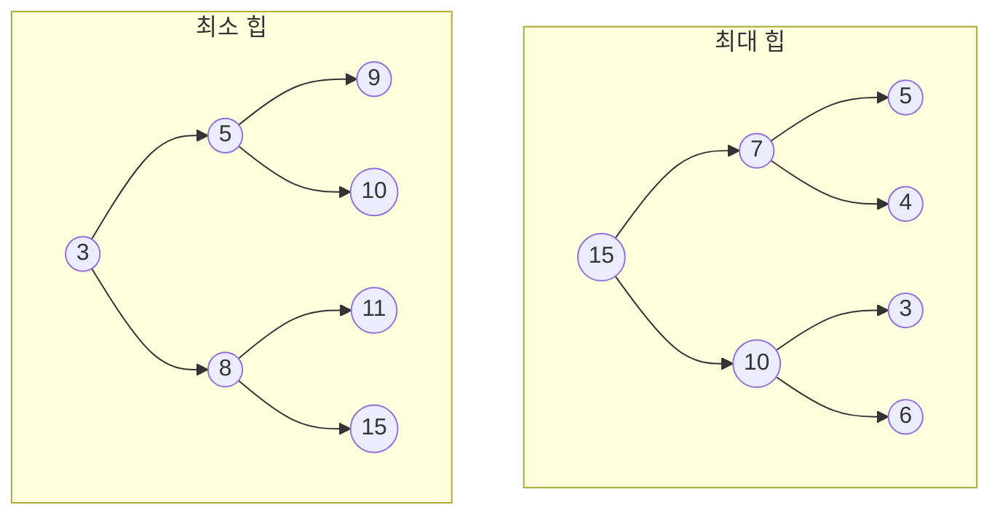
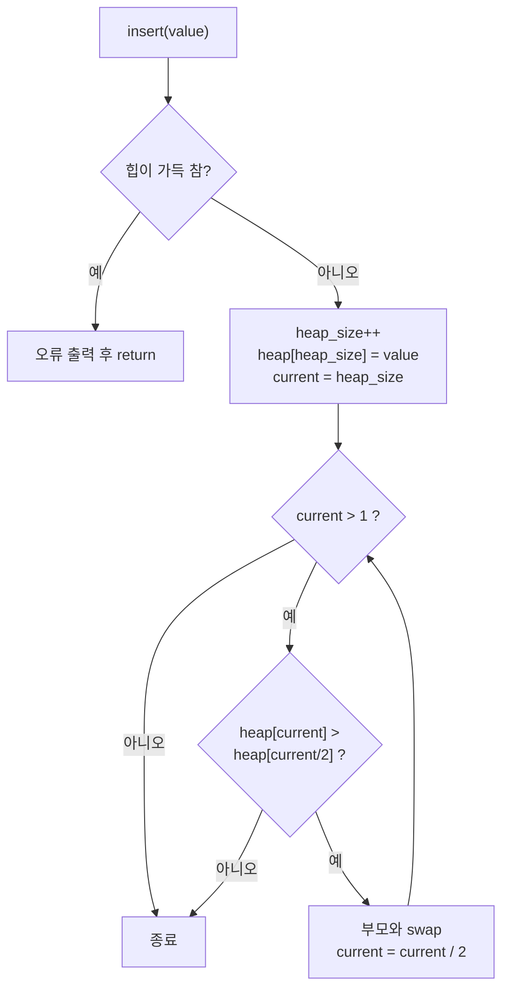
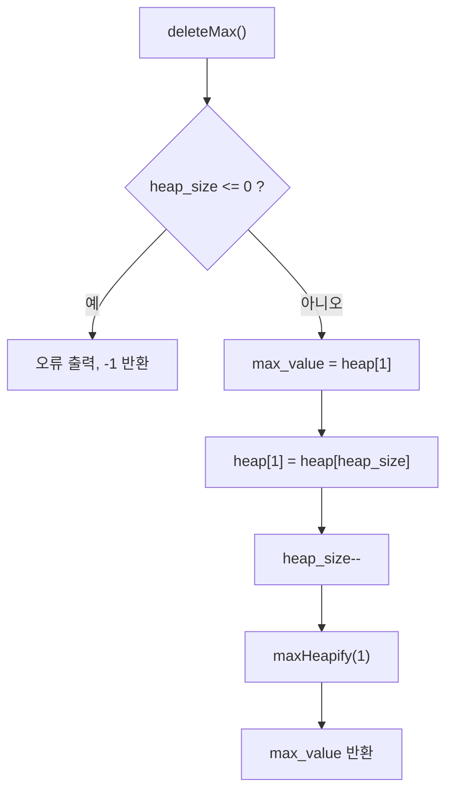
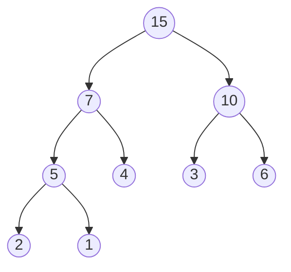
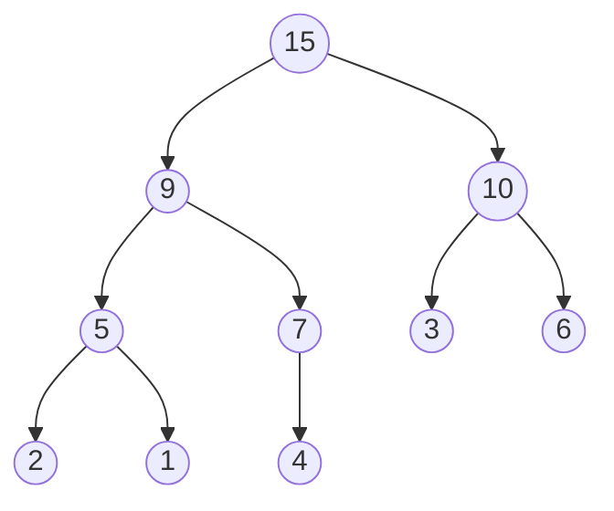
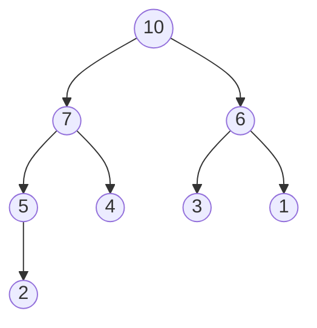
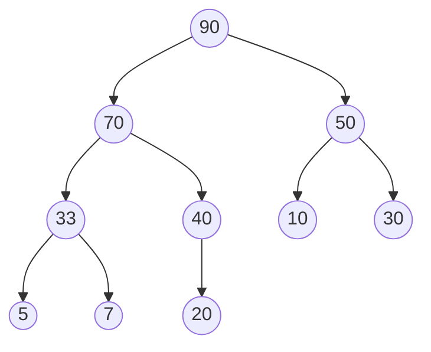
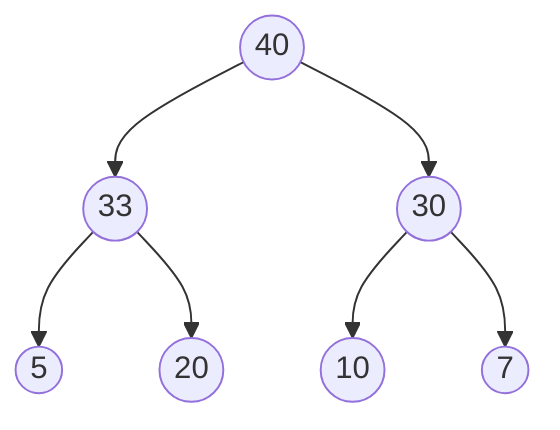

# 11주차 강의 정리: 힙과 우선순위 큐

- **강의 자료**: `11주차_Heap_학생.pdf` (16쪽)
- **수업활동 자료**: `2026_11주차힙수업정리1112YC.pdf` (4쪽)
- **실습 코드**: `heapex_to_fill5.txt` (빈칸 5곳)
- **과목**: 자료구조
- **이번 주**: 트리의 응용, 힙(heap)과 힙 기반 우선순위 큐

---

## 1. 한눈에 보는 오늘 내용

| 구분 | 내용 |
|---|---|
| 힙 정의 | 완전이진트리 + 부모·자식 키 크기 규칙 |
| 힙 종류 | 최대 힙(max heap), 최소 힙(min heap) |
| 힙 높이 | n개 노드 → 약 log₂n |
| 구현 방식 | 배열 (인덱스 1부터 사용) |
| 삽입 | 마지막 위치에 추가 → 위로 교환 (up-heap) |
| 삭제 | 루트 제거 → 마지막 노드를 루트로 → 아래로 교환 (down-heap) |
| 우선순위 큐 | 우선순위가 가장 높은 데이터가 먼저 나가는 큐 |
| 구현 비교 | 힙: 삽입·삭제 모두 O(log n) |



---

## 2. 힙이란

> **쉬운 정의:** 가장 큰 값(또는 가장 작은 값)을 항상 맨 위에 두는 정리된 더미

### 정확한 개념

- **힙(heap)**: 완전이진트리이면서 부모와 자식 사이의 키 크기 규칙을 만족하는 트리
- **완전이진트리**: 마지막 레벨을 제외한 모든 레벨이 가득 차 있고, 마지막 레벨은 왼쪽부터 채워진 이진트리
- **최대 힙(max heap)**: key(부모) > key(자식), 루트가 최댓값
- **최소 힙(min heap)**: key(부모) < key(자식), 루트가 최솟값

### 왜 필요한가

- 최댓값(최우선 데이터)을 매번 빠르게 꺼내야 하는 상황 존재
- 배열 전체 탐색은 O(n), 정렬 유지는 삽입이 O(n) → 힙은 둘 다 O(log n)

### 아주 간단한 핵심 예시

| 부모 | 자식 | 최대 힙 규칙 |
|---|---|---|
| 15 | 7, 10 | 15 > 7, 15 > 10 → 만족 |
| 7 | 5, 4 | 7 > 5, 7 > 4 → 만족 |
| 10 | 3, 6 | 10 > 3, 10 > 6 → 만족 |



### 주의점

- 규칙은 부모와 자식 사이에만 적용
- 형제 노드(7과 10)끼리의 크기 순서는 규정 없음
- 최대 힙의 두 번째로 큰 값은 루트의 자식 중 하나일 뿐, 정렬된 상태가 아님

---

## 3. 힙의 높이

> **쉬운 정의:** 노드가 두 배로 늘어날 때마다 층이 하나씩만 늘어나는 구조

### 정확한 개념

- 완전이진트리라서 n개 노드의 높이는 log₂n 수준
- 마지막 레벨을 제외하면 레벨 k에는 2^(k-1)개의 노드 존재

| 레벨 | 노드 개수 |
|---|---|
| 1 | 1 = 2⁰ |
| 2 | 2 = 2¹ |
| 3 | 4 = 2² |
| 4 | 8 = 2³ |

### 왜 필요한가

- 삽입·삭제가 최대 높이만큼만 비교·교환 → 시간복잡도 O(log n)의 근거

### 아주 간단한 핵심 예시

| n | log₂n |
|---|---|
| 8 | 3 |
| 16 | 4 |
| 32 | 5 |
| 64 | 6 |
| 128 | 7 |
| 256 | 8 |
| 512 | 9 |
| 1024 | 10 |

- **레벨 수(깊이) 공식**: ⌊log₂n⌋ + 1
- **n = 10**: 2³ = 8 ≤ 10 < 16 → 레벨 4
- **n = 60**: 2⁵ = 32 ≤ 60 < 64 → 레벨 6

### 주의점

- 강의 표기는 "log n", 문제에서 묻는 깊이는 레벨 수 기준
- 단순 log₂n에서 1을 더하는 점 주의 (10개 → log₂10 ≈ 3.3이지만 깊이는 4)
- 깊이를 층 수가 아닌 간선 수로 세는 교재도 있으므로 수업에서 쓰는 기준 확인

---

## 4. 배열로 구현하는 힙

> **쉬운 정의:** 트리 노드에 위에서 아래, 왼쪽에서 오른쪽 순서로 번호를 붙여 배열 칸에 그대로 넣는 방식

### 정확한 개념

- 완전이진트리는 중간에 빈 노드가 없어서 번호 순서대로 배열에 빈칸 없이 저장 가능
- 포인터 없이 계산식만으로 부모·자식 위치 확인
- 관례: 인덱스 0은 비우고 인덱스 1을 루트로 사용 (`MAX_HEAP_SIZE`를 101로 잡는 이유)

| 관계 | 인덱스 계산 |
|---|---|
| 왼쪽 자식 | `2 * i` |
| 오른쪽 자식 | `2 * i + 1` |
| 부모 | `i / 2` (정수 나눗셈) |

### 왜 필요한가

- 연결 구조는 부모를 찾으려면 부모 포인터를 따로 저장해야 함
- 배열은 나눗셈 한 번으로 부모 접근 → up-heap에 유리

### 아주 간단한 핵심 예시

```c
int i = 5;
printf("부모: %d\n", i / 2);        // 부모 인덱스
printf("왼쪽: %d\n", 2 * i);        // 왼쪽 자식 인덱스
printf("오른쪽: %d\n", 2 * i + 1);  // 오른쪽 자식 인덱스
```

### 예상 결과 (손 추적)

```text
부모: 2
왼쪽: 10
오른쪽: 11
```

- 검증: 인덱스 10, 5, 3에 대한 `i/2`, `2i`, `2i+1` 계산은 실제 실행으로 확인 (부모(10)=5, 부모(5)=2, 왼쪽(3)=6, 오른쪽(3)=7)

### 그 결과가 나온 이유

- 5 / 2 = 2 (정수 나눗셈은 소수점 버림)
- 2 × 5 = 10, 2 × 5 + 1 = 11

### 배열 예시 (PDF 4쪽 최소 힙)

| 인덱스 | 1 | 2 | 3 | 4 | 5 | 6 | 7 |
|---|---|---|---|---|---|---|---|
| 값 | 3 | 5 | 8 | 9 | 10 | 11 | 15 |

- 인덱스 2(값 5)의 자식: 인덱스 4, 5 (값 9, 10)
- 인덱스 5(값 10)의 부모: 5 / 2 = 2 (값 5)

### 주의점

- 인덱스 0부터 시작하면 공식이 달라짐 (왼쪽 `2i+1`, 오른쪽 `2i+2`, 부모 `(i-1)/2`)
- 자식 인덱스가 `heap_size`보다 크면 자식이 없는 것이므로 범위 검사 필수

---

## 5. 삽입 연산: up-heap

> **쉬운 정의:** 새 값을 맨 끝에 놓고, 부모보다 크면 한 칸씩 위로 올려 자리를 찾는 방식

### 정확한 개념

- **1단계**: 새 노드를 힙의 마지막 위치에 추가 (완전이진트리 모양 유지)
- **2단계**: 부모와 비교해 새 노드가 더 크면 교환
- **3단계**: 부모보다 작거나 루트에 도달하면 종료
- 최대 교환 횟수는 트리 높이 → O(log n)

### 왜 필요한가

- 맨 끝에 놓기만 하면 모양은 유지되지만 크기 규칙이 깨질 수 있음
- 위로만 올리면 규칙 복구 가능 (아래쪽 서브트리는 영향 없음)

### 코드 흐름



### 코드

```c
// 힙에 value를 삽입하고 up-heap으로 최대 힙 규칙 복원
void insert(int value) {
    // 배열이 가득 찼으면 삽입 불가
    if (heap_size >= MAX_HEAP_SIZE - 1) {
        printf("오류: 힙이 가득 찼습니다. 삽입 실패\n");
        return;
    }
    heap_size++;                  // 마지막 위치 확보
    int current = heap_size;
    heap[current] = value;        // 새 값을 맨 끝에 저장

    // 루트에 도달하거나 규칙이 만족될 때까지 위로 이동
    while (current > 1) {
        int parent = current / 2;
        // 부모보다 크면 교환하고 한 층 위로 이동
        if (heap[current] > heap[parent]) {      // 빈칸 2번 정답
            swap(&heap[current], &heap[parent]);
            current = parent;
        }
        // 부모보다 작거나 같으면 제자리 확정
        else {
            break;
        }
    }
}
```

### 아주 간단한 핵심 예시

- 힙 `[15, 9, 10, 5, 7, 3, 6, 2, 1]`에 `20` 삽입

```text
[15, 9, 10, 5, 7, 3, 6, 2, 1, 20]    인덱스 10에 추가, 부모는 인덱스 5(7)
[15, 9, 10, 5, 20, 3, 6, 2, 1, 7]    20 > 7 → 교환, 부모는 인덱스 2(9)
[15, 20, 10, 5, 9, 3, 6, 2, 1, 7]    20 > 9 → 교환, 부모는 인덱스 1(15)
[20, 15, 10, 5, 9, 3, 6, 2, 1, 7]    20 > 15 → 교환, 루트 도달 → 종료
```

- 이 예시는 손으로 추적한 뒤 C 코드로 실행해 결과 일치 확인

### 주의점

- 부모와 값이 같을 때(`>` 아닌 `>=`)는 교환하지 않아도 규칙이 유지되므로 `>` 사용
- 최소 힙은 비교 방향만 반대 (`<`)

---

## 6. 삭제 연산: down-heap

> **쉬운 정의:** 맨 위 값을 꺼내고, 맨 끝 값을 맨 위에 올린 뒤 더 큰 자식과 자리를 바꾸며 아래로 내려보내는 방식

### 정확한 개념

- **1단계**: 루트(최댓값) 별도 저장
- **2단계**: 마지막 노드를 루트로 이동
- **3단계**: 힙 크기 1 감소
- **4단계**: 루트에서 시작해 두 자식 중 더 큰 값과 비교, 자식이 더 크면 교환하며 아래로 반복
- 최대 교환 횟수는 트리 높이 → O(log n)

### 왜 필요한가

- 루트를 지우면 빈자리가 생겨 트리 모양이 깨짐
- 마지막 노드를 루트로 옮기면 모양은 유지되고 규칙만 깨짐 → 아래로 내려 복구

### 코드 흐름



### 코드

```c
// 루트(최댓값)를 꺼내 반환하고 down-heap으로 규칙 복원
int deleteMax() {
    // 비어 있으면 삭제 불가
    if (heap_size <= 0) {
        printf("오류: 힙이 비어 있습니다. 삭제 실패\n");
        return -1;
    }
    int max_value = heap[1];         // 빈칸 3번 정답: 루트 저장
    heap[1] = heap[heap_size];       // 빈칸 4번 정답: 마지막 노드를 루트로
    heap_size--;
    maxHeapify(1);                   // 빈칸 5번 정답: 루트부터 down-heap
    return max_value;
}

// 인덱스 i를 루트로 하는 서브트리의 최대 힙 규칙 복원
void maxHeapify(int i) {
    int largest = i;                 // 현재 노드를 가장 큰 값으로 가정
    int left = 2 * i;
    int right = 2 * i + 1;

    // 왼쪽 자식이 범위 안이고 더 크면 largest 갱신
    if (left <= heap_size && heap[left] > heap[largest])
        largest = left;
    // 오른쪽 자식이 범위 안이고 더 크면 largest 갱신
    if (right <= heap_size && heap[right] > heap[largest])
        largest = right;

    // 자식 중 더 큰 값이 있으면 교환하고 그 위치에서 재귀 호출
    if (largest != i) {
        swap(&heap[i], &heap[largest]);
        maxHeapify(largest);         // 빈칸 1번 정답: 재귀 호출
    }
}
```

### 아주 간단한 핵심 예시

- 힙 `[20, 15, 10, 5, 9]`에서 `deleteMax()`

```text
꺼낸 값: 20
[9, 15, 10, 5]     마지막 노드 9를 루트로, 크기 4
[15, 9, 10, 5]     자식 15, 10 중 15가 큼 → 교환
[15, 9, 10, 5]     인덱스 2(9)의 자식은 인덱스 4(5) → 9 > 5, 종료
```

- 이 예시는 손으로 추적한 뒤 C 코드로 실행해 결과 일치 확인

### 주의점

- 자식이 둘이면 반드시 더 큰 쪽과 교환 (작은 쪽과 바꾸면 규칙 위반)
- 범위 검사(`left <= heap_size`) 누락 시 삭제된 이전 값까지 비교하는 오류
- 크기 감소(`heap_size--`)를 `maxHeapify` 호출 전에 수행해야 함

### 실습 빈칸 정답 요약

| 빈칸 | 위치 | 정답 |
|---|---|---|
| 1 | `maxHeapify` 끝 | `maxHeapify(largest);` |
| 2 | `insert`의 `if` 조건 | `heap[current] > heap[parent]` |
| 3 | `deleteMax` 루트 저장 | `int max_value = heap[1];` |
| 4 | 마지막 노드 이동 | `heap[1] = heap[heap_size];` |
| 5 | down-heap 시작 | `maxHeapify(1);` |

---

## 7. 수업활동 1: 힙 기초 정리

| 문장 | 정답 |
|---|---|
| 힙 트리는 ( ) 이진트리 | 완전 |
| 힙의 2가지 종류 | 최대 힙, 최소 힙 |
| n개 노드 힙의 높이 | log₂n |
| 마지막 레벨 제외, 레벨 k의 노드 개수 | 2^(k-1) |

- **부모·자식 인덱스**
  - 왼쪽 자식 = 부모 × 2
  - 오른쪽 자식 = 부모 × 2 + 1
  - 부모 = 자식 / 2

---

## 8. 수업활동 2: 깊이 4인 최대 힙

- **주어진 힙 배열**: `[15, 7, 10, 5, 4, 3, 6, 2, 1]` (인덱스 1~9)



### 2-1) 9 삽입 (up-heap)

- **1단계**: 인덱스 10(인덱스 5의 오른쪽 자식)에 9 추가
- **2단계**: 부모 4와 비교 → 9 > 4 → 교환
- **3단계**: 부모 7과 비교 → 9 > 7 → 교환
- **4단계**: 부모 15와 비교 → 9 < 15 → 종료
- **결과 배열**: `[15, 9, 10, 5, 7, 3, 6, 2, 1, 4]` (실행 검증 완료)



### 2-2) 삭제 (down-heap)

- **전제**: 2-1의 결과가 아니라 처음 주어진 힙에서 삭제 (문제 문구가 "삭제한 downheap")
- **1단계**: 루트 15 삭제
- **2단계**: 마지막 노드 1을 루트로 이동 → `[1, 7, 10, 5, 4, 3, 6, 2]`
- **3단계**: 자식 7, 10 중 큰 값 10과 교환 → `[10, 7, 1, 5, 4, 3, 6, 2]`
- **4단계**: 인덱스 3의 자식 3, 6 중 큰 값 6과 교환 → `[10, 7, 6, 5, 4, 3, 1, 2]`
- **5단계**: 인덱스 7은 자식 없음 → 종료
- **결과 배열**: `[10, 7, 6, 5, 4, 3, 1, 2]` (실행 검증 완료)



---

## 9. 수업활동 3: 최대 힙 구성과 우선순위 큐

- **삽입 순서**: 10, 5, 20, 33, 70, 30, 50, 90, 7, 40

### 3-1) 삽입 과정별 배열 (실행 결과와 일치)

| 삽입값 | 삽입 후 배열 (인덱스 1부터) | 크기 | 교환 경로 |
|---|---|---|---|
| 10 | 10 | 1 | 루트, 교환 없음 |
| 5 | 10 5 | 2 | 부모 10보다 작음 |
| 20 | 20 5 10 | 3 | 부모 10과 교환 |
| 33 | 33 20 10 5 | 4 | 5와 교환 → 20과 교환 |
| 70 | 70 33 10 5 20 | 5 | 20과 교환 → 33과 교환 |
| 30 | 70 33 30 5 20 10 | 6 | 10과 교환 → 70보다 작음 |
| 50 | 70 33 50 5 20 10 30 | 7 | 30과 교환 → 70보다 작음 |
| 90 | 90 70 50 33 20 10 30 5 | 8 | 5 → 33 → 70 순으로 교환 |
| 7 | 90 70 50 33 20 10 30 5 7 | 9 | 부모 33보다 작음 |
| 40 | 90 70 50 33 40 10 30 5 7 20 | 10 | 20과 교환 → 70보다 작음 |

### 최종 힙 트리



### 3-2) 구성된 배열 `h`

| 인덱스 | 0 | 1 | 2 | 3 | 4 | 5 | 6 | 7 | 8 | 9 | 10 |
|---|---|---|---|---|---|---|---|---|---|---|---|
| h | (비움) | 90 | 70 | 50 | 33 | 40 | 10 | 30 | 5 | 7 | 20 |

### 3-3) 삭제 1회 후 배열

| 인덱스 | 0 | 1 | 2 | 3 | 4 | 5 | 6 | 7 | 8 | 9 | 10 |
|---|---|---|---|---|---|---|---|---|---|---|---|
| 삭제 후 h | (비움) | 70 | 40 | 50 | 33 | 20 | 10 | 30 | 5 | 7 | (사용 안 함) |

- **과정**: 루트 90 제거 → 마지막 노드 20을 루트로 → 자식 70, 50 중 70과 교환 → 자식 33, 40 중 40과 교환 → 종료

### 3-4) 완전이진트리와 깊이

- **배열 저장 이유**: 최대 힙이 완전이진트리라서 빈칸 없이 연속 저장 가능
- **3-1)에서 구축한 트리**: 데이터 개수 10, 높이(깊이) 4
- **데이터가 60개일 때 깊이**: 6 (2⁵ = 32 ≤ 60 < 64)

---

## 10. 우선순위 큐

> **쉬운 정의:** 들어온 순서가 아니라 중요한 순서대로 나가는 대기줄

### 정확한 개념

- **우선순위 큐(priority queue)**: 우선순위를 가진 항목을 저장하고, 우선순위가 가장 높은 항목이 먼저 나가는 큐
- 일반 큐(FIFO)를 확장한 가장 일반적인 형태의 큐
- 스택, 큐도 우선순위 큐의 특수한 경우로 구현 가능

| 자료구조 | 삭제되는 요소 |
|---|---|
| 스택 | 가장 최근에 들어온 데이터 |
| 큐 | 가장 먼저 들어온 데이터 |
| 우선순위 큐 | 우선순위가 가장 높은 데이터 |

### 왜 필요한가

- 먼저 온 순서가 아니라 급한 것부터 처리해야 하는 상황 존재
- 응용 분야: 시뮬레이션, 네트워크 트래픽 제어, OS 작업 스케줄링

### 아주 간단한 핵심 예시

- 환자 위급도 입력 순서: 3, 9, 5 → 호출 순서: 9, 5, 3

```c
insert(3); insert(9); insert(5);   // 위급도 삽입
deleteMax();                        // 9 반환
deleteMax();                        // 5 반환
deleteMax();                        // 3 반환
```

- 이 예시는 C 코드로 실행해 추출 순서 9, 5, 3 확인. 같은 원리가 12절 실행 결과(90, 70, 50 순으로 추출)에서 확인됨

### 주의점

- 같은 우선순위끼리의 처리 순서는 힙이 보장하지 않음 (안정적이지 않음)

---

## 11. 수업활동 4: 구현 방법별 빅오 비교

| 표현 방법 | 삽입 | 삭제(최우선 추출) |
|---|---|---|
| 순서 없는 배열 | O(1) | O(n) |
| 순서 없는 연결 리스트 | O(1) | O(n) |
| 정렬된 배열 | O(n) | O(1) |
| 정렬된 연결 리스트 | O(n) | O(1) |
| **힙** | **O(log n)** | **O(log n)** |

- **순서 없는 구조**: 삽입은 끝에 붙이면 끝, 삭제는 최댓값을 찾느라 전체 탐색
- **정렬된 구조**: 삭제는 맨 앞 하나만 꺼내면 끝, 삽입은 제자리를 찾느라 탐색과 이동
- **힙**: 두 연산 모두 트리 높이(log n)만큼만 비교·교환 → 균형 잡힌 선택
- **n = 1000일 때**: O(n)은 약 1000회, O(log n)은 약 10회

---

## 12. 수업활동 5: 코드 실행 결과 분석

### 전체 코드 구조

```c
#include <stdio.h>
#include <stdlib.h>

#define MAX_HEAP_SIZE 101        // 인덱스 0 비움 → 최대 100개 저장
int heap[MAX_HEAP_SIZE];
int heap_size = 0;               // 현재 원소 수 = 마지막 노드의 인덱스

void swap(int* a, int* b);       // 두 값 교환
void maxHeapify(int i);          // down-heap
void insert(int value);          // up-heap
int  deleteMax();                // 루트 제거 + down-heap
void printHeap();                // 배열 상태 출력
```

### 실행 결과 (직접 컴파일·실행으로 확인)

```text
=== 인덱스 1 기반 최대 힙(Max Heap) 테스트 ===

[삽입 연산]
10 insert 후 :Heap (Array, Index 1부터): 10 (Size: 1)
 5 insert 후 :Heap (Array, Index 1부터): 10 5 (Size: 2)
20 insert 후 :Heap (Array, Index 1부터): 20 5 10 (Size: 3)
33 insert 후 :Heap (Array, Index 1부터): 33 20 10 5 (Size: 4)
70 insert 후 :Heap (Array, Index 1부터): 70 33 10 5 20 (Size: 5)
30 insert 후 :Heap (Array, Index 1부터): 70 33 30 5 20 10 (Size: 6)
50 insert 후 :Heap (Array, Index 1부터): 70 33 50 5 20 10 30 (Size: 7)
90 insert 후 :Heap (Array, Index 1부터): 90 70 50 33 20 10 30 5 (Size: 8)
70 insert 후 :Heap (Array, Index 1부터): 90 70 50 33 20 10 30 5 7 (Size: 9)
40 insert 후 :최종 힙의 데이터 : Heap (Array, Index 1부터): 90 70 50 33 40 10 30 5 7 20 (Size: 10)

[삭제 연산]
추출된 최댓값: 90
Heap (Array, Index 1부터): 70 40 50 33 20 10 30 5 7 (Size: 9)
추출된 최댓값: 70
Heap (Array, Index 1부터): 50 40 30 33 20 10 7 5 (Size: 8)
추출된 최댓값: 50
Heap (Array, Index 1부터): 40 33 30 5 20 10 7 (Size: 7)
Heap (Array, Index 1부터): 20 7 10 5 (Size: 4)
```

- **참고**: 9번째 출력의 `70 insert 후`는 실제로 `7`을 삽입한 줄 (코드의 `printf` 문구 오타, 힙 동작과 무관)

### 최댓값 3회 추출 과정

| 단계 | 추출값 | 마지막 노드 → 루트 | 최종 배열 | 크기 |
|---|---|---|---|---|
| 시작 | - | - | 90 70 50 33 40 10 30 5 7 20 | 10 |
| 1회 | 90 | 20 | 70 40 50 33 20 10 30 5 7 | 9 |
| 2회 | 70 | 7 | 50 40 30 33 20 10 7 5 | 8 |
| 3회 | 50 | 5 | 40 33 30 5 20 10 7 | 7 |

- **1회 교환 경로**: 루트 20 → 70과 교환 (자식 70, 50 중 큰 값) → 40과 교환 (자식 33, 40 중 큰 값)
- **2회 교환 경로**: 루트 7 → 50과 교환 → 30과 교환 (자식 30, 10 중 큰 값)
- **3회 교환 경로**: 루트 5 → 40과 교환 → 33과 교환 (자식 33, 20 중 큰 값)

### 3회 추출 후 힙 트리



### 추가 3회 추출 후 (마지막 출력)

| 추출값 | 최종 배열 | 크기 |
|---|---|---|
| 40 | 33 20 30 5 7 10 | 6 |
| 33 | 30 20 10 5 7 | 5 |
| 30 | 20 7 10 5 | 4 |

- **관찰**: 추출 순서 90, 70, 50, 40, 33, 30 → 항상 내림차순 (힙 정렬의 기본 원리)

---
  
### 아이디어 후보

| 사례 | 우선순위 기준 | 힙 종류 |
|---|---|---|
| 응급실 환자 호출 | 위급도 높은 순 | 최대 힙 |
| 프린터 작업 대기열 | 페이지 수 적은 순 | 최소 힙 |
| 택배 배송 | 배송 마감 임박 순 | 최소 힙 |
| OS 프로세스 스케줄링 | 우선순위 값 높은 순 | 최대 힙 |

---

## 14. 핵심 요약

- **힙**: 완전이진트리 + 부모·자식 크기 규칙 (최대 힙은 루트가 최댓값)
- **배열 구현**: 인덱스 1부터 사용, 왼쪽 자식 `2i`, 오른쪽 자식 `2i+1`, 부모 `i/2`
- **삽입(up-heap)**: 맨 끝에 넣고 위로 올리기 → O(log n)
- **삭제(down-heap)**: 루트 꺼내고 마지막 노드를 올린 뒤 아래로 내리기 → O(log n)
- **우선순위 큐**: 힙으로 구현하면 삽입·삭제 균형 확보
- **시험 포인트**
  - 삽입·삭제 과정을 배열과 트리로 직접 그리기
  - n개 노드의 깊이 계산 (10개 → 4, 60개 → 6)
  - 구현 방법별 빅오 표 암기

### 이해 확인 질문

- 최대 힙 `[20, 15, 10, 5, 9]`에서 `deleteMax()`를 두 번 수행하면 배열은 어떻게 되는가? (정답: `[10, 9, 5]`, 실행 확인)
