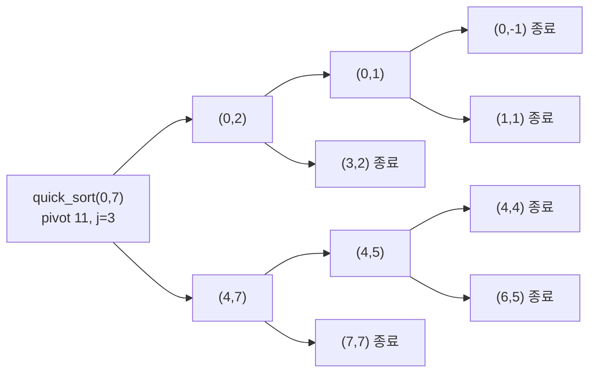
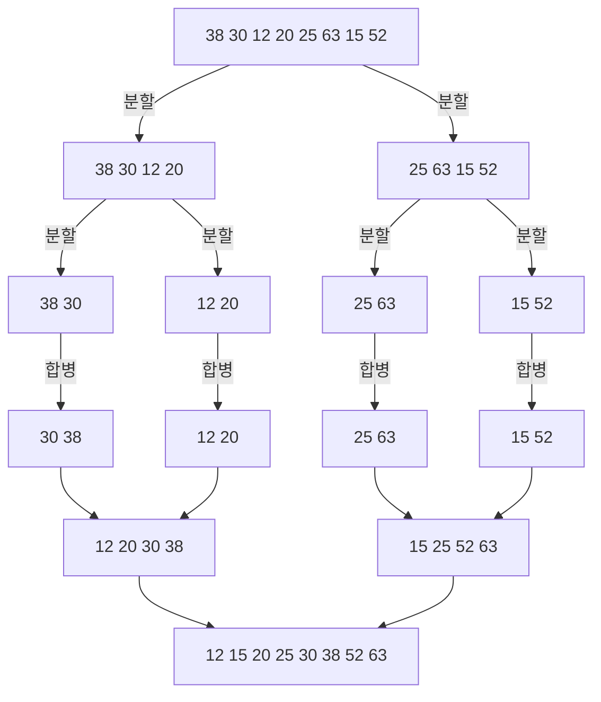
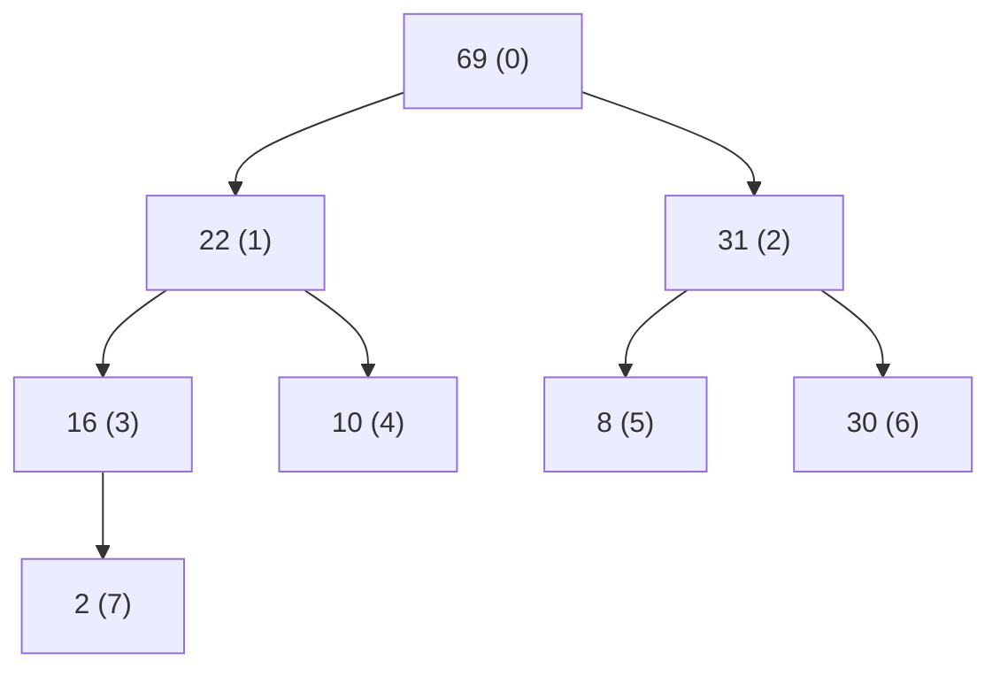

# 13주차: 정렬 알고리즘 (버블·삽입·퀵·합병·힙)

## 1. 개요 (p.1)

> **쉬운 정의:** 데이터를 기준 값(key) 순서대로 줄 세우는 일

- 오름차순: key가 커지는 순서, 내림차순: key가 작아지는 순서
- 이번 주 중심: 합병 정렬, 힙 정렬 (PDF 목차의 파란색 강조 항목)
- 버블·삽입·퀵은 앞선 내용의 복습 성격

---

## 2. 버블 정렬 (p.2~3)

> **쉬운 정의:** 이웃한 두 값을 비교해 순서가 틀리면 맞바꾸고, 한 바퀴마다 가장 큰 값을 맨 뒤로 보내는 정렬

- `a[j] > a[j+1]`이면 교환, 한 pass가 끝나면 뒤쪽 한 칸이 확정 (`i`가 확정 경계)
- **개선**: 한 pass 동안 교환이 한 번도 없으면 종료 (`flag` 변수)

```c
// 교환이 없으면 조기 종료하는 버블 정렬
void bubble(int a[], int n) {
    int i = n - 1, j, tmp, flag = 1;
    while (flag && i != 0) {
        flag = 0;
        for (j = 0; j <= i - 1; j++)
            if (a[j] > a[j + 1]) { flag = 1; tmp = a[j]; a[j] = a[j + 1]; a[j + 1] = tmp; }
        i--;
    }
}
```

**정렬 과정** (`25 48 37 17 52 86 43`, **굵은 글씨**: 확정된 값)

| 단계 | [0] | [1] | [2] | [3] | [4] | [5] | [6] |
|---|---|---|---|---|---|---|---|
| 시작 | 25 | 48 | 37 | 17 | 52 | 86 | 43 |
| i=6 | 25 | 37 | 17 | 48 | 52 | 43 | **86** |
| i=5 | 25 | 17 | 37 | 48 | 43 | **52** | **86** |
| i=4 | 17 | 25 | 37 | 43 | **48** | **52** | **86** |
| i=3 | 17 | 25 | 37 | **43** | **48** | **52** | **86** |
| i=2 | 17 | 25 | **37** | **43** | **48** | **52** | **86** |
| i=1 | 17 | **25** | **37** | **43** | **48** | **52** | **86** |

- i=4 이후는 값 변화 없음 (PDF 표의 i=3~1 빈칸에 해당)
- flag 버전은 i=3 pass에서 교환이 없어 종료
- `{1,2,3,4,5,7,6}`은 flag 버전에서 2 pass 만에 종료 (실행 확인)

---

## 3. 삽입 정렬 (p.4)

> **쉬운 정의:** 앞쪽은 이미 정렬돼 있다고 보고, 다음 값을 알맞은 자리에 끼워 넣는 정렬

- `a[0]~a[i-1]`이 정렬된 상태에서 `a[i]`를 오름차순이 유지되도록 삽입

```c
// 앞쪽 정렬 구간에 a[i]를 알맞은 자리에 삽입
void insertion(int a[], int n) {
    int i, j, idata;
    for (i = 1; i <= n - 1; i++) {
        idata = a[i];
        j = i - 1;
        while (j >= 0 && a[j] > idata) { a[j + 1] = a[j]; j--; }   // 큰 값을 한 칸씩 뒤로
        a[j + 1] = idata;
    }
}
```

**정렬 과정** (`17 20 30 40 25 10 50`, **굵은 글씨**: 이번 단계에서 삽입된 값)

| 단계 | [0] | [1] | [2] | [3] | [4] | [5] | [6] | 삽입 값 | 이동한 값 | 삽입 위치 |
|---|---|---|---|---|---|---|---|---|---|---|
| 시작 | 17 | 20 | 30 | 40 | 25 | 10 | 50 | - | - | - |
| i=4 | 17 | 20 | **25** | 30 | 40 | 10 | 50 | 25 | 30, 40 | [2] |
| i=5 | **10** | 17 | 20 | 25 | 30 | 40 | 50 | 10 | 17, 20, 25, 30, 40 | [0] |
| i=6 | 10 | 17 | 20 | 25 | 30 | 40 | **50** | 50 | 없음 | [6] 그대로 |

- i=1~3은 이미 오름차순이라 이동 없음
- **주의 (PDF 코드)**: 슬라이드는 `a[j] > idata && j >= 0` 순서, `j`가 -1일 때 `a[-1]`을 먼저 읽는 문제 → `j >= 0 && a[j] > idata` 순서 권장 (위 코드가 수정본, 슬라이드 원본 순서는 실행하지 않음)

---

## 4. 퀵 정렬 (p.5~7)

> **쉬운 정의:** 기준값(pivot)보다 작은 쪽과 큰 쪽으로 나눈 뒤, 각 쪽에 같은 방법을 반복(재귀)하는 정렬

- pivot = `a[left]`, `i`는 오른쪽으로 가며 pivot보다 큰 값, `j`는 왼쪽으로 가며 pivot보다 작은 값 탐색
- `i < j`이면 두 값 교환 → 작은 값은 앞, 큰 값은 뒤로 모임
- 탐색이 엇갈리면 `a[j]`와 `a[left]` 교환 → **`j`가 pivot의 최종 위치**
- 이후 `quick_sort(a, left, j-1)`, `quick_sort(a, j+1, right)` 재귀 호출

```c
// pivot 기준으로 분할한 뒤 양쪽을 재귀 정렬 (PDF 설명을 C로 옮긴 코드)
void quick_sort(int a[], int left, int right) {
    int pivot, i, j, tmp;
    if (left < right) {
        i = left; j = right + 1; pivot = a[left];
        while (i < j) {
            do i++; while (i <= right && a[i] < pivot);   // pivot보다 큰 값 탐색
            do j--; while (a[j] > pivot);                 // pivot보다 작은 값 탐색
            if (i < j) { tmp = a[i]; a[i] = a[j]; a[j] = tmp; }
        }
        tmp = a[j]; a[j] = a[left]; a[left] = tmp;        // pivot을 제자리로
        quick_sort(a, left, j - 1);
        quick_sort(a, j + 1, right);
    }
}
```

**첫 분할 과정** (`11 16 5 10 25 7 30 17`, pivot = 11)

| 단계 | [0] | [1] | [2] | [3] | [4] | [5] | [6] | [7] | i | j |
|---|---|---|---|---|---|---|---|---|---|---|
| 시작 | **11** | 16 | 5 | 10 | 25 | 7 | 30 | 17 | 0 | 8 |
| 1차 탐색 후 교환 (16 ↔ 7) | 11 | 7 | 5 | 10 | 25 | 16 | 30 | 17 | 1 | 5 |
| 2차 탐색 (엇갈림, 교환 없음) | 11 | 7 | 5 | 10 | 25 | 16 | 30 | 17 | 4 | 3 |
| a[left] ↔ a[j] 교환 | 10 | 7 | 5 | **11** | 25 | 16 | 30 | 17 | - | 3 |

- pivot 11이 [3]에 확정, 왼쪽 `(0,2)`, 오른쪽 `(4,7)`을 재귀 정렬

**재귀 호출 구조** (p.7, 실행으로 호출 순서 확인)



- `left >= right`이면 호출이 바로 종료

---

## 5. 합병 정렬 (p.8~14)

> **쉬운 정의:** 반으로 쪼개 각각 정렬한 뒤, 정렬된 두 묶음을 앞에서부터 비교하며 하나로 합치는 정렬

- **분할정복(divide and conquer)**: 문제를 2개로 나눠 각각 해결한 뒤 결과를 합쳐 원래 문제를 해결, 재귀로 구현 (PDF: John von Neumann이 제안)
- 흐름: 분할 → 정복(부분 문제 해결) → 합병



- 1개 단위까지의 분할 단계는 생략

### 5-1. merge: 정렬된 두 구간 합치기 (p.10~11)

- 구간 `[left..mid]`(g1), `[mid+1..right]`(g2)가 각각 정렬된 상태
- 인덱스: g1 현재 위치 `i`, g2 현재 위치 `j`, 결과 위치 `k` (초기값 `i=left`, `j=mid+1`, `k=left`)
- `a[i] < a[j]`이면 `tlist[k]=a[i]`, 아니면 `tlist[k]=a[j]`, 해당 인덱스와 `k` 증가
- 한 구간을 다 처리하면 나머지 구간을 그대로 복사
- 마지막에 `tlist`를 `a[left..right]`로 복사

```c
// 정렬된 두 구간을 하나로 합병
void merge(int a[], int left, int mid, int right) {
    int i = left, j = mid + 1, k = left, h;
    int tlist[MAX_SIZE];                                        // 합병 결과를 담는 보조 배열
    while (i <= mid && j <= right) {
        if (a[i] < a[j]) tlist[k++] = a[i++];
        else             tlist[k++] = a[j++];
    }
    if (i == mid + 1) while (j <= right) tlist[k++] = a[j++];   // 왼쪽 소진 → 오른쪽 나머지 복사
    else              while (i <= mid)   tlist[k++] = a[i++];   // 오른쪽 소진 → 왼쪽 나머지 복사
    for (h = left; h <= right; h++) a[h] = tlist[h];            // 결과를 원래 배열로 복사
}

// 반으로 나눠 각각 정렬한 뒤 합병
void merge_sort(int a[], int left, int right) {
    int mid;
    if (left < right) {
        mid = (left + right) / 2;
        merge_sort(a, left, mid);
        merge_sort(a, mid + 1, right);
        merge(a, left, mid, right);
    }
}
```

**합병 과정** `merge(a, 0, 4, 9)`, 입력 `a = 10 20 30 40 50 | 15 17 33 35 37`

| k | i | j | 비교 | tlist[k] | 선택 후 |
|---|---|---|---|---|---|
| 0 | 0 | 5 | 10 < 15 | 10 | i=1 |
| 1 | 1 | 5 | 20 > 15 | 15 | j=6 |
| 2 | 1 | 6 | 20 > 17 | 17 | j=7 |
| 3 | 1 | 7 | 20 < 33 | 20 | i=2 |
| 4 | 2 | 7 | 30 < 33 | 30 | i=3 |
| 5 | 3 | 7 | 40 > 33 | 33 | j=8 |
| 6 | 3 | 8 | 40 > 35 | 35 | j=9 |
| 7 | 3 | 9 | 40 > 37 | 37 | j=10 (오른쪽 소진) |
| 8 | 3 | 10 | 나머지 복사 | 40 | i=4 |
| 9 | 4 | 10 | 나머지 복사 | 50 | i=5 |

- **결과**: `10 15 17 20 30 33 35 37 40 50`

### 5-2. two_one: 합병의 활용 (p.13~16)

> **쉬운 정의:** 이미 정렬된 두 리스트를 하나의 정렬된 리스트로 합치는 함수

- 두 리스트 `a1`, `a2`와 결과 `a`, 인덱스 `i`, `j`, `k` (초기값 모두 0)
- `a1[i] < a2[j]`이면 `a[k] = a1[i]`, 아니면 `a[k] = a2[j]`
- 한 리스트가 소진되면 나머지를 복사, 반환값 `k` = 합쳐진 데이터 수
- merge와의 차이: 별도 배열 `a`에 바로 합침 (구간 인덱스 대신 배열 두 개와 개수 `n1`, `n2` 사용)

```c
// 정렬된 a1, a2를 하나의 정렬된 a로 합치고 개수를 반환
int two_one(int a1[], int a2[], int a[], int n1, int n2) {
    int i = 0, j = 0, k = 0;
    while (i < n1 && j < n2) {
        if (a1[i] < a2[j]) a[k++] = a1[i++];
        else               a[k++] = a2[j++];
    }
    if (i == n1) while (j < n2) a[k++] = a2[j++];
    else         while (i < n1) a[k++] = a1[i++];
    return k;
}
```

**확인 문제 (p.15)**: `a1 = {10,15,22,25,33}`, `a2 = {20,30,40,50,60,70,80}`, `two_one(a1, a2, a, 5, 7)`의 while 종료 후 `i, j, k`는?

| k | i | j | 비교 | a[k] | 선택 후 |
|---|---|---|---|---|---|
| 0 | 0 | 0 | 10 < 20 | 10 | i=1 |
| 1 | 1 | 0 | 15 < 20 | 15 | i=2 |
| 2 | 2 | 0 | 22 > 20 | 20 | j=1 |
| 3 | 2 | 1 | 22 < 30 | 22 | i=3 |
| 4 | 3 | 1 | 25 < 30 | 25 | i=4 |
| 5 | 4 | 1 | 33 > 30 | 30 | j=2 |
| 6 | 4 | 2 | 33 < 40 | 33 | i=5 (`i == n1`, while 종료) |

- **답**: `i = 5, j = 2, k = 7` (실행 확인)
- while 밖에서 `a2`의 나머지 40~80을 복사해 최종 `k = 12`

**실습 (p.16)**: `two_one`을 3번 호출해 정렬된 4개 리스트 합병

| 호출 | 입력 | 결과 |
|---|---|---|
| 1 | `list1` + `list2` | `tlist1` |
| 2 | `list3` + `list4` | `tlist2` |
| 3 | `tlist1` + `tlist2` | `list` (최종) |

---

## 6. 힙 정렬 (p.17~27)

> **쉬운 정의:** 가장 큰 값이 항상 맨 위(루트)에 오는 트리(최대 힙)에서 가장 큰 값을 하나씩 꺼내 뒤쪽부터 채우는 정렬

- 힙에서는 루트가 가장 큰 원소이고, 삭제하면 항상 루트를 반환
- **최대 힙** + 원소 수만큼 삭제 → 오름차순, **최소 힙** + 원소 수만큼 삭제 → 내림차순
- 배열 표현 (인덱스 0부터): 왼쪽 자식 `2i+1`, 오른쪽 자식 `2i+2`, 부모 `(i-1)/2`

예시 `{69,10,30,2,16,8,31,22}`를 buildHeap으로 구성한 최대 힙 (괄호는 배열 인덱스)



### 6-1. 구성 요소

- **buildHeap (insert, up-heap)**: 새 값을 배열 끝에 넣고 부모와 비교해 큰 값이면 위로 교환 반복 (`parent = (current-1)/2`)
- **maxHeapify (down-heap)**: 현재 노드, 왼쪽 자식, 오른쪽 자식 중 가장 큰 값을 찾아 현재 노드가 아니면 교환하고, 내려간 자리에서 재귀
- **deleteMax**: 루트(최댓값) 저장 → 마지막 노드를 루트로 이동 → `heap_size` 1 감소 → `maxHeapify(a, 0)` → 최댓값 반환

### 6-2. 정렬 절차 (heapSorta)

1. `k = 0 ~ n-1`에서 `buildHeap(a, k)` 반복: 데이터를 하나씩 insert해 최대 힙 구성
2. `k = n-1 ~ 1`에서 `cmax = deleteMax(a)`, `a[k] = cmax` 반복: 삭제로 비워진 힙 바로 뒤 자리에 최댓값 저장

```c
// i를 루트로 하는 서브트리를 최대 힙으로 복구 (down-heap)
void maxHeapify(int a[], int i) {
    int largest = i;
    int left = 2 * i + 1;
    int right = 2 * i + 2;
    if (left < heap_size && a[left] > a[largest]) largest = left;
    if (right < heap_size && a[right] > a[largest]) largest = right;
    if (largest != i) {
        swap(&a[i], &a[largest]);
        maxHeapify(a, largest);    // 내려간 자리에서 다시 힙 조건 복구
    }
}

// 힙을 구성한 뒤 최댓값을 꺼내 뒤쪽부터 채우는 정렬
void heapSorta(int a[], int n) {
    int k, cmax;
    for (k = 0; k < n; k++) buildHeap(a, k);
    for (k = n - 1; k > 0; k--) {
        cmax = deleteMax(a);
        a[k] = cmax;
    }
}
```

### 6-3. 단계별 결과 (p.19~27, **굵은 글씨**: 정렬이 확정된 구간)

| 단계 | 꺼낸 값 | [0] | [1] | [2] | [3] | [4] | [5] | [6] | [7] |
|---|---|---|---|---|---|---|---|---|---|
| 최대 힙 구성 | - | 69 | 22 | 31 | 16 | 10 | 8 | 30 | 2 |
| 삭제 1회 | 69 | 31 | 22 | 30 | 16 | 10 | 8 | 2 | **69** |
| 삭제 2회 | 31 | 30 | 22 | 8 | 16 | 10 | 2 | **31** | **69** |
| 삭제 3회 | 30 | 22 | 16 | 8 | 2 | 10 | **30** | **31** | **69** |
| 삭제 4회 | 22 | 16 | 10 | 8 | 2 | **22** | **30** | **31** | **69** |
| 삭제 5회 | 16 | 10 | 2 | 8 | **16** | **22** | **30** | **31** | **69** |
| 삭제 6회 | 10 | 8 | 2 | **10** | **16** | **22** | **30** | **31** | **69** |
| 삭제 7회 | 8 | 2 | **8** | **10** | **16** | **22** | **30** | **31** | **69** |
| 최종 | - | 2 | 8 | 10 | 16 | 22 | 30 | 31 | 69 |

- 위 결과는 실습 파일을 채워 실행한 출력과 PDF 마지막 장의 콘솔 출력이 일치

---

## 7. 정렬 비교 (보충: PDF에 없는 내용)

| 정렬 | 핵심 방식 | 평균 시간 | 최악 시간 | 추가 메모리 | 안정성 |
|---|---|---|---|---|---|
| 버블 | 이웃 교환 | O(n²) | O(n²) (flag 사용 시 최선 O(n)) | O(1) | 안정 |
| 삽입 | 정렬 구간에 삽입 | O(n²) | O(n²) (최선 O(n)) | O(1) | 안정 |
| 퀵 | pivot 분할 + 재귀 | O(n log n) | O(n²) | 재귀 스택 | 불안정 |
| 합병 | 분할정복 + 합병 | O(n log n) | O(n log n) | O(n) (보조 배열) | 안정 |
| 힙 | 최대 힙 + 삭제 반복 | O(n log n) | O(n log n) | O(1) | 불안정 |
